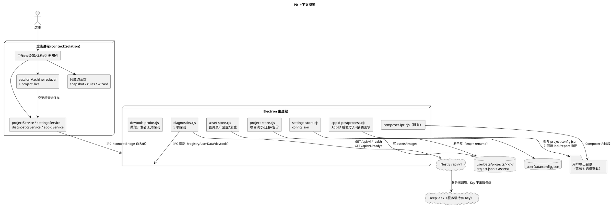

# P0 工作台与交接 · 实现方案设计

> 文档类型：实现方案（design），不含完整实现代码
> 日期：2026-10-31
> 范围：P0 四项 —— (a) 项目工作台与持久化；(b) 设置与运行自检；(c) 导出前体检 + 导出交接上架向导；(d) 小程序支付结果页
> 约束前提：不写业务代码、不改现有源码、不新增运行时依赖、不触碰 Composer 冻结契约与注册表 digest（例外见第 8 章与第 13 章）

---

## 一、背景与目标

### 1.1 现状问题清单（逐条对应真实代码位置）

| 编号 | 真实问题 | 证据位置 | 影响 |
| --- | --- | --- | --- |
| P-1 | 桌面端无任何持久化：全部状态只存在于渲染进程内存，关窗即丢 | `src/App.jsx:289`（`useReducer(reducer, undefined, createInitialState)` 无任何读写盘）；`src/state/sessionMachine.mjs:127-150`（`createInitialState` 纯内存构造） | 店主无法中断后继续；无法管理多个门店项目；「项目」概念实际不存在 |
| P-2 | 主进程只有 4 类能力：composer 导出、选图、开路径、存图 | `desktop/main.cjs:36-53`（`generator:pick-materials`，最多 6 张 / 10MB，返回 dataUrl）、`desktop/main.cjs:55-58`（`generator:open-path`）、`desktop/main.cjs:60-72`（`generator:save-image`）；`desktop/composer-ipc.cjs:137-148`（5 个 composer 通道） | 没有项目读写、没有资产落盘、没有设置读写、没有诊断通道 |
| P-3 | 侧栏底部硬编码「本地演示模式 · 未连接大模型」，与已接入 DeepSeek 的事实不符 | `src/components/layout/Sidebar.jsx:57` | 用户对模型连通状态判断错误，且无任何入口可以自检/修改 |
| P-4 | `DeployStep` 成功态只给「打开目录 / 复制路径」+ 一句提示，交接信息不足 | `src/components/build/DeployStep.jsx:142-219`，尤其 `:217`（「下一步：在微信开发者工具中导入该目录」） | 导入失败时用户不知道卡在哪一步；AppID、合法域名、测试号/正式号的选择成本全落在用户身上 |
| P-5 | `StoreInfoStep` 只有 5 个文本字段，无图片上传入口；选图 IPC 已存在但未接 UI | `src/components/build/StoreInfoStep.jsx:29-93`；对比 `desktop/main.cjs:36-53` | 门店图片/Logo 无法进入工程；「门店环境」「门店相册」能力始终为空 |
| P-6 | `MiniProgramPreview` 使用硬编码商品常量，只能切 tab，不能加购物车 | `src/components/preview/MiniProgramPreview.jsx:5-10`（`PRODUCTS` 常量）、`:143`（`useState('home')` 单一切 tab） | 预览与真实产物观感不一致，无法验证 AgentDraft 里的菜品是否真的进入页面 |
| P-7 | 小程序端 7 页已齐（home/menu/orders/mine/checkout/order-detail/merchant-orders），但支付成功只 toast，没有结果页 | `miniprogram/app.json:2-10`；`miniprogram/pages/order-detail/index.js:85-100`（`onPay` 成功仅 `platform.toast('演示模拟支付成功')`） | 顾客付完款没有「取餐号 / 下一步」的落地页，闭环体验断点；`miniprogram/pages/checkout/index.js:169` 用 `?pay=1` 跳详情，说明业已存在「待支付」入口但无「已支付」出口 |
| P-8 | Agent 只有 `POST /agent/turn`，没有独立 health 端点；服务端已有全局 health/readyz | `server/src/agent/agent.controller.ts:25-47`；`server/src/app.module.ts:13,17,37`（`HealthController`/`ReadyController` 已注册）；`server/src/main.ts:6`（`setGlobalPrefix('api/v1')`） | 自检缺少统一探针，前端只能靠一次真实 turn 判断后端可用（会消耗额度） |
| P-9 | 导出前无本地体检：用户直接选目录，失败原因只能等 Composer 返回错误码 | `src/App.jsx:581-603`（选目录后立即 `buildPlanFromSession` + `exportProject`）；`src/services/exportService.js:62-77`（`validatePlan` 已存在但 UI 未调用） | 报错滞后、错误信息是错误码翻译而非「你哪里该改」；`previewOnly`/`versionGaps` 只能在导出完成后看到（`src/state/sessionMachine.mjs:658-674`） |
| P-10 | AppID 无处填写；导出产物被 Composer 强制改写为 `touristappid` | `templates/base/ordering-base/1.0.0/wechat/project.config.json:33`（模板值 `wx3b1c04f63cf6cfd0`）；`scripts/composer/emit.cjs:205-215`（`buildProjectConfig` 无条件 `config.appid = 'touristappid'`） | 用户每次都要在微信开发者工具里手填 AppID；且用户以为自己填过就不会被覆盖 |

> **与「已核实事实」不一致的地方见第 13.4 节**，本节表格中的 P-8、P-10 已按真实代码修正。

### 1.2 P0 目标（可验收的表述）

1. **可中断**：关闭应用再打开，能回到「项目列表」，打开任一项目恢复到离开时的阶段与资料；图片以资产文件形式落盘，不再因重启丢失。
2. **可诊断**：设置页有 5 行自检，任一失败给出「原因 + 下一步动作」，并能复制脱敏诊断 JSON。
3. **可预防**：点「导出」之前完成本地体检，error 级问题阻断并定位到具体字段，warn 级可继续但需确认，info 级仅提示。
4. **可交接**：导出成功后进入六步交接向导，状态可持久化、可中断续接；AppID 落到产物的 `project.config.json`，并如实说明摘要与可复现性的变化。
5. **可收口**：小程序支付成功后进入结果页，四态明确，取餐号使用订单 `shortId` 并标注「演示用」。

### 1.3 非目标（本轮明确不做）

- 不做真实微信支付、退款、对账；不接微信开放平台账号体系；不做云端同步与多端协作。
- 不做菜单编辑器（后续走「后端 imports apply」，见第 2 章）。
- 不做自动上传/自动提交审核/自动发布。
- 不引入新运行时依赖（图标继续用 `lucide-react`；不加 zustand/redux/idb/electron-store）。
- 不重构 Composer 九阶段流水线，不改 `base.manifest.v1` / `manifest.v1` / `slots.v1` / `composition.v1` / `lock.v1` 任一 schema。

---

## 二、范围与非目标

### 2.1 本轮交付范围（按文件面）

| 层 | 交付物 | 说明 |
| --- | --- | --- |
| 主进程 | 项目存储与资产存储、设置存储、诊断、AppID 后置写入、微信开发者工具探测 | 全部新增文件，`desktop/main.cjs` 只做通道注册（最小改动） |
| 渲染进程 · 领域层 | 项目快照序列化/反序列化、体检规则、交接向导步骤机、撤销栈 | 纯函数，可直接 Node 测试 |
| 渲染进程 · 服务层 | `projectService`、`settingsService`、`diagnosticsService`、`appidService` | 唯一允许触碰 `window.smartStore` 与 `fetch` 的地方 |
| 渲染进程 · 组件 | 工作台、设置页、体检面板、交接向导、侧栏状态块、项目卡片 | 只收 props 与发事件 |
| 小程序 | `order-detail` 内新增「支付结果」视图（四态） | 不新增页面、不改 `app.json`（理由见 6.5 与 13.1） |

### 2.2 明确不做：菜单编辑器

用户已拍板：菜单编辑走**后端 imports apply** 路线，前置条件是先补 B3 的「门店 / 分类 / 商品」写接口。本轮只做边界声明：

- 现有导入链路已具备 preview/apply 与幂等：`src/services/importService.js:151-202`、`server/src/imports/`。
- 现有 `buildImportPayload` 只支持「1 个默认分类 + 扁平菜品」：`src/services/importService.js:116-149`（`categoryDraftId = 'cat-default'`，`tables: []`）。
- 因此菜单编辑器需要的最小后端补口为：门店资料更新、分类增删改、商品增删改与排序、桌号维护。**本轮不设计其实现细节、不排期、不写接口契约。**
- 桌面端不做「本地菜单编辑后整体覆盖」：会与后端 `catalogVersion`、缓存失效、运营数据冲突（`server/src/stores/stores.service.ts` 已在上下架时递增目录版本）。

### 2.3 明确不做：其他

- 真实支付 / 上传审核 / 账号体系 / 云端同步。
- 图片上传到对象存储（OBS）：本轮图片只落本机资产目录。
- MiniProgramPreview 的购物车交互改造（属 P1，本轮仅登记为「已知现状」P-6，不在 P0 交付内）。

---

## 三、总体架构与数据流

### 3.1 视图层与 `phase` 的关系（关键设计决策）

现有九阶段 `phase` 语义是「会话式流程的位置」：`src/state/constants.mjs:1-11`。工作台、设置页**不是流程阶段**，若塞进 `PHASES` 会污染 `PHASE_META`、`CLOSED_PHASES`、`COMPOSER_PLACEHOLDER` 等既有映射（`src/state/constants.mjs:20-59`）。

因此引入独立的 `view` 维度：

```text
state.view  : 'workbench' | 'flow' | 'settings'   // 新增，UI 层
state.phase : PHASES 九阶段（不变）               // 仅 view==='flow' 时有意义
```

- `view === 'workbench'`：显示项目工作台；`phase` 保留但不由渲染路径使用。
- `view === 'flow'`：显示现有会话式界面，`phase` 语义完全不变。
- `view === 'settings'`：显示设置与自检。

`App.jsx` 的顶层渲染改为三分支；`renderStage()`（`src/App.jsx:700-866`）与 `buildPanelCards()`（`:82-278`）不改。

### 3.2 上下文视图（进程 / 存储 / 外部）



通信约定：

| 链路 | 协议 | 频率 |
| --- | --- | --- |
| 渲染 → 主进程 | `ipcRenderer.invoke` / `ipcMain.handle` | 用户动作触发 + 保存节流（默认 800ms，最长 5s 强制 flush） |
| 渲染 → 后端自检 | `fetch`（仅 `diagnosticsService`） | 用户点「重新自检」+ 打开设置页一次；不轮询 |
| 主进程 → 文件系统 | `node:fs/promises` | 每次保存 / 每次资产写入 |
| 主进程 → 导出目录 | 既有 `composer:export`；新增 `composer:apply-appid` | 每次导出 1 次 |

### 3.3 服务/组件总体架构（渲染进程内部）

```plantuml
@startuml
skinparam componentStyle rectangle
title 渲染进程内部结构与依赖方向

package "页面组合（App.jsx）" {
  [App]\n  as APP
}

package "组件（只收 props / 发事件）" {
  [ProjectWorkbench] as WB
  [ProjectCard] as PC
  [SettingsPanel] as ST
  [DiagnosticsList] as DL
  [PreflightPanel] as PF
  [HandoffWizard] as HW
  [SidebarStatus] as SB
  [OrderResult（小程序）] as OR
}

package "服务层（唯一允许 IPC / HTTP）" {
  [projectService] as PSVC
  [settingsService] as SSVC
  [diagnosticsService] as DSVC
  [appidService] as ASVC
  [exportService（既有）] as ESVC
}

package "领域层（纯函数）" {
  [projectSnapshot] as SNAP
  [preflightRules] as RULES
  [handoffMachine] as HSM
  [undoStack] as UNDO
}

package "状态层" {
  [sessionMachine.mjs\n+ projectSlice] as SM
}

APP --> WB
APP --> ST
APP --> PF
APP --> HW
APP --> SB
WB --> PC
ST --> DL
APP --> SM
APP --> PSVC
APP --> SSVC
APP --> DSVC
APP --> ASVC
APP --> ESVC
PSVC --> SNAP
SSVC --> SNAP
ASVC --> SNAP
SM --> RULES
SM --> HSM
APP --> UNDO
@enduml
```

依赖铁律（沿用既有分层，`docs/component-contract.md:5-10` 的桌面等价约定）：

1. 组件内不得出现 `window.smartStore`、`fetch`、`ipcRenderer`、`localStorage`。
2. 服务层是唯一 IPC / HTTP 出口；主进程是唯一文件系统出口。
3. 领域层纯函数不 import 服务层，不读时间戳以外的一切环境（时间由调用方传入）。
4. `sessionMachine.mjs` 不 import 服务层（保持纯 reducer 可测，`test/session-machine.test.cjs` 现有约定）。

### 3.4 谁写盘、谁读盘

| 动作 | 写入者 | 读取者 | 落点 |
| --- | --- | --- | --- |
| 项目状态保存 | 主进程 `project-store.cjs`（渲染进程只发快照） | 主进程 → 渲染进程 | `userData/projects/<projectId>/project.json` |
| 图片/Logo 落盘 | 主进程 `asset-store.cjs` | 主进程（缩略图 dataUrl）→ 渲染进程 | `userData/projects/<projectId>/assets/images/` |
| 应用设置 | 主进程 `settings-store.cjs` | 主进程 → 渲染进程 | `userData/config.json` |
| 备份 | 主进程 `project-store.cjs` | 恢复流程 | `userData/projects/<projectId>/backups/project.<n>.json` |
| 导出工程 | Composer（既有） | 用户 / 微信开发者工具 | 用户确认的导出目录 |
| AppID 后置写入 | 主进程 `appid-postprocess.cjs` | 微信开发者工具 | `<导出目录>/project.config.json` |
| 浏览器模式 | 渲染进程 `projectService`（localStorage adapter） | 同左 | `localStorage['smartstore.project.v1.<id>']` |

**渲染进程绝不直接写文件**：即使 Electron 提供 `nodeIntegration:false` + `sandbox:true`（`desktop/main.cjs:18-23`），也不把 `fs` 暴露给渲染层。

### 3.5 数据流（保存路径，含防抖与顺序保证）

```text
用户操作
  → dispatch(action)                         [纯 reducer]
  → state 变化
  → useEffect 侦测「可持久化切片」引用变化
  → projectSnapshot.toDocument(state)        [领域纯函数，剥掉 transient]
  → projectService.saveProject(doc)          [服务层，节流 800ms]
  → ipcRenderer.invoke('project:save', …)    [主进程]
  → 主进程写盘队列（串行）：
      写入 project.json.tmp → fsync → rename → 写 success 时间戳
  → 返回 { ok, savedAt, bytes, rev }
  → dispatch({ type: 'PROJECT_SAVED', savedAt, bytes })
```

失败路径：返回 `{ ok:false, code, message }` → `dispatch({ type:'PROJECT_SAVE_FAILED', … })` → 侧栏状态块显示「未保存 · 重试」，并在切换项目/关窗前强制 flush 一次。

---

## 四、数据契约

### 4.1 `project.json` v1 —— 完整字段表

文件位置：`<userData>/projects/<projectId>/project.json`
编码：UTF-8 无 BOM，LF；JSON 2 空格缩进（与 Composer 输出风格一致，便于人工比对）。
体积上限：**1 MiB**（超限保存返回 `PROJECT_TOO_LARGE`，UI 提示「清理会话记录」）。
写入方式：临时文件 + `rename`（见 5.3）。

#### 4.1.1 顶层结构

| 字段 | 类型 | 必填 | 上限/约束 | 来源 | 说明 |
| --- | --- | --- | --- | --- | --- |
| `schemaVersion` | number | 是 | 必须为 `1` | 新增 | 文档版本；读取时按 4.4 迁移 |
| `projectId` | string | 是 | `^p_[a-z0-9]{8,24}$` | 新增 | 与目录名一致，主进程生成 |
| `createdAt` | string | 是 | ISO-8601 UTC（秒级，`Z`） | 新增 | 由主进程落章，渲染进程不改写 |
| `updatedAt` | string | 是 | ISO-8601 UTC | 新增 | 每次成功保存后由主进程回填 |
| `name` | string | 是 | 1–60 字符 | `state.store.name` / `NEW_PROJECT_LABEL` | 工作台显示名；与 `store.name` 冗余，打开时以 `store.name` 为准回填 |
| `phase` | string | 是 | `PHASES` 九值之一 | `state.phase` | 恢复用；非法值降级为 `onboarding` |
| `activeSessionId` | string | 是 | 必须命中 `sessions[].id` | `state.activeSessionId` | 不命中则取最后一条 `main` 会话 |
| `store` | object | 是 | 见 4.1.2 | `state.store` | |
| `features` | object | 是 | 见 4.1.3 | `state.features` | |
| `build` | object | 否 | 见 4.1.4 | `state.build` | `candidates` 已稳定，不算 transient |
| `visual` | object | 是 | 见 4.1.5 | `state.visual` | `image` 以 `assetId` 引用，不内联 |
| `agentDraft` | object | 是 | 见 4.1.6 | `state.agentDraft` | |
| `agentConfirmedSeq` | number \| null | 否 | 整数 ≥ 0 或 `null` | 新增（由 `state.agent.confirmedAtSeq` 映射） | 用于重启后判定「资料是否已确认」，见 7.3；其余 `agent` 字段全是派生量，不落盘 |
| `assets` | object | 是 | 见 4.1.9 | 新增 | 图片资产索引（`{ images: [] }`） |
| `sessions` | array | 是 | 1–20 条；总消息 ≤ 200 条 | `state.sessions` | 会话是「对话记录」，需节流裁剪 |
| `seq` | number | 是 | 整数 ≥ 0 | `state.seq` | 消息 id 计数器，必须持久化，否则重启后 id 重复 |
| `deploy` | object | 否 | 见 4.1.7 | `state.deploy`（仅持久字段） | 不存进度类字段 |
| `appid` | string | 否 | `''` 或 `^wx[0-9a-f]{16}$` | 新增（项目级） | 见第 8 章 |
| `lastExportParent` | string | 否 | ≤ 1200 字符 | 新增 | 仅用于预填目录选择器默认值；**不可直接用于写入**（白名单在内存，见 5.2） |
| `unmappedFields` | object | 否 | 任意 | 新增 | 4.4「未知字段保留」的载体 |

`projectId` 生成规则（主进程）：`p_` + 8 位 base36 时间戳 + 6 位随机（小写字母数字）。不复用项目名做目录名，避免 Windows 保留名（`CON`、`PRN`、`AUX`、`NUL`、`COM1`…）与非法字符问题。

#### 4.1.2 `store`

| 字段 | 类型 | 必填 | 约束 | 对应现状 |
| --- | --- | --- | --- | --- |
| `name` | string | 是 | ≤ 48 字符（`slice(0,48)`，同 `sessionMachine.mjs:237`） | `state.store.name` |
| `type` | string | 是 | 友元列表或自定义品类（`STORE_TYPES` 来自 `src/domain/storeBrief.mjs:1`） | `state.store.type` |
| `notes` | string | 否 | ≤ 200 | `state.store.notes` |
| `address` | string | 否 | ≤ 120 | `state.store.address` |
| `phone` | string | 否 | ≤ 32 | `state.store.phone` |
| `logoAssetId` | string | 否 | 必须命中 `assets.images[].assetId` | 新增（对接 `PickMaterials`） |
| `imageAssetIds` | string[] | 否 | ≤ 6 项 | 新增（门店图片，复用 6 张上限 `desktop/main.cjs:44`） |
| `businessHours` | string | 否 | 由 `agentDraft.businessHours` 派生，不单独编辑 | 新增（避免双事实来源，见 4.1.9） |

#### 4.1.3 `features`

| 字段 | 类型 | 必填 | 约束 |
| --- | --- | --- | --- |
| `selected` | string[] | 是 | 必含 `catalog.mjs` 中 `required:true` 的四项（`src/domain/catalog.mjs:2-5`）；去重 |
| `custom` | string | 否 | ≤ 500 字符 |

#### 4.1.4 `build`

| 字段 | 类型 | 必填 | 约束 |
| --- | --- | --- | --- |
| `candidates` | array | 否 | ≤ 5 项，每项 `{ id,name,layout,score,summary }` 且字段白名单化；来自 `buildTemplateCandidates`（`src/App.jsx:352-362`） |
| `selectedId` | string | 否 | 命中 `candidates[].id`，否则回落第一项 |

#### 4.1.5 `visual`（图片不内联）

| 字段 | 类型 | 必填 | 约束 |
| --- | --- | --- | --- |
| `styleId` | string | 是 | 必须命中 `STYLE_PRESETS[].id`（`src/domain/storeBrief.mjs:3-8`），否则回落 `warm` |
| `prompt` | string | 是 | ≤ 2000 |
| `promptRounds` | array | 否 | ≤ 12 轮，每轮 `{ text ≤ 500, reply ≤ 500 }` |
| `imageAssetId` | string | 否 | 当前效果图资产；替代 `state.visual.image.dataUrl` |
| `imageMeta` | object | 否 | `{ provider?: string ≤ 40, note?: string ≤ 200, width?, height? }`（保留 `ImageReview` 展示所需，`src/components/build/ImageReview.jsx:42-49`） |
| `imageRounds` | array | 否 | ≤ 12 轮，`{ text ≤ 500, reply ≤ 500, assetId? }` |

> **设计决策**：`visual.image.dataUrl` 一旦落进 `project.json`，一张 1–4MB 的 base64 会让文档逼近或超过 1MiB 上限，且每次保存都要序列化一个巨大字符串（`JSON.stringify` 开销 + 备份放大）。因此图片一律转资产引用。`ADD_IMAGE_ROUND`（`sessionMachine.mjs:565-578`）的落盘时机在服务层：先 `asset-attach` 拿到 `assetId`，再 dispatch 带 `assetId` 的动作。

#### 4.1.6 `agentDraft`

字段与 `src/domain/agentDraft.mjs:180-204`（`createEmptyAgentDraft` / `normalizeAgentDraft`）严格一致，不新增业务字段：

| 字段 | 类型 | 约束 |
| --- | --- | --- |
| `storeName` | string | ≤ 48 |
| `category` | string | ≤ 24 |
| `businessHours` | string | 已归一化，≤ 3 段 `HH:MM-HH:MM` |
| `fulfillment` | object | `{ dineIn: boolean, takeaway: boolean }` |
| `dishes` | array | 3–5 项，`{ id, name ≤24, priceCents: integer|null, priceText, description ≤60 }` |

写入前必须过 `normalizeAgentDraft`（纯函数），避免脏数据把 `validateAgentDraft` 打挂。

#### 4.1.7 `deploy`（仅持久字段）

| 字段 | 类型 | 必填 | 说明 |
| --- | --- | --- | --- |
| `directory` | string | 否 | 上次导出父目录（仅展示与预填） |
| `projectName` | string | 否 | 上次项目名（经 `sanitizeProjectName`） |
| `resultDigest` | string | 否 | 上次 `lockDigest`，用于交接向导显示「与上次一致/已变化」 |
| `handoff` | object | 否 | 交接向导状态，见 4.1.8 |

#### 4.1.8 `deploy.handoff`（交接向导持久状态）

| 字段 | 类型 | 必填 | 约束 |
| --- | --- | --- | --- |
| `stepId` | string | 是 | `'prepare' \| 'import' \| 'appid' \| 'domain' \| 'preview' \| 'next'`（六步见 6.4） |
| `completedStepIds` | string[] | 是 | 已完成步骤 id 列表，顺序无关 |
| `appidApplied` | boolean | 是 | 是否已成功写入产物 |
| `appidDigestBefore` | string | 否 | 改写前 `project.config.json` 的 `sha256:` 摘要 |
| `appidDigestAfter` | string | 否 | 改写后摘要 |
| `devtoolsDetected` | boolean | 否 | 最近一次探测结果 |
| `updatedAt` | string | 是 | ISO-8601 |

#### 4.1.9 `assets`（资产索引，写在 `project.json` 内）

| 字段 | 类型 | 必填 | 约束 |
| --- | --- | --- | --- |
| `images` | array | 是（可为空数组） | 每项见下 |

单个资产条目：

| 字段 | 类型 | 约束 | 说明 |
| --- | --- | --- | --- |
| `assetId` | string | `^a_[0-9a-f]{16}$` | 由内容哈希派生（去重关键） |
| `fileName` | string | `^[0-9a-f]{16}\.(png\|jpg\|jpeg\|webp)$` | 落在 `assets/images/` 下的文件名 |
| `originalName` | string | ≤ 120，已去掉 `[\\/:*?"<>|]` | 展示用 |
| `mime` | string | 枚举 `image/png` / `image/jpeg` / `image/webp` | |
| `bytes` | number | 1 – 10,485,760 | 单张上限与 `desktop/main.cjs:48` 一致 |
| `width` / `height` | number | 可选 | 主进程读取文件头得到（见 4.3.4） |
| `sha256` | string | `^sha256:[0-9a-f]{64}$` | 内容摘要，去重与完整性双用 |
| `createdAt` | string | ISO-8601 | |

> **为什么 `assetId` 用哈希**：同一张 Logo 反复选择、或「重新生成效果图后回退到上一版」，都不会重复占空间；删除项目时整目录删除即可，不需要引用计数。

#### 4.1.10 transient 字段清单（**绝不写盘**）

下表字段存在内存 state 中但必须被 `projectSnapshot.toDocument()` 剥离。违反此清单会引入「重启后卡在 loading」类问题。

| 位置 | 字段 | 原因 |
| --- | --- | --- |
| `deploy` | `status`（仅 `validating/generating/verifying/choosing`）、`step`、`progress`、`stage`、`stageMessage`、`busy`、`taskId` | 进程内任务态，重启必然失效（`sessionMachine.mjs:100-125`） |
| `deploy` | `error` | 错误已展示过；重启后重试状态不成立 |
| `deploy` | `warnings`、`previewOnly`、`versionGaps` | 属于「上一次导出的结果」，重启后由体检/导出重新计算；`resultDigest` 保留即可 |
| `deploy.import` | 全部字段 | B3 导入预览是一次性 token（`src/services/importService.js:175-202`（`previewToken`）），重启后必然过期 |
| `agent` | `status`、`missingFields`、`errors`、`nextQuestion`、`reply`、`meta`、`turnId`、`lastError`、`attempts`、`simulateFailure`、`lastUtterance`、`confirmedAtSeq` | 全为派生量：由 `agentDraft` + `validateAgentDraft` + `buildNextQuestion` 重算（`sessionMachine.mjs:56-76`、`agentDraft.mjs:298-365`） |
| `build` | `status` | `building` 是异步中间态（`src/App.jsx:338-367`）；恢复时按 `candidates` 是否为空决定 `idle`/`ready` |
| `sessions[]` | `revealFlush` | 逐字弹出动画控制器，重启后无意义（`sessionMachine.mjs:248-258`） |
| `sessions[].messages[]` | `staged`、`delay`、`instant` | 动画元数据，重启后应直接完整显示 |
| `visual` | `image.dataUrl` | 转 `imageAssetId`（4.1.5） |
| 组件本地 state | `promptTips`、`promptBusy`、`imageBusy`、`draft`（`src/App.jsx:290-301`） | 会话输入与网络忙态，不持久化 |

#### 4.1.11 `project.json` 完整示例

```json
{
  "schemaVersion": 1,
  "projectId": "p_lz9k2m4a7f3c1x",
  "createdAt": "2026-10-31T06:12:03Z",
  "updatedAt": "2026-10-31T09:41:55Z",
  "name": "松月食堂",
  "phase": "deploy",
  "activeSessionId": "session-deploy",
  "store": {
    "name": "松月食堂",
    "type": "社区餐馆",
    "notes": "只做当天的新鲜",
    "address": "杭州市西湖区文三路 88 号",
    "phone": "0571-88886666",
    "logoAssetId": "a_3f9c1d7e5b2a8406",
    "imageAssetIds": ["a_3f9c1d7e5b2a8406", "a_77c0e9142bd6f38a"]
  },
  "features": { "selected": ["scan-order","product-catalog","cart-checkout","order-tracking","takeaway"], "custom": "" },
  "build": {
    "candidates": [{ "id": "warm-bistro", "name": "街巷食集", "layout": "menu", "score": 92, "summary": "菜单优先，适合家常菜。" }],
    "selectedId": "warm-bistro"
  },
  "visual": {
    "styleId": "warm",
    "prompt": "暖木色家常餐馆招牌，柔光，手写体店名…",
    "promptRounds": [{ "text": "再暖一点", "reply": "好的，我把暖色占比提高了。" }],
    "imageAssetId": "a_91ab5540cf1e7d32",
    "imageMeta": { "provider": "mock", "note": "本地占位效果图" },
    "imageRounds": []
  },
  "agentDraft": {
    "storeName": "松月食堂",
    "category": "社区餐馆",
    "businessHours": "10:00-21:00",
    "fulfillment": { "dineIn": true, "takeaway": true },
    "dishes": [
      { "id": "dish-1", "name": "宫保鸡丁", "priceCents": 2800, "priceText": "28.00", "description": "微辣" },
      { "id": "dish-2", "name": "番茄炒蛋", "priceCents": 1600, "priceText": "16.00", "description": "" },
      { "id": "dish-3", "name": "米饭", "priceCents": 300, "priceText": "3.00", "description": "" }
    ]
  },
  "sessions": [
    {
      "id": "session-main",
      "title": "松月食堂",
      "kind": "main",
      "status": "done",
      "messages": [
        { "id": "m1", "role": "agent", "text": "请给你的店铺小程序命名", "meta": { "kind": "naming" } },
        { "id": "m2", "role": "user", "text": "松月食堂", "meta": null }
      ],
      "handoff": null
    }
  ],
  "seq": 2,
  "deploy": {
    "directory": "D:\\小程序工程",
    "projectName": "songyue-shitang",
    "resultDigest": "sha256:5b2c…",
    "handoff": {
      "stepId": "appid",
      "completedStepIds": ["prepare", "import"],
      "appidApplied": true,
      "appidDigestBefore": "sha256:1a2b…",
      "appidDigestAfter": "sha256:9f8e…",
      "devtoolsDetected": true,
      "updatedAt": "2026-10-31T09:40:12Z"
    }
  },
  "appid": "wx1234567890abcdef",
  "lastExportParent": "D:\\小程序工程",
  "assets": {
    "images": [
      {
        "assetId": "a_3f9c1d7e5b2a8406",
        "fileName": "3f9c1d7e5b2a8406.png",
        "originalName": "门头.png",
        "mime": "image/png",
        "bytes": 284133,
        "width": 1200,
        "height": 800,
        "sha256": "sha256:c0ffee…",
        "createdAt": "2026-10-31T06:20:11Z"
      }
    ]
  }
}
```

### 4.2 `config.json` v1 —— 应用级设置

文件位置：`<userData>/config.json`（与项目目录平级，**不属于任何项目**）。

| 字段 | 类型 | 必填 | 默认 | 约束 | 说明 |
| --- | --- | --- | --- | --- | --- |
| `schemaVersion` | number | 是 | `1` | 必须为 1 | |
| `apiBaseUrl` | string | 是 | `http://127.0.0.1:3000/api/v1` | `^https?://` 且 ≤ 200 | 自检与 Agent 探测目标；默认值与 `src/services/importService.js:2` 对齐 |
| `agentTransport` | string | 是 | `mock` | `mock` \| `http` | 与 `src/services/agentTurn/agentServiceConfig.js:14-20` 语义一致 |
| `agentEndpoint` | string | 是 | `/api/v1/agent/turn` | ≤ 200，必须以 `/` 开头 | |
| `agentTimeoutMs` | number | 是 | `30000` | 1000–120000 | |
| `defaultAppid` | string | 否 | `''` | `''` 或 `^wx[0-9a-f]{16}$` | 新项目默认继承（项目级可覆盖） |
| `autoSaveEnabled` | boolean | 是 | `true` | | 关闭后仅在「切换项目 / 关闭窗口 / 手动保存」时写盘 |
| `autoSaveDebounceMs` | number | 是 | `800` | 300–5000 | |
| `maxBackups` | number | 是 | `3` | 1–10 | 每个项目保留的备份份数 |
| `lastProjectId` | string | 否 | `''` | 命中 `projects/` 下目录 | 启动时尝试恢复 |
| `uiScale` | string | 否 | `'default'` | `default` \| `compact` | 预留（本轮仅存储，不做视觉实现） |
| `unmappedFields` | object | 否 | — | — | 未知字段保留（4.4） |

**禁令**：`config.json` 不得包含 `DEEPSEEK_API_KEY`、`appSecret`、任何 Bearer Token、任何绝对路径以外的凭据。写入前由主进程执行字段白名单校验（只允许上表键），出现未知键 → 归入 `unmappedFields` 而不是直接写顶层。

示例：

```json
{
  "schemaVersion": 1,
  "apiBaseUrl": "http://127.0.0.1:3000/api/v1",
  "agentTransport": "http",
  "agentEndpoint": "/api/v1/agent/turn",
  "agentTimeoutMs": 30000,
  "defaultAppid": "",
  "autoSaveEnabled": true,
  "autoSaveDebounceMs": 800,
  "maxBackups": 3,
  "lastProjectId": "p_lz9k2m4a7f3c1x",
  "uiScale": "default"
}
```

### 4.3 资产目录结构与规则

#### 4.3.1 目录布局

```text
<userData>/                                  # Electron app.getPath('userData')
├── config.json                              # 应用设置
├── diagnostics/                             # 自检快照（滚动保留最近 10 份）
│   └── 2026-10-31T09-41-55Z.json
├── projects/
│   ├── p_lz9k2m4a7f3c1x/
│   │   ├── project.json
│   │   ├── project.lock                     # { pid, startedAt } 便携的「正在编辑」标记（可选）
│   │   ├── assets/
│   │   │   └── images/
│   │   │       ├── 3f9c1d7e5b2a8406.png
│   │   │       └── 77c0e9142bd6f38a.png
│   │   └── backups/
│   │       ├── project.1.json
│   │       ├── project.2.json
│   │       └── project.3.json
│   └── p_8m2q1w7e5r4t0y/
└── projects-trash/                          # 删除后的短期保留（第 6.1 节：二次确认后落这里）
    └── p_oldid__20261031T094155Z/
```

Windows 备注：`userData` 默认位于 `%APPDATA%\<productName>`（Electron 33 + `app.getPath('userData')`），不使用中文路径做拼接，避免编码差异；路径统一用 `path.join`，落盘后在日志里以 `path.relative(userData, file)` 打印，避免日志泄漏用户名。

#### 4.3.2 命名与去重

- 文件名：`<sha256前 16 位 hex>.<ext>`，扩展名由真实 MIME 决定（`png`/`jpg`/`webp`）。
- 去重：先读文件字节 → 算 `sha256` → 若 `assets/images/<前16位>.<ext>` 已存在且大小一致，直接复用（不再复制），返回已有 `assetId`。
- 大小写：`assetId` 与文件名全小写；`originalName` 保留原样用于展示。
- 禁止：以用户原始文件名直接落盘（Windows 非法字符、重名覆盖、`CON.txt` 等保留名）。

#### 4.3.3 选择与落盘的分离（安全设计）

现状 `generator:pick-materials` 在**主进程内一次完成**「弹框 + 读取 + base64」（`desktop/main.cjs:36-53`），返回 6 张 dataUrl，一次 IPC 传输可能超过 60MB base64。P0 改为两段式：

1. `project:pick-images`：弹系统对话框 → **只返回元数据** `[{ token, name, bytes, mime, width, height }]`，不返回内容。主进程把 `token → 绝对路径` 记入 `pendingPickTokens`（内存 Map，5 分钟 TTL，进程退出即失效）。
2. `project:attach-images`：入参 `{ projectId, tokens: string[] }`。主进程校验 token 在 Map 内且未过期 → 读取 → 算摘要 → 落盘 → 返回 `assetId` 列表。

收益：
- 渲染进程永远拿不到任意外部路径，无法通过 `attach` 侧信道读任意文件（防路径穿越）。
- IPC 体积从「几 MB × 6」降为「几百字节」。
- 与既有 `pickMaterials` 保持兼容：旧方法保留一版（`@deprecated`），但 P0 的 UI 只调新通道。

#### 4.3.4 图像尺寸读取

主进程仅解析文件头（不引入 sharp 等依赖）：
- PNG：IHDR（偏移 16，大端 4+4）。
- JPEG：遍历 SOF0/SOF2 段。
- WebP：VP8X/VP8/VP8L 分支。
- 解析失败 → `width`/`height` 省略，不阻断落盘（UI 显示天然比例）。

#### 4.3.5 导出时的复制与路径改写规则

| 场景 | 规则 | 理由 |
| --- | --- | --- |
| 门店图片是否进入导出工程 | **本轮不进入** | 写入 `assets/` 需要改 Base 页面 WXML/JSON 与 `store.generated.js`，会动冻结资产（见 8.5）；且 `emit.cjs` 只从资产市场拷贝 `assets/<assetId>/`（`scripts/composer/emit.cjs:379-386`），不接受任意本地图片 |
| 效果图进入导出工程 | **本轮不进入** | 同上；效果图是设计参考，不是运行资源 |
| 图片路径改写 | 不涉及 | 无图片写入产物 → 无需改写 |
| `project.config.json` 的 appid | 导出**后**由主进程改写 | 见第 8 章 |
| `project.config.json` 的 `projectname` | 已由 Composer 写入（`emit.cjs:212`），不改 | |

> 结论要写清楚：**P0 的图片资产是「本地项目资产」，服务于项目工作台的展示与恢复，不是导出工程的运行时资源。** 若要让门店图片进产物，属于 Base 资产能力扩展（`store-gallery` 目前只是 feature 占位），需走注册表重冻结，不在 P0。

### 4.4 版本迁移与容错

#### 4.4.1 版本递增策略

- `schemaVersion` 只在**破坏性变更**时递增（字段语义改变、必填新增、结构重组）。
- 新增可选字段不递增，直接写入；旧版本读取器通过「未知字段保留」忽略。
- 迁移函数集中在一个表：`MIGRATIONS = { 1: noop, 2: v1_to_v2, … }`，按 `from + 1` 逐级执行。
- 迁移结果写回时**先备份原文件**（`backups/project.migrate.<ts>.json`）再覆盖，便于回退。

#### 4.4.2 未知字段保留

读取 → 迁移 → 归一化的三段式：

```text
raw  = JSON.parse(文件)                       // 可能失败，进 4.4.4
doc  = migrate(raw)                           // 版本升级，保持未知字段原样
known = pick(doc, KNOWN_FIELDS)               // 已知字段归一化（含默认值、长度截断）
unknown = omitEveryLevel(doc, KNOWN_FIELDS)   // 逐层收集未识别键
next  = { ...known, unmappedFields: unknown } // 保存时写回
```

- 关键：保存时**必须**把 `unmappedFields` 原样写回，且再读取时把它视为未知（不污染业务）。这样「新版本写过的项目被旧版本打开再保存」不会丢数据。
- 已知字段中类型不符（如 `features.selected` 变成字符串）→ 视为未知字段移入 `unmappedFields`，并使用默认值，不抛错。

#### 4.4.3 读取失败降级（分级）

| 故障 | 判定 | 降级动作 | 用户可见 |
| --- | --- | --- | --- |
| 文件不存在 | `ENOENT` | 视为新项目（但不创建，直到首次保存） | 无提示 |
| JSON 语法错误 | `JSON.parse` 抛错 | 尝试 `backups/` 中最新一份可解析备份 | 横幅「项目文件损坏，已从 xx:xx 的备份恢复」 |
| 备份也不可用 | 全部解析失败 | 以「空白项目 + 保留 projectId」打开，原文件移至 `projects/<id>/project.corrupt.<ts>.json` | 阻断式弹窗 + 「打开损坏文件所在目录」按钮 |
| 版本过高 | `schemaVersion > 1` | 只读打开：显示项目卡片但禁止保存（`PROJECT_FUTURE_VERSION`） | 卡片显示「由更高版本创建，请升级应用」 |
| 校验失败（如 `projectId` 与目录名不符） | 结构校验 | 以目录名覆盖 `projectId`，继续 | 记 warn 级诊断 |
| 体积超限 | > 1 MiB | 拒绝写入，允许读取 | 保存失败文案「会话记录过多，请清理」 |

#### 4.4.4 备份轮转

- 每次成功保存**之前**把当前 `project.json` 复制为 `backups/project.<n>.json`（`n` 递增，环形覆盖，保留 `maxBackups` 份）。
- 备份不参与「体积上限」判定（备份目录独立）。
- 项目删除时备份随项目目录一起移动到 `projects-trash/`。
- 恢复入口：设置页「诊断 → 项目文件 → 从备份恢复」（P0 只提供「打开备份目录」，一键恢复放 P1，避免误操作面扩大）。

---

## 五、IPC 契约与写盘策略

### 5.1 通用约定（与既有 `composer-ipc.cjs` 对齐）

沿用 `desktop/composer-ipc.cjs:13-24` 的三条安全边界：

1. **来源白名单**：`isTrustedSender` 正则 `^(file://|http://127\.0\.0\.1:5173/)`，所有新通道复用同一实现（导出为公共函数，不复制粘贴）。
2. **参数长度校验**：每个通道独立上限（见 5.2），超限一律 `PAYLOAD_TOO_LARGE`。
3. **路径约束**：写在 `userData` 内 → 主进程自行拼接，不接受渲染进程传绝对路径；写在用户目录 → 必须先在 `approvedParents`（系统对话框白名单）里，复用 `desktop/composer-ipc.cjs:40-58` 的机制。

统一返回体：

```ts
// 逻辑形态（实现为 .cjs，无 TS）
type IpcOk<T>  = { ok: true; data: T };
type IpcFail    = { ok: false; code: ErrorCode; message: string; details?: unknown };
```

错误码总表（新增部分，既有 composer 错误码不变）：

| 错误码 | 触发条件 | 用户文案（中文） |
| --- | --- | --- |
| `UNTRUSTED_SENDER` | 来源非白名单 | 请求来源不受信任 |
| `PROJECT_INVALID_ID` | `projectId` 不符合 `^p_[a-z0-9]{8,24}$` | 项目标识无效 |
| `PROJECT_NOT_FOUND` | 目录或文件不存在 | 项目不存在或已被删除 |
| `PROJECT_READ_FAILED` | 读文件失败（权限/占用） | 项目文件无法读取，请检查是否被其他程序占用 |
| `PROJECT_PARSE_FAILED` | JSON 无法解析且无可用备份 | 项目文件已损坏 |
| `PROJECT_TOO_LARGE` | 序列化后 > 1 MiB | 项目数据过大，请清理会话记录 |
| `PROJECT_FUTURE_VERSION` | `schemaVersion > 1` | 项目由更高版本创建，请升级应用 |
| `PROJECT_WRITE_FAILED` | tmp/rename 失败 | 保存失败，请检查磁盘空间或权限 |
| `PROJECT_BUSY` | 同项目写队列阻塞超 10s | 正在保存上一个更改，请稍后 |
| `PROJECT_DELETE_BUSY` | 导出或保存进行中 | 有任务正在运行，完成后才能删除 |
| `ASSET_TOKEN_EXPIRED` | pick token 过期 | 所选图片授权已过期，请重新选择 |
| `ASSET_TOKEN_UNKNOWN` | token 不在白名单 | 请重新选择图片 |
| `ASSET_TOO_LARGE` | 单张 > 10 MiB | 单张图片不能超过 10 MB |
| `ASSET_COUNT_EXCEEDED` | 超过 6 张 | 最多保留 6 张门店图片 |
| `ASSET_UNSUPPORTED_TYPE` | 非 png/jpg/webp | 仅支持 PNG / JPG / WebP |
| `ASSET_READ_FAILED` | 源文件读取失败 | 无法读取所选图片 |
| `SETTINGS_INVALID` | 字段白名单/取值校验失败 | 设置有未通过的项 |
| `APPID_INVALID` | 不符合 `^wx[0-9a-f]{16}$` | AppID 格式不正确（wx + 16 位十六进制） |
| `APPID_TARGET_MISSING` | 产物目录无 `project.config.json` | 产物缺少 project.config.json，可能不是完整工程 |
| `APPID_WRITE_FAILED` | 写入或回填失败（已回滚） | AppID 写入失败，工程保持原始状态 |
| `APPID_VERIFY_FAILED` | 回填后自检不一致 | 产物摘要自检未通过，已回滚 |
| `DEVTOOLS_NOT_FOUND` | 未探测到微信开发者工具 | 未找到微信开发者工具 |
| `DIAGNOSTICS_FAILED` | 自检内部异常 | 自检未完成，请查看诊断详情 |

### 5.2 通道表

| 通道 | 入参 | 出参 | 上限 | 安全校验 |
| --- | --- | --- | --- | --- |
| `project:list` | `{}` | `{ projects: ProjectSummary[] }`，按 `updatedAt` 倒序；`ProjectSummary = { projectId, name, updatedAt, phase, thumbnailAssetId?, hasCorrupt?, futureVersion? }` | 目录扫描 ≤ 500 个 | 只扫 `userData/projects/*`；跳过无 `project.json` 的目录（`hasCorrupt` 标记） |
| `project:create` | `{ name?: string(≤60), inheritAppid?: boolean }` | `{ projectId, createdAt, appid }` | payload ≤ 8 KiB | 名称经 `sanitizeProjectName`（`src/App.jsx:280-286` 的等价实现移到主进程） |
| `project:load` | `{ projectId }` | `{ doc, assets: AssetMeta[], savedAt, bytes, recoveredFrom?: string }` | — | `projectId` 正则；路径 `path.join(projects, id, 'project.json')` 后校验 `resolve` 前缀 |
| `project:save` | `{ projectId, doc }` | `{ savedAt, bytes, rev }` | doc 序列化 ≤ 1 MiB | 结构白名单校验 + `schemaVersion===1` + `unmappedFields` 原样保留 |
| `project:delete` | `{ projectId, confirmName: string }` | `{ trashed: true, trashPath }` | — | `confirmName` 必须与项目 `name` 完全一致（防误删） |
| `project:reveal` | `{ projectId }` | `{}` | — | 复用 `shell.openPath`，只允许 `userData/projects/<id>` |
| `project:pick-images` | `{ max?: 1\|6 }` | `{ items: [{ token, name, bytes, mime, width?, height? }] }` | 单张 ≤ 10 MiB，张数 ≤ 6 | 系统对话框；token 仅内存，TTL 300s |
| `project:attach-images` | `{ projectId, tokens: string[] }` | `{ assets: AssetMeta[] }` | tokens ≤ 6；总量 ≤ 40 MiB | token 白名单；落盘路径 `projects/<id>/assets/images/` |
| `project:read-asset` | `{ projectId, assetId, maxWidth?: 320 }` | `{ dataUrl }` | 返回 ≤ 1.5 MiB（缩略图） | `assetId` 正则；文件名必须命中 `assets.images` 索引，禁止拼任意文件名 |
| `project:remove-asset` | `{ projectId, assetId }` | `{ removed: boolean, affectedRefs: string[] }` | — | 若仍被 `store.logoAssetId` 等引用，返回 `affectedRefs` 而非静默删 |
| `settings:load` | `{}` | `{ config, source: 'file'\|'default' }` | — | 不存在则返回默认值，不创建文件 |
| `settings:save` | `{ config }` | `{ savedAt }` | ≤ 16 KiB | 键白名单（4.2）；禁止未知键进顶层；禁止敏感键 |
| `diagnostics:run` | `{ scope: ('all'\|'runtime'\|'storage'\|'composer'\|'backend'\|'agent')[] }` | `{ lines: DiagnosticLine[], json: DiagnosticJson }` | — | 主进程部分不含任何密钥；后端探测在渲染层做（见 5.5） |
| `diagnostics:save-snapshot` | `{ json }` | `{ path }` | ≤ 64 KiB | 只写 `userData/diagnostics/` |
| `composer:apply-appid` | `{ outputPath, appid }` | `{ applied: true, digestBefore, digestAfter, lockDigestBefore, lockDigestAfter, treeDigest }` | — | 仅当 `outputPath` 在 `exportedOutputs`（`composer-ipc.cjs:41`）内；`appid` 正则；写入前备份原文件 |
| `devtools:probe` | `{}` | `{ found, path?, version?, via: 'registry'\|'default-path'\|'cli'\|'none' }` | — | 只读注册表与已知路径，不执行任意命令 |

> **为什么 `diagnostics:run` 不能全在主进程**：后端可达性需要 `fetch`，主进程有 `net` 但会绕过 CORS 语义；更重要的是「渲染层看到的可用性」才是用户实际会遇到的，所以 HTTP 探测放渲染层服务（5.5），主进程只做文件系统与资源级探测。两者在 UI 上合并为 5 行。

### 5.3 写盘策略

#### 5.3.1 单写队列（每项目一条）

```text
saveQueue: Map<projectId, { tail: Promise, pending: Doc|null, timer: Timeout }>

enqueue(projectId, doc):
  entry.pending = doc                    // 覆盖式合并：后写覆盖前写
  if (entry.running) return              // 运行中，等本轮结束后取 pending
  entry.running = true
  loop:
    doc = entry.pending; entry.pending = null; if (!doc) break
    result = await writeAtomic(projectId, doc)
    broadcast('project:saved', { projectId, ...result })
  entry.running = false
```

- **语义**：同一项目的保存严格串行；不同项目并行（各自队列）。
- **合并**：节流窗口内多次变更只写最后一次（避免磁盘抖动）。
- **超时**：单次写超过 10s → 返回 `PROJECT_BUSY`，但仍继续在后台完成，下一次保存前会先 `flush`。

#### 5.3.2 原子写（tmp + fsync + rename）

```text
writeAtomic(projectId, doc):
  text = JSON.stringify(doc, null, 2) + '\n'
  if (Buffer.byteLength(text) > 1MiB) return fail('PROJECT_TOO_LARGE')
  rotateBackup(projectId)                       // 保存前备份当前版本
  tmp = join(dir, 'project.json.tmp')
  fh = await fs.open(tmp, 'w')
  await fh.writeFile(text, 'utf8')
  await fh.sync()                               // 关键：保证 rename 后不丢内容
  await fh.close()
  await fs.rename(tmp, join(dir, 'project.json'))   // Windows: 目标存在时 rename 会失败
  return { savedAt, bytes, rev: ++revMap[projectId] }
```

Windows 注意事项（必须写进实现备注）：

- Node 在 Windows 上 `fs.rename` 覆盖已存在文件会抛 `EPERM`/`EEXIST`（与 POSIX 不同）。因此实现必须是：`fs.rename(target → target.old)` → `fs.rename(tmp → target)` → `fs.unlink(target.old)`；任一步失败则回滚（`target.old → target`）。
- 若 `project.json` 被其他程序占用（如用户用编辑器打开）→ 捕获 `EBUSY`/`EPERM` 返回 `PROJECT_WRITE_FAILED`，文案提示「文件被占用」。
- 不用 `fs.writeFile(..., {flag:'wx'})` 写主文件（那是 `generator:save-image` 的做法，适合一次性新文件，不适合覆盖写：`desktop/main.cjs:70`）。

#### 5.3.3 失败回滚

| 失败点 | 回滚动作 | 对外结果 |
| --- | --- | --- |
| 序列化超限 | 不触碰磁盘 | `PROJECT_TOO_LARGE`，UI 弹出「清理会话」建议 |
| tmp 写入失败 | 删除 tmp | `PROJECT_WRITE_FAILED` |
| rename 失败 | `target.old → target` | `PROJECT_WRITE_FAILED` |
| 备份轮转失败 | 继续主流程（备份失败不阻断） | 记 warn 诊断 `backup-skipped` |
| 已提交但广播失败 | 不回滚（磁盘已一致） | 前端通过下次 `project:load` 自愈 |

#### 5.3.4 切换项目 / 关闭窗口前 flush

- 切换项目（工作台点另一个项目、新建项目、删除项目、进入设置不算）→ `await projectService.flush()`：等待队列清空，最长 5s；超时则阻断切换并提示「还有未保存的更改」。
- 关闭窗口：`main.cjs` 监听 `before-quit` 与窗口 `close`：
  1. 向渲染进程发送 `project:flush-request`（`webContents.send`）。
  2. 渲染进程 `flush()` 后回 `ipcRenderer.invoke('project:flush-done')`。
  3. 主进程 `event.preventDefault()` 直到收到回执或 3s 超时。
  4. 超时仍未回执 → 允许退出，并在下次启动时若检测到 `project.json.tmp` 存在，用 tmp 与主文件比对后给出「检测到未完成的写入」提示（自愈策略：tmp 更新且可解析则替换主文件）。
- 该逻辑需要新增一个 `before-quit` 钩子，**不改变**现有 `window-all-closed` 行为（`desktop/main.cjs:75`）。

### 5.4 浏览器（非 Electron）降级

`projectService` 采用双 adapter，接口一致：

```js
// 服务层契约（伪代码签名）
createProjectAdapter() -> {
  mode: 'desktop' | 'browser',
  list(), load(id), save(id, doc), create(name), remove(id, confirmName),
  pickImages(max), attachImages(id, tokens), readAsset(id, assetId),
  capabilities: { fileAssets: boolean, imageStorage: boolean, autoSave: boolean }
}
```

| 能力 | 桌面（desktop） | 浏览器（browser） |
| --- | --- | --- |
| 项目列表 | `project:list` | 遍历 `localStorage` 前缀键 |
| 保存 | 原子写文件 | `localStorage.setItem`，**配额上限判定**：< 4 MiB 写入，超限返回 `PROJECT_TOO_LARGE` |
| 图片资产 | 落盘 | **不落盘**：只保留 `originalName` 与 `bytes`，`dataUrl` 存内存（刷新即丢） |
| 自动保存 | 800ms 节流 | 3000ms 节流（localStorage 同步写会卡主线程） |
| AppID 写入产物 | 支持 | 不支持（`DESKTOP_REQUIRED`，复用 `src/services/exportService.js:25` 文案） |
| 交接向导探测开发者工具 | 支持 | 不支持，显示「需桌面端」 |

浏览器模式 UI 必须显式标注（不可只在 Console）：

- 工作台顶部横幅：**「浏览器模式：项目只保存在本机浏览器里，图片不会落盘，刷新或清缓存会丢失。」**
- 资产面板每个图片项角标：`未落盘`。
- 导出页沿用既有 `DESKTOP_REQUIRED_MESSAGE`（`src/services/exportService.js:25`）。

### 5.5 自检的可观测性边界（与 CORS 的关系）

- 后端 CORS 配置：`server/src/main.ts:7-12`（`origin` 取 `DESKTOP_ORIGIN`，否则反射任意 Origin，`exposedHeaders: X-Request-Id`）。
- 桌面 `file://` 页面的 `Origin` 为 `null`；`origin: true` 会回显，因此自检**通常可通**。
- 但若用户把 `DESKTOP_ORIGIN` 配成具体域名，自检会因 CORS 失败。因此自检的「后端可达」判定必须区分三种失败：
  1. `network`：`fetch` 直接 reject（服务未启动 / 端口错）。
  2. `cors`：`fetch` reject 且 `config.apiBaseUrl` 与本机 `location.origin` 不同源（用「无法收到响应」+「重试一次 `no-cors` 探测成功」来辅助判定，`no-cors` 成功说明服务在，只是被策略拦）。
  3. `http-5xx`：收到响应但状态码 ≥ 500。
- 文案分别给出：`服务未启动，请运行 npm run start:dev（server 目录）` / `服务在运行但被浏览器跨域策略拦截，请检查 DESKTOP_ORIGIN` / `服务异常（HTTP 500），请查看服务端日志`。

---

## 六、页面信息架构与状态矩阵

### 6.1 项目工作台

入口与结构：

```text
view = 'workbench'
┌──────────────────────────────────────────────────────────────┐
│ 标题栏：智能开店 · 我的项目        [搜索框]      [新建项目]   │
├──────────────────────────────────────────────────────────────┤
│ 空态 / 列表（卡片网格）/ 加载骨架 / 错误面板                  │
│  卡片：缩略图 | 项目名 | 阶段标签 | 更新时间 | ⋯菜单          │
│  ⋯菜单：打开 / 在文件夹中显示 / 复制项目 ID / 删除            │
├──────────────────────────────────────────────────────────────┤
│ 底部：模式标识（桌面端落盘 / 浏览器模式不落盘图片）           │
└──────────────────────────────────────────────────────────────┘
```

状态矩阵（`workbench.status`）：

| 状态 | 触发 | UI 表现 | 可用动作 |
| --- | --- | --- | --- |
| `idle` | 初次进入 | 无列表数据 | 「新建项目」「打开最近项目」（若 `lastProjectId` 存在） |
| `loading` | `project:list` 进行中 | 3 张骨架卡 | 全部禁用（防重复请求） |
| `ready-empty` | 返回 0 项 | 空态插画 + 「创建你的第一家门店小程序」+ 「新建项目」主按钮 | 新建 |
| `ready-list` | ≥ 1 项 | 卡片网格（2–4 列自适应） | 打开、显示目录、删除、搜索 |
| `search-empty` | 搜索词有值且命中 0 | 「没有匹配「xxx」的项目」+「清除搜索」 | 清除搜索 |
| `error` | `project:list` 失败 | 错误面板：错误码 + 文案 + 「重试」+「打开数据目录」 | 重试、打开目录 |
| `deleting` | 删除确认后进行中 | 卡片蒙层 + 转圈，其余卡片禁用 | 无（防并发） |

删除交互（二次确认，且不可用「一键撤销」糊过去）：

1. 点「删除」→ 弹确认框，标题「删除项目"松月食堂"？」，正文列出「将移除：项目配置、图片资产、会话记录。不会删除已导出的小程序工程。」。
2. 要求用户**手动输入项目名**（不是勾选「我已知晓」）：输入框必须与项目名完全一致，「删除」按钮才可点。
3. 通过后调用 `project:delete`（`confirmName` 二次校验在主进程做，防止渲染进程被绕）。
4. 删除 = 移动到 `projects-trash/<id>__<ts>/`，保留 30 天（P0 不提供 UI 恢复，但路径可在设置页诊断里看到）。
5. 若删除的是 `lastProjectId` → 清空该设置。

搜索：对 `name` 做大小写不敏感子串匹配 + 简单的 `phase` 中文标签匹配（如输入「部署」命中 `deploy` 阶段项目）。不做模糊拼音搜索（无依赖可用，且收益低）。

卡片阶段标签映射（复用 `PHASE_META`，`src/state/constants.mjs:20-30`）：`home→新建`、`onboarding→命名`、`features→选功能`、`building→构建中`、`template-pick→选骨架`、`store-info→装修`、`prompt-studio→提示词`、`image-review→审核`、`deploy→部署`。

### 6.2 设置与运行自检

分区：`运行环境` / `数据与存储` / `后端与模型` / `诊断`。

#### 6.2.1 五行自检的判定规则

| # | 行名 | 探测方式 | 上限/超时 | 通过条件 | 失败原因文案（分级） |
| --- | --- | --- | --- | --- | --- |
| 1 | 运行环境 | 渲染层读取 `window.smartStore?.isDesktop`（`src/services/exportService.js:31-41` 同款 bridge 判定）+ 主进程返回 `app.getVersion()`、`process.versions.electron/chrome/node`、`process.platform` | 同步 + 1s | 桌面模式且版本号可读 | 浏览器模式：`当前是浏览器预览，导出与文件落盘不可用`（info，不阻断） |
| 2 | 本地数据目录 | 主进程：`app.getPath('userData')` 存在性、可写性（写 `.probe` 后删）、剩余空间（`fs.statfs` 可用则用，Windows 不可用则跳过并标 `unknown`） | 3s | 目录可写且剩余 > 50 MB | `数据目录不可写（权限或磁盘满）` / `剩余空间不足 50 MB` |
| 3 | Composer 资源完整性 | 主进程：`loadRegistry({ verifyFreeze:true })`（`scripts/composer/index.cjs:74` 同款调用）→ 返回 `registryVersion` / `registryDigest` / 资产数；并检查 `templates/base/ordering-base/1.0.0/src` 存在与 `manifest` 可解析 | 5s | `ok:true` 且 `registryDigest` 与 `registry.lock.json.contentDigest` 一致 | `模板资产与注册表不一致（REGISTRY_DRIFT），请重新安装或运行 registry:check` |
| 4 | 后端服务 | 渲染层 `GET {apiBaseUrl}/health`（**注意实际路径**：`server/src/main.ts:6` 全局前缀 + `server/src/health.controller.ts:10` → `/api/v1/health`），再 `GET {apiBaseUrl}/readyz` | 每次 4000ms，两次共 ≤ 8s | 两者均 2xx 且 `health.status === 'ok'`；`readyz` 若 503 仅降级为 warn（数据库不可用 ≠ 服务不可用，`server/src/ready.controller.ts:18-24`） | 见 5.5 的三分法文案 |
| 5 | 模型通道 | 依据 `config.agentTransport`：<br>• `mock` → 直接通过，标注「本地 Mock（未接入真实模型）」<br>• `http` → 检查 `agentEndpoint` 格式 + 探测 `HEAD/GET {origin}/api/v1/health` 可用 + **不发送真实 turn**（避免计费与数据写出） | 4s | `http` 模式下后端可用即通过；端点非法则失败 | `Agent 端点配置不正确（应为 /api/v1/agent/turn）` / `后端不可用，Agent 无法工作` |

> 关于 agent health：**本轮不新增 `/api/v1/agent/health`**。理由：`server/src/agent` 只有 `POST /agent/turn`（`server/src/agent/agent.controller.ts:25-47`），而全局 `/api/v1/health` 足以判定「后端进程活着」。真实模型凭据是否有效，只有发起一次 turn 才能确定，但那样会消耗额度并可能写入数据 —— 放在用户主动点「测试一次」按钮里（P1）。**若用户要求精确的 agent 健康探针，需服务端新增 `GET /api/v1/agent/health`（只读、无模型调用、无 DB 写），该改动需用户二次确认后才实施。**

#### 6.2.2 复制诊断 JSON 的内容白名单

允许字段（严格白名单，逐项列举）：

```json
{
  "generatedAt": "2026-10-31T09:41:55Z",
  "app": { "name": "智能开店", "version": "0.2.0", "mode": "desktop", "platform": "win32", "arch": "x64" },
  "runtime": { "electron": "33.2.1", "chrome": "130.0.0.0", "node": "20.18.0" },
  "storage": {
    "userDataWritable": true,
    "freeSpaceMb": 128000,
    "projectCount": 3,
    "corruptProjectCount": 0,
    "lastSaveBytes": 41233
  },
  "composer": {
    "registryVersion": "2026.11.0",
    "registryDigest": "sha256:53d8c9…",
    "frozen": true,
    "assets": { "base": 1, "uiBlock": 3, "featurePack": 1, "recipe": 3 },
    "composerVersion": "1.0.0"
  },
  "backend": {
    "baseUrl": "http://127.0.0.1:3000/api/v1",
    "health": { "ok": true, "status": 200, "service": "smart-store-server", "environment": "development", "latencyMs": 34 },
    "readyz": { "ok": true, "status": 200, "database": "ok", "cache": "redis" }
  },
  "agent": { "transport": "http", "endpoint": "/api/v1/agent/turn", "timeoutMs": 30000, "reachable": true },
  "checks": [{ "id": "runtime", "result": "pass", "message": "" }]
}
```

**禁止出现**（复制前逐项剔除，并有单元测试断言）：

- 任何 `*KEY*` / `*SECRET*` / `*TOKEN*` / `password` 键与值；`Authorization` 头；`DEEPSEEK_API_KEY`。
- 任何完整绝对路径（`userData` 只输出「可写/占用/剩余空间」，不输出目录名；项目路径一律不输出）。
- 项目业务数据（店名、地址、电话、菜品、金额）。
- 用户标识（openId、demoOpenId —— 见 `miniprogram/config/env.js` 的演示身份，虽不含真实身份，仍不入诊断）。
- 后端响应体全文（只保留 `status/service/environment/database/cache` 这几个白名单字段）。

实现方式：`diagnosticsService.scrub(json)` 递归遍历，键名匹配 `/key|secret|token|password|authorization|openid/i` 一律替换为 `"[redacted]"`；值匹配绝对路径正则（`^[A-Za-z]:\\` 或 `^/`）替换为 `"[path]"`。

### 6.3 导出前体检

位置：`phase === 'deploy'` 且 `deploy.status === 'idle' | 'cancelled' | 'failed'` 时，在 `DeployStep` 之上渲染 `PreflightPanel`。**不改变「选择导出位置」按钮时序**：体检通过前按钮禁用（error 阻断），warn 需勾选确认。

#### 6.3.1 规则表（error / warn / info）

| 级别 | 规则 ID | 判定 | 依据（现有代码/契约） | 阻断 |
| --- | --- | --- | --- | --- |
| error | `E-PLAN-NAME` | `plan.storeProfile.name` 为空或 > 48 字符 | `scripts/composer/schema.cjs:381-382`；`planFromSession.mjs:90` 有兜底，但空白名会变成「我的餐馆」需用户知情 | 是 |
| error | `E-PLAN-DISHES` | 有效菜品（名称 + 整数 `priceCents`）< 3 | `src/domain/agentDraft.mjs:256-262`；`planFromSession.mjs:51-59` 会静默丢弃无效菜品 → 需要显式阻断 | 是 |
| error | `E-PLAN-PRICE` | 任一 `priceCents` 非整数或不在 1–999999 | `agentDraft.mjs:287-291` | 是 |
| error | `E-PLAN-HOURS` | `businessHours` 解析后为空 或 段数 > 3 | `agentDraft.mjs:218-222`；`parseBusinessHours`（`planFromSession.mjs:37-49`）失败即空数组 | 是 |
| error | `E-PLAN-FULFILLMENT` | `dineIn === false && takeaway === false` | `agentDraft.mjs:321-323` | 是 |
| error | `E-PLAN-CONTRACT` | `composer:validate` 返回 `ok:false`（任何 Composer 契约错） | `src/services/exportService.js:62-77`；`scripts/composer/index.cjs:224-246` | 是 |
| error | `E-THEME-CONTRAST` | `THEME_CONTRAST_LOW`（Composer 预检返回） | `src/services/exportService.js:14` | 是 |
| error | `E-TARGET-EXISTS` | 目标目录同名工程已存在（预计冲突） | 主进程预检查 `preflight`（`scripts/composer/atomic.cjs` 的 `TARGET_EXISTS`） | 是（可直接给「改项目名」建议） |
| error | `E-APPID-FORMAT` | AppID 非空且不符合 `^wx[0-9a-f]{16}$` | 第 8 章 | 是（因为后置写入会失败） |
| warn | `W-PREVIEW-ONLY` | `composer:validate` 返回 `previewOnly[]` 非空 | `src/state/sessionMachine.mjs:667`（`previewOnly` 结果字段） | 否，需勾选「我已了解这些能力未接入线上」 |
| warn | `W-VERSION-GAP` | `updatesAvailable[]` 非空 | `src/services/exportService.js:243`（`validateComposition` 的 warnings 构造） | 否，需勾选 |
| warn | `W-UNMAPPED-FEATURE` | 勾选了模板外的能力（如 `store-gallery`、`loyalty-membership`） | `planFromSession.mjs:74-81`（`unmappedCapabilities` + warnings） | 否，说明「不会写入工程」 |
| warn | `W-DISH-DROPPED` | `agentDraft.dishes.length !== plan.storeProfile.dishes.length` | `planFromSession.mjs:92-94` | 否 |
| warn | `W-IMG-NOT-EXPORTED` | 项目有图片资产但不会进产物 | 4.3.5 | 否（info 更合适，见下） |
| warn | `W-BACKEND-LOCAL` | `mode==='development'` 且 `apiBinding.baseUrl` 为 `127.0.0.1` | `emit.cjs:150`；`safety.cjs:92-96` | 否，说明「只能在本地联调」 |
| warn | `W-NO-APPID` | AppID 未填 | 第 8 章 | 否（产物会保留 `touristappid`） |
| info | `I-IMG-NOT-EXPORTED` | 有图片资产 | 4.3.5 | 否 |
| info | `I-SESSION-LONG` | `sessions` 消息数 > 120 | 4.1.1 | 否 |
| info | `I-DEVTOOLS-NOT-FOUND` | 未探测到微信开发者工具 | 6.4 | 否 |
| info | `I-DEMO-PAYMENT` | 始终存在 | `emit.cjs:26`（`DEFAULT_DISCLAIMER`） | 否，固定展示「演示付款，不产生真实扣款」 |

#### 6.3.2 体检执行顺序（避免重复计算）

```text
1. plan = buildPlanFromSession(state)                 // 纯函数，已有（planFromSession.mjs:61）
2. 本地静态规则（E-PLAN-*、E-APPID-FORMAT、warn/info 中的 plan 派生项）
3. 若 2 无 error 且桌面模式 → await exportService.validatePlan(plan)   // 走 Composer P0–P2，不写盘
4. 合并 Composer 返回（previewOnly / warnings / capabilitySet）
5. 目标冲突预检查（仅当已知 directory + projectName）
6. 输出 { errors, warns, infos, planDigest, checkedAt }
```

性能：全程无网络、无磁盘写。`composer:validate` 已在主进程可用（`desktop/composer-ipc.cjs:60-65`），但 UI 从未调用（P-9 的根因）。

#### 6.3.3 体检结果 UI

- 顶部一句话结论：`可以导出` / `有 2 项需要先修正` / `可以继续，但有 3 项提示`。
- error 项：红色行 + 「去修改」跳转到对应阶段（`store-info` / `image-review` / `deploy`）。
- warn 项：黄色行 + 复选框「我已了解」；全部勾选后「选择导出位置」才可点。
- info 项：折叠区，默认收起。
- 底部固定：「重新体检」「查看完整 JSON」（JSON 只在本地展开，不写盘）。

### 6.4 导出交接向导（六步）

触发：`deploy.status === 'done'` 后，`DeployStep` 成功区新增主按钮「开始交接上架」。点击 → 打开 `HandoffWizard`（全宽抽屉或集中式步骤页），步态写入 `project.json → deploy.handoff`。

| 步骤 | ID | 标题 | 内容 | 完成判定 | 失败兜底 |
| --- | --- | --- | --- | --- | --- |
| 1 | `prepare` | 确认产物 | 显示 `outputPath`、`planDigest`、`lockDigest`、文件数、`checks` 摘要；「打开目录」；提示「本应用不会上传或发布」 | 用户点「产物没问题」 | 若无 `generation-report.json` → 提示「报告缺失，可继续但无法核对校验项」 |
| 2 | `import` | 导入微信开发者工具 | 三步图文：①打开微信开发者工具 ②导入项目 → 选择上述目录 ③AppID 选择「测试号」或稍后填正式号。按钮「打开微信开发者工具」/「复制路径」 | 用户点「已导入成功」或「我稍后再导入」 | 未探测到工具 → 按钮变「未找到开发者工具，请手动打开」，并给出官方下载提示文案（不自动下载） |
| 3 | `appid` | 写入 AppID | 输入框（项目级 AppID，`wx…`）+ 说明「将写入 `<目录>/project.config.json`」+「这不会修改你的模板资产，也不会影响 Plan/Registry 摘要；但会改变产物摘要，详见说明」；按钮「写入 AppID」 | `composer:apply-appid` 返回 `applied:true` 且 `digestAfter` 非空 | 校验失败 → 不写入并给格式提示；写入失败 → 回滚并提示「工程保持原始状态，可稍后重试」；用户可「跳过，稍后在 IDE 内手填」 |
| 4 | `domain` | 配置服务器域名 | 列出 mustache：`request 合法域名` 需要 `apiBaseUrl` 的 host；说明「本地联调可用测试号 + 关闭域名校验」；按钮「复制域名」 | 用户点「已配置」或「仅本地调试，跳过」 | 无 |
| 5 | `preview` | 真机预览 | 说明「用微信开发者工具生成预览码，扫码在真机检查：菜单 → 加购 → 结算 → 演示支付 → 结果页取餐号」；列出本轮四条验收路径 | 用户点「真机走查完成」 | 无 |
| 6 | `next` | 后续与边界 | 固定声明：不代办认证/审核/发布；列出未接入能力（`previewOnly`）；给出「回到工作台」 | 结束向导 | 无 |

状态持久化：每步完成即 `project:save`（走 5.3 队列）；重开项目时若 `deploy.status` 不是 `done`（例如用户重启后 Composer 结果已不在内存），向导显示「上一次交接进度：第 3 步 / 6」，但**不允许继续写 AppID**（产物路径需重新确认存在），提示「重新导出后可继续」。

微信开发者工具探测方式（`devtools:probe`）：

1. Windows 注册表：`HKCU\Software\Microsoft\Windows\CurrentVersion\Uninstall\微信web开发者工具` 与 `HKLM\...`，读 `InstallLocation`（用 `reg query` via `child_process.execFile`，不拼 shell 字符串）。
2. 默认安装路径：`%LOCALAPPDATA%\微信web开发者工具\`、`%ProgramFiles(x86)%\Tencent\微信web开发者工具\`，检测 `cli.bat` 或 `wechatdevtools.exe`。
3. 可选：`cli.bat --version`（**只读命令**，超时 3s，失败即忽略）。
4. 全部失败 → `{ found:false, via:'none' }`，"打开" 按钮降级为「复制安装说明」。

> 明确不做：不自动启动开发者工具并注入项目（`cli open --project` 需要工具开启服务端口，当前环境端口关闭，见 `docs/2026-10-31-两轮提交验收与修复说明.md:105`）。探测只用于改善文案。

### 6.5 小程序支付结果页

#### 6.5.1 形态选择与理由

不新增 `pages/order-result`，而是在 `pages/order-detail` 内实现「支付结果视图」：

理由（必须写明，否则会被误认为偷懒）：

1. 新增页面要改 `miniprogram/app.json`（页面注册）+ Base 的 `base.manifest.v1.json` 的 `pages[]` + `plan.pages`；前两者属于**冻结资产**，改动必然触发注册表重冻结（见 8.5）。
2. `pages/order-detail` 已经是支付入口（`?pay=1`，`miniprogram/pages/checkout/index.js:169`）与状态承载页（`order-status` / `status-timeline` 组件已在用：`miniprogram/pages/order-detail/index.wxml:18,49`），结果视图放这里语境最顺。
3. 页面级 `state-view` 组件（`docs/component-contract.md:140-149`）已提供 loading/empty/error 三态展示，四态中的 loading/error 可直接复用；`success`/`pending` 需要新组件或页面内区块。

组件划分（遵守 `docs/component-contract.md:14-30` 的硬约束）：

| 归属 | 名称 | 职责 | 属性 / 事件 |
| --- | --- | --- | --- |
| 组件（新增） | `pay-result`（`miniprogram/components/pay-result/`） | 纯展示四态卡：状态图标、标题、说明、取餐号、金额、按钮 | props：`state`（`loading/success/pending/error`）、`shortId`、`totalText`、`fulfillmentText`、`title`、`description`、`primaryText`、`secondaryText`、`demoNotice`；events：`primary`、`secondary`、`retry` |
| 页面 | `pages/order-detail` | 决定进入哪个视图、调用 `orderService.demoPayment`、处理导航 | 数据 `payResult: { state, shortId, totalText, ... } \| null` |

> 组件不得调用 `wx.request`、不得 `navigateTo`、不得读 `globalData` —— 与既有组件一致（`miniprogram/components/` 下的 13 个组件均遵守，`docs/component-contract.md` 第 2 节）。

#### 6.5.2 四态定义

| 状态 | 进入条件 | 展示 | 主按钮 | 次按钮 |
| --- | --- | --- | --- | --- |
| `loading` | `onPay` 已发出且未返回（`acting && actionLabel==='pay'`）；或结果页轮询拉单中 | 「正在确认支付结果…」+ 骨架 | 无（禁用） | 无 |
| `success` | `demoPayment` 成功 **且** 重新拉取的订单满足 `paymentStatus === 'DEMO_PAID'`（以服务端为准，不信本地） | 「支付成功 · 请凭号取餐」+ 大字取餐号（`shortId`）+ 金额 + 取餐方式 + 固定文案「演示付款，不产生真实扣款」 | 「查看订单进度」→ 停留在详情页并滚到进度卡 | 「返回订单列表」→ `wx.switchTab` 到 `pages/orders` |
| `pending` | `demoPayment` 成功但拉单显示 `paymentStatus === 'UNPAID'`，或状态为 `PENDING_PAYMENT`（服务端尚未落库） | 「支付已提交，正在等待门店确认」+ 取餐号 + 「可下拉刷新」 | 「刷新状态」→ 重新 `getOrder` | 「返回订单列表」 |
| `error` | `demoPayment` 失败（`errorText.describeError` 的 message/action） | 错误文案 + `requestId` + 建议动作（重试 / 重新登录 / 返回） | 「重试支付」→ 再调一次 `demoPayment`（幂等由服务端保证） | 「返回订单列表」 |

取餐号：`orderView.toOrderView` 已产出 `shortId = String(order.id).slice(-6).toUpperCase()`（`miniprogram/domain/orderView.js:122`），**直接复用**，不新增字段、不改后端。文案必须写「取餐号（演示）」，并在说明里写「正式上线应使用门店叫号系统或后端排号，本工程为演示用短号」。

商家身份进入的重定向规则（关键边界）：

- `pages/order-detail` 已有身份判定：`session.isMerchantOf(order.storeId)` → `role === 'MERCHANT'`（`miniprogram/pages/order-detail/index.js:59`）。
- 结果页只对 `role === 'CUSTOMER'` 展示。若 `role === 'MERCHANT'`：
  - 若通过 `?pay=1` 进入 → 立即 `wx.redirectTo` 回 `pages/merchant-orders`，并 `toast('店主身份不进行顾客支付')`。
  - 若通过订单列表进入（无 `pay` 参数）→ 不展示结果页，页面行为完全不变（避免影响店主接单流程）。
- 若 `order.status === 'CANCELLED'` 且 `canPay === false` → 结果页不展示，回落到现有详情视图（防止顾客在已取消订单上看到「支付成功」）。

#### 6.5.3 与既有支付入口的接线

```text
checkout 下单成功
  → redirectTo order-detail?id=…&pay=1        (既有，miniprogram/pages/checkout/index.js:169)
  → onShow → load()                            (既有，order-detail/index.js:35-39)
  → 若 options.pay==='1' 且 canPay → 显示「待支付」提示条（既有，:29-32）+ 底栏「演示模拟支付」
  → onPay():
       setData payResult.state='loading'
       await demoPayment(orderId)              (既有，services/order.js:70-77)
       await load()                            (复用，确保以服务端状态为准)
       if (paymentStatus === 'DEMO_PAID' && status !== 'CANCELLED') → 'success'
       else → 'pending'
     catch → 'error'
  → 用户点 primary/secondary → 页面导航或重新拉单
```

不改变后端：`demoPayment` 只调 `POST /orders/:id/demo-payment`（`miniprogram/services/order.js:70-77`），状态推进与幂等已在 B1 实现（`docs/2026-10-31-两轮提交验收与修复说明.md:23-30`）。

#### 6.5.4 视觉与文案规范

- 成功态：主色 `--color-success`（`miniprogram/theme.generated.wxss` 里定义，`#2F7D4F`），取餐号用等宽字体、`48rpx`、字距 `2rpx`。
- 失败态：`--color-danger`（`#B23A2F`）+ `error-banner` 风格，保留 `requestId`（现有 `error-banner` 已有 `request-id` 属性：`miniprogram/pages/order-detail/index.wxml:5,35-41`）。
- 演示声明必须出现在成功态正文（不是小字角标）：`本页为演示付款，未发生真实扣款，取餐号仅用于演示。`

---

## 七、状态机改动

### 7.1 新增切片（不改现有切片语义）

现有 state 结构见 `src/state/sessionMachine.mjs:127-150`。新增两个顶层键，**不新增 phase**：

```js
// createInitialState 增量（示意）
{
  ...现有 11 个键保持不变,
  view: 'workbench',            // 'workbench' | 'flow' | 'settings'
  project: {                    // 新增 projectSlice
    mode: 'desktop',            // 由 projectService 初始化时写入
    status: 'idle',             // idle | loading | ready | error
    list: [],                   // ProjectSummary[]
    activeId: null,             // 当前打开项目
    dirty: false,               // 有未保存变更
    saving: false,
    lastSavedAt: null,
    lastSavedBytes: 0,
    saveError: null,            // { code, message }
    openError: null,            // { code, message, canRecover }
    deleteTarget: null,         // { projectId, name }
    search: '',                 // 工作台搜索词
  },
  settings: {                   // 新增 settingsSlice
    status: 'idle',             // idle | loading | ready | error
    config: null,               // config.json v1
    diagnostics: {              // 五行自检结果
      status: 'idle',           // idle | running | done | failed
      checkedAt: null,
      lines: [],                // DiagnosticLine[]
      error: null,
    },
  },
}
```

> **为什么 `activeId` 不放在 `project.list` 元素上**：状态与列表解耦，删除/重命名列表时不会影响当前打开项的引用。

### 7.2 新增 action 清单

| Action | 载荷 | 归约效果 | 触发出处 |
| --- | --- | --- | --- |
| `VIEW_SET` | `{ view }` | 切 `view`；`workbench → flow` 时若 `phase==='home'` 保持 | 侧栏、工作台 |
| `PROJECT_LIST_REQUEST` | `{}` | `project.status='loading'` | 应用启动、返回工作台 |
| `PROJECT_LIST_SUCCESS` | `{ list }` | `status='ready'`, `list` 归一化排序 | service |
| `PROJECT_LIST_FAILURE` | `{ error }` | `status='error'`, `list=[]`（不清空已有） | service |
| `PROJECT_OPEN_REQUEST` | `{ projectId }` | `status='loading'`（列表保留） | 卡片点击 |
| `PROJECT_OPEN_SUCCESS` | `{ projectId, doc, assets, recoveredFrom }` | `status='ready'`；**用 `doc` 整体替换 hydration 切片**（见 7.3）；`view='flow'`；`activeId` | service |
| `PROJECT_OPEN_FAILURE` | `{ error }` | `openError` 写入 | service |
| `PROJECT_NEW_SUCCESS` | `{ projectId, createdAt, appid }` | 初始化空白切片 + `activeId` + `view='flow'` + `phase='home'` | service |
| `PROJECT_MARK_DIRTY` | `{}` | `dirty=true` | 任何持久切片变更后（由 App 层 effect 统一 dispatch） |
| `PROJECT_SAVE_REQUEST` | `{}` | `saving=true` | 节流器 |
| `PROJECT_SAVED` | `{ savedAt, bytes }` | `saving=false`, `dirty=false`, `lastSavedAt/Bytes` | 主进程回执 |
| `PROJECT_SAVE_FAILED` | `{ error }` | `saving=false`, `saveError` | 主进程回执 |
| `PROJECT_DELETE_REQUEST` | `{ projectId, name }` | `deleteTarget` | 卡片菜单 |
| `PROJECT_DELETE_CANCEL` | `{}` | `deleteTarget=null` | 确认框取消 |
| `PROJECT_DELETE_SUCCESS` | `{ projectId }` | 从 `list` 移除；若 `activeId===projectId` → `activeId=null` 且 `view='workbench'` 并重置 hydration 切片 | service |
| `PROJECT_DELETE_FAILURE` | `{ error }` | `deleteTarget=null`, `saveError` | service |
| `PROJECT_SEARCH_SET` | `{ value }` | `search ≥ 0 长度` | 搜索框 |
| `PROJECT_SET_APPID` | `{ appid }` | 写 `appid`（**不属于 hydration 切片，单独字段**），并同步 `agentDraft`? 否（AppID 不参与 Plan） | 设置/交接向导 |
| `SETTINGS_LOAD_SUCCESS` | `{ config }` | `settings.config` | service |
| `SETTINGS_SAVE_SUCCESS` | `{ config }` | 覆盖 config | service |
| `SETTINGS_PATCH` | `{ patch }` | 浅合并（仅白名单键） | 设置页字段 |
| `DIAGNOSTICS_START` | `{}` | `status='running'` | 设置页 |
| `DIAGNOSTICS_LINE` | `{ line }` | 追加/覆盖同 id 行（流式显示） | service |
| `DIAGNOSTICS_DONE` | `{ lines, checkedAt }` | `status='done'` | service |
| `DIAGNOSTICS_FAILURE` | `{ error }` | `status='failed'` | service |
| `PREFLIGHT_START` / `PREFLIGHT_RESULT` / `PREFLIGHT_RESET` | `{ plan? } / { errors, warns, infos, planDigest, checkedAt } / {}` | 存 `deploy.preflight`（新增子键，见 7.4） | 体检面板 |
| `PREFLIGHT_ACK_TOGGLE` | `{ ruleId }` | 勾选 warn 项 | 体检面板 |
| `HANDOFF_OPEN` | `{}` | `deploy.handoff.stepId='prepare'`（或从持久状态恢复） | DeployStep 按钮 |
| `HANDOFF_STEP_SET` | `{ stepId }` | 设置当前步 | 向导 |
| `HANDOFF_STEP_COMPLETE` | `{ stepId }` | `completedStepIds` 去重追加 | 向导 |
| `HANDOFF_APPID_RESULT` | `{ applied, digestBefore, digestAfter, lockDigestBefore, lockDigestAfter, error? }` | 写 `deploy.handoff.appid*` | appidService |
| `HANDOFF_CLOSE` | `{}` | `deploy.handoff=null`（不删已完成记录，只收起 UI） | 向导 |
| `UNDO_PUSH` | `{ label }` | 压栈（由 App 层在语义动作前调用） | App |
| `UNDO_APPLY` | `{ snapshot }` | 替换 hydration 切片 | App |
| `REDO_APPLY` | `{ snapshot }` | 替换 hydration 切片 | App |

### 7.3 Hydration：打开项目时如何安全替换

`PROJECT_OPEN_SUCCESS` 必须**原子替换**下列切片，且不得污染流程外的状态：

```text
替换（来自 project.json）：
  phase, activeSessionId, store, features, build, visual, agentDraft,
  sessions, seq, deploy.directory, deploy.projectName, deploy.resultDigest,
  deploy.handoff, appid
重算（不读取文档）：
  agent        ← 由 normalizeAgentDraft + validateAgentDraft + buildNextQuestion 重建
                 （复用 sessionMachine.mjs:56-76 的 withValidatedDraft 逻辑，抽成导出函数）
  deploy       ← createInitialDeploySlice() 后回填 directory/projectName/resultDigest/handoff
  build.status ← candidates.length ? 'ready' : 'idle'
  visual.image ← 由 imageAssetId 异步补：先置 null，service 拿到 dataUrl 后 dispatch SET_IMAGE
丢弃：
  deploy.taskId/progress/step/busy/error/warnings/previewOnly/versionGaps/import
```

`agent` 重建是必须的：`agent.status === 'confirmed'` 会直接影响 `StoreInfoStep` 渲染分支（`src/App.jsx:744-763`）与 composer 可见性（`sessionMachine.mjs:843-862`）。若把 `status` 持久化，重启后可能卡在 `requesting`（因为 `AGENT_TURN_SUCCESS` 在 `status !== REQUESTING` 时直接返回，`sessionMachine.mjs:365`）。

> **重要**：`agent.status === 'confirmed'` 无法从 `agentDraft` 反推（`validateAgentDraft` 只给 `readyForReview`）。因此需要少量新增持久字段。设计选择：**在 `project.json` 里持久化 `agentConfirmedSeq`（number | null）**，重建时若 `agentConfirmedSeq === seq` 且 `readyForReview` 为真，则置 `status='confirmed'`，否则 `reviewing/collecting`。这比持久化整个 `agent` 切片安全（其余字段全是派生量）。

### 7.4 `deploy` 切片增量（不破坏既有字段）

在 `createInitialDeploySlice()`（`sessionMachine.mjs:100-125`）中新增两个键，既有键全部保留：

```js
preflight: {
  status: 'idle',      // idle | checking | done | failed
  errors: [],          // { ruleId, level, message, fieldPath?, action? }
  warns: [],
  infos: [],
  acknowledged: [],    // warn ruleId 数组
  planDigest: null,
  checkedAt: null,
  error: null,
},
handoff: null,         // { stepId, completedStepIds, appidApplied, ... } | null
```

既有 `DEPLOY_SUCCESS`（`:658-674`）在成功时一并清空 `preflight`（已无意义）；`DEPLOY_FAILURE` 保留 `preflight`（用户修完可复用）。

### 7.4.1 新增选择器（纯函数，供组件与 App 复用）

沿用现有选择器风格（`sessionMachine.mjs:836-862` 的 `selectActiveSession` / `selectSelectedFeatures` / `selectAgentComposerState`）：

| 选择器 | 输入 | 输出 | 用途 |
| --- | --- | --- | --- |
| `selectVisibleProjects(state)` | `project.list`, `project.search` | `ProjectSummary[]`（按 `name` 子串 + 阶段中文标签匹配，`updatedAt` 倒序） | 工作台列表 |
| `selectWorkbenchState(state)` | `project` | `'idle' \| 'loading' \| 'empty' \| 'list' \| 'search-empty' \| 'error' \| 'deleting'` | 工作台状态机（6.1 矩阵） |
| `selectSaveLabel(state)` | `project.dirty/saving/lastSavedAt/saveError` | `{ tone: 'saved'\|'saving'\|'dirty'\|'error', text: string }` | 侧栏与标题栏的「已保存 09:41 / 保存中… / 有未保存更改 / 保存失败」 |
| `selectCanExport(state)` | `deploy.preflight`, `project.dirty`, `project.mode` | `{ can: boolean, reason: string }` | 体检门禁（error 阻断、warn 未勾选、桌面模式校验） |
| `selectDiagnosticsSummary(state)` | `settings.diagnostics` | `{ status, passed, failed, warned, checkedAt, headline }` | 设置页顶部结论 |
| `selectHandoffProgress(state)` | `deploy.handoff` | `{ currentIndex, total, completedCount, canContinue, blockingReason }` | 交接向导 |
| `selectHydrationSource(state)` | `project.activeId` | `'desktop' \| 'browser' \| 'none'` | 浏览器模式横幅与能力降级 |
| `selectUndoState(state)` | undo/redo 栈长度 | `{ canUndo, canRedo }` | TitleBar 按钮 |

约束：全部为纯函数，不访问 `window`/`Date.now()`（时间由参数传入），可直接在 Node 测试中调用。

### 7.5 与现有 phase 语义的冲突规避

| 风险 | 规避措施 |
| --- | --- |
| `CLOSED_PHASES`（`constants.mjs:59`）被工作台误用 | 工作台在 `view` 维度，不读 `phase`；`App.jsx` 顶层分支先判 `view` |
| `PHASE_META[phase]` 在 `view='workbench'` 时为 `undefined` → `TitleBar` 渲染空白（`src/App.jsx:306`、`:891-892`） | 工作台与设置页使用各自的 `TitleBar` 标题（硬编码文案），不读 `PHASE_META`；并在 `App` 层加防御：`const meta = PHASE_META[phase] ?? PHASE_META[PHASES.HOME]` |
| `useEffect` 中多个「进入某 phase 就自动执行」的副作用（`App.jsx:322-424`：构建、提示词、生图、部署订阅）在 hydration 时被误触发 | 这些 effect 均以 `phase` 为依赖并带 `xStarted.current` 守卫；hydration 后 `phase` 可能正是 `building`/`prompt-studio`/`image-review`，会重新触发一次生成（**成本与体验问题**）。规避：hydration 时若 `phase ∈ {building, template-pick}` → 降级到 `features`（因为 `candidates` 可能为空）；若 `phase ∈ {prompt-studio, image-review}` 且已有 `prompt`/`imageAssetId` → 恢复时把 `promptStarted.current`/`imageStarted.current` 预置为 `true`（在 `PROJECT_OPEN_SUCCESS` 之后由 App 层 effect 设置） |
| `RESET`（`sessionMachine.mjs:227-228`）会清空一切 | `RESET` 语义改为「重置当前项目内容，保留 projectId 与 appid」；真正回工作台用 `VIEW_SET` + `flush`。这需要改 `RESET` 的返回值为 `createInitialState()` 后回填 `project.activeId` / `appid` —— **属于行为变更，需在验收说明中写明** |
| 会话 `id` 冲突（`m${seq}`，`sessionMachine.mjs:159`） | `seq` 必须持久化（4.1.1）；hydration 后 `seq` 取文档值 |

### 7.6 撤销/重做快照栈边界

```text
可撤销（semantic 集合，写进快照）：
  store（name/type/notes/address/phone/logoAssetId/imageAssetIds）
  features（selected/custom）
  build（selectedId；candidates 不变）
  visual（styleId/prompt/promptRounds/imageAssetId/imageMeta/imageRounds）
  agentDraft（整棵）
  appid

不可撤销（不进快照）：
  phase、view、activeSessionId、sessions、seq
  deploy（含 preflight/handoff）
  agent（派生量）、settings、project.*
  visual.image.dataUrl（运行时缓存，重建自 assetId）
```

规则：

- 栈深 `20`；超过则丢最旧。
- 压栈时机：由 App 层在 dispatch 之前判断 `action.type` 是否属于「语义动作白名单」（`SUBMIT_NAME`、`TOGGLE_FEATURE`、`SET_FEATURES_CUSTOM`、`SET_STORE_FIELD`、`SET_STYLE`、`EDIT_AGENT_*`、`ADD/REMOVE_AGENT_DISH`、`SET_PROMPT`、`CONFIRM_*`、`APPROVE_IMAGE`、`PROJECT_SET_APPID`）。高频输入类（`SET_PROMPT` 每次按键）→ **合并压栈**：同一动作名 + 同一字段在 600ms 内连续触发只保留第一次快照。
- 快照必须**深拷贝** `agentDraft.dishes`（否则 `applyDraftPatch` 的浅拷贝会污染历史）。
- `UNDO_APPLY` 后必须 `PROJECT_MARK_DIRTY` 并触发保存；`phase` 不随快照回退（例如撤销后仍停在 `store-info`），避免把用户踢回上一个页面造成认知负担。
- 撤销栈**不持久化**（重启清空）：状态语义比撤销历史更重要，且持久化会让 `project.json` 体积翻倍。
- `RESET` / `PROJECT_OPEN_SUCCESS` 时清空两个栈。

UI 入口：`TitleBar` 右侧（`src/components/layout/TitleBar.jsx:8-13`）新增两个图标按钮（`Undo2` / `Redo2`，来自 `lucide-react`，无新依赖），`disabled` 由 `canUndo/canRedo` 控制；快捷键 `Ctrl+Z` / `Ctrl+Shift+Z` 由 App 层 `keydown` 监听并阻止默认（仅 `view==='flow'` 且焦点不在 `input/textarea`）。

---

## 八、AppID 后置写入的专项设计

### 8.1 问题陈述（必须先说清"会坏在哪"）

用户要求：导出完成后由主进程改写输出工程的 `project.config.json` 的 `appid`，不往 CompositionPlan 加字段，不动冻结契约与 registry digest。**这条路径在现有 Composer 实现下会与产物摘要校验发生冲突**，必须正面处理。

事实链（逐条引用）：

1. Composer 在 staging 目录上计算产物摘要：
   - `scripts/composer/verify.cjs:139-140`：`tree = treeSha256(stagingDir)`；`files = listTree(stagingDir).map(fileSha256)`。
   - `scripts/composer/verify.cjs:141-148`：若传入 `expectedTree` 且不等 → `REPRODUCIBILITY_FAILED`。
2. 摘要写入 Lock 并重算 lockDigest：
   - `scripts/composer/index.cjs:157-159`：`outputDigest = { tree, files }` → `finalizeLock(lock, outputDigest)` → 写 `composition.lock.json`。
   - `scripts/composer/digest.cjs:135-140`：`lockDigest` 排除 `generatedAt` 与 `lockDigest` 自身，但**包含** `outputDigest`。
3. `treeSha256` 覆盖目录内所有文件（`scripts/composer/digest.cjs:74-84`），包括 `project.config.json`。
4. `buildProjectConfig` **无条件**把 appid 写死为 `touristappid`：`scripts/composer/emit.cjs:205-215`（第 211 行）。模板值 `wx3b1c04f63cf6cfd0`（`templates/base/ordering-base/1.0.0/wechat/project.config.json:33`）在产物里被覆盖。
5. 校验器对 `project.config.json` 只跳过「JSON 解析校验」：`scripts/composer/verify.cjs:74-76`（`if (file === 'project.config.json' ... ) continue;`），但**仍然参与摘要**。

**结论**：后置改写 `project.config.json` 必然导致
- `lock.outputDigest.files` 中该文件摘要失配；
- `lock.outputDigest.tree` 失配 → `lock.lockDigest` 失配；
- `generation-report.json` 的 `output.treeSha256` / `output.files` 失配（`scripts/composer/report.cjs:51-56`）。

因此「改写后原样留着摘要」= 交付一个自相矛盾的工程。任何声称「不影响校验」的说法都是错的。

### 8.2 选定方案：受控改写 + 摘要回填（重封）

**方案 D-1（采用）**：改写 → 按 Composer 原口径重算摘要 → 回填 `composition.lock.json` 与 `generation-report.json` → 二次校验 → 写侧车审计文件。

不采用的其他候选与理由：

| 方案 | 做法 | 为什么不选 |
| --- | --- | --- |
| D-a 只改写不回填 | 保持摘要原样 | 交付物自相矛盾；后续任何「校验产物」的工具都会报错 |
| D-b 复制目录再改写 | 生成 `<name>-appid/` 副本 | 目录翻倍、用户困惑「该导入哪个」；且仍未解决副本内部摘要问题 |
| D-c 改 `store.generated.js` 写 appid | 让小程序运行时读 appid | 小程序运行时不需要 appid（它由 IDE 与平台使用），改动毫无收益还扩大产物面 |
| D-d 直接在 Composer 加 `options.appid` | 在 emit 阶段写入 staging | **这是长期正解**，但需改 `scripts/composer/emit.cjs` 与 `desktop` 调用点，属「需用户二次确认」范围，故列为 D-3 降级/演进 |
| D-e 让用户自己在 IDE 填 | 完全不写 | 保留为兜底（用户点「跳过」时走这条） |

### 8.3 改写与回填的具体算法

#### 8.3.1 前置校验（不改动任何文件就失败）

```text
1. appid 必须为 '' 之外的合法值：/^wx[0-9a-f]{16}$/        → 否则 APPID_INVALID
2. outputPath 必须命中 composer-ipc 的 exportedOutputs（composer-ipc.cjs:41,103）
   —— 防止渲染进程传任意路径改写用户机器上的文件        → 否则 TARGET_NOT_WRITABLE
3. 存在 <output>/project.config.json、composition.lock.json、generation-report.json
   —— 三者缺一不做回填（info 级：仅改写 project.config.json 并提示「摘要未回填」？不 —— 设计选择：直接失败，宁可让用户手填也不留隐患）
4. project.config.json 可解析且为对象；生成的 appid 与原值不同（相同则直接 applied 短路，写审计）
```

#### 8.3.2 摘要口径（**必须固化为「清单口径」而非「整目录口径」**）

这是本设计最关键的一条工程结论：

```text
摘要范围 = composition.lock.json → outputDigest.files[].path 的集合
（该集合在 Composer 写 lock 之前计算，因此不含：
   composition.lock.json、generation-report.json、生成报告.md、appid-postprocess.json）

重算方式（与 composer/digest.cjs 完全一致的构造）：
  files' = 清单.map(p => ({ path: p, digest: 'sha256:' + sha256(readFile(p)) }))
  tree'  = 'sha256:' + sha256( 清单排序后.map(p => p + ':' + digestOf(p)).join('\n') )
```

> 为什么不能「对输出目录整体重算 tree」：`composition.lock.json` 与报告是在 `verifyOutput` 之后才写入的（`scripts/composer/index.cjs:159` 写 lock、`:196` 写报告；而 `:152` 才校验），它们不可能出现在 `outputDigest.tree` 里。实测时 `treeSha256(输出目录) !== lock.outputDigest.tree` 是**正常现象**，把它当作失败判据会误判。核查脚本必须实现「清单口径」，并在文档与 UI 中写明。

#### 8.3.3 回填步骤（严格顺序）

```text
S0 读取三个文件（原文保留在内存）；计算 before: fileSha256(project.config.json)
S1 备份 → <output>/.appid-backup/<ts>/{project.config.json, composition.lock.json, generation-report.json}
     （.appid-backup 目录不参与任何摘要；失败则中止 → APPID_WRITE_FAILED）
S2 改写 project.config.json：JSON.parse → obj.appid = 目标值 → JSON.stringify(obj, null, 2) + '\n'
     （与 composer/emit.cjs:28-30 的 json() 完全一致，保证风格不变）
     写入：tmp + rename（Windows 三步法，见 5.3.2）
S3 重算 files'/tree'（清单口径，8.3.2）
S4 更新 lock：
     next.outputDigest = { tree: tree', files: files' }
     next.lockDigest   = canonicalDigest(去掉 generatedAt 与 lockDigest 后的 next)
     validateLock(next) 必须 ok                          // 复用 scripts/composer/schema.cjs:709
     planDigest / registryDigest / sourceDigests / features / resolvedDependencies 一律不动
S5 写 lock（tmp + rename）
S6 更新 report：output.treeSha256 = tree'、output.files = files'、output.fileCount = files'.length
     其余字段（checks/previewOnly/durations/generatedAt）不动；写 report（tmp + rename）
S7 写侧车 appid-postprocess.json（见 8.3.4）
S8 二次校验（见 8.3.5）；任一失败 → 回滚 S1 备份的全部三个文件 → APPID_VERIFY_FAILED
```

#### 8.3.4 侧车审计文件 `appid-postprocess.json`

放在导出目录根部，**明确标记为「宿主附加文件，不属于 Composer 产物」**：

```json
{
  "recordVersion": "appid-postprocess.v1",
  "appliedAt": "2026-10-31T09:40:12Z",
  "target": "project.config.json",
  "appidMasked": "wx12****abcdef",
  "appidSha256": "sha256:…",
  "fileDigestBefore": "sha256:…",
  "fileDigestAfter": "sha256:…",
  "treeDigestBefore": "sha256:…",
  "treeDigestAfter": "sha256:…",
  "lockDigestBefore": "sha256:…",
  "lockDigestAfter": "sha256:…",
  "scope": "composer-outputDigest-files",
  "note": "AppID 由智能开店宿主写入；本文件不属于 Composer 产物，不参与摘要。"
}
```

- `appid` **不明文记录**（只留掩码与哈希）——虽然 AppID 不是密钥，但避免审计文件被误当凭据收集面。
- 该文件在 S7 才写入，因此天然不在 S3 的清单里；即使后续有人对整目录算 tree，也会因为它与 lock/report 的存在而不同（8.3.2 已声明口径）。

#### 8.3.5 二次校验清单（写成可自动化的断言）

| 断言 | 期望 | 失败码 |
| --- | --- | --- |
| A1 `JSON.parse(project.config.json).appid === 目标值` | true | `APPID_VERIFY_FAILED` |
| A2 清单口径重算的 `files'` 与 `lock.outputDigest.files` 逐项相等 | 全部相等 | 同上 |
| A3 清单口径重算的 `tree'` 与 `lock.outputDigest.tree` 相等 | true | 同上 |
| A4 `canonicalDigest(lock − generatedAt − lockDigest) === lock.lockDigest` | true | 同上 |
| A5 除 `project.config.json` 外，清单中所有文件摘要与改写前一致 | 差异数 === 0 | 同上 |
| A6 `lock.planDigest` / `lock.registryDigest` / `lock.features` 与改写前一致 | 深度相等 | 同上 |
| A7 `validateLock(lock).ok === true` | true | 同上 |
| A8 `app.json` / `config/store.generated.js` 的 `sha256` 未变 | true | 同上 |

### 8.4 如何确认「Composer 产物摘要校验不会被后置改写破坏」——落地前的核查方法

用户在实施前应执行以下 7 步（每步都可脚本化，建议实现为 `scripts/appid-check.cjs` 的一次性核查工具，或直接写成测试用例）：

| 步骤 | 操作 | 期望结果 | 这一步证明了什么 |
| --- | --- | --- | --- |
| C1 | 静态阅读 `scripts/composer/verify.cjs:74-76,139-148` 与 `scripts/composer/index.cjs:157-159`、`digest.cjs:74-84,134-140` | 确认 `project.config.json`（1）不参与 JSON 解析校验、（2）参与 files 与 tree、（3）`lockDigest` 覆盖 `outputDigest` | 明确冲突存在，不是猜测 |
| C2 | 用 `npm run composer:build`（`scripts/composer/cli.cjs`）导出一份工程 | `generation-report.json` 的 `output.treeSha256 === composition.lock.json` 的 `outputDigest.tree` | 生成时自洽 |
| C3 | 按 `lock.outputDigest.files[].path` 逐条重算并比较 | 全部相等 | 清单口径可复现 |
| C4 | 对**整个输出目录**执行 `treeSha256` 并与 `lock.outputDigest.tree` 比较 | **不相等**（因含 lock、report、生成报告.md） | 证明必须用清单口径；防后续实现者踩坑 |
| C5 | 仅把 `project.config.json` 的 appid 改成任意 `wx…`（不做事后回填），再执行 C3 | `project.config.json` 一项失配；`tree` 失配 | 量化后置改写的破坏范围（恰好 1 个文件 + tree + lockDigest） |
| C6 | 在副本上依次执行 8.3.3 的 S2–S8 | A1–A8 全部通过 | 回填方案成立 |
| C7 | 在 C6 基础上故意改 `app.json` 一个字节，再执行 A2 | 断言失败（`APPID_VERIFY_FAILED`） | 证明校验不是「恒真」，具备负例检出能力 |
| C8 | 运行 `npm test`（含 `test/composer-determinism.test.cjs`）与 `npm run composer:verify` | 全绿 | 未破坏 Composer 自身的可复现性测试（该测试不带 appid，走纯 Composer 路径） |

> C5 与 C7 是**必做**的两条：没有 C5 就无法向用户证明「为什么要回填」；没有 C7 就无法证明「回填后的校验还有效」。

### 8.5 与 `lockDigest` / 可复现性声明的关系（必须写进 README 与交接向导）

原声明（`scripts/composer/lock.cjs:6-7`）：

> 相同 Plan + 相同注册表 → 相同 lockDigest，无论 generatedAt 与实际输出时间。

后置写入后的真实语义：

| 维度 | 是否仍可复现 | 说明 |
| --- | --- | --- |
| 配方指纹 `planDigest` | ✅ | 只由 Plan 决定（`digest.cjs:90-106`），AppID 不进 Plan |
| 资产指纹 `registryDigest` | ✅ | 只由 registryVersion + assets 索引决定（`digest.cjs:121-132`） |
| 源资产摘要 `sourceDigests` | ✅ | 只由 Base/Assets 文件内容决定（`lock.cjs:17-42`） |
| 产物摘要 `outputDigest` | ⚠️ 依赖 AppID | 产物含 `project.config.json`，其 appid 被宿主改写 |
| `lockDigest` | ⚠️ 依赖 AppID | 因为它覆盖 `outputDigest` |

因此对用户的表述必须改为：

> 「相同方案 + 相同模板版本 + **相同 AppID** → 完全相同的工程与相同的 lockDigest；更换 AppID 只会改变产物指纹，配方与模板指纹不变。」

要求落地为两处文案：
1. 交接向导第 3 步（AppID）的说明文字。
2. 工程内 `README.md` —— **但不能改 `buildReadme`**（`scripts/composer/emit.cjs:217-255` 属冻结资产链）。替代做法：宿主在写 `appid-postprocess.json` 的同时**不碰 README**，而在应用内交接向导里展示该声明。若必须改 README，需走 D-3。

### 8.6 失败处理矩阵

| 场景 | 处理 | 用户可见 |
| --- | --- | --- |
| AppID 格式非法 | 前置校验阶段拒绝，不碰文件 | 输入框内联错误「应为 wx + 16 位十六进制」 |
| 用户跳过 | 不写、不回填、不生成侧车 | 向导显示「未写入，可在 IDE 内手填」；`handoff.appidApplied=false` |
| 产物缺 `project.config.json` | 拒绝 | 「产物不完整，请重新导出」+ 「打开目录」 |
| 目标文件只读/被占用 | `APPID_WRITE_FAILED`，回滚 | 「工程保持原始状态，关闭占用后重试」 |
| 回填后 A1–A8 任一失败 | 全量回滚三个文件（从 `.appid-backup`） | 「摘要自检未通过，已回滚」+ 「查看诊断」 |
| 回滚也失败（磁盘异常） | 保留 `.appid-backup` 与原始内容 tmp，返回 `details.backupDir` | 「已保留备份，请手动恢复：<备份目录相对路径>」 |
| 重复写入同一 AppID | 短路返回 `applied:true` + `unchanged:true`，不产生新备份 | 「AppID 已是该值」 |
| 更换 AppID（二次写入） | 允许；新的 before 取当前值；侧车追加 `revisions[]` 而非覆盖 | 「已更新，摘要已重新封存」 |

### 8.7 降级方案（按优先级）

| 级别 | 方案 | 触发条件 | 代价 |
| --- | --- | --- | --- |
| D-1 | 受控改写 + 清单口径回填 + 侧车审计（**默认**） | 正常路径 | 需实现 `desktop/appid-postprocess.cjs`（约 250 行）；`lockDigest` 语义需如实说明 |
| D-2 | 只改写不回填 + 明确横幅「产物摘要已失效，请勿用于校验」 | 回填逻辑不可用（例如用户环境禁写 lock） | 交付物自相矛盾风险 |
| D-3 | Composer 增加 `compose({ appid })`，在 staging 阶段写入 | 用户二次确认后实施 | 需改 `scripts/composer/emit.cjs:205-215` 与 `desktop/composer-ipc.cjs` 调用；不改任何 schema，`lockDigest` 自然自洽；这是长期正解 |
| D-4 | 完全不写，交给用户在 IDE 填 | 用户选择跳过 / 浏览器模式 | 每次手工成本 |

**推荐路线**：本轮实施 D-1；把 D-3 写入 `docs/后端待实现接口清单.md` 之外的技术债清单（`docs/待完成目标.md` 的「当前已知工程风险」节），标注「需用户拍板」。

---

## 九、文件改动清单

### 9.1 新增（桌面主进程）

| 路径 | 职责 |
| --- | --- |
| `desktop/project-store.cjs` | 项目目录布局、`project.json` 读写、原子写（tmp+rename 三步）、备份轮转、损坏恢复、删除到 `projects-trash/` |
| `desktop/project-ipc.cjs` | `project:*` 8 个通道的注册、参数校验、错误码映射；复用 `composer-ipc.cjs` 导出的 `isTrustedSender`（`:164-170`），不复制正则 |
| `desktop/asset-store.cjs` | 图片 token 白名单（TTL 300s）、`sha256` 去重落盘、尺寸头解析、缩略图 dataUrl 生成（限 320px） |
| `desktop/settings-store.cjs` | `config.json` 读写、键白名单、默认值、敏感键拒绝 |
| `desktop/diagnostics.cjs` | 运行环境、userData 可写与剩余空间、Composer 资源完整性（调用 `loadRegistry` 只读）、快照写入 |
| `desktop/appid-postprocess.cjs` | 8.3 全流程：备份、改写、清单口径重算、回填 lock/report、侧车、A1–A8 校验、回滚 |
| `desktop/devtools-probe.cjs` | 注册表 / 默认路径 / `cli.bat --version`（只读、超时 3s）探测 |
| `desktop/flush-guard.cjs` | 关窗前 flush 握手（`before-quit` + IPC 回执 + 3s 超时 + tmp 自愈） |

### 9.2 修改（桌面主进程，最小化）

| 路径 | 改动内容 | 风险控制 |
| --- | --- | --- |
| `desktop/main.cjs` | 仅追加 5 行：`require` 三个新模块并 `register(...)`；注册 `flush-guard` | 不改窗口 `webPreferences`（`desktop/main.cjs:18-23` 的 `contextIsolation:true`、`sandbox:true` 保持）；不动既有 4 个 handler（`:36-72`） |
| `desktop/preload.cjs` | 新增白名单方法：`projectList/projectCreate/projectLoad/projectSave/projectDelete/projectReveal/pickImages/attachImages/readAsset/removeAsset/settingsLoad/settingsSave/diagnosticsRun/diagnosticsSaveSnapshot/applyAppid/probeDevtools/onProjectFlushRequest/reportFlushDone` | 全部为 `invoke` 包装；**不暴露** `ipcRenderer`、`fs`、`path`；`Object.freeze` 保持（`:14`） |

> `preload.cjs` 的改动会打破 `test/desktop-contract.test.cjs:179-181` 中「方法清单」的断言（只断言存在，不断言数量）→ 追加方法不会让测试失败；但**必须同步补断言**（见 11.2）。

### 9.3 新增（渲染进程 · 服务层）

| 路径 | 职责 |
| --- | --- |
| `src/services/projectService.js` | 双 adapter（desktop/browser）、`flush()`、节流保存、`capabilities` 导出 |
| `src/services/settingsService.js` | `config.json` 读写；无桌面桥时退化为内存默认值并在 UI 标注 |
| `src/services/diagnosticsService.js` | 编排 5 行自检；负责 HTTP 探测（`/api/v1/health`、`/readyz`）与 CORS 三分法判定；`scrub()` 白名单 |
| `src/services/appidService.js` | 调 `composer:apply-appid`；格式前置校验；错误码→中文映射（与 `exportService.js:1-23` 风格一致） |
| `src/services/devtoolsService.js` | 调 `devtools:probe`，封装「打开开发者工具/复制安装说明」两个动作 |
| `src/services/assetService.js` | 图片选择→落盘→读缩略图的三步封装；浏览器模式返回「未落盘」标记 |

### 9.4 新增（渲染进程 · 领域纯函数）

| 路径 | 职责 |
| --- | --- |
| `src/domain/projectSnapshot.mjs` | `toDocument(state)` / `fromDocument(doc)` / `KNOWN_FIELDS` / `collectUnknown()`；transient 剥离的**唯一实现** |
| `src/domain/preflightRules.mjs` | 6.3.1 规则表实现：`evaluateLocal(state)` → `{ errors, warns, infos }`；`mergeComposerResult()` |
| `src/domain/handoffMachine.mjs` | 六步定义、`nextStep/prevStep/canComplete`、持久化形状校验 |
| `src/domain/undoStack.mjs` | 环形栈、`push/undo/redo/canUndo/canRedo/clear`、动作名合并策略 |
| `src/domain/diagnosticFormat.mjs` | `DiagnosticLine` 结构、级别枚举、`toCopyText(lines)` |

### 9.5 新增（渲染进程 · 组件）

| 路径 | 职责 | 关键约束 |
| --- | --- | --- |
| `src/components/workbench/ProjectWorkbench.jsx` | 工作台容器：标题、搜索、列表容器、空/加载/错误态分发 | 只收 `status/list/search/activeId` 与回调 |
| `src/components/workbench/ProjectCard.jsx` | 单卡片：缩略图、名称、阶段标签、更新时间、菜单 | 事件 `open/reveal/delete` |
| `src/components/workbench/WorkbenchEmpty.jsx` | 空态与搜索无结果两种文案 | 纯展示 |
| `src/components/settings/SettingsPanel.jsx` | 设置页容器（四个分区） | 收 `config/diagnostics` 与回调 |
| `src/components/settings/DiagnosticsList.jsx` | 5 行结果 + 复制诊断 + 保存快照 | 收 `lines/status`，发 `rerun/copy/save` |
| `src/components/settings/StorageSection.jsx` | 数据目录、项目数、备份策略、打开目录 | 纯展示 |
| `src/components/deploy/PreflightPanel.jsx` | 体检结果三级列表 + 勾选 + 去修改 | 收 `errors/warns/infos/acknowledged` |
| `src/components/deploy/HandoffWizard.jsx` | 六步向导 | 收 `handoff/result/appid/devtools` |
| `src/components/layout/SidebarStatus.jsx` | 侧栏底部真实状态（替换 `Sidebar.jsx:57` 那行） | 收 `mode/agentLabel/saveState/lastSavedAt` |
| `src/components/common/ConfirmDialog.jsx` | 删除项目的输入式二次确认 | 收 `title/description/expectedText/confirmText` |

### 9.6 修改（渲染进程）

| 路径 | 改动 | 说明 |
| --- | --- | --- |
| `src/App.jsx` | 1) 顶层按 `view` 三分支；2) 挂载 hydration/自动保存/undo 三个 effect；3) `RESET` 语义改为「重置当前项目」；4) `DeployStep` 上方插入 `PreflightPanel`，成功区接 `HandoffWizard`；5) `handleDeployChooseDirectory`（`:581-603`）前置体检门禁 | 这是最大的一处改动，但只做「接线」，不含业务逻辑（逻辑在领域层） |
| `src/components/layout/Sidebar.jsx` | 第 57 行替换为 `<SidebarStatus …/>`；新增「项目」与「设置」入口按钮 | 不改会话列表结构 |
| `src/components/layout/TitleBar.jsx` | 尾部追加 undo/redo 按钮与「保存状态」小字 | 保持 `onReset` 行为 |
| `src/styles/index.css` | 追加 `@import './workbench.css'; @import './settings.css';` | 现有 8 个 import 顺序不变（`:1-8`） |
| `src/components/build/StoreInfoStep.jsx` | 新增「门店图片」区块（最多 6 张）与「Logo」单选 | 事件 `onPickImages/onRemoveImage/onSetLogo`，不直接调 IPC |
| `src/components/preview/MiniProgramPreview.jsx` | **不改** | P-6 登记为 P1，本轮不动（避免与导出 WXML 双实现问题叠加） |

### 9.7 新增（样式）

| 路径 | 职责 |
| --- | --- |
| `src/styles/workbench.css` | 工作台网格、卡片、空态、骨架 |
| `src/styles/settings.css` | 设置分区、自检行、体检面板、交接向导 |

### 9.8 新增 / 修改（小程序）

| 路径 | 改动类型 | 职责 |
| --- | --- | --- |
| `miniprogram/components/pay-result/index.js/.json/.wxml/.wxss` | 新增 | 四态展示组件（见 6.5.1） |
| `miniprogram/pages/order-detail/index.js` | 修改 | `onPay` 改为状态机驱动；新增 `payResult` 数据；商家身份重定向；`onResultPrimary/onResultSecondary` |
| `miniprogram/pages/order-detail/index.wxml` | 修改 | 顶部插入 `<pay-result>`（条件渲染），不影响既有详情块 |
| `miniprogram/pages/order-detail/index.json` | 修改 | `usingComponents` 追加 `pay-result` |
| `miniprogram/pages/order-detail/index.wxss` | 修改 | 结果视图布局与安全区 |
| `templates/base/ordering-base/1.0.0/src/components/pay-result/*` | 新增（**需拍板**） | 与镜像保持一致（`scripts/mini-dup-check.cjs:84-108` 要求同名文件内容一致） |
| `templates/base/ordering-base/1.0.0/src/pages/order-detail/*` | 修改（**需拍板**） | 同上；改动会使 base `integrity` 变化 → `registry.lock.json` 失配 |
| `templates/registry/migration.json` | 修改（**仅 D-2 降级时**） | 把 `pages/order-detail/*` 加入 `allowedDiffs`，让镜像允许超前于 Base |

> 第 9.8 的三处「需拍板」即第 13.1 的未决问题 1。**未拍板前不写任何 Base 文件**。

### 9.9 新增（测试）

| 路径 | 覆盖 |
| --- | --- |
| `test/project-snapshot.test.cjs` | 序列化/反序列化往返、transient 剥离、未知字段保留、体积上限、损坏降级 |
| `test/project-store-contract.test.cjs` | IPC 契约：来源校验、路径约束、原子写、备份轮转、删除确认、并发保存合并（仿 `test/desktop-contract.test.cjs` 的 stub 方式） |
| `test/preflight-rules.test.cjs` | 每条 error/warn/info 的正负例；阻断/可继续判定 |
| `test/handoff-machine.test.cjs` | 步进、回退、完成标记、持久化形状 |
| `test/appid-postprocess.test.cjs` | C2–C7 全链路（临时目录 + 真实 composer 生成的最小工程）；含负例 C7 |
| `test/miniprogram-pay-result.test.cjs` | 四态映射、商家重定向、取餐号来自 `shortId`、演示文案存在 |

### 9.10 明确不动

| 路径 | 原因 |
| --- | --- |
| `scripts/composer/**` | 冻结契约实现；本轮零改动（D-3 若实施才改） |
| `templates/registry/registry.v1.json`、`registry.lock.json` | 注册表 digest 不动 |
| `server/**` | 无后端改动（agent health 建议见 6.2.1） |
| `src/composition/planFromSession.mjs` | CompositionPlan 不加字段（AppID 不进 Plan） |
| `src/services/importService.js` | 菜单编辑器不在本轮 |

---

## 十、分步实施计划 S1–S6

每步都必须「独立可验收」：即使后续步骤未做，本步产物也能单独跑通并通过检查。

### S1 主进程项目存储地基

- **输入**：第 4 章数据契约、第 5 章 IPC 与写盘策略。
- **产出**：
  - `desktop/project-store.cjs`、`desktop/asset-store.cjs`、`desktop/settings-store.cjs`、`desktop/project-ipc.cjs`
  - `desktop/main.cjs`（+5 行注册）、`desktop/preload.cjs`（+13 个方法）
  - `test/project-store-contract.test.cjs`
- **完成条件（可验收）**：
  1. `npm run test:desktop` 全绿，新增用例覆盖：不可信来源拒绝、`projectId` 非法拒绝、超 1 MiB 拒绝、原子写后文件内容与入参一致、备份份数 ≤ `maxBackups`、删除需 `confirmName` 完全一致。
  2. 手工：连续调用 `project:create` → `save` → `load` 往返 10 次，`userData/projects/<id>/project.json` 内容稳定、无 `.tmp` 残留。
  3. 手工：写入过程中强制结束进程，再启动时若有 `.tmp`，能被 `flush-guard` 自愈或明确提示。
- **依赖**：无。

### S2 渲染层 project slice + 工作台

- **输入**：S1 的 IPC；第 4.1 数据契约；第 7 章状态机。
- **产出**：
  - `src/domain/projectSnapshot.mjs`、`src/services/projectService.js`
  - `src/state/sessionMachine.mjs` 新增 `projectSlice` 与 22 个 action（第 7.2）
  - `src/components/workbench/*`、`src/styles/workbench.css`
  - `src/App.jsx` 顶层 `view` 分支 + 自动保存 effect
  - `test/project-snapshot.test.cjs`
- **完成条件**：
  1. `npm test` 全绿；`toDocument → fromDocument` 往返后 `agentDraft`/`store`/`features`/`sessions`/`seq` 深度相等，且 `deploy.busy` 等 transient 不在文档中。
  2. 手工：跑完九阶段到 `deploy`，关闭应用、重开 → 工作台显示该项目、阶段标签「部署」、双击可回到 `deploy` 阶段且资料完整。
  3. 手工：浏览器模式（`npm run dev` 直接开 5173）能新建/保存/重开，并显示「浏览器模式不落盘图片」横幅。
  4. 手工：删除项目需输入项目名，输入错误时按钮禁用。
- **依赖**：S1。

### S3 设置与运行自检

- **输入**：S1 的 `settings:*`/`diagnostics:*`；`config.json` 契约（4.2）；6.2 判定规则。
- **产出**：
  - `desktop/diagnostics.cjs`、`src/services/settingsService.js`、`src/services/diagnosticsService.js`、`src/domain/diagnosticFormat.mjs`
  - `src/components/settings/*`、`src/styles/settings.css`、`src/components/layout/SidebarStatus.jsx`
  - `src/App.jsx` 的 `view==='settings'` 分支
- **完成条件**：
  1. 5 行自检在「服务未启动」场景下第 4 行失败、其余通过，文案为「本地服务未启动」，且不出现任何绝对路径或密钥。
  2. 后端启动后点「重新自检」，第 4 行转绿，耗时 < 5s（`health` 2xx + `readyz` 2xx）。
  3. 复制诊断 JSON 后的文本通过 `test` 断言：不含 `DEEPSEEK`、`key`、`token`、`password`、`C:\\`、`/home/`。
  4. 侧栏底部显示真实状态：桌面模式 + 「DeepSeek 后端（真实模型）」或「本地 Mock（未接入真实模型）」（文案取自 `agentServiceConfig.js:19-20`）。
- **依赖**：S1（settings/diagnostics 通道）、S2（`view` 分支）。

### S4 导出前体检

- **输入**：S2 的 state；`composer:validate`（既有）；`src/services/exportService.js:62-77`。
- **产出**：
  - `src/domain/preflightRules.mjs`、`src/components/deploy/PreflightPanel.jsx`
  - `src/App.jsx` 接入（体检门禁 + `deploy.preflight` 状态）
  - `test/preflight-rules.test.cjs`
- **完成条件**：
  1. 构造 6 个负例（店名空、菜品 2 道、价格 0 元、营业时间为空、取餐方式都关、AppID 非法）→ 每种都被对应 error 规则命中并给出 `fieldPath` 与「去修改」跳转。
  2. 勾选 `store-gallery`（模板外能力）→ `W-UNMAPPED-FEATURE` warn 出现，勾选「我已了解」后按钮可用。
  3. `composer:validate` 返回 `previewOnly` 时 warn 出现且不可跳过（必须勾选）。
  4. 体检全程无写盘：`userData` 与导出目录 mtime 不变（可用测试断言目录快照）。
- **依赖**：S2。

### S5 导出交接向导 + AppID 后置写入

- **输入**：S4；第 8 章；`desktop/devtools-probe.cjs`。
- **产出**：
  - `desktop/appid-postprocess.cjs`、`desktop/devtools-probe.cjs`
  - `src/domain/handoffMachine.mjs`、`src/services/appidService.js`、`src/services/devtoolsService.js`
  - `src/components/deploy/HandoffWizard.jsx`
  - `test/handoff-machine.test.cjs`、`test/appid-postprocess.test.cjs`
- **完成条件**：
  1. C2–C7 全部通过（见 8.4）：改写后 A1–A8 全绿；故意改 `app.json` 能被 A2 检出（负例）。
  2. 写入非法 AppID → 前置拒绝，`project.config.json` mtime 不变。
  3. 模拟写 lock 失败（只读 lock 文件）→ 三个文件全部回到改写前内容（逐字节比对），返回 `APPID_WRITE_FAILED`。
  4. 向导六步可前进/回退；关闭应用重开项目后显示「上次进度：第 N 步」，且不允许在非 `done` 状态继续写 AppID。
  5. 未安装开发者工具时，第 2 步按钮降级为「复制安装说明」，不报错。
- **依赖**：S4。

### S6 小程序支付结果页

- **输入**：第 6.5 章；`miniprogram/domain/orderView.js:122`（`shortId`）；`miniprogram/services/order.js:70-77`。
- **产出**：
  - `miniprogram/components/pay-result/*`
  - `miniprogram/pages/order-detail/*` 四文件改动
  - （待拍板）`templates/base/ordering-base/1.0.0/src/**` 同步
  - `test/miniprogram-pay-result.test.cjs`
- **完成条件**：
  1. `npm test` 全绿（含新增用例）；`npm run mini:check` 0 错误 0 警告。
  2. `npm run mini:smoke` 与 `npm run mini:pages` 通过（现有 24 + 21 项），并新增至少 1 项「支付成功 → 结果页 success → 取餐号 === 订单 shortId」。
  3. 四态可复现：断网（→ error）、后端返回 `UNPAID`（→ pending）、正常（→ success）、点击瞬间（→ loading）。
  4. 商家身份从订单列表进入详情：无结果页、行为与改动前一致（回归）。
  5. `npm run mini:dup-check` 通过（若走 D-2 降级则说明 `allowedDiffs` 变更理由）。
- **依赖**：S1–S5 无强依赖（可并行），但若走 D-1 需与注册表重冻结同批次执行。

### 依赖关系图

```text
S1 ──> S2 ──> S3
          └──> S4 ──> S5
S6（独立，可并行；若 D-1 则与「registry 重冻结」同一批次）
```

---

## 十一、测试策略与验收口径

### 11.1 单元测试（Node，`node --test`，零新依赖）

| 模块 | 关键用例 | 数量目标 |
| --- | --- | --- |
| `projectSnapshot` | 往返一致；transient 剥离；`unmappedFields` 保留；超 1 MiB 拒绝；`sessions` 裁剪；`schemaVersion` 过高只读；`projectId` 与目录名不符 | 12 |
| `preflightRules` | 6 条 error + 6 条 warn + 4 条 info 的正负例；error 阻断；warn 需 ack | 18 |
| `handoffMachine` | 六步顺序、回退、`completedStepIds` 去重、非法 stepId 拒绝、恢复形状校验 | 8 |
| `undoStack` | 深度上限 20、合并策略（600ms 同键）、redo 栈清空时机、深拷贝隔离 | 7 |
| `appid-postprocess` | C2–C7（真实 Composer 生成最小工程到临时目录）；回滚字节级一致；重复写入短路；掩码不含明文 | 10 |
| `pay-result` 领域映射 | `demoPayment` 结果 → 四态；`MERCHANT` 重定向；`CANCELLED` 不展示；`shortId` 来源 | 8 |

### 11.2 桌面契约测试（复用 `test/desktop-contract.test.cjs` 的模式）

沿用其 stub 手法（`createDialogStub`、`senderEvent`、`makeContext`，`:13-46`）：

| 用例 | 断言 |
| --- | --- |
| 未信任来源调用任一新通道 | 一律 `UNTRUSTED_SENDER`，且不产生文件 |
| `project:load` 传 `../../etc/passwd` 或 `p_../../x` | `PROJECT_INVALID_ID` |
| `project:save` 传 1.1 MiB 文档 | `PROJECT_TOO_LARGE`，磁盘无变更 |
| `project:delete` 传错误 `confirmName` | 拒绝，目录仍在 |
| `project:attach-images` 传未 pick 的 token | `ASSET_TOKEN_UNKNOWN` |
| `project:attach-images` 传过期 token（注入时钟） | `ASSET_TOKEN_EXPIRED` |
| `composer:apply-appid` 传未导出过的 `outputPath` | `TARGET_NOT_WRITABLE` |
| `preload` 方法清单 | 既有 10 个（`:179`）+ 新增 13 个全部为 function；`ipcRenderer` 不可见；`onProjectFlushRequest` 返回退订函数 |
| 并发 `project:save` 3 次 | 最终文件内容等于最后一次入参，中间无 `.tmp` 残留 |

### 11.3 构建与门禁命令

| 命令 | 期望 | 说明 |
| --- | --- | --- |
| `npm test` | 全绿 | 现有 139 项 + 新增约 63 项 |
| `npm run build` | 通过 | Vite 构建（新样式与新组件不引入依赖） |
| `npm run test:desktop` | 全绿 | 桌面契约 |
| `npm run mini:check` | 0 错误 0 警告 | 7 页面 + 14 组件（新增 `pay-result`） |
| `npm run mini:smoke` / `mini:pages` | 全通过 | 真实后端闭环（S6 后需新增结果页断言） |
| `npm run mini:dup-check` | 通过 | S6 之后必须检查（D-1 需同步 Base；D-2 需改 `allowedDiffs`） |
| `npm run registry:check` | 通过 | **D-1 走完重冻结后**必须通过；未重冻结前会报 `REGISTRY_DRIFT` |
| `cd server && npm test` | 全绿 | 本轮不改后端，作为回归基线 |
| `npm run check:packaging` | 通过 | 打包资源断言（新文件都在 `desktop/**`，已被 `build.files` 覆盖，见 `package.json:45-55`） |

### 11.4 手工走查清单（无法自动化，必须真实执行并记录）

| # | 场景 | 判定 |
| --- | --- | --- |
| M1 | 新建项目 → 走完九阶段 → 关闭 → 重开 → 从工作台回到 `deploy` | 资料、样式、菜品、会话记录完整；图片正常显示 |
| M2 | 同一项目连续快速修改店名 20 次 → 立刻关窗 | 重开后是最后一次输入的值（验证 flush 握手） |
| M3 | 手动把 `project.json` 改成非法 JSON → 打开 | 从备份恢复，横幅提示；不丢整个项目 |
| M4 | 磁盘写满（可用小容量虚拟盘模拟）→ 保存 | 明确失败文案，不出现「假保存成功」 |
| M5 | 后端未启动 → 自检第 4 行 | 文案为「服务未启动」，而不是「网络错误」 |
| M6 | 后端启动但 `DESKTOP_ORIGIN` 配成 `https://example.com` → 自检 | 文案为「被跨域策略拦截」 |
| M7 | 体检 6 个 error 逐项修复 | 每修一项对应行消失；全绿后按钮可用 |
| M8 | AppID 写入后，用文本编辑器对比 `project.config.json` 的 appid 与 `appid-postprocess.json` | 掩码正确、明文不出现 |
| M9 | AppID 写入后，再手动改 `app.json` 一个字符 → 重新执行校验工具 | 校验应失配（证明有检出能力） |
| M10 | 微信开发者工具真实导入产物 → 编译 | 编译通过；`appid` 为填写值；四页面 tab 正常 |
| M11 | 真机（或模拟器）走「下单 → 演示支付 → 结果页」 | 四态可见；取餐号与订单 `shortId` 一致；演示文案存在 |
| M12 | 以店主身份从订单列表进入详情 | 无结果页；接单按钮正常 |
| M13 | 浏览器模式（vite dev）新建/保存/刷新 | 项目可恢复；图片标「未落盘」；导出按钮提示需桌面端 |

### 11.5 明确无法自动化的部分

- 微信开发者工具的真实编译与渲染（CLI 端口关闭，既有结论见 `docs/2026-10-31-两轮提交验收与修复说明.md:105`）。
- 真机安全区、滚动手感、字体渲染。
- Electron 安装包（NSIS）内的 userData 路径与权限（需真实安装后验证；`docs/待完成目标.md:135` 记录上次安装包未完成）。
- 浏览器 localStorage 的真实配额行为（不同浏览器、隐私模式差异大；只能做「超限时降级」的逻辑测试，不能覆盖真实配额）。

---

## 十二、风险与缓解

| # | 风险 | 触发场景 | 影响 | 缓解 |
| --- | --- | --- | --- | --- |
| R1 | **大对象持久化**：`sessions` + `imageRounds` + `candidates` 让 `project.json` 逼近 1 MiB | 长会话、多轮生图 | 保存失败、备份放大、加载变慢 | 4.1.10 剥离 transient；`sessions` 消息上限 200 条（超出裁最旧并保留首条命名消息）；图片转 `assetId`；超限返回明确错误并提供「清理会话记录」入口 |
| R2 | **并发写**：自动保存 + 用户切换项目 + 关窗 flush 三者竞争 | 快速操作 | 文件损坏或写入互相覆盖 | 每项目单写队列（5.3.1）+ 覆盖式 pending 合并 + 切换前 `await flush()` + 关窗握手（5.3.4）；`.tmp` 残留自愈 |
| R3 | **项目损坏恢复**：断电/杀进程/磁盘错误 | 任意保存 | 用户丢失全部资料 | 保存前备份轮转（4.4.4）+ 三级降级（4.4.3）+ 损坏文件另存不删除 + 设置页可打开备份目录 |
| R4 | **缩略图渲染成本**：工作台 20 张 4MB 原图直接 `img src` | 项目多、图大 | 首屏卡顿、内存涨 | 缩略图由主进程生成（最长边 320px，JPEG 质量 0.82，≤ 1.5MiB 上限）；列表懒加载 + `decoding="async"`；无缩略图时用占位色块（沿用 `MiniProgramPreview` 的渐变做法，`src/components/preview/MiniProgramPreview.jsx:34-37`） |
| R5 | **localStorage 配额**：浏览器模式 5MB 上限，且同步写阻塞主线程 | 浏览器模式 + 有会话 | 写失败、UI 冻结 | 浏览器模式 3s 节流；写入前估算体积（`JSON.stringify(doc).length * 2`，UTF-16 近似）；超限降级为「不自动保存 + 顶部横幅」；图片一律不落盘 |
| R6 | **AppID 改写与校验冲突**（本方案最重风险） | 每次导出带 AppID | 交付物摘要自相矛盾、误导用户 | 第 8 章：清单口径回填 + A1–A8 二次校验 + 失败全量回滚 + 侧车审计 + 必要时降级 D-2/D-3；并在交接向导如实说明 `lockDigest` 语义变化 |
| R7 | **`RESET` 语义变更**导致现有测试/行为回归 | 用户点「重置」 | 旧语义（全新空白状态）与新语义（重置当前项目）混淆 | 保留 `RESET_PROJECT`（新）与 `RESET_ALL`（旧语义，工作台可用）；`src/App.jsx:432`、`:894`、`sessionMachine.mjs:227-228` 三处同步；`test/session-machine.test.cjs` 增加两态用例 |
| R8 | **hydration 触发重复生成**（构建/生图副作用） | 恢复到 `building`/`image-review` | 重复调用模型、浪费额度、状态错乱 | 7.5 的 phase 降级 + `promptStarted/imageStarted` 预置守卫；hydration 时对 `building` 直接回退 `features` |
| R9 | **注册表重冻结**（若 S6 走 D-1） | 改 Base 资产 | `REGISTRY_DRIFT`，导出直接失败 | 与 S6 同批次执行 `node scripts/registry-check.cjs --write`，并记录 base `integrity` 前后值；不冻结则必须走 D-2 降级（只改镜像 + `allowedDiffs`） |
| R10 | **IPC 体积**：`pick-materials` 旧通道返回 6×10MB base64 | 用户选大图 | 卡顿甚至 OOM | 新增两段式通道（4.3.3）；旧通道保留一版但 UI 不再使用；`attach` 侧限单张 10MiB、总量 40MiB |
| R11 | **安全回归**：新增通道绕过来源校验或路径约束 | 实现疏忽 | 任意文件读写 | 全部通道统一经 `registerComposerIpc` 同款包装（复用 `isTrustedSender`）；路径一律主进程拼接 + `resolve` 前缀断言；契约测试逐通道断言 |
| R12 | **Windows 文件锁**：`project.json` 被编辑器打开 | 用户手动查看 | 保存失败 | 捕获 `EBUSY/EPERM` → `PROJECT_WRITE_FAILED`，文案给「关闭占用程序」；不重试覆盖 |
| R13 | **`agent.status` 恢复错误**导致资料页卡死 | 重启后 | 无法确认资料，流程中断 | 7.3 的 `agentConfirmedSeq` 方案；否则 `status` 一律由派生量重算 |
| R14 | **产品语义稀释**：把「工作台」做成文件管理器 | 设计走样 | 与「会话式生成器」定位冲突（`docs/product-scope.md:3-9`） | 工作台只做「项目」这一层抽象，不暴露导出目录、不提供「打开任意文件夹」；所有入口都回到流程 |

---

## 十三、未决问题

### 13.1 需要用户拍板的问题（逐条 + 带理由的默认建议）

| # | 问题 | 选项 | 默认建议与理由 |
| --- | --- | --- | --- |
| Q1 | **支付结果页是否允许进入导出工程**：`miniprogram/` 与 `templates/base/.../src/` 被 `scripts/mini-dup-check.cjs:84-108` 强制要求同名文件一致；改 Base 会让 base `integrity`（`templates/registry/registry.v1.json:18`）与 `registry.lock.json` 的 `contentDigest` 失配，导出时 `loadRegistry({verifyFreeze:true})`（`scripts/composer/index.cjs:74`）直接返回 `REGISTRY_DRIFT` | **D-1**：同步改 Base + 执行一次 `registry-check --write`（只更新 integrity，不动 registryVersion / 资产版本 / schema）<br>**D-2**：只改 `miniprogram/`，把 `pages/order-detail/*` 与 `components/pay-result/*` 加入 `templates/registry/migration.json` 的 `allowedDiffs`，导出工程保持「支付成功只 toast」 | **建议 D-1**。理由：P0(d) 的价值在于「导出工程的顾客闭环」，只改镜像会让交付物缺这一环；重冻结只改 integrity 数值，不改契约、不改版本号、不改资产语义，风险可量化。**但这一步触及用户「不动注册表」的硬约束，必须先确认。** 若用户坚持不动注册表 → 走 D-2，并在验收说明中如实写「导出工程暂无结果页」。 |
| Q2 | 删除项目是否保留 30 天回收站 | 直接删除 / 移到 `projects-trash/` 保留 30 天 / 永久保留 | **默认保留 30 天**（移到 `projects-trash/`，不自动清理，P0 不加清理任务）。理由：误删成本极高（含资产与会话），磁盘成本极低；无清理任务也不会失控（用户可手动删目录）。 |
| Q3 | 会话消息是否进 `project.json` | 全量 / 最近 200 条 / 完全不入 | **默认最近 200 条**（4.1.1）。理由：会话是「可回看」的产品价值，但全量会让 1MiB 上限很快耗尽；200 条约 40–80KB，足够覆盖一次完整流程。裁剪时必须保留第一条命名消息与最近 50 条，避免语义断裂。 |
| Q4 | 是否需要独立 agent 健康端点 | 复用 `/api/v1/health` / 新增 `GET /api/v1/agent/health` | **默认复用 `/api/v1/health`**（6.2.1）。理由：`server/src/app.module.ts:37` 已注册 `HealthController`，新增端点属后端改动，本轮约束为「不改 server」；`/health` 足以判定进程可用。若需要「模型凭据是否有效」，那必须真实调用一次（有额度成本），放 P1 的「测试一次」按钮。**若用户坚持精确探针，需二次确认后由后端 agent 团队加只读端点。** |
| Q5 | 自动保存默认开关 | 开 / 关 | **默认开（800ms 节流）**。理由：本轮核心价值就是「不丢」，默认关等于放弃该价值；但保留 `config.json` 的 `autoSaveEnabled` 与 UI 开关，供需要「改坏了不想保存」的用户使用。 |
| Q6 | 工作台是否显示导出产物位置 | 显示 / 不显示 | **默认只显示「已导出 / 未导出」状态，不显示路径**。理由：路径展示有价值但易与工作台定位混淆（R14）；需要路径的场景走交接向导第 1 步的「打开目录」。 |
| Q7 | `RESET` 语义 | 保留旧语义 / 改为重置当前项目 | **默认改为「重置当前项目内容，保留 projectId 与 appid」**，并另加 `RESET_ALL` 提供旧语义（工作台入口）。理由：在工作台时代，「重置=世界重启」会让用户丢失当前项目身份；但完全移除旧语义会破坏既有用户习惯与测试预期。 |
| Q8 | AppID 是否允许多项目共用 | 允许 / 禁止 | **默认允许但提示**。理由：一个小程序主体可能先做多个方案对比，禁止会挡住真实用法；但同一 AppID 对应两个工程同时上传会互相覆盖，需在第 3 步给 warn：「该 AppID 已用于项目 X 的导出」。 |

### 13.2 与「已核实事实」不一致之处（阅读代码后发现）

| # | 用户给定事实 | 真实情况 | 证据 |
| --- | --- | --- | --- |
| F1 | 「模板 AppID 为演示值 `wx3b1c04f63cf6cfd0`」 | 模板源文件确为 `wx3b1c04f63cf6cfd0`，但**Composer 产物里不是这个值**：`buildProjectConfig` 无条件写入 `touristappid` | `templates/base/ordering-base/1.0.0/wechat/project.config.json:33`；`scripts/composer/emit.cjs:205-215`（`:211`） |
| F2 | 「服务端已有 `/health` 与 `/readyz`」 | 路径前缀是 `/api/v1`，实际为 `GET /api/v1/health` 与 `GET /api/v1/readyz`；且两者都已在 `AppModule` 注册（不是「只有 agent 有 controller」） | `server/src/main.ts:6`；`server/src/health.controller.ts:10`；`server/src/ready.controller.ts:6`；`server/src/app.module.ts:13,17,37` |
| F3 | 「`server/src/agent` 只有 `POST /agent/turn`，无 health 端点」——未提及全局 health | 表述不完整：全局 `/api/v1/health` 存在，只是**不在 `agent` 模块内**。自检无需新增端点（见 Q4） | 同上 |
| F4 | 「`DeployStep` 成功态只提供『打开目录 / 复制路径』和一句『在微信开发者工具中导入』」 | 准确；但需补充：成功态还会渲染 `previewOnly` / `versionGaps` / `warnings` 三个区块，以及下方 `ImportDiffCard`（B3 导入差异卡） | `src/components/build/DeployStep.jsx:142-219`；`src/App.jsx:848-860` |
| F5 | 「`MiniProgramPreview` 使用硬编码商品常量（第 5–10 行），只能切 tab」 | `compact` 尺寸下（`size="compact"`，用于右侧面板预览）**连 tab 都没有**，只有静态三段；只有 `full` 尺寸可切 tab | `src/components/preview/MiniProgramPreview.jsx:151-194`（compact 分支）、`:219-236`（full 的 tab 点击） |
| F6 | 「小程序端已有 7 页；`order-detail` 的 `onPay` 成功后只 toast，无结果页」 | 准确；补充：`checkout` 下单后通过 `redirectTo` 带 `?pay=1` 进入详情，说明「待支付」入口已存在，但确实无「已支付」出口 | `miniprogram/pages/checkout/index.js:169`；`miniprogram/pages/order-detail/index.js:85-100` |
| F7 | 「取餐号使用订单 `shortId`」 | `shortId` 现定义为 `order.id` 末 6 位大写（`orderView.js:122`），**不是后端字段**；因此「不改后端」成立，但要注意 `shortId` 长度固定 6，可能与真实叫号冲突（需文案标注） | `miniprogram/domain/orderView.js:116-122` |
| F8 | 「桌面端无任何持久化实现」 | 准确（无 fs / localStorage 持久化）。补充：`localStorage`/`sessionStorage` 在整个 `src/` 中未被使用，因此浏览器降级是「净新增」，不会与既有数据冲突 | 全仓 `src/**` 无 `localStorage` 引用 |
| F9 | 「不新增运行时依赖」 | 可行；但需注意 `test/desktop-contract.test.cjs` 用的是 Node 内置 `node:test`（`package.json:13`），新增测试必须沿用，不引入 vitest/jest | `package.json:13`、`test/desktop-contract.test.cjs:3` |

### 13.3 另外两个需要在实施中留意的既有细节（非冲突，但会误导实现）

| # | 细节 | 影响 | 处理 |
| --- | --- | --- | --- |
| N1 | `config/store.generated.js` 的 `meta.lockDigest` 是 `buildLock` 阶段的 lockDigest（此时 `outputDigest` 为空 `{tree:'',files:[]}`），而 `composition.lock.json` 的 `lockDigest` 是 `finalizeLock` 之后重算的（含 `outputDigest`）。两者**本来就不相等** | 若实现者以为「它们应该相等」，会在 AppID 回填时错误地去改写 `store.generated.js` | 明确：**回填只改 lock 与 report**，不改 `store.generated.js`；`meta.lockDigest` 的语义是「配方阶段 Lock 指纹」，在文档与诊断里如实标注 |
| N2 | `verifyOutput` 计算 `tree` 时，目录里还没有 `composition.lock.json` 与 `generation-report.json`（它们在 `:159` 与 `:196` 才写） | 对输出目录整体重算 `tree` 必然不等 | 8.3.2 的清单口径；核查脚本必须按 `outputDigest.files` 而非 `listTree(目录)` |

### 13.4 无需用户拍板的事项（已在本方案内部决策）

- 项目目录用 `projectId`（`p_` + base36）而非项目名：避免 Windows 保留名、非法字符、改名一致性。
- 图片落盘但不进导出工程（4.3.5）：进产物需改 Base 页面与 `store.generated.js`，属 M7 资产扩展，不混进 P0。
- 交接向导第 2 步不自动拉起微信开发者工具：CLI 服务端口当前不可用（`docs/2026-10-31-两轮提交验收与修复说明.md:105`）。
- 撤销栈不持久化：避免 `project.json` 体积翻倍。

---

## 附录 A：关键决策一览（便于评审快速定位）

| 主题 | 决策 | 位置 |
| --- | --- | --- |
| 工作台与流程的关系 | 新增 `view` 维度，`phase` 语义不变 | 3.1 / 7.5 |
| 项目数据落点 | Electron `userData/projects/<id>/`；浏览器降级 localStorage 且明示「不落盘图片」 | 4.1 / 5.4 |
| 图片 | 哈希命名去重、token 白名单两段式选取、不进导出工程 | 4.3 |
| 写盘 | 每项目单队列 + tmp/fsync/rename（Windows 三步）+ 备份轮转 + 失败回滚 | 5.3 |
| 自检 | 五行；后端探测在渲染层区分 network/cors/http-5xx；诊断 JSON 白名单 | 6.2 / 5.5 |
| 体检 | error 阻断、warn 需勾选、info 折叠；先本地规则再 `composer:validate` | 6.3 |
| 交接 | 六步、状态持久化、开发者工具只探测不拉起 | 6.4 |
| AppID | 导出后改写 + 清单口径回填 lock/report + A1–A8 校验 + 侧车审计 + 失败全量回滚 | 8.3 / 8.4 |
| 结果页 | 不新增页面，`order-detail` 内四态视图；取餐号用 `shortId` 并标演示 | 6.5 |
| 撤销 | 仅语义切片、栈深 20、不持久化、不随快照回退 `phase` | 7.6 |

## 附录 B：本方案**不**做的实现细节（交由编码阶段决定）

- 具体 CSS 数值（间距、圆角、栅格断点）——遵循现有 `src/styles/tokens.css` 变量与 `src/styles/layout.css` 的布局骨架，视觉上可自由发挥。
- 具体 React 组件内部 state 拆分方式。
- 具体日志文案措辞（只要满足「不含路径/密钥」约束）。
- `projects-trash/` 的清理策略实现（P0 不做清理）。