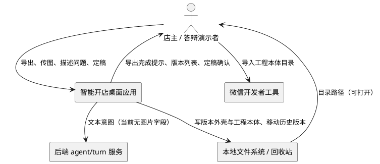

# 打磨阶段与版本化部署 · 需求规格

| 项目 | 内容 |
| --- | --- |
| 文档状态 | 需求规格（待评审） |
| 版本 | v0.1 |
| 日期 | 2026-11-01 |
| 适用范围 | 桌面端导出链路 + 会话状态机 + 项目持久化 + 本地文件系统 |
| 文档性质 | 只描述「做什么」，不描述「怎么做」 |
| 下游文档 | 由 `spec-design-agent` 产出设计文档，由 `spec-task-agent` 产出任务清单 |

> 本文档不含任何实现步骤、代码结构、数据库设计或函数签名。第 9 章「改动影响面」只列出受影响的文件与「为什么必须碰」，不写实现方式。

---

## 1. 背景与目标

### 1.1 用户原始请求（逐字保留，未做改写）

> 一个小的问题需要修复，首先我希望小程序导出完之后应该加入一个导出已经完成，目录：的提示。
> 然后提供一个进入打磨阶段的按钮。
> 点击之后用户可以在会话框传入图片，并且描述自己遇到的bug或者对于哪个ui不满意，这里agent将全权负责对于程序的修改，在项目部署的文件夹生成一个又一个修改的版本。
> 所以这又引发了一个新的问题，我需要选择文件夹部署的时候不是直接把本体放进去而是放进去一个外壳是名称加上v版本号的文件夹，点进去才是小程序。
> 直到最终定稿的时候，点击最终确认按钮之后小程序彻底固定，提示是否删去历史优化版本，可以选择删去并且重命名小程序的文件夹。

### 1.2 本轮要解决的三个痛点（大白话）

**痛点一：导出完了，但我不知道东西在哪。**
现在导出成功后，页面顶部写的是「工程已生成」，下面有一行「工程目录」。对一个不熟悉桌面应用的用户来说，这句话没有回答「我现在该去哪个文件夹」。用户想要的是一句直白的、带完整路径的结论：导出已经完成，目录是哪里。

**痛点二：生成出来的东西不满意，但没有「继续改」的路。**
现在整个流程是线性的：选功能 → 选骨架 → 填资料 → 出效果图 → 导出。导出就是终点。如果用户看到真实跑起来的小程序后说「这个按钮颜色太丑」「这个页面点进去白屏」，他只能回到前面的步骤改配置、重新导出，而且分不清这次导出和上次导出有什么区别。用户想要的是一个「打磨阶段」：拿着已经导出的工程，对着会话框说问题、贴截图，让系统改一版新的出来。

**痛点三：改了几版之后，磁盘上一堆目录分不清谁是谁。**
如果每次导出都往同一个父目录里写一个叫「松月食堂」的文件夹，第二次就会被「同名目录已存在」拦住；如果用户自己改名，又不知道哪个是最新、哪个是废弃的、哪个是准备交付的。用户想要的是版本化：每次导出产出一个带版本号的外壳目录，点进去才是小程序本体；打磨够了之后能「定稿」，把版本固定下来，并且可以选择清掉中间的历史版本、把目录名整理成最终名字。

### 1.3 本轮目标

1. **导出结果可定位**：导出成功后，用户能在页面上一眼看到「导出已完成，目录：<绝对路径>」，并且能直接打开、复制该路径。
2. **打磨可迭代**：导出成功后提供「进入打磨阶段」入口，用户能在会话里贴图 + 用自然语言描述问题，系统据此产出一个新版本工程。
3. **版本可区分**：磁盘结构从「父目录/项目名」升级为「父目录/项目名-vN/项目名」，版本号单调递增、可追溯、不互相覆盖。
4. **交付可收口**：提供「最终确认（定稿）」动作，定稿后工程固定、后续不可再迭代；定稿后询问是否删除历史版本，并支持把外壳目录重命名成最终名字。
5. **诚实**：当前阶段 agent 没有视觉能力、图片无法进入模型；凡涉及这一点的地方，界面必须如实说明，不得让用户误以为「贴了图 AI 就真的看了图」。

### 1.4 本轮不追求的目标

- 不追求「AI 直接改写生成出来的小程序源码」。原因见第 7 章与开放问题 C。
- 不追求真实微信上传、审核、真机调试。
- 不追求云端多设备同步版本历史。

---

## 2. 术语

**打磨阶段（Polish Phase）**
: 指导出成功之后、定稿之前的一个独立阶段。用户在该阶段的会话里描述问题或上传截图，系统据此产出一个新的工程版本。打磨阶段不改变导出前的配置流程，只作用于「已导出工程如何继续演进」。

**打磨轮次（Polish Round）**
: 用户提交一次「图片 + 文字描述」并据此生成一个新版本，称为一个打磨轮次。一个打磨阶段可以包含多个打磨轮次。

**版本（Version）**
: 一个具体的、可被微信开发者工具直接导入的小程序工程目录。每个版本由一次导出或一次打磨轮次产生，拥有唯一的版本号。

**版本号（Version Number）**
: 从 1 开始的正整数，记为 `vN`（v1、v2、v3……）。版本号在同一个项目内全局单调递增，不因项目显示名变更而重置，不因删除历史版本而回退或复用。

**版本外壳（Version Shell）**
: 位于用户选择的部署父目录下、名字为 `<项目名>-vN` 的一层文件夹。外壳本身不是小程序工程，它只是容器；点进外壳之后才能看到真正的小程序工程目录。

**工程本体（Inner Project）**
: 版本外壳内的那一层小程序工程目录，包含 `app.json`、页面代码、`composition.lock.json`、`generation-report.json`、生成报告等产物。工程本体的目录名与外层的版本号解耦。

**基线版本（Base Version）**
: 某一轮打磨开始前，用户当前正在看的那个版本。新版本以基线版本的配置与产物事实为基础进行修改，而不是从零重新收集资料。

**定稿（Finalize）**
: 用户点击「最终确认」后，项目进入不可再迭代的终态。定稿意味着：版本号封存、不再允许生成新版本、不再允许进入打磨、当前版本被标记为交付版本。

**历史版本（Historical Version）**
: 定稿之后，除定稿所选版本以外的所有版本。历史版本在定稿整理时可以被删除，也可以被保留。

**版本清单（Version Manifest）**
: 随版本外壳一起维护的一份逻辑记录，描述该项目有哪些版本、每个版本的路径、版本号、生成时间、用户当时的问题描述、对应产物摘要、是否定稿。它是「版本号的权威来源」，不依赖扫描目录猜测。

**意图结构化（Intent Compile）**
: 把用户的一句自然语言（可能附带图片）翻译成对项目配置的结构化修改，例如改主题色、改页面顺序、改功能项、改文案。它是当前系统里「agent 修改程序」唯一可落地的形态。

**交付版本（Delivered Version）**
: 定稿时用户选中的那个版本。交付版本是最终被保留、被重命名、被拿去交接上架的版本。

---

## 3. 角色与使用场景

### 3.1 核心角色

**店主（Store Owner）**
: 使用本应用生成自己店铺小程序的非技术用户。他关心的是「东西在哪、改得对不对、最后交付哪个」。他不需要理解版本号规则，但需要一眼看懂当前是第几版。

**答辩演示者（Presenter）**
: 在评审、答辩或客户演示现场操作应用的人。他需要在几十秒内走完「导出 → 看到目录 → 进入打磨 → 生成一版 → 定稿 → 清理历史」的完整链路，并且每一步的界面状态要能自解释。

**打磨执行者（Polish Agent，系统内角色）**
: 系统内部的智能体角色，负责把用户的问题描述转换成结构化修改并触发新版本生成。它不是人类角色，但它对用户可见，因此它的能力边界必须在界面上如实呈现。

### 3.2 外部系统

**微信开发者工具**
: 用户拿到工程目录后，用它导入并本地调试。本应用不驱动它，只提供目录。

**后端 agent/turn 服务**
: 提供自然语言理解与资料收集能力。当前契约只接受文本（`utterance` + `draft` + `client`），不接受图片。

**操作系统文件系统与回收站**
: 版本外壳、工程本体、历史版本的实际存放位置；删除历史版本时依赖系统回收站或等价的「可还原删除」。

**Composer（本地生成器）**
: 按 CompositionPlan 从冻结模板确定性生成工程。它不接受「直接改代码」的输入，只能接受结构化配置。

### 3.3 交互上下文

### 3.4 关键使用场景

**S1 首次导出后确认位置**
用户完成配置，点击导出，等待进度条结束。界面出现「导出已完成，目录：D:\小程序\松月食堂-v1\松月食堂」。用户点「打开目录」，资源管理器落在工程本体上。

**S2 进入打磨阶段**
用户在同一个完成页点击「进入打磨阶段」。界面切到打磨会话，会话顶部说明「当前版本 v1，可以贴图并描述问题」，底部输入框支持文字 + 附件。

**S3 传图 + 描述问题**
用户把一张「结算页按钮错位」的截图拖进输入框，输入「这个按钮被挡住了，而且颜色太土」。发送后，界面如实提示「图片已保存为参考，当前模型只能读取你的文字描述」。系统据此产出一个新版本 v2。

**S4 多轮打磨**
用户连续提出三轮问题，得到 v2、v3、v4。每次生成完成后，界面显示「新版本 v4 已生成，目录：...」，并提供「打开这一版」「继续打磨」「与上一版对比」。

**S5 定稿**
用户认为 v4 可用，点击「最终确认（定稿）」。系统二次确认「定稿后不能再生成新版本」，确认后项目进入定稿态，界面显示「已定稿 · v4」。

**S6 清理历史版本**
定稿完成后，系统询问「是否删除历史优化版本（v1–v3）？」用户选择删除，系统列出将被删除的三个目录、说明「会移到系统回收站，可还原」，再次确认后执行。

**S7 重命名最终目录**
用户勾选「把外壳目录重命名为最终名称」，系统把 `松月食堂-v4` 改为 `松月食堂-final`，并把结果路径告知用户。

**S8 答辩演示全链路**
演示者在 60 秒内演示：导出 → 「导出已完成，目录：」→ 进入打磨 → 贴一张图 + 一句话 → 生成 v2 → 定稿 → 删除 v1 → 重命名。全程每一步都停在可截图的稳定界面，不出现空白或长时间无反馈。

---

## 4. 用户故事

**US-1**
As a 店主，I want 导出结束后看到「导出已完成，目录：完整路径」，so that 我知道该去哪个文件夹，而不是在磁盘里翻找。

**US-2**
As a 店主，I want 在完成页一键打开或复制工程目录，so that 我能立刻把它拖进微信开发者工具。

**US-3**
As a 店主，I want 在导出成功后看到「进入打磨阶段」按钮，so that 我知道流程还没有结束、还能继续改。

**US-4**
As a 店主，I want 在打磨会话里贴截图并描述问题，so that 我不用学专业术语也能表达「哪里丑、哪里坏」。

**US-5**
As a 店主，I want 每次打磨都产出一个新的、独立的版本目录，so that 我随时能回到上一版，不会把好的版本改坏。

**US-6**
As a 店主，I want 部署父目录里出现的是「名字-v版本号」的外壳文件夹、点进去才是小程序，so that 我能一眼分清第几版，也不会被同名冲突卡住。

**US-7**
As a 店主，I want 打磨多轮后点「最终确认」把版本固定下来，so that 交付时不会有人误改。

**US-8**
As a 店主，I want 定稿后系统问我要不要删掉中间版本，so that 交付目录干净，而且我知道删了什么、能不能还原。

**US-9**
As a 店主，I want 定稿时把目录重命名成最终名字，so that 交付给客户或同事时名字说得清。

**US-10**
As a 答辩演示者，I want 整个链路每一步都有明确的界面状态，so that 我能在评审现场稳定演示，不用解释「这里其实还没做完」。

**US-11**
As a 打磨执行者，I want 明确知道「我只能改结构化配置、不能直接改生成代码」，so that 我不会产出破坏产物一致性的结果。

**US-12**
As a 评审人，I want 界面如实标注「当前图片不能进入模型」，so that 我不会被演示误导，以为系统已经具备视觉能力。

---

## 5. 功能需求（EARS）

> 每条需求标注 EARS 模式：`Ubiquitous`（系统始终如此）、`Event-driven`（当……时）、`State-driven`（处于……状态时）、`Optional`（若存在……）、`Unwanted`（若出现异常/禁止情形）。验收条件统一写作「触发场景 → 预期行为」。

### 5.1 导出完成提示

**FR-1 导出成功后的完成提示（Event-driven）**
当一次导出以成功状态结束时，系统应当在该页面的首屏可见位置展示一个独立提示条，文案形如「导出已完成，目录：<工程本体绝对路径>」，不得只依赖现有的「工程已生成」状态徽标。

> 备注：用户原始表述为「导出已经完成，目录：」；两种措辞均可接受，最终文案在设计阶段定稿，但「已完成 + 目录：+ 真实路径」三要素不可缺失。

a. 验收条件：导出成功 → 提示条出现，文案包含「导出已完成」与「目录：」，路径等于本次 `generation-report.json` 中记录的 `outputPath`，且路径完整可读（不得截断成「…」而无法复制）。

**FR-2 提示中的路径可直接使用（Event-driven）**
当用户点击提示中的路径或提示旁的「打开目录」时，系统应当用系统文件管理器打开该工程本体目录。

a. 验收条件：点击路径/打开目录 → 资源管理器打开的是「外壳/本体」这一层，而不是外壳的父目录，也不是外壳层本身。

**FR-3 路径可复制（Event-driven）**
当用户点击「复制路径」时，系统应当把工程本体的绝对路径写入剪贴板，并给出一次性可见反馈。

a. 验收条件：点击复制 → 剪贴板内容与提示中展示的路径逐字一致；界面出现「已复制」类反馈，且不弹系统级对话框打断流程。

**FR-4 提示与状态严格同步（Unwanted）**
如果导出处于未开始、进行中、已取消、失败或冲突状态，那么系统不得展示「导出已完成」提示或「进入打磨阶段」按钮。

a. 验收条件：导出失败 → 完成提示与打磨入口均不可见；导出进行中 → 两者均不可见。

**FR-5 再次导出后提示刷新（Event-driven）**
当用户在同一项目中第二次及以后导出成功时，系统应当在完成提示中展示最新一次产物的路径与版本号，不得展示上一次的路径。

a. 验收条件：v1 导出后进入打磨生成 v2 → 完成提示中的路径指向 v2 的外壳/本体，版本号显示 v2。

### 5.2 打磨阶段入口

**FR-6 打磨入口的可见条件（State-driven）**
当项目处于「导出成功且未定稿」状态时，系统应当在完成提示旁展示「进入打磨阶段」主按钮。

a. 验收条件：导出成功且未定稿 → 按钮可见、可点击；已定稿 → 按钮不可见或被禁用并说明原因。

**FR-7 进入打磨阶段（Event-driven）**
当用户点击「进入打磨阶段」时，系统应当把项目切换到打磨阶段，并激活打磨会话，且该切换在项目重新打开后仍能恢复到打磨阶段。

a. 验收条件：点击进入 → 界面切到打磨会话；关闭应用再打开该项目 → 仍停在打磨阶段，且能看到历史打磨消息。

**FR-8 打磨会话的上下文（Ubiquitous）**
打磨会话必须显式告知用户三件事：当前基线版本是哪一个、该版本对应的目录在哪、本轮可修改的范围是什么。

a. 验收条件：进入打磨会话 → 会话首条信息包含基线版本号、基线目录、可修改范围说明；缺任一项视为不满足。

**FR-9 未导出不可进入打磨（Unwanted）**
如果项目尚未成功导出过任何版本，那么系统不得提供可用的「进入打磨阶段」入口。

a. 验收条件：从未导出 → 打磨入口不可见；通过任何间接方式触发进入 → 被拒绝并给出「请先完成一次导出」类提示。

**FR-10 定稿后入口关闭（State-driven）**
当项目已定稿时，系统应当关闭打磨入口，并在原位置展示「已定稿」状态说明。

a. 验收条件：定稿后 → 原「进入打磨阶段」按钮位置显示「已定稿 · vN」；点击无任何生成动作。

**FR-11 从工作台进入打磨（Event-driven）**
当用户在工作台的项目卡片上打开一个已导出未定稿的项目时，系统应当把用户带到该项目上次停留的阶段；若上次停在打磨阶段，则直接进入打磨会话。

a. 验收条件：工作台打开项目 → 阶段与关闭前一致；项目卡片上的阶段标签显示「打磨」。

### 5.3 打磨会话：传图与描述

**FR-12 打磨会话的输入形态（Ubiquitous）**
打磨会话的输入区必须同时支持文字描述与图片附件，二者至少提供其一即可提交。

a. 验收条件：只输入文字 → 可提交；只附加图片 → 可提交；两者都有 → 可提交；两者都无 → 提交按钮禁用。

**FR-13 图片选择入口（Event-driven）**
当用户点击输入区的附件按钮时，系统应当弹出系统文件选择框，只允许选择 PNG、JPEG、WebP 三种格式。

a. 验收条件：点击附件 → 弹出系统文件对话框；选择其他格式 → 不被接受并有明确提示；取消 → 会话无变化。

**FR-14 图片粘贴与拖拽（Event-driven）**
当用户在输入区粘贴截图或将图片文件拖入输入区时，系统应当把该图片加入本轮待发送的附件列表。

a. 验收条件：粘贴一张截图 → 出现缩略图并进入待发送列表；拖拽三张图片 → 三张都进入列表且顺序与拖入顺序一致。

**FR-15 图片数量与体积上限（Ubiquitous）**
系统必须限制单轮打磨的图片数量与体积：单轮最多 6 张、单张不超过 10 MB、单轮合计不超过 40 MB、单个项目资产总量不超过 40 MB。

a. 验收条件：选择第 7 张 → 被拒绝并提示「单轮最多 6 张」；单张 11 MB → 被拒绝并提示「单张不能超过 10 MB」；累计超限 → 提示剩余可用额度。

**FR-16 图片落盘为项目资产（Event-driven）**
当用户提交一轮打磨时，系统应当先把本轮图片保存为该项目可复用的图片资产，再提交描述，不得只在内存中持有。

a. 验收条件：提交成功后重启应用并打开项目 → 该轮消息仍能显示图片缩略图；图片资产可在项目资产列表中被找到。

**FR-17 消息中只保存图片引用（Ubiquitous）**
打磨消息中引用的图片必须以「资产标识 + 文件名 + 宽高 + 摘要」这类引用形式保存，不得把 base64 图片数据写进消息正文或项目文档。

a. 验收条件：查看保存后的项目文档 → 打磨消息中不存在 `data:image/...;base64` 字符串；消息仍能定位到对应资产。

**FR-18 用户描述的必填语义（Optional）**
如果一轮打磨只提供图片而没有文字描述，那么系统应当在提交前提示「建议补充一句文字说明（当前只能理解文字）」，并允许用户确认后继续提交。

a. 验收条件：只发图不发字 → 出现一次提示；用户确认 → 提交成功，且消息被标记为「仅图片参考」。

**FR-19 无视觉能力时的诚实提示（Ubiquitous）**
系统必须在打磨会话中常驻说明：当前模型只能理解文字描述，图片仅作为参考存档，不参与模型推理。

a. 验收条件：进入打磨会话 → 说明文字可见；用户第一次传图 → 再出现一次且仅一次的强调提示。

**FR-20 图片不进入导出工程（Ubiquitous）**
打磨阶段上传的图片默认不得被写入新版本的小程序工程产物中。

a. 验收条件：打磨生成 v2 后检查工程本体 → 不存在由打磨截图引入的图片文件；产物文件清单与只改配置时的口径一致。

**FR-21 提交后的处理状态（Event-driven）**
当用户提交一轮打磨后，系统应当进入「理解中 → 修改中 → 生成中 → 校验中 → 完成/失败」的可见状态序列，每一步都有文字说明，不得出现无反馈的空白期。

a. 验收条件：提交 → 5 个状态依次可见；任一步耗时超过 2 秒 → 有持续可见的活动指示。

**FR-22 连续多轮打磨（Ubiquitous）**
打磨会话必须支持在一个会话中连续进行多轮打磨，且每轮消息保留在时间线上，用户可回看每一轮的问题描述与产出的版本号。

a. 验收条件：连续三轮打磨 → 会话时间线含三轮用户消息与三轮 agent 结果消息；每条结果消息包含对应版本号。

**FR-23 打磨消息的持久化上限（Ubiquitous）**
系统必须对打磨会话的消息数量施加上限，超出时按既有规则保留首条与最近若干条，且不得因裁剪导致「版本号与问题描述」的对应关系丢失。

a. 验收条件：打磨消息超过上限 → 被裁剪；被裁剪后的会话中，每个仍保留的版本结果消息仍能对应到它的问题描述或版本摘要。

### 5.4 版本生成

**FR-24 每轮打磨产出一个新版本（Event-driven）**
当一轮打磨成功结束时，系统应当产出一个新的版本目录，版本号等于当前最大版本号加 1，且该版本可被微信开发者工具独立导入。

a. 验收条件：基线 v1 完成一轮打磨 → 产出 v2；v2 目录内包含完整工程产物与 `composition.lock.json`、`generation-report.json`。

**FR-25 修改范围的限定（Ubiquitous）**
打磨阶段的修改必须限定为对结构化配置的修改（店铺资料、主题与配色、页面与模块顺序、功能项、文案等），不得直接改写已生成工程的源码文件。

a. 验收条件：任意一轮打磨的产物 → 满足既有静态校验与产物摘要一致性检查；若出现「产物与配置锁不一致」即判定不满足。

**FR-26 新版本以基线版本为起点（Ubiquitous）**
打磨产出的新版本必须以本轮基线版本的配置事实为起点进行增量修改，不得把用户的店铺资料重置为空或回退到默认值。

a. 验收条件：基线版本店铺名为「松月食堂」且有 5 道菜 → 打磨只改配色 → 新版本仍为「松月食堂」且仍有 5 道菜。

**FR-27 生成前的目标检查（Event-driven）**
当开始生成一个新版本时，系统应当先检查目标外壳目录与内层目录是否已存在，确认不存在后才开始写入。

a. 验收条件：目标外壳已存在 → 在写入任何文件前即返回冲突；检查过程不创建任何目录或文件。

**FR-28 生成中的进度反馈（Event-driven）**
当新版本生成进行中时，系统应当展示与首次导出一致的阶段化进度（校验、解析、生成锁、预检、写文件、校验产物、提交、报告）。

a. 验收条件：生成中 → 阶段消息逐条更新且进度单调不减；完成后进度为 100%。

**FR-29 生成失败不影响既有版本（Unwanted）**
如果新版本生成失败或被取消，那么系统必须保证所有已存在的版本目录内容完全不变，且不在目标父目录留下半成品目录。

a. 验收条件：人为制造生成失败 → v1 目录的摘要与失败前一致；父目录中不存在残留的临时目录（超过保留时限后必须被清理）。

**FR-30 版本产物的一致性（Ubiquitous）**
每个成功产出的版本必须留下可追溯的产物摘要（配置锁摘要 + 产物摘要），且摘要与目录实际内容一致。

a. 验收条件：对任一版本执行既有的产物校验流程 → 通过；手工改动产物后 → 校验能发现不一致。

**FR-31 版本与问题描述的关联（Ubiquitous）**
每个版本必须在版本清单中记录「该版本因什么问题而产生」，包括用户描述文本摘要、图片引用、生成时间。

a. 验收条件：查看版本清单 → v2 条目包含其对应的用户描述摘要与至少一个图片引用（若该轮有图）。

**FR-32 以历史版本为新基线（Event-driven）**
当用户选择「以这一版继续打磨」时，系统应当把所选历史版本设为新的基线，并在其基础上生成更高版本号的新版本。

a. 验收条件：当前 v4，用户选择以 v2 为基线继续打磨 → 新版本号为 v5（不复用 v3），v5 的配置起点与 v2 一致。

**FR-33 版本数量上限（Ubiquitous）**
系统必须限制单个项目的版本总数（建议上限 30），达到上限时必须阻止继续打磨并提示先定稿或清理历史版本。

a. 验收条件：版本数达到上限 → 「继续打磨」被禁用并给出可执行的原因；不得静默失败。

**FR-34 历史版本只读（Ubiquitous）**
系统不得在打磨过程中修改任何既有版本的目录内容；所有变更只能发生在新建的版本目录中。

a. 验收条件：完成 v5 生成后，v1–v4 的文件清单与摘要与生成时不符即判定为不满足。

### 5.5 版本外壳目录结构

**FR-35 版本外壳命名规则（Ubiquitous）**
每次导出或打磨产出的目录结构必须是两层：第一层为版本外壳 `<项目名>-vN`，第二层为工程本体 `<项目名>`。

a. 验收条件：项目名「松月食堂」、版本 1 → 结构为 `…/松月食堂-v1/松月食堂/`；外壳内不得平铺小程序文件。

**FR-36 项目名清洗的一致性（Ubiquitous）**
外壳名与内层名必须使用与既有一致的项目名清洗规则（非法字符替换、长度上限），且外壳名在内层名之后追加 `-vN`。

a. 验收条件：项目名含 `:`、`/`、`?` → 外壳与内层都不含这些字符；项目名长度达上限 → 外壳名仍能完整写入且不超路径长度红线。

**FR-37 外壳内只允许两类内容（Ubiquitous）**
版本外壳内必须只包含「一个工程本体目录」与「版本清单相关文件」，不得放入截图、缓存、临时文件或其他工程的副本。

a. 验收条件：检查任一版本外壳 → 有且仅有一个工程目录；无用户上传图片；无 staging/临时目录。

**FR-38 版本号全局递增（Ubiquitous）**
版本号必须在同一个项目内全局递增，从 v1 开始，删除历史版本后不得回退、不得复用已使用过的编号。

a. 验收条件：v1、v2、v3 存在，删除 v2 → 下一次生成仍为 v4；版本清单中不存在重复版本号。

**FR-39 项目名变更后的版本连续性（Event-driven）**
当用户在打磨过程中修改店铺/项目显示名时，后续版本的外壳名应当使用新名字，但版本号必须继续递增，且版本清单必须同时记录每个版本生成时的外壳名，保证历史目录仍可定位。

a. 验收条件：v1 时名称为「松月食堂」，改为「松月小馆」后生成 v2 → 目录为 `松月小馆-v2`，清单中 v1 仍指向 `松月食堂-v1`，版本号连续无断层。

**FR-40 首次导出即为 v1（Event-driven）**
当项目第一次成功导出时，系统应当直接使用版本外壳结构，版本号为 v1，不得停留在「父目录/项目名」的旧结构。

a. 验收条件：全新项目首次导出 → 产物路径为 `<父目录>/<项目名>-v1/<项目名>/`；完成提示展示的路径与之匹配。

**FR-41 目标存在判定口径（Ubiquitous）**
目标冲突检查必须以「本次将要写入的外壳目录」为对象，而不是以「父目录/项目名」为对象，避免第一次导出后第二次必然误报同名冲突。

a. 验收条件：`<父目录>/<项目名>-v1` 存在、`<父目录>/<项目名>` 不存在 → 生成 v2 不被判定为冲突；`<父目录>/<项目名>-v2` 已存在 → 判定为冲突并给出可读原因。

**FR-42 外壳已存在但清单缺失（Unwanted）**
如果目标外壳目录已存在但无法确认它属于本项目，那么系统必须拒绝写入并说明原因，不得直接覆盖或猜测合并。

a. 验收条件：手工创建一个同名外壳 → 生成被拒绝，错误信息说明「目录已存在且不属于本项目」；该目录内容未被修改。

### 5.6 定稿

**FR-43 定稿入口（State-driven）**
当项目处于打磨阶段时，系统应当在会话的固定操作区展示「最终确认（定稿）」按钮，且该按钮在只有 v1 时同样可见。

a. 验收条件：打磨阶段 → 定稿按钮常驻可见；首次导出后直接进入打磨 → 按钮可点击。

**FR-44 定稿前的二次确认（Event-driven）**
当用户点击「最终确认（定稿）」时，系统应当先弹出确认框，明确说明「定稿后不能继续打磨、不能生成新版本、版本号封存」，并要求用户显式确认。

a. 验收条件：点击定稿 → 出现确认框；取消 → 项目状态完全不变；确认 → 进入定稿流程。

**FR-45 定稿版本的确定（Event-driven）**
当用户确认定稿时，系统应当把当前基线版本标记为交付版本，并在界面上明确显示「已定稿 · vN」。

a. 验收条件：在 v4 上定稿 → 交付版本为 v4；界面显示 v4；版本清单中 v4 状态为「交付」。

**FR-46 定稿记录的落盘（Ubiquitous）**
定稿状态必须持久化到项目文档中，包含：是否已定稿、定稿时间、交付版本号、交付版本外壳路径与工程本体内路径、定稿时的产物摘要。

a. 验收条件：定稿后关闭并重开应用 → 仍显示已定稿且信息完整；项目文档中能读到上述五项。

**FR-47 定稿后的锁定行为（State-driven）**
当项目已定稿时，系统应当禁止继续打磨、禁止生成新版本、禁止再次导出覆盖，并在相关按钮上给出禁用原因。

a. 验收条件：已定稿 → 打磨输入区只读；定稿按钮变为「已定稿」；再次导出入口被禁用并提示「已定稿，如需修改请新建项目」。

**FR-48 定稿后的可用能力（State-driven）**
当项目已定稿时，系统仍应当允许用户打开目录、复制路径、查看版本清单、进入交接上架流程。

a. 验收条件：已定稿 → 「打开目录」「复制路径」「开始交接上架」均可用。

**FR-49 定稿与 AppID 后置写入的顺序（Event-driven）**
当用户在定稿前已经完成 AppID 后置写入时，定稿不得破坏工程内配置锁与生成报告的一致性；当用户在定稿后才写入 AppID 时，系统应当仍然允许该动作并重算摘要。

a. 验收条件：已完成 AppID 写入的版本被定稿 → 产物摘要校验仍通过；定稿后写入 AppID → 写入成功且摘要更新。

**FR-50 定稿的不可逆性说明（Ubiquitous）**
系统必须在定稿确认框中如实说明定稿不可逆，不得使用「可以随时回来改」这类与实际行为冲突的措辞。

a. 验收条件：确认框文案 → 明确出现「不可逆」「不能再生成新版本」类表述。

### 5.7 定稿后删除历史版本

**FR-51 定稿后的清理询问（Event-driven）**
当定稿成功完成时，系统应当主动询问是否删除历史优化版本，并且不得在用户未选择前自动删除任何目录。

a. 验收条件：定稿成功 → 出现「是否删除历史优化版本」询问；用户未响应 → 磁盘上所有历史版本保持原样。

**FR-52 清理选项的完整性（Ubiquitous）**
清理询问必须提供三个选项：删除历史版本、暂时保留、稍后处理；选择「稍后处理」后必须留有再次进入的入口。

a. 验收条件：询问框 → 三选项均可用；选择「稍后处理」→ 关闭询问，打磨/定稿页面出现「清理历史版本」入口。

**FR-53 清理前的清单与确认（Event-driven）**
当用户选择删除历史版本时，系统应当先展示将被删除的版本清单（版本号 + 目录名 + 生成时间），并要求用户二次确认。

a. 验收条件：选择删除 → 出现清单，条目数与历史版本数一致；取消 → 无任何目录被移动或删除。

**FR-54 删除的方式（Ubiquitous）**
删除历史版本必须采用「可还原」的方式：优先移入操作系统回收站；回收站不可用时，移入父目录下带时间戳的回收子目录。禁止直接永久删除。

a. 验收条件：执行删除 → 历史版本目录在原路径消失；在系统回收站或回收子目录中能找到对应目录；定稿版本目录不受影响。

**FR-55 删除范围（Ubiquitous）**
删除历史版本时不得删除交付版本，也不得删除版本清单与定稿记录。

a. 验收条件：删除后 → 交付版本目录仍存在且内容完整；版本清单仍存在并能描述已删除的版本编号。

**FR-56 删除失败的处理（Unwanted）**
如果部分历史版本删除失败，那么系统应当逐条报告失败项与原因，并保持未失败项的删除结果，不得回滚已成功的删除。

a. 验收条件：其中一个目录被外部程序占用 → 该目录保留并报错；其余目录正常移入回收站；界面列出失败清单。

**FR-57 删除的不可逆提示（Ubiquitous）**
系统必须在确认框中说明「目录会从部署位置移除，可从回收站还原」，并说明若回收站被清空则不可恢复。

a. 验收条件：确认框 → 上述两类说明均可见。

**FR-58 删除后的界面状态（Event-driven）**
当历史版本清理完成后，系统应当展示「已清理 N 个历史版本」的结果，并保留「打开定稿目录」入口。

a. 验收条件：清理完成 → 结果提示包含数量；「打开定稿目录」可点击并打开正确路径。

### 5.8 重命名

**FR-59 定稿时的重命名选项（Optional）**
如果定稿流程进入整理阶段，那么系统应当提供「将外壳目录重命名为最终名称」的选项，并默认勾选。

a. 验收条件：整理阶段 → 选项存在且默认勾选；取消勾选 → 不执行重命名。

**FR-60 重命名规则（Ubiquitous）**
重命名后的外壳目录名必须满足：使用当前项目名 + `-final` 后缀；不得与父目录中已有目录重名；不得包含非法字符。

a. 验收条件：项目名「松月食堂」→ 外壳名 `松月食堂-final`；父目录已存在同名目录 → 重命名被拒绝并给出建议名。

**FR-61 内层目录的重命名策略（Ubiquitous）**
重命名时必须保持「外壳内只有一个工程本体」的结构；内层目录名不得与外壳同名造成 `<项目名>/<项目名>` 的歧义嵌套。

a. 验收条件：重命名后 → 结构为 `<项目名>-final/<项目名>/`；不存在同名双层目录。

**FR-62 重命名与版本清单的同步（Ubiquitous）**
重命名后，版本清单与定稿记录中的路径必须同步更新，保证用户从应用内打开时仍能找到定稿目录。

a. 验收条件：重命名后从应用内点击「打开定稿目录」→ 打开新路径；项目文档中的定稿路径与新目录一致。

**FR-63 重命名失败的回滚（Unwanted）**
如果重命名失败（目标已存在、被占用、权限不足），那么系统必须保持原目录名不变，并告知失败原因与建议动作。

a. 验收条件：目标已存在 → 原目录未被改名；界面提示「目标目录已存在」并给出建议名。

### 5.9 失败与回滚

**FR-64 生成失败的清理（Unwanted）**
如果版本生成过程中断，那么系统必须清理本次产生的临时目录，不得让用户看到「半成品外壳」或「只有部分文件的工程」。

a. 验收条件：生成中断后检查父目录 → 无本次产生的临时目录；已有版本目录未被改动。

**FR-65 定稿失败的回滚（Unwanted）**
如果定稿过程中写盘失败，那么项目必须保持未定稿状态，并且不产生「一半定稿信息」。

a. 验收条件：模拟写盘失败 → 重开项目仍为未定稿；定稿相关字段要么全有要么全无。

**FR-66 版本清单损坏的恢复（Unwanted）**
如果版本清单损坏或无法解析，那么系统必须阻止继续打磨，并给出「请先修复版本清单」的可读提示，不得凭扫描目录猜测版本号继续写入。

a. 验收条件：手工破坏版本清单 → 打磨入口被禁用并说明原因；既有版本目录不被修改。

**FR-67 磁盘空间不足（Unwanted）**
如果生成新版本时磁盘空间不足，那么系统必须在写入任何文件前阻止生成，并说明所需空间与可用空间。

a. 验收条件：构造小容量目标盘 → 生成前即失败；失败信息包含所需与可用空间；无半成品。

**FR-68 父目录不可写或被删除（Unwanted）**
如果父目录在打磨过程中被删除或变为不可写，那么系统必须明确报错，并允许用户重新选择部署位置；重新选择后版本号继续递增。

a. 验收条件：外部删除父目录后点击继续打磨 → 报错「导出位置不存在」；重新选择目录后生成 vN+1，且版本号不与历史冲突。

**FR-69 崩溃恢复（Unwanted）**
如果应用在生成过程中崩溃，那么下次启动时系统应当能识别并清理本次残留的临时目录，且不影响已完成版本的可用性。

a. 验收条件：生成中强杀进程 → 重启后残留临时目录被清理；已完成版本仍可打开。

### 5.10 并发与冲突

**FR-70 生成任务互斥（State-driven）**
当已有导出或打磨生成任务在运行时，系统应当拒绝启动第二个生成任务，并提示「已有任务在运行」。

a. 验收条件：生成中再次点击打磨提交/导出 → 被拒绝；第一个任务仍正常完成。

**FR-71 预检后的抢占（Unwanted）**
如果预检通过后目标目录被其他进程抢先创建，那么系统必须在写入前再次检查并返回冲突，而不是覆盖或写入失败后留下半成品。

a. 验收条件：预检通过后手工创建同名外壳 → 生成返回冲突；该目录内容未被改写。

**FR-72 多项目同父目录同名（Unwanted）**
如果两个项目使用相同的显示名并指向同一父目录，那么系统必须通过版本清单与归属判定避免交叉写入，并在冲突时给出可读原因。

a. 验收条件：项目 A、B 都叫「松月食堂」→ 第二个项目生成时能识别外壳归属冲突；不会写入另一项目的目录。

**FR-73 版本号并发分配（Unwanted）**
如果两次版本分配同时发生（例如双窗口），那么系统必须保证同一项目不会分配出重复版本号；发生竞争时后到者失败并提示重试。

a. 验收条件：并发触发两次生成 → 只有一个成功，另一个失败并提示；版本清单中无重复版本号。

**FR-74 外部程序占用目录（Unwanted）**
如果定稿重命名或删除历史版本时目标目录被外部程序占用，那么系统必须提示「目录正在被使用」，并保持原状。

a. 验收条件：用其他程序占用目录后重命名 → 失败并提示；目录名未变化。

**FR-75 单写者约束（Ubiquitous）**
同一项目的项目文档与版本清单必须只有一个写入者；打磨消息、定稿状态、版本记录不得出现互相覆盖导致的字段丢失。

a. 验收条件：保存打磨消息的同时触发自动保存 → 两份内容都保留；不出现「后写覆盖前写」。

---

## 6. 验收标准

> 分两类：**A（自动化可验）** 指可以用纯函数测试、临时目录文件系统测试或 IPC handler 测试验证，不需要人工看界面；**B（必须人工 GUI 验证）** 指必须在真实桌面应用中肉眼确认的界面与交互。

### 6.1 自动化可验（A）

- [ ] **AC-A-01** 版本外壳命名纯函数：输入（项目名「松月食堂」、版本 1）→ 输出（外壳 `松月食堂-v1`、内层 `松月食堂`）。
- [ ] **AC-A-02** 外壳命名对非法字符与超长项目名的清洗结果与既有项目名清洗一致，且外壳总长度不超路径红线。
- [ ] **AC-A-03** 目标冲突判定：`<父>/<名>-v1` 存在、`<父>/<名>` 不存在 → 分配 v2 时不判冲突。
- [ ] **AC-A-04** 目标冲突判定：`<父>/<名>-v2` 已存在 → 返回冲突，且不创建任何文件。
- [ ] **AC-A-05** 版本号分配：清单含 v1、v2、v3，删除 v2 后 → 下一次分配 v4。
- [ ] **AC-A-06** 版本号分配：项目名从「A」改为「B」→ 下一次仍分配 v(N+1)，清单保留 v1 的旧外壳名。
- [ ] **AC-A-07** 生成成功后目录结构断言：外壳目录内只有一个工程目录，且工程目录含 `composition.lock.json`、`generation-report.json`。
- [ ] **AC-A-08** 生成失败断言：临时目录被清理，既有版本目录摘要不变。
- [ ] **AC-A-09** 定稿落盘断言：项目文档解析后含定稿标记、定稿时间、交付版本号、交付路径、产物摘要五项，且重开项目后一致。
- [ ] **AC-A-10** 定稿后锁定断言：对已定稿项目调用生成入口 → 返回拒绝错误码（如 `PROJECT_FINALIZED`），不写盘。
- [ ] **AC-A-11** 打磨消息持久化断言：消息中只含资产标识引用，不含 base64；重启后消息仍能定位资产。
- [ ] **AC-A-12** 项目文档白名单断言：保存后再加载，打磨与定稿相关字段未被降级或丢弃（渲染层与主进程两侧口径一致）。
- [ ] **AC-A-13** 阶段降级断言：未导出项目若项目文档阶段为打磨 → 加载后降级到导出阶段，而不是显示空打磨会话。
- [ ] **AC-A-14** 删除历史断言：删除后原路径不存在，回收位置存在同名目录；交付版本目录仍存在。
- [ ] **AC-A-15** 删除部分失败断言：模拟一个目录被占用 → 返回失败清单，其余目录已移走，已成功项不回滚。
- [ ] **AC-A-16** 重命名断言：成功后外壳名为 `<项目名>-final`、内层为 `<项目名>`；清单与定稿路径同步。
- [ ] **AC-A-17** 重命名冲突断言：目标已存在 → 返回冲突，原目录名不变。
- [ ] **AC-A-18** 图片上限断言：第 7 张、11 MB 单张、超总量三种情况分别被拒绝并返回对应原因。
- [ ] **AC-A-19** 导出完成提示数据断言：成功结果的路径字段等于报告 `outputPath`，且指向工程本体而非外壳。
- [ ] **AC-A-20** 并发互斥断言：第一个生成任务未结束时，第二个请求返回「已有任务在运行」。
- [ ] **AC-A-21** 版本数量上限断言：达到上限后继续打磨被拒绝，且不产生第 N+1 个目录。
- [ ] **AC-A-22** 打磨产物不含上传图片断言：新版本工程文件清单中不存在由打磨截图引入的文件。

### 6.2 必须人工 GUI 验证（B）

- [ ] **AC-B-01** 导出成功后首屏可见「导出已完成，目录：<完整路径>」，路径不截断、可读。
- [ ] **AC-B-02** 点击提示中的路径/「打开目录」→ 资源管理器打开的是工程本体目录。
- [ ] **AC-B-03** 点击「复制路径」→ 有一次性可见反馈，粘贴内容与展示路径一致。
- [ ] **AC-B-04** 完成页存在「进入打磨阶段」主按钮，点击后切到打磨会话且可见基线版本信息。
- [ ] **AC-B-05** 未导出时看不到完成提示与打磨按钮（用全新项目走一遍确认）。
- [ ] **AC-B-06** 打磨会话输入区可见附件按钮、支持拖拽与粘贴，缩略图正确显示。
- [ ] **AC-B-07** 打磨会话常驻「图片仅供参考、模型只读文字」说明；首次传图有且仅有一次强调提示。
- [ ] **AC-B-08** 提交后能看到「理解中 → 修改中 → 生成中 → 校验中 → 完成」的状态序列，无长时间空白。
- [ ] **AC-B-09** 新版本生成后提示「新版本 vN 已生成」并展示新路径，可打开。
- [ ] **AC-B-10** 打磨会话可回看每一轮的问题描述与对应版本号。
- [ ] **AC-B-11** 打磨阶段的定稿按钮常驻可见；点击出现二次确认，文案明确「不可逆」。
- [ ] **AC-B-12** 取消定稿确认 → 项目状态与界面完全不变。
- [ ] **AC-B-13** 确认定稿 → 界面显示「已定稿 · vN」，打磨输入区变只读。
- [ ] **AC-B-14** 定稿后出现「是否删除历史优化版本」询问，含三个选项。
- [ ] **AC-B-15** 选择删除 → 出现历史版本清单与二次确认；确认后提示「已清理 N 个」；可在回收站找到目录。
- [ ] **AC-B-16** 选择「稍后处理」→ 出现可再次进入的清理入口。
- [ ] **AC-B-17** 重命名选项默认勾选，执行后目录名为 `<项目名>-final`，且应用内打开路径正确。
- [ ] **AC-B-18** 定稿后「打开目录/复制路径/开始交接上架」仍可用；「进入打磨阶段」不可用且有原因说明。
- [ ] **AC-B-19** 工作台项目卡片阶段标签能显示「打磨」「已定稿」。
- [ ] **AC-B-20** 关闭应用重开项目 → 仍停在打磨阶段/定稿状态，历史消息与版本信息完整。
- [ ] **AC-B-21** 答辩演示全链路（S8）在 60 秒内可完成且无卡死、无白屏、无系统级意外的文件对话框。
- [ ] **AC-B-22** 生成失败时界面给出可读错误码与重试入口，已完成版本仍可打开。

### 6.3 防退化验收

- [ ] **AC-D-01** 原有导出链路的所有既有自动化测试仍通过（使用版本外壳结构后，旧用例中的路径断言需要按新结构更新，不得直接删除用例）。
- [ ] **AC-D-02** 原有「同名目录不覆盖」的保护仍然有效，只是判定对象改为外壳目录。
- [ ] **AC-D-03** 原有 AppID 后置写入、产物校验、导入差异卡片能力不被削弱。
- [ ] **AC-D-04** 原有项目文档未知字段保留（`unmappedFields`）机制对新增字段生效。
- [ ] **AC-D-05** 浏览器预览模式下不得出现「已完成导出」的误导提示（仍应提示必须在桌面应用中导出）。

---

## 7. 边界与非目标

### 7.1 明确不做

1. **不直接改写已生成的小程序源码。** Composer 的产物由配置锁摘要与产物摘要共同背书。任何「直接编辑生成出来的 .js/.wxml/.wxss」都会破坏 `lockDigest` / `outputDigest` 的一致性，绕过安全扫描口径，并让「可复现性」失效。因此打磨只能走「结构化配置修改 → 重新 compose」。
2. **不接入真实多模态视觉模型。** 当前 agent/turn 契约只有 `utterance`，DeepSeek 文本模型无视觉能力，生图 Provider 也未选定。本轮只做「图片存档 + 文字理解」，不得对外宣称「AI 看图改 UI」。
3. **不做真实微信上传、提交审核、真机调试。** 导出仍是本地目录交付。
4. **不修改 CompositionPlan schema 与模板 registry。** 版本信息放在目录名与版本清单里，不进 Plan 字段。
5. **不做版本历史的云端同步与多人协作。** 版本清单是本机单写者文件。
6. **不做「撤销定稿」。** 定稿的语义是不可逆终态。需要继续改请新建项目（可提供「以此项目为模板新建」作为后续能力，本轮不做）。
7. **不自动删除任何用户目录。** 所有删除都必须经过显式确认，且采用可还原方式。
8. **不改变资金/订单/后端接口语义。** 本轮不触碰 `/api/v1` 业务接口。

### 7.2 能力边界（必须诚实呈现）

| 用户以为 | 实际能力 | 界面必须怎么说 |
| --- | --- | --- |
| 贴图 AI 就懂视觉问题 | 图片只存档，模型只读文字 | 「图片已保存为参考，当前只能读取你的文字描述」 |
| agent 会直接改代码 | 只改结构化配置再重新生成 | 「本轮按你的描述调整店铺资料/配色/页面/功能，并重新生成一版」 |
| 定稿后还能改 | 定稿不可逆 | 「定稿后不能生成新版本」 |
| 删除历史就是彻底删了 | 默认进回收站 | 「会移到回收站，可从回收站还原」 |

### 7.3 与既有边界的关系

- 导出仍受「只能写到用户经系统对话框确认过的父目录」约束。
- 打磨生成仍受「单任务串行」约束。
- 所有新增文件写盘仍受路径长度、磁盘空间、可写性检查约束。
- 项目文档仍受 1 MB 体积上限与顶层白名单约束；打磨消息与版本清单设计时必须考虑体积（不得把图片或大段产物塞进项目文档）。

---

## 8. 开放问题清单（A–H）

> 每条给出**默认推荐**与**理由**。默认推荐可直接作为设计阶段输入；若产品方另有决定，以产品决定为准。

### A. 版本外壳目录命名

**问题**：外壳用 `<项目名>-v1` / `<项目名>_v1` / `<项目名>-v1.0.0`？内层目录是否仍叫项目名？版本号是全局递增还是每次打磨递增？项目名改动后历史外壳如何保持连续？

**默认推荐**：
1. 外壳 = `<项目名>-v1`（连字符 + 单整数版本号）。
2. 内层仍叫 `<项目名>`（与既有产物目录名保持完全一致，微信开发者工具导入路径不变）。
3. 版本号在**项目内全局递增**（v1、v2、v3……），每次打磨 +1，不因删除历史而回退、不复用。
4. 项目名变更时，版本号继续递增；历史外壳保持原名不动；版本清单记录每个版本生成时的外壳名，作为历史目录的唯一权威索引。

**理由**：
- 用连字符而不是下划线：与既有 `sanitizeProjectName` 的替换规则（非法字符替换为 `-`）风格一致，且下划线在部分工具与复制场景下易与空格混淆。
- 不用 `v1.0.0` 三段式：本轮没有语义化版本需求，三段式会让用户在「第几版」上产生额外认知负担，且与「打磨轮次」不是一一对应。
- 内层保持项目名：既有的产物结构、报告内容、导入说明、用户既有习惯全部不变，改动最小；同时避免 `<项目名>-v1/<项目名>-v1` 这种重复。
- 全局递增而非每次打磨从 1 开始：每次从 1 开始会导致不同版本目录同名，且用户无法一眼判断「这是第几次迭代」。
- 项目名变更需要清单兜底：仅靠目录名无法在改名后定位旧版本，必须有权威清单。

**需拍板**：外壳是否允许出现「项目名本身以 -v 数字结尾」的歧义（如项目名叫「测试-v2」）。默认处理：以版本清单为准，不做字符串猜测。

### B. 版本号与既有 TARGET_EXISTS / 预检规则的关系

**问题**：首次导出（v1）与第 N 次导出（vN）如何避免误报冲突？预检应检查什么？

**默认推荐**：
1. 预检对象从 `parentDir/projectName` 改为 `parentDir/<projectName>-vN`，其中 vN 来自版本清单分配结果。
2. 首次导出分配 v1，因此旧结构 `parentDir/projectName` 不再被使用；若该旧目录已存在，**不视为本次冲突**，但要在提示中告知用户「发现旧版目录，未做处理」。
3. 预检同时校验内层目标 `parentDir/<shell>/<projectName>` 是否已存在。
4. 预检仍然保持「只读、不创建任何文件」的既有约束。

**理由**：
- 现有冲突判定是 `path.join(parentDir, projectName)`，如果不改判定对象，第二次导出必然误报，功能无法使用。
- 版本号由清单权威分配，而不是「扫描目录里最大的 -vN」，可以避免手工建的目录干扰版本连续性；扫描只作为「清单缺失时的修复提示」，不参与自动分配。
- 旧目录不改名、不删除：属于用户资产，系统不得擅自处理。

**需拍板**：是否需要在首次导出时提示「检测到旧结构目录，是否迁移」。默认：只提示，不迁移。

### C. 打磨阶段如何真正落实「agent 修改程序」

**问题**：在没有视觉/生图能力的前提下，是限定为「结构化配置修改 + 重新 compose」，还是把「直接改代码」列为非目标？

**默认推荐**：**限定为结构化配置修改 + 重新 compose**，并在产品与文档中把「直接改生成产物代码」明确列为非目标。同时必须诚实标注当前 agent 的多模态缺口：图片无法进入模型。

**理由**：
- Composer 是「按 CompositionPlan 从冻结模板确定性生成」，产物带 `composition.lock.json` 与 `generation-report.json`，`lockDigest`/`outputDigest` 一致性是既有安全与可复现性的基础。直接改代码会让这两个摘要失效，也会绕过安全扫描（敏感信息、内部地址检测）。
- 当前后端 `AgentTurnRequest` 只有 `utterance` + `draft` + `client`，没有 `attachments`；DeepSeek 文本模型无视觉；生图 Provider 未选定。声称「看图改 UI」是不成立的。
- 结构化修改覆盖用户实际能感知的问题（配色、页面顺序、文案、功能开关、店铺资料），在演示与真实使用中已经能解决大部分「丑 / 不对」的诉求。

**落地口径**：
- 可修改：店铺资料、主题与配色、页面/模块顺序与显隐、功能项、文案措辞。
- 不可修改：已生成源码、模板 registry、CompositionPlan schema。
- 图片：只存档与人工比对，不参与推理。

**需拍板**：后端是否愿意在后续版本为 agent/turn 增加 `attachments`（含 assetId 与可选的可访问 URL）字段。若愿意，本规格的 FR-19 说明文案可从「只能读文字」升级为「已支持图片理解」。默认：本轮不加，写入后端待实现清单。

### D. 会话内传图后的图片处置

**问题**：图片作为项目资产落盘还是仅内存参考？是否进导出工程？持久化时是否需要引用而非 dataUrl？

**默认推荐**：
1. **落盘为项目资产**，复用既有 `pickImages` / `attachImages` 两段式流程（选择只返回元数据，attach 才读文件落盘）。
2. 持久化时**只存引用**（资产标识、文件名、宽高、摘要、时间），绝不存 base64。
3. 图片**默认不进导出工程**；如果未来需要「参考图进产物」，必须由 Plan 显式声明，并单独评审（本轮不做）。
4. 上限沿用既有：单张 10 MB、单次 6 张、单次合计 40 MB、项目总量 40 MB。

**理由**：
- 既有资产存储已实现去重（sha256 前 16 位命名）、magic number 校验、宽高解析、缩略图适配，复用它比新造一套更安全。
- 项目文档有 1 MB 上限，base64 图片必然撑爆；只存引用是唯一可持续方案。
- 打磨截图是「用户的诊断材料」，不是小程序素材；打进产物会造成体积膨胀与隐私风险（截图可能包含用户信息）。

**需拍板**：打磨截图是否需要在项目资产列表里与「门店图片」区分（建议增加来源标记）。默认：需要区分。

### E. 定稿语义

**问题**：定稿后是否禁止继续导出/打磨？「彻底固定」意味着什么？定稿记录落在哪个切片？

**默认推荐**：
1. 定稿后**禁止继续打磨与生成新版本**；**禁止再次导出覆盖**；但允许打开目录、复制路径、查看版本清单、进入交接上架、写入 AppID。
2. 「彻底固定」= 三重锁定：**锁定 Plan**（配置不再变更）、**锁定版本目录**（不再写入）、**只读语义**（应用内所有生成类入口禁用）。不是文件系统只读属性（不修改用户文件权限，避免影响微信开发者工具使用）。
3. 定稿记录落在**顶层 `finalize` 切片**，而不是塞进 `deploy`：
   - `finalize: { finalized, finalizedAt, deliveredVersion, shellPath, innerPath, resultDigest, renamedTo }`
   - 理由：定稿是项目级生命周期状态，不属于「某一次部署」；`deploy` 切片已经只持久化 4 个字段，扩展它会混淆「最近一次部署」与「最终交付」两个语义。
4. 顶层新增键必须同步两处白名单（渲染层快照的已知顶层键、主进程保存白名单）与新建项目的最小文档，否则保存时字段会被降级丢失。

**需拍板**：是否需要「解除定稿」的高级能力。默认：不提供；如确需，另立需求并明确风险。

### F. 定稿后的整理动作

**问题**：删除历史版本用 `rm` 还是移到回收？外壳是否重命名？内层是否同步重命名？

**默认推荐**：
1. 删除历史版本 → **移到系统回收站**（`shell.trashItem` 等价能力）；回收站不可用时降级为移到父目录下 `.trash-<时间戳>/`。**禁止直接永久删除**。
2. 外壳重命名为 `<项目名>-final`；内层保持 `<项目名>`。
3. 不做 `<项目名>-v4 → <项目名>` 的重命名（会与内层同名形成 `<项目名>/<项目名>` 的歧义嵌套，也会与「未定稿目录」混淆）。
4. 危险动作必须二次确认 + 不可逆提示：「历史版本会从部署位置移除，可从回收站还原；回收站清空后不可恢复」。

**理由**：
- 本机项目数据已有「删除到 projects-trash」的先例，说明团队已经接受「可还原删除」的取舍；导出目录在用户磁盘上，直接 rm 风险更高。
- `-final` 后缀能同时满足「名字说得清」与「不与版本目录冲突」；内层改名会破坏微信开发者工具中已导入的路径，也可能让用户的既有收藏/脚本失效。
- `<项目名>/<项目名>` 这种双层同名结构对用户和后续工具都容易误判。

**需拍板**：`-final` 是否要带日期（如 `<项目名>-final-20261101`）。默认：不带，保持简洁；如需追溯，定稿时间已在项目文档中。

### G. 打磨阶段的对话入口归属

**问题**：新增独立 phase（`polish`）+ `session-polish`，还是复用 `deploy` 会话？

**默认推荐**：**新增独立 phase `polish` 与独立会话 `session-polish`**。

**理由**：
- `deploy` 会话的语义是「交付上架」，其中包含 ImportDiffCard、交接上架等动作；把打磨塞进去会让「当前是在交付还是在迭代」含混。
- 独立 phase 才能让 `project.json` 记住「用户停在打磨阶段」，从工作台重开时能直接回到打磨会话。
- 独立会话可以独立设置输入区形态（附件）、独立设置只读态（定稿后），不必在 deploy 会话里做条件分支。

**新增 phase 必须同步的全部位置（缺一不可）**：
1. `src/state/constants.mjs`：`PHASES` 增加 `POLISH`；`PHASE_META` 增加标签与说明；如打磨需要输入框，`COMPOSER_PLACEHOLDER` / `COMPOSER_SUBMIT_LABEL` 增加对应项；`CLOSED_PHASES` 是否需要纳入需评估（影响输入区可见性）。
2. `src/state/sessionMachine.mjs`：`createInitialState` 增加 `polish` 与 `finalize` 切片；新增 `session-polish` 的创建动作；`PHASE_GOTO` 增加 `polish → session-polish` 映射；新增打磨相关 reducer 动作。
3. `src/domain/projectSnapshot.mjs`：`KNOWN_TOP_KEYS` 增加 `polish`、`finalize`；新增对应 pick 函数；`resolvePhase` 增加降级规则（未定稿且无成功导出 → 降级到 `deploy`；已定稿 → 保持 `polish` 或映射到定稿展示）；`trimMessages` 需保留附件引用字段。
4. `desktop/project-store.cjs`：`PHASES` 白名单增加 `polish`（否则保存时 phase 被降级为 `home`）；`KNOWN_TOP_KEYS` 增加新键；`createBlankDocument` 增加空切片。
5. `src/components/workbench/ProjectCard.jsx`：`PHASE_LABELS` 增加「打磨」；定稿态的展示口径（阶段标签 vs 独立徽标）需明确。
6. `src/App.jsx`：`renderPhase` 增加 `polish` 分支；`COMPOSER_PHASES` 是否纳入；完成页按钮接线。
7. `docs/面向AI的桌面端构建文档.md` 与活动交接：状态流变化需同步（属于文档同步，不是代码）。

**需拍板**：定稿后 `phase` 保留 `polish` 还是新增 `finalized` 阶段。默认：保留 `polish`，定稿态由 `finalize.finalized` 表达，避免 phase 枚举再膨胀。

### H. 非目标 / 边界

**默认推荐**：
1. 不做真实微信上传、审核、真机调试（保持现有「只写本地目录」边界）。
2. 不做真实多模态视觉模型；不声称图片进入模型。
3. 不改 CompositionPlan schema 与模板 registry；版本信息放在**目录名 + 版本清单（sidecar）**，不放进 Plan 字段。
4. 不做「直接改写生成产物代码」。
5. 不做云端版本同步、多人协作、跨设备恢复。
6. 不做「自动删除用户目录」与「自动迁移旧结构目录」。

**理由**：
- Plan 是「配置契约」，往里塞版本元数据会污染 digest 计算与模板解析，且会让既有校验规则失效。
- 版本信息天然属于「交付产物」层，放在目录名与清单里，既不进产物内容，也不影响可复现性。
- 微信上传/审核涉及资质、密钥与合规，不属于本轮可交付范围。

**需拍板**：是否需要在 `docs/后端待实现接口清单.md` 登记「agent/turn 支持图片附件」的后续建议。默认：需要登记（本轮只登记，不实现）。

---

## 9. 对现有代码的改动影响面

> 只列文件与「为什么要碰」，不写实现细节。具体方案由设计阶段给出。

### 9.1 渲染层（src/）

| 文件 | 为什么必须碰 |
| --- | --- |
| `src/components/build/DeployStep.jsx` | 现有完成态只有「工程已生成」徽标与三个按钮，需要新增「导出已完成，目录：」提示条与「进入打磨阶段」入口；同时保持既有「打开目录/复制路径」可用。 |
| `src/components/build/PolishPanel.jsx`（新增） | 打磨阶段的会话容器：基线信息、附件入口、状态序列、版本结果卡片、定稿按钮。 |
| `src/components/chat/Composer.jsx` | 当前只有 textarea 与发送按钮，没有附件/粘贴入口；打磨会话需要附件能力（若复用该组件则必须扩展，若不复用则在 PolishPanel 内独立实现）。 |
| `src/components/chat/MessageBubble.jsx` | 当前只渲染 `text`，不支持图片；打磨消息需要展示图片缩略图与「仅图片参考」标记。 |
| `src/state/constants.mjs` | `PHASES` / `PHASE_META` 没有打磨阶段；需要新增 `POLISH` 及其中文标签、输入区占位与提交文案；`CLOSED_PHASES` 是否纳入需评估。 |
| `src/state/sessionMachine.mjs` | 会话树是线性的 `session-main → session-store → session-visual → session-deploy`，没有打磨会话；`PHASE_GOTO` 映射缺 `polish`；初始状态缺 `polish` / `finalize` 切片；缺打磨相关动作。 |
| `src/domain/projectSnapshot.mjs` | `KNOWN_TOP_KEYS` 不含新切片（会被当作未知字段）；`pickDeploy` 只保留 4 个字段；`trimMessages` 只保留 id/role/text/meta（图片引用会被裁掉）；`resolvePhase` 缺打磨阶段的降级规则。 |
| `src/services/exportService.js` | 需要新增打磨相关 IPC 封装与错误码文案；现有 `TARGET_EXISTS` 文案需适配「版本外壳」语境。 |
| `src/services/agentTurn/agentTurnService.js` | 请求体只有 `utterance` / `draft` / `client`，没有图片字段；打磨需要明确「文字优先、图片仅引用」的调用方式（本轮不扩展契约）。 |
| `src/App.jsx` | `renderPhase` 的 `deploy` 分支需要新增完成提示与打磨入口接线；需要增加 `polish` 视图分支；导出完成后不再只有 ImportDiffCard，还要有打磨入口。 |
| `src/components/workbench/ProjectCard.jsx` | `PHASE_LABELS` 缺「打磨」；定稿态的标签/徽标展示口径需要定义。 |
| `src/domain/preflightRules.mjs` | 现有规则针对导出前体检；打磨的生成前检查如果复用该规则集，需要确认「已导出过的资料」不会重复报错（尤其 AppID/菜单等规则）。 |

### 9.2 桌面主进程（desktop/）

| 文件 | 为什么必须碰 |
| --- | --- |
| `desktop/project-store.cjs` | `PHASES` 白名单不含 `polish`，保存时会被降级为 `home`；`KNOWN_TOP_KEYS` 不含 `polish` / `finalize`；`createBlankDocument` 缺新切片。三处不同步会导致「打磨状态一保存就丢」。 |
| `desktop/composer-ipc.cjs` | 预检当前判定 `parentDir/projectName`，与版本外壳结构冲突；需要新增版本分配、打磨生成、版本清单读取、定稿、清理历史、重命名的 IPC 通道与来源校验。 |
| `desktop/preload.cjs` | 新增通道必须在 `contextBridge` 暴露，否则渲染层无法调用。 |
| `desktop/main.cjs` | 新 IPC 需要在 `app.whenReady` 前后注册；改动 `desktop/*.cjs` 后必须完整重启应用才生效（既有约定）。 |
| `desktop/asset-store.cjs` | 打磨图片需要复用两段式选择/落盘；`attachImages` 当前按项目维度存，需确认「打磨截图」与「门店图片」是否要区分来源。 |
| `desktop/appid-postprocess.cjs` | 定稿与 AppID 后置写入顺序相互影响（定稿后仍允许写 AppID），需要确认产出摘要重算口径不变。 |

### 9.3 生成器（scripts/composer/）

| 文件 | 为什么必须碰 |
| --- | --- |
| `scripts/composer/atomic.cjs` | `preflight` 固定以 `parentDir/projectName` 为最终路径；版本外壳需要「目标目录名可指定」的能力，否则每次都会命中旧判定。 |
| `scripts/composer/index.cjs` | `compose` 直接 commit 到 `preflightResult.finalPath`；需要支持写入「外壳/内层」两级结构，且保持 staging 原子提交与失败清理不变。 |
| `scripts/composer/report.cjs` / `lock.cjs` | 报告与锁中的 `outputPath` 语义需要与新结构一致（报告里的路径应指向工程本体）。 |

### 9.4 后端（server/，本轮不实现，仅登记缺口）

| 文件 | 为什么必须碰（或登记） |
| --- | --- |
| `server/src/agent/agent.types.ts` | `AgentTurnRequest` 只有 `utterance` / `draft` / `client` / `projectId`，无附件字段；若要真正支持图片，需要契约扩展。本轮不实现，登记到 `docs/后端待实现接口清单.md`。 |

### 9.5 文档

| 文件 | 为什么必须碰 |
| --- | --- |
| `docs/面向AI的桌面端构建文档.md` | 状态流新增 `polish` 与 `finalize`，属于「桌面状态流变化」，按文档规范必须同步。 |
| `docs/项目概览.md` / `docs/待完成目标.md` | 若本需求改变当前工作线与里程碑，需同步。 |
| `docs/README.md` | 本规格文档需要进入文档地图（按文档规范）。 |
| `docs/后端待实现接口清单.md` | 登记「agent/turn 支持图片附件」的后续建议。 |

### 9.6 明确不需要碰

- 小程序端（`miniprogram/`、`templates/`）的业务代码：本轮产物结构变化不影响小程序运行逻辑，不应改动模板资产。
- 点餐业务后端接口（`/api/v1` 订单、商品、支付）：与打磨/版本化无关。
- 资金与订单状态：与本轮无关。

---

## 10. 与既有实现的核对说明

本文档在写作前核对了以下事实，与用户提供的工程现状一致：

1. `DeployStep.jsx` 完成态标题为「工程已生成」，完成按钮为「开始交接上架 / 打开目录 / 复制路径」，无字面量「导出完成」提示，无打磨入口。
2. 导出链路为 `App.jsx runDeployExport → exportService.js → composer:* IPC`，产物目录为 `<父目录>/<sanitizeProjectName(项目名)>`；同名目录直接 `TARGET_EXISTS` 拒绝覆盖；渲染层另有只读预检。
3. 产物内含 `composition.lock.json` / `generation-report.json` / 生成报告；AppID 为后置写入并重算摘要。
4. 会话 phase 枚举为 9 个，会话树线性；`PHASE_GOTO` 映射只有 store/visual/deploy 三类。
5. 会话消息结构只渲染 `text`；输入组件只有 textarea；持久化只保留 `id/role/text/meta`。
6. 项目资产已有 `pick-images / attach-images / read-asset` 两段式能力；图片不进导出工程。
7. `agent/turn` 契约只有 `utterance + draft + client`，无多模态字段。
8. Composer 为确定性生成，产物带锁与摘要校验。
9. `project.json` 的 `deploy` 切片只持久化 `directory / projectName / resultDigest / handoff`；渲染层与主进程两份白名单需要同步新增键。
10. 桌面端已有「删除到 projects-trash」「备份轮转」「IPC 超时兜底」「改动 desktop/*.cjs 需重启应用」等既有约定。

若后续实现过程中发现与本文档冲突的事实，以代码为准，并回写本文档的修订记录，不得在实现中静默改变需求语义。

---

## 11. 待确认清单（供评审会逐条打勾）

- [ ] A：外壳命名采用 `<项目名>-vN`，内层为 `<项目名>`，版本号项目内全局递增。
- [ ] A：项目名变更后版本号连续、旧外壳不改名、版本清单记录历史外壳名。
- [ ] B：预检对象改为 `<项目名>-vN`，旧结构目录只提示不迁移。
- [ ] C：打磨限定为「结构化配置修改 + 重新 compose」，直接改代码列为非目标。
- [ ] C：界面必须如实说明「图片不进模型」。
- [ ] D：打磨图片落盘为资产、只存引用、不进导出工程。
- [ ] D：打磨截图与门店图片在资产列表中区分来源。
- [ ] E：定稿落在顶层 `finalize` 切片，不扩 `deploy`。
- [ ] E：定稿不可逆，不提供解除。
- [ ] F：删除历史版本走系统回收站，不做永久删除。
- [ ] F：外壳重命名为 `<项目名>-final`，内层保持 `<项目名>`。
- [ ] G：新增 `polish` phase + `session-polish` 会话，并完成 7 处同步点。
- [ ] G：定稿后 phase 保留 `polish`，定稿态由 `finalize.finalized` 表达。
- [ ] H：不碰 CompositionPlan schema 与 registry；版本信息放目录名 + 清单。
- [ ] H：后端图片附件能力登记为待实现，不在本轮实现。