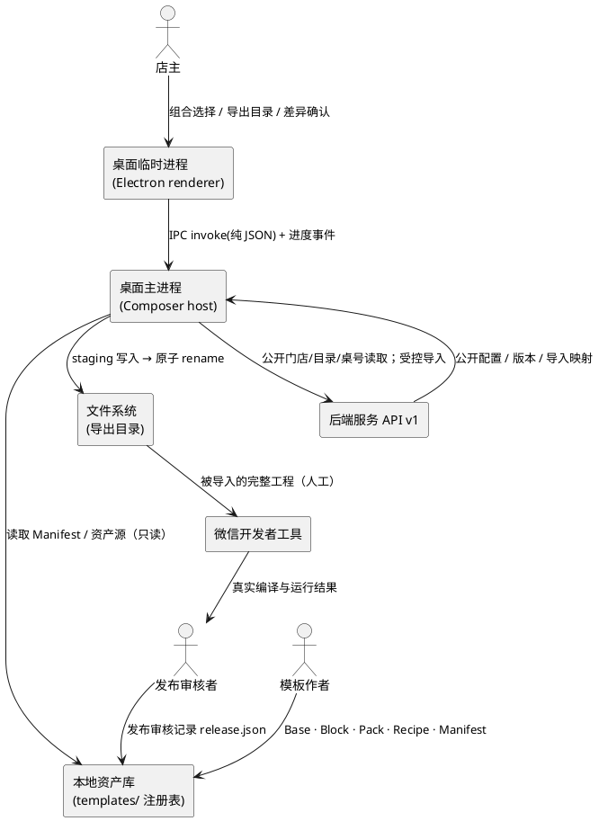
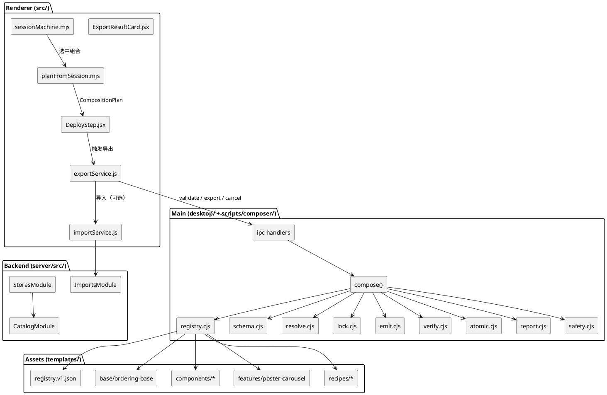
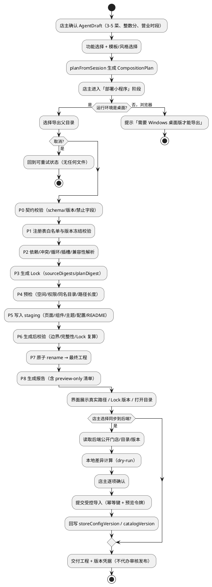
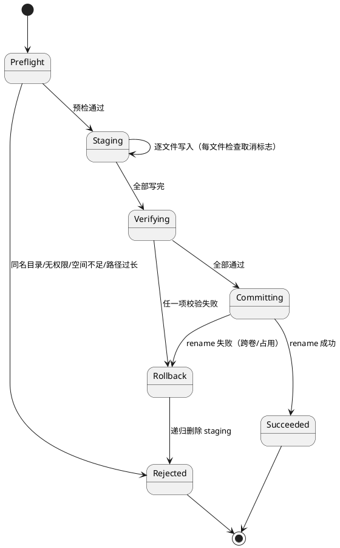
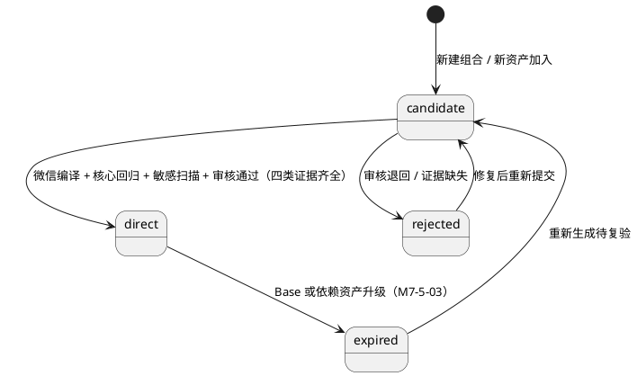

# M5–M7 实现方案：本地 Composer、生成器与后端联通、模板资产扩展

> 状态：**技术设计（HOW）**，编制日期 2026-10-31。本文只回答“用什么结构、什么契约、什么顺序实现”，不包含可直接运行的业务实现代码。
> 上游需求：`docs/M5-M7-本地Composer与模板资产扩展-需求规格.md`（下称“需求规格”）。需求规格定义验收口径，本文不得放宽；两者冲突时以需求规格为准，并在本文第 4 章登记偏差。
> 依据基线：`docs/模板库与组合生成规划.md`、`docs/template-schema.md`、`docs/component-contract.md`、`docs/api.md`、`docs/backend-local-dev.md`、`docs/面向AI的桌面端构建文档.md`、`docs/待完成目标.md`、`docs/handoff/当前工作区交接.md`。
> 本轮边界：**只产出设计文档**。未修改 `src/`、`server/`、`miniprogram/`、`templates/`、`electron/`（实际目录为 `desktop/`）、`package.json` 等任何实现文件；未安装依赖；未执行任何 git 写操作；未触碰工作区既有内容。

---

## 零、设计前置：事实核对、环境边界与默认决策

### 0.1 本轮范围

| 里程碑 | 本文覆盖的实现范围 | 明确不覆盖 |
| --- | --- | --- |
| M5 | 五类契约冻结、Base 提炼门禁、确定性 Composer、原子导出、Electron IPC 接线、桌面部署阶段真实化、打包资源包含修复 | 云端注册表、组合任务队列 |
| M6（B3） | 后端受控导入模块、`storeConfigVersion`、公开桌号、导出配置 v2 与版本映射、桌面端差异确认 | 图片/加料/规格导入、真实微信支付 |
| M7 | 首批资产（1 Base / 3 UI Block / 1 Feature Pack / 3 Recipe）、preview-only 机制、发布状态门禁 | 广告位、优惠券的真实后端能力 |

### 0.2 已核对的仓库事实（设计输入，不是猜测）

| 位置 | 核对到的事实 | 对设计的影响 |
| --- | --- | --- |
| `package.json:12` | `build:win` = `vite build` + `electron-builder --win nsis --x64` | 打包链路入口确定，资源包含修复落在 `build.files` |
| `package.json:38` | `build.files` 仅含 `desktop/**`、`dist/**`、`templates/**`、`scripts/**`、`package.json` | **不含 `src/`**，而导出脚本运行时 import `src/domain/catalog.mjs` → 安装包内必然 `MODULE_NOT_FOUND`（P0，对应 M5-7-01/04） |
| `scripts/generate-mini-program.cjs:35` | `await import('../src/domain/catalog.mjs')` 在 `copyTemplate` 内 | 同上；Composer 必须改为从注册表读取主题与模板元数据，彻底断开对 `src/` 的运行时依赖 |
| `scripts/generate-mini-program.cjs:36` | 固定 4 页 `home/menu/orders/mine` | 与 `miniprogram/` 的 7 页不一致，不能作为 Base |
| `scripts/generate-mini-program.cjs:70` | `fs.cp(sourceRoot, destination)` 整目录复制 | 是 M5-5-09 要退出的“复制基线” |
| `scripts/generate-mini-program.cjs:74-79` | `app.wxss` 字符串锚点替换颜色，`replace` 失败静默 | M5-7-06“主题替换静默失败”的根因 |
| `scripts/generate-mini-program.cjs:20` | `fs.mkdir(destination, { recursive: false })` 直接抛原始错误 | 同名目录冲突没有可读错误，M5-6-04 不满足 |
| `desktop/main.cjs:27-35` | `generator:export` 弹目录选择后同步完成全部工作，只返回 `{cancelled, projectPath}` | 无进度、无取消、无报告、无 Lock，M5-6-01/03/04 全部不满足 |
| `desktop/preload.cjs:3-9` | 暴露 `isDesktop/exportProject/pickMaterials/openPath/saveImage` | 可增量扩展，无需重写 |
| `src/App.jsx:381-403` | 部署阶段用 `setInterval` 900ms 推进 `DEPLOY_STEPS` | M5-6-01 的“定时动画冒充导出” |
| `src/domain/onboardingScript.mjs:35` | `DEPLOY_STEPS = ['校验店铺配置','生成小程序工程','上传到演示环境','等待审核发布']` | 含“上传/审核发布”，违反 M5-6-05/07，必须改为四个真实步骤 |
| `src/state/sessionMachine.mjs:566-570` | `deploy: {status,step,progress}` + `DEPLOY_PROGRESS/DEPLOY_DONE` | 增量扩展点；不新增顶层 phase |
| `src/state/sessionMachine.mjs:552-564` | `APPROVE_IMAGE` 新建 `session-deploy` 会话 | 导出接线的会话入口确定 |
| `miniprogram/app.json` | 7 页面（含 `checkout`、`order-detail`、`merchant-orders`），tabBar 4 项 | Base 页面集合的直接来源 |
| `miniprogram/components/` | 13 个组件：`cart-bar/cart-panel/category-nav/error-banner/fulfillment-switch/loading-block/order-card/order-status/product-card/product-detail/state-view/status-timeline/store-header` | 3 个首批 UI Block 从其中挑选，其余作为 Base 内置组件 |
| `miniprogram/services/` | 9 个服务文件；`request.js` 依赖 `request-core.js`，`platform.js` 封装 `wx.request` | Base 服务层契约的事实基线 |
| `miniprogram/config/env.js:10-11` | `API_BASE_URL` 默认 `http://127.0.0.1:3000/api/v1`，`DEFAULT_STORE_ID` 默认 `store-demo-001` | 导出工程必须用 `store.generated.js` 覆盖，不得依赖 `process.env` |
| `miniprogram/services/store.js` | 仅 `getStore` / `getCatalog`，无版本比对 | M6-3-06 需要新增版本守卫 |
| `server/src/stores/stores.service.ts:5-13` | `PublicStoreView` 无 `configVersion` | 需要新增字段（A2） |
| `server/src/catalog/catalog.service.ts:30-34` | `catalog:{storeId}` 缓存，TTL 300，`invalidate` 已存在 | 导入成功后复用 `invalidate` |
| `server/src/merchant/merchant.service.ts:158-171` | 上下架事务内 `catalogVersion increment` + 事务外 `invalidate` | 导入沿用同一模式，但必须处理“缓存失效失败”语义 |
| `server/prisma/schema.prisma:69-92` | `Store` 有 `catalogVersion`，无 `configVersion`；`StoreTable` 无唯一约束 | A2 需要迁移；桌号名唯一需应用层校验 |
| `server/src/common/auth/store-member.guard.ts:29-37` | Guard 只校验“是否成员”，不区分 `OWNER/STAFF` | M6-1-05 需要新增 `StoreOwnerGuard` |
| `server/src/app.module.ts:19-34` | 已注册 `PrismaModule/CacheModule/AuthModule/StoresModule/OrdersModule/MerchantModule/GenerationModule/AgentModule` | 新增 `ImportsModule` 一处注册即可 |
| `scripts/validate-miniprogram.cjs` | 已覆盖：页面/组件四件套、`usingComponents`、事件处理函数、组件越界（`wx.request`/路由/`globalData`/服务层 require） | 可直接复用于 Composer 产物校验，无需另写一套 |
| `test/generator.test.cjs` | 仅 1 个端到端断言，基于旧复制脚本 | Composer 上线后该测试需改写为“产物契约”测试 |
| `test/desktop-contract.test.cjs` | **不存在**（`npm run test:desktop` 不可用） | 本设计把该文件列入 S3 交付物 |
| `git status`（本轮实测） | 工作区仅 `?? docs/M5-M7-本地Composer与模板资产扩展-需求规格.md` | 见 0.4 与 A9 说明 |

### 0.3 本机现实条件与可执行边界（实测）

| 条件 | 实测结果 | 可执行路径 | 不可越界的标注 |
| --- | --- | --- | --- |
| Node.js | `v24.14.0` | 满足 `>=22`，`fs.statfs`、`fs.cp`、`node:test` 均可用 | — |
| Electron 运行时 | `node_modules/electron/dist/electron.exe` 存在 | `npm run desktop` / `npm run desktop:dev` 可在本机真实运行 | 本地运行 ≠ 安装包验收 |
| electron-builder 缓存 | `%LOCALAPPDATA%\electron-builder\Cache` **不存在**（`NO_CACHE`） | 打包会尝试下载 `winCodeSign`/`nsis` 资源 | 网络不可用时构建必然失败；**禁止**用 `desktop:dev` 冒充 M5-7-02 |
| 微信开发者工具 | `E:\微信web开发者工具\cli.bat` 存在，但服务端口处于关闭状态（交接文档与 B2 记录一致） | 只能“人工 GUI 导入 + 截图/日志”；CLI 需用户在工具“设置→安全设置”中开启端口 | **禁止**把 `npm run mini:check` 写成“微信编译通过” |
| MySQL | `E:\smartstore-tools\mysql\bin\mysqld.exe` ZIP 免安装实例，端口 3306，root 无密码 | 无需管理员权限即可迁移/建库 | MySQL `basedir` 不能含中文，工作区路径含中文 → 数据目录必须留在 ASCII 路径 |
| Redis | WSL Ubuntu 24.04 + `networkingMode=mirrored`，`127.0.0.1:6379` 直通 | `CACHE_DRIVER=redis` 可真实验收；不可用时 `CACHE_DRIVER=memory` 降级 | 内存降级下 `/readyz` 返回 `cache:"memory"`，不得用于“缓存链路已验收”结论 |
| 管理员权限 | 无 | 全部使用免安装/用户目录方案 | 不引入 Docker、Windows 服务、防火墙规则变更 |
| 网络 | 不确定；Electron 运行时已在本地，但 builder 资源未缓存 | 先探测再决定是否打包 | 打包失败必须保留可诊断日志，不得静默跳过 |

### 0.4 与交接文档的差异（必须记录）

`docs/handoff/当前工作区交接.md` 第 2 节声称 `src/App.jsx`、`src/hooks/`、`src/state/sessionMachine.mjs` 等存在**未提交改动**；本轮实测 `git status` 仅有一份未跟踪的需求文档，说明这些改动**已经提交**。

对设计的实际影响：

1. A9“在现有会话式 UI 改动上增量修改、不回滚不重写”的**结论不变**：仍然只做增量，不改写既有 `revealFlush`、`SKIP_INTRO`、阶段会话交接逻辑。
2. “未提交”与“已提交”的差别只影响回滚手段：设计不依赖任何 `git stash`/`checkout` 操作，全部通过新增文件与最小编辑实现，因此无论是否未提交都成立。
3. 本设计的 S3 阶段明确列出对 `src/App.jsx`、`src/state/sessionMachine.mjs`、`src/domain/onboardingScript.mjs` 的**编辑点**（不是重写点），并在测试中锁定既有不变量（`test/session-machine.test.cjs`、`test/reveal-transition.test.cjs` 必须全绿）。

### 0.5 需求编号口径说明

需求规格正文共出现 **95** 个可追踪规则编号（M5-1×8、M5-2×8、M5-4×9、M5-5×10、M5-6×9、M5-7×7、M6-1×10、M6-2×8、M6-3×7、M7-1×4、M7-2×2、M7-3×5、M7-4×4、M7-5×4）。文档自称“94 条”，且第 7 章矩阵把 `M5-4-01…09` 误写为 `M5-3-01…09`（该组实际为 9 条，误记也可能因此少 1）。

本设计的处理：**按正文 95 个编号逐条追踪**（第 2.11 节），不因口径差异漏项；同时保留对 `M5-3` 这一误写的说明，避免实现阶段误建一个不存在的章节。

### 0.6 默认决策记录（A1–A14）与“若被否决”的降级路径

> 用户未逐条答复 A1–A14，按“进入下一阶段即批准文档默认推荐”处理。下表为**显式记录的采纳决策**；每一行都给出否决后的降级设计，保证方案可回退而不推翻整体架构。

| 编号 | 采纳的默认决策 | 设计落点 | 若用户否决，如何降级 |
| --- | --- | --- | --- |
| **A1** | **批准在 B3 范围新增后端受控导入写接口**：`POST /api/v1/merchant/stores/:storeId/imports` + `GET .../imports/:importId`，仅 `OWNER`，带 `Idempotency-Key`，整体事务、差异确认、不回滚既有运营数据 | 2.6.1–2.6.6；新增 `server/src/imports/`；新增 `store_imports` 表 | 不新增写接口 → M6 降级为“只读导出 + 在线 API + 门店配置快照”，导入卡片整体置灰并显示“当前后端不支持受控导入”；`store.generated.meta` 中 `sourceMode="snapshot"`；M6-1-01…10 记为“未完成”而非“已满足”，不得以 `PATCH` 既有上下架接口拼凑导入 |
| **A2** | **新增 `storeConfigVersion`**：`Store` 增 `configVersion Int @default(0)`，公开 `GET /stores/:storeId` 返回 `configVersion`；配置类变更（profile/履约/主题）递增；目录类变更仍只递增 `catalogVersion` | 2.6.2、2.6.5、2.4.3；迁移 `add_store_config_version_and_imports` | 不新增字段 → 以 `(store.updatedAt, catalogVersion)` 组合成 `configVersionRef="updatedAt:2026-11-01T..."`；导出 `meta.storeConfigVersion` 置 `null` 并写 `meta.versionGaps[].code="STORE_CONFIG_VERSION_UNAVAILABLE"`；`mode=production` 直接拒绝导出（不满足 M6-3-04 的上线口径），仅 `mode=development` 允许并标注 |
| **A3** | 纳入 `GET /api/v1/stores/:storeId/tables` 公开只读接口 | 2.6.1、2.6.7；Base 首页桌号选择改为“真实桌号优先，演示桌号兜底” | 不纳入 → 导出工程继续使用 `config/env.js` 的 `DEMO_TABLES` 兜底，但 `store.generated.meta.versionGaps` 记 `TABLES_API_UNAVAILABLE`，堂食选桌在界面上标注“演示桌号” |
| **A4** | Base 保留店主订单台；导出工程按 `memberships` 决定入口显隐，**不做构建期裁剪** | 2.2.2 `pages[]` 中 `merchant-orders` 标记 `audience:"merchant"`，页面内以 `memberships` 判定入口 | 若要“导出时裁剪店主入口” → 在 Plan 增加 `capabilities.merchantConsole=false`，Composer 在 `app.json.pages` 中剔除该页并从 tabBar/我的页移除入口；需新增裁剪白名单，且不得影响顾客闭环 |
| **A5** | **海报素材随 Recipe 打包公开图片**：`templates/features/poster-carousel/1.0.0/assets/*.png` 为仓库内自制演示素材，因此 `poster-carousel` 可标 `online-ready`（无后端依赖） | 2.7.3、2.7.5；资源约束写入 Manifest `visual.assets` | 若要求店主自传素材 → `poster-carousel` 改标 `preview-only`，新增“素材上传/对象存储”后端需求登记（P2），导出工程 `capabilities.previewOnly` 加入该 ID，`order-poster` Recipe 降为候选（Candidate），不进正式模板选择 |
| **A6** | 广告位与优惠券**本轮不实现资产**，仅保留 schema 与 preview-only 机制 | 2.7.6 扩展顺序门禁；2.7.5 状态机 | 若要求本轮同步实现后端营销能力 → 直接超出 M7 上限（需求规格第 10 章第 9 条），需书面修订规格后才进入设计 |
| **A7** | 微信编译验收允许“CLI **或**人工 GUI + 截图/日志”，但**静态校验不得替代** | 2.8.5 证据清单；第 3 章降级路径 | 若坚持 CLI 自动化 → 必须先开启工具服务端口并提供可用 `cli.bat`；否则该验收项标记“阻塞”，不得标“通过” |
| **A8** | 安装包验收依赖可联网或镜像；本机当前**无 builder 缓存**，先做 S3.6 的可行性探测 | 2.5.6、2.8.5 | 若构建环境不可联网 → 交付“本地 Electron 运行 + 资源包含静态断言”作为**部分证据**，M5-7-02 明确记为“未完成”，并在答辩材料中单列 |
| **A9** | **在现有会话式 UI 上增量修改**：`App.jsx` 只替换 DEPLOY 阶段 effect、新增导出回调与结果渲染；`sessionMachine.mjs` 只新增 deploy 相关 action 与 selector；**不回滚、不重写** `revealFlush`/`SKIP_INTRO`/阶段会话交接 | 2.5.4 编辑点表；0.4 事实更正 | 若要求“零改动 src/”→ 导出能力只能通过独立窗口（`desktop/export-window.html`）提供，会话 UI 保持演示动画但**必须标注“演示”**；代价是 M5-6-01/03/07 只能部分满足，需用户书面接受 |
| **A10** | 导出配置采用 `schemaVersion` 递增到 **2**，旧 v1 产物**明确拒绝**（`STORE_CONFIG_VERSION_UNSUPPORTED`），不做兼容读取 | 2.4.3 | 若需兼容 v1 → Base 增加 `configSchemaVersion` 分支读取器；但必须在工程说明中标注“v1 兼容模式”，并禁止用于正式 Recipe |
| **A11** | 候选 Recipe 发布审核**人工执行**，审核记录写入 `templates/recipes/<id>/<version>/release.json`（含审核人、时间、证据路径），单人不要求双人复核 | 2.7.4 | 需双人复核 → `release.json.approvals[]` 要求两条记录且 `reviewer` 不同；门禁脚本增加最小审批数校验 |
| **A12** | 首批 Recipe 名称与主题由实现方自主决定（视觉风格自由） | 2.7.4 Recipe 清单 | 若需固定命名 → 仅调整 `templates/recipes/*/recipe.json` 的 `displayName` 与 `themeTokens`，不影响 Composer |
| **A13** | 商品图片、加料、规格**不进入 M6 导入范围**，导入结果 `notImported[]` 显式列出 | 2.6.4 | 若需要图片导入 → 必须先补对象存储与上传接口，M6 顺延为两个子阶段，`sourceDraftDigest` 需覆盖图片摘要 |
| **A14** | 本轮**不修改** `docs/后端待实现接口清单.md`，只给出可合并的建议文本 | 附录 3.5（建议文本块） | 若授权合并 → 由后续实现轮次在 S4 一并写入，并保持与 `docs/api.md` 同版本 |

### 0.7 新增决策（A15–A17，实现阶段必须先确认的补充项）

| 编号 | 默认决策 | 理由 | 否决降级 |
| --- | --- | --- | --- |
| A15 | 桌面端调用受控导入时，**开发环境**使用 `POST /auth/wechat/login` + `demoOpenId=demo-owner-001` 获取 Token；`ALLOW_DEMO_LOGIN=false` 时导入入口禁用并提示“请在微信小程序端完成导入” | 桌面端目前**没有登录体系**（交接第 3 节、项目概览风险清单），而 M6-1-05 要求真实 `OWNER` 身份；这是唯一不改动鉴权架构的可行路径 | 若要桌面端真实店主登录 → 需新增独立店主登录与 Token 存储（B5 范围），M6 本轮只能交付“只读导出 + 小程序侧导入” |
| A16 | Base 资产目录采用 `templates/base/<id>/<version>/`，**不引入符号链接**（Windows 无管理员权限时 symlink 不可靠） | 本机无管理员权限，`mklink /D` 对普通用户失败；用“内容一致性断言”替代链接 | 若允许符号链接 → 可减少复制体积，但必须增加链接逃逸校验（M5-1-05 禁止 symlink 逃逸） |
| A17 | Composer **不引入任何新的 npm 依赖**（JSON Schema 校验、glob、hash 全部用 Node 内置能力实现） | 用户要求不得安装依赖；离线环境不可控 | 若允许引入 `ajv`/`fast-glob` 可简化 schema 校验，但必须在离线镜像可用后另行审批 |

---

# 一、需求与存量功能关系分析

本章目的：把 95 条规则映射到**已存在的代码位置**，明确“已实现 / 需扩展 / 需新增”，并识别存量约束，避免设计落在空中。

## 1.1 需求功能与存量功能对比

### 1.1.1 已实现功能

| 需求功能 | 存量功能 | 代码位置 | 匹配度 |
| --- | --- | --- | --- |
| 本地生成小程序工程（目录创建、配置写入、README） | `writeProject` + `copyTemplate` + `writeStoreConfig` | `scripts/generate-mini-program.cjs:14-112` | 50%（能力存在，但路径是复制而非组合） |
| 选择保存目录并导出（桌面） | `generator:export` 弹窗 + 调用 `writeProject` | `desktop/main.cjs:27-35` | 75%（IPC 形态可复用，缺进度/取消/错误分类） |
| 导出后打开目录 | `generator:open-path` → `shell.openPath` | `desktop/main.cjs:56-59` | 100% |
| 小程序公开门店配置（名称/地址/电话/营业时间/履约/主题） | `store.generated.js` 渲染数据结构 | `scripts/generate-mini-program.cjs:50-68` | 75%（字段在，但版本/白名单/契约不满足 M6-3） |
| 主题颜色写入 WXSS 变量 | `app.wxss` 四处 `--store-*` 替换 | `scripts/generate-mini-program.cjs:72-79` | 50%（锚点静默失败，违反 M5-5-10/M5-7-06） |
| 完整点餐闭环的 Base 候选（7 页面/13 组件/服务层/领域层） | `miniprogram/` 参考工程 | `miniprogram/app.json`、`miniprogram/pages/`、`miniprogram/components/`、`miniprogram/services/`、`miniprogram/domain/` | 75%（可作为 Base 源，但缺插槽协议与 Manifest） |
| 组件通信铁律（只 props/events） | 13 组件实现 + 静态校验 | `docs/component-contract.md`、`scripts/validate-miniprogram.cjs:372-414` | 100%（可直接作为 M5-2-06/M7-3-04 的检查器） |
| 公开门店与目录读取（含 `catalogVersion`） | `StoresService` / `CatalogService` | `server/src/stores/stores.service.ts`、`server/src/catalog/catalog.service.ts` | 75%（缺 `configVersion`） |
| 目录缓存失效 | `CatalogService.invalidate` + 上下架事务 | `server/src/catalog/catalog.service.ts:100-102`、`server/src/merchant/merchant.service.ts:158-171` | 100%（导入复用即可） |
| 门店成员鉴权 | `SessionAuthGuard` + `StoreMemberGuard` | `server/src/common/auth/` | 75%（缺 OWNER 限定） |
| 幂等键模式 | `IdempotencyKey` 表 + 订单幂等实现 | `server/prisma/schema.prisma:214-230`、`server/src/orders/` | 75%（模式可借鉴，需独立表避免污染订单语义） |
| AgentDraft 本地校验（3–5 菜、整数分、营业时段） | `validateAgentDraft` / `normalizeBusinessHoursText` | `src/domain/agentDraft.mjs:218-332` | 75%（可作为导入前本地门槛，但需补“后端能力可用性”判断） |
| 会话阶段状态机与消息揭示 | `sessionMachine` + `useSequentialReveal` | `src/state/sessionMachine.mjs`、`src/hooks/` | 75%（部署阶段仍是演示动画） |

### 1.1.2 需要扩展的功能

| 需求功能 | 存量功能 | 差异说明 | 扩展方向 |
| --- | --- | --- | --- |
| 真实导出（M5-6-01） | 部署阶段定时器 | 输入：无（只有 `setInterval`）；输出：无真实产物；业务逻辑：进度与真实任务无关 | 在 `App.jsx` 的 DEPLOY effect 内改为调用 `exportService`；`sessionMachine` 新增 `DEPLOY_START/DEPLOY_STAGE/DEPLOY_SUCCESS/DEPLOY_FAILURE/DEPLOY_CANCEL`；`DeployStep` 增加 `onStart/onRetry/onCancel/onOpenPath/result` props |
| 导出错误可读（M5-6-04） | `writeProject` 抛原始 `Error` | 输入：原始异常；输出：无错误码；边界：磁盘满/只读/同名目录未区分 | Composer 统一错误码 + `desktop` 侧包装为 `{status:'failed', code, message, retryable}` |
| 导出目录保护（4.2.5） | `mkdir recursive:false` 抛 `EEXIST` | 缺少“同名工程目录”识别与建议名 | 预检阶段显式检测 + 返回 `{code:'TARGET_EXISTS', suggestedName}` |
| 主题变量写入（M5-5-10） | 字符串 `replace` | 锚点缺失静默通过 | 改为“Token 表驱动生成”：Base 提供 `theme.tokens.json` 与 `app.wxss` 的 Token 占位注释，Composer 生成 `theme.generated.wxss` 并由 `app.wxss` `@import`；锚点缺失 → `THEME_TOKEN_MISSING` 失败 |
| 公开配置字段白名单（M6-3-01） | 渲染数据含 `template`、`icons`、`capabilities.available` | 字段集合未冻结，`meta` 缺失 | `store.generated.js` 升到 `schemaVersion=2`，用字段白名单生成器；多余字段在生成前拒绝 |
| Base 提炼（M5-2-01） | `miniprogram/` 手写工程 | 无 Manifest、无插槽、无注册表 | 复制到 `templates/base/ordering-base/1.0.0/`，补 `manifest.json` + 插槽锚点 + Token 表；`miniprogram/` 保留为验证工程并加“内容一致性断言” |
| 导入幂等（M6-1-02） | 只有订单幂等 | 实体不同、语义不同（门店配置而非订单） | 新建 `store_imports` 表，唯一键 `(storeId,userId,idempotencyKey)`；不与 `idempotency_keys` 混用 |
| 权限（M6-1-05） | `StoreMemberGuard` 允许 OWNER/STAFF | 缺角色限定 | 新增 `StoreOwnerGuard`（复用 membership 查询，校验 `role===OWNER`），仅用于导入路由 |
| 目录版本递增（M6-1-09） | 上下架已递增 | 导入同时影响门店配置与目录，需双版本 | 事务内 `catalogVersion+1` 与 `configVersion+1`；事务后 `invalidate`，失败写 `cacheRefreshed=false` |
| 导出配置版本映射（M6-3-04） | 无 `meta` | 缺 6 类版本 | `meta` 必填九项（见 2.4.3），无后端能力时按 A2 降级规则处理 |
| 版本不一致提示（M6-3-06） | `getCatalog` 无版本比对 | 缺 `versionGuard` | Base 新增 `domain/versionGuard.js` 纯函数 + 首页 `onLoad` 比对 `meta.catalogVersion` 与在线 `version` |

### 1.1.3 需要新增的功能或接口

**A. 契约与注册表（M5-1 / M5-4 / M7-3）**

1. `templates/registry/registry.v1.json`：资产白名单索引 + `registryVersion` 冻结。
2. 五类 Schema：`base.manifest.v1`、`manifest.v1`、`slots.v1`、`composition.v1`、`lock.v1`（字段级定义见 2.2）。
3. `scripts/composer/` 工具链：`schema.cjs`（内置校验器）、`registry.cjs`（加载/冻结/漂移检测）、`manifest-impl-check.cjs`（声明与实现一致）、`resolve.cjs`、`lock.cjs`、`emit.cjs`、`safety.cjs`、`atomic.cjs`、`report.cjs`。
   - 输入：Plan + 注册表根目录 + 门店资料；输出：规范化结果/Lock/工程/报告；依赖：仅 Node 内置模块。

**B. 确定性生成（M5-5）**

4. `compose()` 流水线（P0–P8），保证“同 Lock 同产物”。
5. `composition.lock.json` 生成与 `outputDigest` 计算。
6. `generation-report.json`（机器可读）+ `生成报告.md`（人类可读）。

**C. 桌面接线（M5-6）**

7. IPC：`composer:validate`、`composer:export`、`composer:cancel`、`composer:read-report`、`composer:progress`（主→渲染）。
8. `src/services/exportService.js`（唯一导出入口，含浏览器降级）。
9. `src/composition/planFromSession.mjs`（会话状态 → CompositionPlan 的纯函数）。
10. `src/components/build/DeployStep.jsx` 升级（4 真实步骤 + 成功/失败/取消/冲突卡）。

**D. 后端受控导入（M6-1）**

11. `server/src/imports/{imports.module,imports.controller,imports.service,imports.dto}.ts`。
12. Prisma：`Store.configVersion`、`StoreImport` 模型 + 迁移。
13. `StoreOwnerGuard`。
14. `GET /stores/:storeId/tables`（A3）。

**E. 导出配置 v2（M6-3）**

15. `store.generated.js` v2 契约与生成器（字段白名单 + `meta` + `demoPaymentDisclaimer`）。
16. Base 侧 `domain/versionGuard.js` + 首页刷新提示。

**F. 资产扩展（M7）**

17. `templates/base/ordering-base/1.0.0/`（含 `manifest.json`、`slots.json`、`theme.tokens.json`、`src/`）。
18. `templates/components/{store-header,product-card,cart-bar}/1.0.0/`。
19. `templates/features/poster-carousel/1.0.0/`（含 `hero-carousel` UI Block、`assets/`、`preview/`）。
20. `templates/recipes/{order-classic,order-poster,order-classic-candidate}/…`。

**G. 验收与测试（M10）**

21. 根目录新增 Composer 测试 8 个文件 + `test/desktop-contract.test.cjs`；服务端新增 2 个测试文件。

## 1.2 存量功能详细分析

### 1.2.1 导出链路（`scripts/generate-mini-program.cjs`）

**接口契约**

- `writeProject(parentAbsPath, payload)` → `Promise<string>`（最终工程目录绝对路径）。
  - `payload`：`{ storeName, template{id}, features[], generatedModules[], pendingFeatures[], theme{id,colors[4]}, icons[{id,label,tint,dataUrl}] }`。
  - 副作用：在 `parentAbsPath` 下创建 `<safeProjectName(storeName)>` 目录并写入全部文件；失败时 `fs.rm(destination, {recursive:true, force:true})`。
- `safeProjectName(name)`：小写化 + 非字母数字中文替换为 `-` + 截断 36 字符。

**业务规则**

1. `payload` 必须是对象，否则抛 `A project configuration is required.`（英文，未本地化）。
2. 店名默认“我的餐馆”，截断 48 字符。
3. 页面固定 4 个；tabBar 固定 4 项；`appid` 固定 `touristappid`。
4. 图标仅接受 `data:image/png;base64,` 且 ≤10MB，文件名由 label slug 化。
5. `capabilities` 由 `features/generatedModules/pendingFeatures` 直接映射，**不含** `previewOnly/onlineReady/pendingBackend` 语义。

**扩展点**

- 无钩子。唯一可复用能力：目录创建、`writeJson`（2 空格 + 结尾换行）、`writeStoreConfig`（`module.exports = <JSON>;`）、图标落盘、README 渲染。
- 这些**格式化细节**（2 空格缩进、`\n` 结尾、`module.exports`）对确定性至关重要，Composer 必须沿用同一格式约定。

**约束（不可违背）**

- 配置必须是 `.js` 而非 `.json`（`docs/template-schema.md` 第 1 节：小程序 `require` 只解析 `.js`，写成 `.json` 会导致白屏）。
- 主题色必须是 `#RRGGBB` 大写规范化。
- 导出工程不得含密钥（当前 README 文案符合，但需扫描强制）。

### 1.2.2 会话状态机与部署阶段

**接口契约**

- `reducer(state, action)` 纯函数；`action.type` 枚举含 `DEPLOY_PROGRESS{step,progress}`、`DEPLOY_DONE`。
- `deploy` 切片：`{status:'idle'|'running'|'done', step:number, progress:number}`。**注意：没有 `failed`/`cancelled` 状态**。
- `APPROVE_IMAGE` → `createStepSession({phase: DEPLOY, id:'session-deploy', ...})`，旧会话标 `done`。
- `PHASES.DEPLOY` 是 `CLOSED_PHASES` 之一（`src/state/constants.mjs:59`），Composer 不在该阶段显示。

**业务规则**

1. 部署阶段由 `useEffect` + `setInterval` 驱动，900ms/步，4 步后 `DEPLOY_DONE`。
2. `deployStarted` ref 防止重复启动；phase 离开时重置。
3. 消息揭示 `revealFlush` 与阶段切换互不影响（现有关键不变量）。

**扩展点**

- 新增 action 是安全的（未知 action 走 `default: return state`）。
- `DeployStep` 组件 props 由 `App.jsx` 传入，可扩展 props 而不破坏既有调用（有默认值）。

**约束**

- 不得新增顶层 phase（模板库规划与桌面文档均如此要求）。
- 不得修改 `createStepSession` 与 `handoff` 语义（M5-6-08）。
- `CLOSED_PHASES` 决定 Composer 可见性，导出交互必须放在阶段面板内，不能复用底部 Composer。

### 1.2.3 Electron 主进程与 preload

**接口契约**

- `ipcMain.handle('generator:export', (_e, payload) => ({cancelled:boolean, projectPath?:string}) | {cancelled:false, projectPath}`)。
- `ipcMain.handle('generator:open-path', (_e, target) => string`（`shell.openPath` 返回空串表示成功）。
- `preload` 通过 `contextBridge.exposeInMainWorld('smartStore', Object.freeze({...}))` 暴露；`contextIsolation:true`、`sandbox:true`、`nodeIntegration:false`。

**约束**

- 渲染进程**不能**直接 `require('node:fs')`（`sandbox:true`）→ 所有文件操作必须在主进程。
- 因此 Composer 必须以 CommonJS 形式在**主进程**运行（`require` 可用），渲染进程只传纯 JSON。
- `payload` 必须可结构化克隆（不能传函数、`Map`、`Date` 对象需转字符串）。

### 1.2.4 `miniprogram/` 参考工程（Base 候选）

**能力事实**：7 页面、13 组件、9 服务文件、7 领域文件、`state/visit-store.js`；`validate-miniprogram.cjs` 实测 0 错 0 警。

**约束**

1. 组件只 props/events（静态校验强制）。
2. `wx.request` 只允许出现在 `services/platform.js`。
3. 页面 `require` 路径必须带 `.js`。
4. `app.json` 的 `pages`/`tabBar` 与磁盘一一对应。
5. 现有页面**没有插槽协议**，必须新增锚点与占位兜底，且不能改变现有渲染结果。

### 1.2.5 后端 `stores` / `catalog` / `merchant` 与 Prisma

**接口契约**

- `GET /stores/:storeId` → `{id,name,address,phone,businessHours,fulfillment{dineIn,takeaway},theme{backgroundColor,textColor,primaryColor}}`，无鉴权。
- `GET /stores/:storeId/catalog` → `{storeId,version,updatedAt,categories[{id,name,sortOrder,products[]}]}`，缓存键 `catalog:{storeId}`。
- `PATCH /merchant/products/:id/availability` → 事务内 `available` 更新 + `catalogVersion+1`，事务外 `invalidate`。

**业务规则**

- 金额 `priceCents` 整数；`UnsignedInt`。
- `Store.businessHours` 为 `VarChar(64)` 单字符串（现有以逗号分隔多段）。
- `StoreTable` 无唯一约束，桌号唯一需应用层保证。
- 错误统一 `AppError(status, code, message, details)`。

**约束**

- `businessHours` 长度上限 64：3 段 `HH:MM-HH:MM` 共 35 字符，安全；但任意超长输入必须 `422`。
- 所有写操作必须经 `SessionAuthGuard`；导入还需 `OWNER`。
- 不得绕过 Prisma 直接 SQL（现有全部走 Prisma）。

### 1.2.6 静态校验与测试设施

- `scripts/validate-miniprogram.cjs` 面向 `miniprogram/`，路径硬编码。Composer 产物校验需将其**参数化**（新增 `--root` 参数或抽出 `runChecks(root)`），属于小范围重构，不改变现有行为。
- `node --test test/*.test.cjs` 是根目录测试入口；`server` 用 Vitest + 真实 MySQL 测试库。
- 现有 `test/generator.test.cjs` 断言旧复制脚本行为（如 `priceText`、`app.pages.length===4`），Composer 上线后**必须改写**，不能保留为“旧路径仍可用”。

## 1.3 存量约束清单（设计必须遵守）

| 编号 | 约束 | 来源 | 设计应对 |
| --- | --- | --- | --- |
| C1 | 小程序配置必须是 `.js`（`module.exports`），不能是 `.json` | `docs/template-schema.md` §1 | 生成器沿用 `writeStoreConfig` 格式 |
| C2 | 组件不得触网/固定路由/全局业务状态/服务层 | `docs/component-contract.md` §2 | 复用 `validate-miniprogram` 越界检查；Composer 生成后强制扫描 |
| C3 | `wx.request` 只允许 `services/platform.js` | `validate-miniprogram.cjs:471-473` | 生成的页面/服务保持该结构 |
| C4 | 渲染进程无 Node 能力（sandbox） | `desktop/main.cjs:20` | Composer 只在主进程运行 |
| C5 | 无新依赖安装 | 本轮用户约束 | Schema 校验、glob、hash 全部内置实现 |
| C6 | 业务金额只用整数分，服务端计算 | 偏好与 `docs/api.md` §1 | 导出配置只透传 `priceCents`，不写 `priceText` |
| C7 | 后端 API 只能调用已冻结接口或第 9 章批准的新接口 | 需求 4.5.4 | 新增接口先改 `docs/api.md`（S4 前置任务） |
| C8 | 不得新增顶层 phase | 桌面文档 §9 | 导出入驻 DEPLOY 面板 |
| C9 | `businessHours` 列长 64 | `schema.prisma:74` | 导入前校验总长 |
| C10 | 安装包 `files` 不含 `src/` | `package.json:38` | Composer 不 runtime import `src/`；同时修 `files` |
| C11 | 微信 CLI 不可用 | 本机实测 | 静态校验 + 人工证据双轨 |
| C12 | 无管理员权限 | 环境实测 | 免安装 MySQL/WSL Redis/用户目录 |
---

# 二、增量设计方案

## 2.1 实现模型

### 2.1.1 上下文视图



通信约定：

| 链路 | 协议 | 频率 | 说明 |
| --- | --- | --- | --- |
| renderer → main | `ipcRenderer.invoke`（结构化克隆 JSON） | 每次导出 1 次 + 取消 0–1 次 | 入参 ≤ 256 KB；不接受函数/路径对象 |
| main → renderer | `webContents.send('composer:progress')` | 每阶段 1 次 + 每 50 个文件 1 次 | 只含 `{taskId,stage,step,total,message}` |
| main → 资产库 | `fs.readFile` | 每次导出 1 遍 | 只读，不写回注册表 |
| main → 后端 | HTTPS JSON（`/api/v1`） | 导出前 2–3 次 GET；导入 1–2 次 POST/GET | 超时 10s；失败不阻塞本地导出 |
| main → 文件系统 | `fs` | 每文件 1 次写 | 全部在 staging 内，最后 1 次 rename |

### 2.1.2 服务/组件总体架构



模块职责与依赖方向（**单向，不反向**）：

| 模块 | 职责 | 输入 | 输出 | 允许依赖 |
| --- | --- | --- | --- | --- |
| `planFromSession` | 会话状态 → `composition.v1` 纯函数 | `state.store/agentDraft/features/visual/build` | Plan | 无（纯函数） |
| `exportService` | 渲染进程唯一导出入口；环境判定与错误归一化 | Plan + 门店资料 | `ExportResult` | `window.smartStore` |
| `ipc handlers` | 参数白名单、进度转发、取消标志、结果包装 | IPC 入参 | `ExportResult` | `scripts/composer` |
| `compose()` | 编排 P0–P8，不改写契约 | Plan/资产/门店资料 | Lock + 工程 + 报告 | 下列 `*.cjs` |
| `registry.cjs` | 加载索引、版本冻结、漂移检测、资产定位 | `templates/registry` | 解析后资产表 | `schema.cjs` |
| `resolve.cjs` | 白名单/版本/依赖/冲突/插槽/兼容性 | Plan + 资产表 | `ResolvedGraph` | `schema.cjs` |
| `lock.cjs` | 生成 Lock 与摘要 | `ResolvedGraph` | `lock.v1` | `safety.cjs` |
| `emit.cjs` | 生成文件到 staging | `ResolvedGraph` + Lock | `EmittedFile[]` | `atomic.cjs` |
| `verify.cjs` | 产物边界/完整性/可复现校验 | staging 目录 | `VerifyResult` | `atomic.cjs` |
| `atomic.cjs` | staging 生命周期、预检、rename、清理 | 目标父目录 | 最终路径 | 无 |
| `safety.cjs` | 秘密/路径/禁止字段扫描 | 文本或 Buffer | 命中列表 | 无 |
| `report.cjs` | 生成报告（机器 + 人类） | 全流程上下文 | `generation-report.json`/`.md` | 无 |
| `ImportsModule` | 受控导入、幂等、差异、事务 | DTO + Token | `ImportResult` | Prisma/Cache/OwnerGuard |

### 2.1.3 端到端数据流



时序要点（与 2.1.3 图互补）：

1. **Plan 只有一份**：桌面 React 预览、Composer、`mini:check` 共用同一 Plan（M5-6-06）。
2. **Lock 只由 Composer 生成**：任何界面不得自行拼 Lock。
3. **后端调用不进入生成主链**：后端不可用不得阻塞本地导出（本地导出是 M5 验收，后端联通是 M6 增量）。
4. **导入在导出之后**：先有真实工程设计，再把门店资料同步到后端；导入失败不回滚工程（工程可重导出）。
5. **版本回流**：导入成功后 `storeConfigVersion/catalogVersion` 写入下一份导出配置；当前工程可提示“版本已更新，建议重新导出”。

### 2.1.4 目录与文件规划

```text
templates/
├─ registry/
│  ├─ registry.v1.json              # 唯一白名单索引 + registryVersion
│  ├─ registry.lock.json            # 冻结摘要（registryVersion + contentDigest）
│  └─ schema/
│     ├─ base.manifest.v1.json      # Base 契约 Schema（文档型，供人读 + 校验器内置规则）
│     ├─ manifest.v1.json
│     ├─ slots.v1.json
│     ├─ composition.v1.json
│     ├─ lock.v1.json
│     ├─ store.generated.v2.json
│     └─ fixtures/
│        ├─ valid/*.json            # 合法样例（每类至少 1 份）
│        └─ invalid/*.json          # 非法样例（每类规则至少 1 份）
├─ base/ordering-base/1.0.0/
│  ├─ manifest.json                 # kind=base
│  ├─ slots.json                    # 页面插槽声明
│  ├─ theme.tokens.json             # 主题 Token 白名单 + 默认值 + 对比度配对
│  ├─ src/                          # 页面/组件/服务/领域/样式/入口
│  └─ wechat/                       # project.config.json 模板、sitemap
├─ components/
│  ├─ store-header/1.0.0/{manifest.json,src/}
│  ├─ product-card/1.0.0/{manifest.json,src/}
│  └─ cart-bar/1.0.0/{manifest.json,src/}
├─ features/
│  └─ poster-carousel/1.0.0/
│     ├─ manifest.json
│     ├─ src/components/hero-carousel/
│     ├─ src/pages/home.extend.json # 插槽接入声明（不复制整页）
│     ├─ preview/{normal,empty,error,long}.json
│     └─ assets/{poster-1.png,poster-2.png,poster-3.png}
├─ recipes/
│  ├─ order-classic/1.0.0/{recipe.json,plan.json,release.json}
│  ├─ order-poster/1.0.0/{recipe.json,plan.json,release.json}
│  └─ order-classic-candidate/0.1.0/{recipe.json,plan.json,candidate.json}
└─ mini-program/                    # 历史静态模板：M5 后只读归档，不再作为导出源

scripts/composer/
├─ index.cjs          # compose() 唯一入口
├─ registry.cjs
├─ schema.cjs
├─ manifest-impl-check.cjs
├─ resolve.cjs
├─ lock.cjs
├─ emit.cjs
├─ verify.cjs
├─ atomic.cjs
├─ safety.cjs
├─ report.cjs
├─ digest.cjs
└─ cli.cjs            # node scripts/composer/cli.cjs --plan <file> --out <dir>

src/
├─ composition/
│  ├─ planFromSession.mjs
│  └─ themePresets.mjs        # 主题预设（Token 全量，来自 registry，不重复定义）
├─ services/
│  ├─ exportService.js
│  └─ importService.js
└─ components/build/
   ├─ DeployStep.jsx（改造）
   └─ ExportResultCard.jsx（新增）

server/src/imports/
├─ imports.module.ts
├─ imports.controller.ts
├─ imports.service.ts
├─ imports.dto.ts
└─ import-diff.ts            # 纯函数：差异计算

server/prisma/
├─ schema.prisma（增量：Store.configVersion、StoreImport、StoreTable 唯一性注释）
└─ migrations/<ts>_add_imports_and_config_version/migration.sql
```

**命名与版本纪律**

- 资产目录必须 `templates/<kind-dir>/<id>/<semver>/`，`manifest.json` 内的 `identity.version` 必须与目录名一致（不一致 → `MANIFEST_VERSION_MISMATCH`）。
- `registryVersion` 采用 `YYYY.MM.<rev>`（如 `2026.11.0`），只允许显式写死。
- Composer 版本 `COMPOSER_VERSION`（`0.1.0`）定义在 `scripts/composer/version.cjs`，Lock 写入。

---

## 2.2 五类契约（字段级 Schema）

> 本节是**契约**，不是实现。所有字段名、类型、必填性、取值范围、拒绝条件在此冻结；实现阶段不得自行增减。

### 2.2.1 通用约定

| 约定 | 规则 |
| --- | --- |
| `schemaVersion` | 每份契约首字段；`base.manifest.v1` / `manifest.v1` / `slots.v1` / `composition.v1` / `lock.v1` |
| 版本 | 语义化 `MAJOR.MINOR.PATCH`；资产内容变化必须递增（M5-1-02、4.4.4） |
| ID | `^[a-z][a-z0-9]*(-[a-z0-9]+)*$`，长度 3–48；注册表内全局唯一（跨 kind） |
| 插槽 ID | kebab-case（`home-hero`、`home-marketing`、`menu-aside`）。**需求文档中 `home.hero` 为示意写法，实现统一 kebab-case**，原因是 WXML 表达式中带点的字符串键容易与成员访问混淆 |
| 路径 | 只能是包内相对 POSIX 路径；禁止 `..`、`/` 开头、盘符、UNC、反斜杠、符号链接（M5-1-05） |
| 颜色 | `^#[0-9A-F]{6}$`（大写规范化） |
| 金额 | 整数分；禁止字符串、浮点、`priceText` 进入契约 |
| 禁止字段 | `source/code/script/command/url(http…)/token/secret/password/apiKey/priceText/totalCents` 等（M5-1-08、M5-4-08） |
| 可复现字段 | `generatedAt`、`reportTime`、`hostname`、`durationMs` 仅允许出现在报告与 Lock 的时间字段，**不参与**摘要比较 |

### 2.2.2 Base 契约（`base.manifest.v1`）

Base 契约 = `manifest.v1` 的 Base 特化 + 页面/插槽/Token/服务声明。文件：`templates/base/<id>/<version>/manifest.json`。

| 字段 | 类型 | 必填 | 约束 | 说明 |
| --- | --- | --- | --- | --- |
| `schemaVersion` | string | 是 | `"base.manifest.v1"` | — |
| `identity` | object | 是 | 见 Manifest | `kind` 必须为 `base` |
| `baseRange` | string | 是 | 精确 `semver` 或 `^x.y.z` | Base 自身版本，供其他资产引用 |
| `apiContracts` | string[] | 是 | 至少 1 项，如 `["storefront.v1"]` | 兼容的后端契约列表（M5-4-09） |
| `minWechatLib` | string | 是 | 形如 `"2.32.0"` | 最低基础库（需求 4.5.1） |
| `entry` | object | 是 | `{root:"src", appJs:"app.js", appJson:"app.json", appWxss:"app.wxss"}` | 入口必须存在 |
| `pages` | PageDecl[] | 是 | ≥1，`pageId` 唯一 | 见下表 |
| `themeTokens` | TokenDecl[] | 是 | ≥4（背景/主色/强调/文字） | 见下表 |
| `layouts` | string[] | 是 | 如 `["home.standard","menu.standard"]` | Plan 的 `layout` 必须在此白名单 |
| `services` | ServiceDecl[] | 是 | 至少 `request/store/order/auth/merchant` | 声明服务文件与可调用端点 |
| `builtinComponents` | string[] | 是 | 资产 ID 或本地路径 | Base 内置组件（不可被 Plan 覆盖） |
| `excludedCapabilities` | string[] | 是 | 必须包含 `ad-slot`、`coupon`、`poster-carousel`，且这三个能力不得出现在 Base 的可渲染页面/组件中 | M5-2-04 排除项；命中则注册表校验失败 |
| `storeConfigSchema` | number[] | 是 | 如 `[2]` | 支持的 `store.generated.schemaVersion` |
| `slots` | object | 是 | `slots.v1` 结构（见 2.2.4） | 页面插槽声明 |

**PageDecl**

| 字段 | 类型 | 必填 | 约束 |
| --- | --- | --- | --- |
| `pageId` | string | 是 | `home/menu/orders/mine/checkout/order-detail/merchant-orders` |
| `path` | string | 是 | `pages/<pageId>/index`，必须四件套齐全 |
| `layout` | string | 是 | 必须在 Base `layouts` 内 |
| `navTitle` | string | 否 | 默认标题 |
| `tabBar` | object\|null | 否 | `{index,text,iconPath?,selectedIconPath?}` |
| `audience` | `"customer"\|"merchant"` | 是 | `merchant` 页允许按 `memberships` 隐藏入口（A4） |
| `required` | boolean | 是 | `home/menu/orders/mine` 必须 `true` |
| `slots` | string[] | 否 | 该页面拥有的插槽 ID（必须与 `slots` 对应） |

**TokenDecl**

| 字段 | 类型 | 必填 | 约束 |
| --- | --- | --- | --- |
| `key` | string | 是 | camelCase，如 `primaryColor` |
| `cssVar` | string | 是 | `--store-primary` |
| `kind` | `"color"` | 是 | 本期仅颜色 |
| `default` | string | 是 | `#RRGGBB` |
| `contrastWith` | string\|null | 否 | 需要满足 4.5:1 的配对 Token（如 `pageBackground`） |

**ServiceDecl**

| 字段 | 类型 | 必填 | 约束 |
| --- | --- | --- | --- |
| `name` | string | 是 | `request/store/catalog/order/auth/merchant/session` |
| `file` | string | 是 | 相对 `entry.root` 的 `.js` 路径 |
| `endpoints` | string[] | 是 | 方法+路径，如 `GET /stores/:storeId` |
| `contract` | string | 是 | 如 `storefront.v1` |

**Base 必备能力清单（M5-2-03 的可执行断言）**

| 能力 | 断言方式 |
| --- | --- |
| 工程骨架 | `entry` 四件套存在且可 JSON 解析 |
| 页面注册与导航 | `app.json.pages` 与 `pages[].path` 一一对应；tabBar 页面均在 pages |
| 全局主题 Token | `themeTokens` ≥4，且 `app.wxss` 存在 `@import "theme.generated.wxss";` |
| 公开配置加载 | `src/config/store.generated.js` 存在且被 4 个 tab 页面 require |
| 服务层请求与错误归一化 | `services/request.js` + `services/platform.js` 存在；`wx.request` 只在 `platform.js` |
| 加载/空/异常状态 | `components/state-view`、`loading-block`、`error-banner` 存在 |
| 核心 7 页面 | `pages[]` 含 7 个 `pageId` |
| 插槽协议 | `slots` 至少 `home-hero` 与 `home-marketing`，且页面 WXML 有对应锚点 |
| 店主订单台 | `pages/merchant-orders` 存在，`audience:"merchant"` |

### 2.2.3 Manifest 契约（`manifest.v1`）

适用于 `ui-block` / `feature-pack` / `recipe`（Base 用 2.2.2 扩展）。

| 字段 | 类型 | 必填 | 约束 / 说明 |
| --- | --- | --- | --- |
| `schemaVersion` | string | 是 | `"manifest.v1"` |
| `identity` | `{id,version,kind,registryVersion}` | 是 | `kind ∈ base/ui-block/feature-pack/recipe`；`registryVersion` 必须等于当前冻结值 |
| `entry` | `{root,files[],assets[]}` | 是 | `root` 相对路径；`files` 必须显式列出（用于完整性校验）；`assets` 为资源清单 |
| `compat` | `{baseRange,minWechatLib,apiContract[]}` | 是 | 不满足时生成前拒绝（需求 4.5.1） |
| `composition` | `{acceptsSlots[],requiresSlots[],dependencies[],conflicts[],providesPages[],requiresPages[],maxInstances}` | 是 | 依赖/冲突引用已登记 ID + 精确版本 |
| `interface` | `{props,events}` | 是（`ui-block`）/ 可选 | 见下 |
| `visual` | `{themeTokens[],assets,previewData}` | 是 | `previewData` 四类键必填（M7-3-02） |
| `backend` | `{capabilities[],pending[]}` | 是 | `pending` 非空 → `release.status` 必须 `preview-only`（M7-4-01） |
| `release` | `{status,verifiedRecipes[],approvedBy,approvedAt}` | 是 | `status ∈ preview-only/online-ready` |
| `verification` | `{testEntry,wechatCompile,knownLimits[]}` | 是 | 缺项即注册表校验失败（M7-3-01） |
| `boundary` | `{allowNetwork,allowRoutes,allowGlobalState,allowServiceImport}` | 是 | UI Block 四项必须全 `false`（M5-2-06、M7-3-04） |

**`interface.props`**：`{ [propKey: string]: { type: "String"|"Number"|"Boolean"|"Object"|"Array", required: boolean, default?: any, maxLength?: number } }`
**`interface.events`**：`{ [eventName: string]: { detail: { [key: string]: type } } }`，`eventName` 必须属于动词集 `select|change|submit|retry|close|add|remove|open|pay|accept|advance|cancel`。

**声明与实现一致性（M5-1-06）**

校验器把组件 JS 在 `node:vm` 沙箱中执行，注入桩 `Component()`/`Page()`/`require()`：

1. 捕获 `properties` 的键集合与类型；与 `interface.props` **双向**比对（多一个少一个都失败）。
2. 静态扫描 `triggerEvent('<name>'` 与 `this.triggerEvent(\"<name>\")`，与 `interface.events` 比对。
3. 组件顶层出现副作用（`setInterval`、`wx.*`、`console.log` 之外的 IO）→ `COMPONENT_SIDE_EFFECT`。

**Manifest 示例（`store-header@1.0.0`，节选）**

```json
{
  "schemaVersion": "manifest.v1",
  "identity": { "id": "store-header", "version": "1.0.0", "kind": "ui-block", "registryVersion": "2026.11.0" },
  "entry": { "root": "src", "files": ["index.js", "index.json", "index.wxml", "index.wxss"], "assets": [] },
  "compat": { "baseRange": "^1.0.0", "minWechatLib": "2.32.0", "apiContract": ["storefront.v1"] },
  "composition": { "acceptsSlots": ["home-hero", "menu-aside"], "requiresSlots": [], "dependencies": [], "conflicts": [], "providesPages": [], "requiresPages": ["home"], "maxInstances": 1 },
  "interface": {
    "props": {
      "storeName": { "type": "String", "required": true, "default": "", "maxLength": 48 },
      "tableName": { "type": "String", "required": false, "default": "" },
      "businessHours": { "type": "String", "required": false, "default": "" },
      "mode": { "type": "String", "required": false, "default": "TAKEAWAY" }
    },
    "events": {}
  },
  "visual": { "themeTokens": ["primaryColor", "textColor", "pageBackground"], "assets": { "formats": ["png"], "maxBytes": 524288 }, "previewData": { "normal": "preview/normal.json", "empty": "preview/empty.json", "error": "preview/error.json", "long": "preview/long.json" } },
  "backend": { "capabilities": ["store-profile"], "pending": [] },
  "release": { "status": "online-ready", "verifiedRecipes": ["order-classic@1.0.0"], "approvedBy": "release-review", "approvedAt": "2026-11-15" },
  "verification": { "testEntry": "test/composer-assets.test.cjs", "wechatCompile": "manual-gui", "knownLimits": ["不显示门店图片"] },
  "boundary": { "allowNetwork": false, "allowRoutes": false, "allowGlobalState": false, "allowServiceImport": false }
}
```

### 2.2.4 插槽契约（`slots.v1`）

插槽解决一个硬约束：微信小程序**没有运行时动态组件**，`usingComponents` 与标签必须在构建期确定（M5-5-03）。因此插槽采用“**源码锚点 + 生成期替换**”，而不是运行期挂载。

**SlotDecl**

| 字段 | 类型 | 必填 | 约束 | 说明 |
| --- | --- | --- | --- | --- |
| `slotId` | string | 是 | kebab-case，全局唯一 | 如 `home-hero` |
| `ownerPage` | string | 是 | 必须是 Base `pages[].pageId` | 归属页面 |
| `anchor` | string | 是 | 形如 `<!-- @slot:home-hero -->` | WXML 中必须**恰好出现一次** |
| `accepts` | (`"ui-block"`\|`"feature-pack"`)[] | 是 | 非空 | 类型白名单 |
| `maxItems` | number | 是 | 0–3 | 容量（M5-4-04） |
| `order` | `"plan"`\|`"priority-desc"` | 是 | 默认 `plan` | 顺序语义 |
| `fallback` | string | 是 | 相对 WXML 片段路径 | 未分配时必须保留的兜底块 |
| `dataKey` | string | 是 | camelCase | 页面 `slotProps` 的键（`homeHero`） |

**Anchor 协议（三段式）**

```xml
<!-- @slot:home-hero -->
<!-- @slot-fallback:home-hero -->
<store-header store-name="{{store.name}}" business-hours="{{store.businessHours}}" mode="{{mode}}" />
<!-- @slot-fallback:home-hero:end -->
<!-- @slot:home-hero:end -->
```

规则：

1. 未分配：保留 fallback 块，页面**完整显示**（M5-2-07）。
2. 已分配：用生成的组件标签序列替换 `fallback` 块，锚点本身保留（便于二次生成定位）。
3. 锚点缺失/重复/顺序错乱 → `SLOT_ANCHOR_INVALID`，生成失败（不静默）。
4. 页面 JS 固定 `const slotProps = require('../../config/slots.generated.js');`，`data: { slotProps }`；`config/slots.generated.js` 由 Composer 生成，未分配时为 `module.exports = {}`。
5. WXML 属性绑定：`autoplay="{{slotProps.homeHero[0].autoplay}}"`；`props` 的 camelCase 键在 WXML 中写 kebab-case（`auto-play`）。
6. `feature-pack` 若需向页面注入**逻辑**（订阅、服务调用），只能通过 `src/pages/<page>.extend.json` 声明：`{ "hooks": {"onLoad": ["initPoster"]}, "dataBindings": {...} }`；Composer 生成 `pages/<page>/extensions.generated.js`，页面源码固定 `require('./extensions.generated.js')` 并调用。

**插槽声明示例**

```json
{
  "schemaVersion": "slots.v1",
  "slots": {
    "home-hero": {
      "ownerPage": "home",
      "anchor": "<!-- @slot:home-hero -->",
      "accepts": ["ui-block", "feature-pack"],
      "maxItems": 1,
      "order": "plan",
      "fallback": "fragments/home-hero.fallback.wxml",
      "dataKey": "homeHero"
    },
    "home-marketing": {
      "ownerPage": "home",
      "anchor": "<!-- @slot:home-marketing -->",
      "accepts": ["feature-pack"],
      "maxItems": 2,
      "order": "plan",
      "fallback": "fragments/home-marketing.fallback.wxml",
      "dataKey": "homeMarketing"
    },
    "menu-aside": {
      "ownerPage": "menu",
      "anchor": "<!-- @slot:menu-aside -->",
      "accepts": ["ui-block"],
      "maxItems": 1,
      "order": "plan",
      "fallback": "fragments/menu-aside.fallback.wxml",
      "dataKey": "menuAside"
    }
  }
}
```

### 2.2.5 CompositionPlan（`composition.v1`）

| 字段 | 类型 | 必填 | 约束 | 拒绝条件 |
| --- | --- | --- | --- | --- |
| `schemaVersion` | string | 是 | `"composition.v1"` | 其他值 → `PLAN_SCHEMA_UNSUPPORTED`（M5-1-02） |
| `planId` | string | 是 | `^plan_[a-z0-9-]{6,40}$` | 缺失/非法 |
| `baseTemplate` | `{id,version}` | 是 | 精确版本 | `"latest"`/范围 → `VERSION_NOT_EXACT`（M5-4-02） |
| `registryVersion` | string | 是 | 精确，等于注册表冻结值 | 不匹配 → `REGISTRY_VERSION_MISMATCH` |
| `features` | `{id,version}[]` | 否 | 去重；kind ∈ `feature-pack/ui-block` | 重复 → `FEATURE_DUPLICATED`；未登记 → `ASSET_NOT_REGISTERED` |
| `pages` | PagePlan[] | 是 | 至少 `home`；`pageId` 唯一 | 重复 → `PAGE_DUPLICATED`（M5-4-03） |
| `themeTokens` | `{[key]: "#RRGGBB"}` | 是 | 键必须在 Base `themeTokens` 白名单 | 未知键 → `THEME_TOKEN_UNKNOWN`；对比度不足 → `THEME_CONTRAST_LOW`（M5-5-10） |
| `apiBinding` | `{contractVersion}` | 是 | 形如 `storefront.v1` | 不在 Base `apiContracts` → `API_CONTRACT_INCOMPATIBLE`（M5-4-09） |
| `capabilities` | `{merchantConsole:boolean}` | 否 | 默认 `true` | A4 裁剪开关 |
| `degradations` | `{assetId,version,reason}[]` | 否 | 只允许声明为“显式降级” | 未声明却缺资产 → 失败（M5-5-07） |
| `previewOnlyAck` | boolean | 否 | 默认 `false` | Plan 含 preview-only 资产但未 ack → `PREVIEW_ONLY_NOT_ACKNOWLEDGED` |

**PagePlan**

| 字段 | 类型 | 必填 | 约束 |
| --- | --- | --- | --- |
| `id` | string | 是 | 必须在 Base `pages[].pageId` 内（Base 未声明的新页必须由 `feature-pack` 提供） |
| `layout` | string | 是 | 必须在 Base `layouts` 内 |
| `slots` | `{[slotId]: SlotItem[]}` | 否 | `slotId` 必须属于该页；每个 slot 只允许出现一次（M5-4-03 重复插槽） |

**SlotItem**

| 字段 | 类型 | 必填 | 约束 |
| --- | --- | --- | --- |
| `component` | string | 是 | 已登记 ID，或 `feature-pack` 内的 `componentId` |
| `version` | string | 是 | 精确版本 |
| `props` | object | 否 | 键必须在 Manifest `interface.props`；类型匹配；必填有值；字符串 ≤200 字 |

**Plan 示例（`order-poster@1.0.0`）**

```json
{
  "schemaVersion": "composition.v1",
  "planId": "plan_order-poster-1",
  "baseTemplate": { "id": "ordering-base", "version": "1.0.0" },
  "registryVersion": "2026.11.0",
  "features": [
    { "id": "poster-carousel", "version": "1.0.0" },
    { "id": "store-header", "version": "1.0.0" },
    { "id": "product-card", "version": "1.0.0" }
  ],
  "pages": [
    {
      "id": "home",
      "layout": "home.standard",
      "slots": {
        "home-hero": [
          {
            "component": "hero-carousel",
            "version": "1.0.0",
            "props": { "autoplay": true, "interval": 4000, "items": "asset:poster-carousel/posters" }
          }
        ],
        "home-marketing": [
          { "component": "store-header", "version": "1.0.0", "props": { "storeName": "松月食堂", "mode": "DINE_IN" } }
        ]
      }
    },
    { "id": "menu", "layout": "menu.standard", "slots": { "menu-aside": [{ "component": "product-card", "version": "1.0.0", "props": { "variant": "compact" } }] } },
    { "id": "orders", "layout": "orders.standard" },
    { "id": "mine", "layout": "mine.standard" }
  ],
  "themeTokens": { "pageBackground": "#FAF7F1", "primaryColor": "#E78A35", "accentColor": "#286957", "textColor": "#29332F" },
  "apiBinding": { "contractVersion": "storefront.v1" },
  "capabilities": { "merchantConsole": true },
  "previewOnlyAck": false
}
```

> `props` 中的 `asset:poster-carousel/posters` 是**资源引用语法**（`asset:<assetId>/<assetKey>`），由 Composer 解析为工程内相对路径数组，不允许外部 URL（M5-1-08）。

### 2.2.6 Composition Lock（`lock.v1`）

| 字段 | 类型 | 必填 | 说明 |
| --- | --- | --- | --- |
| `lockVersion` | string | 是 | `"lock.v1"` |
| `planDigest` | string | 是 | `sha256:<64hex>`，对规范化 Plan 计算 |
| `base` | `{id,version,digest}` | 是 | `digest` 为 Base 资产树摘要 |
| `registryVersion` | string | 是 | 精确值 |
| `registryDigest` | string | 是 | 注册表内容摘要 |
| `features` | `{id,version,kind,digest}[]` | 是 | 按 `id` 字典序；含 UI Block 与 Feature Pack |
| `resolvedDependencies` | `{id,version,requiredBy:string[]}[]` | 是 | 按 `id` 排序，`requiredBy` 排序 |
| `composerVersion` | string | 是 | 如 `0.1.0` |
| `apiContract` | `{contractVersion}` | 是 | 与 Plan 一致 |
| `capabilitySet` | `{onlineReady[],previewOnly[],pendingBackend[]}` | 是 | 排序后的 ID 列表；同 ID 不得同时在前两者（6.4.7） |
| `sourceDigests` | `{path,sha256}[]` | 是 | 资产源文件，路径相对注册表根；按路径排序 |
| `outputDigest` | `{files:{path,sha256}[],treeSha256}` | 是 | 产物文件清单；按路径排序 |
| `backendVersions` | `{storeConfigVersion:number\|null,catalogVersion:number\|null,reason?:string}` | 是（可为空值） | 无后端能力时写 `null` + `reason`（6.3.4） |
| `generatedAt` | string | 是 | ISO 8601；**不参与**可复现比较 |

**Lock 示例（节选，`outputDigest.files` 只列 3 个）**

```json
{
  "lockVersion": "lock.v1",
  "planDigest": "sha256:1f0c…",
  "base": { "id": "ordering-base", "version": "1.0.0", "digest": "sha256:9a2b…" },
  "registryVersion": "2026.11.0",
  "registryDigest": "sha256:77d1…",
  "features": [
    { "id": "poster-carousel", "version": "1.0.0", "kind": "feature-pack", "digest": "sha256:ab34…" },
    { "id": "product-card", "version": "1.0.0", "kind": "ui-block", "digest": "sha256:cd56…" },
    { "id": "store-header", "version": "1.0.0", "kind": "ui-block", "digest": "sha256:ef78…" }
  ],
  "resolvedDependencies": [{ "id": "hero-carousel", "version": "1.0.0", "requiredBy": ["poster-carousel"] }],
  "composerVersion": "0.1.0",
  "apiContract": { "contractVersion": "storefront.v1" },
  "capabilitySet": { "onlineReady": ["poster-carousel", "product-card", "store-header"], "previewOnly": [], "pendingBackend": [] },
  "sourceDigests": [{ "path": "base/ordering-base/1.0.0/src/app.json", "sha256": "…" }],
  "outputDigest": {
    "files": [
      { "path": "app.json", "sha256": "…" },
      { "path": "config/store.generated.js", "sha256": "…" },
      { "path": "pages/home/index.wxml", "sha256": "…" }
    ],
    "treeSha256": "sha256:…"
  },
  "backendVersions": { "storeConfigVersion": 7, "catalogVersion": 12 },
  "generatedAt": "2026-11-20T08:15:00.000Z"
}
```

### 2.2.7 契约校验错误码

| 错误码 | 触发 | 定位信息 | 对应规则 |
| --- | --- | --- | --- |
| `PLAN_SCHEMA_UNSUPPORTED` | `schemaVersion` 非 `composition.v1` | `{field:"schemaVersion",got}` | M5-1-02 |
| `PLAN_FIELD_FORBIDDEN` | 出现源码/脚本/URL/秘密字段 | `{path:"features[0].source"}` | M5-1-08、M5-4-01 |
| `VERSION_NOT_EXACT` | `latest`/`^1.0.0` | `{path,value}` | M5-4-02 |
| `ASSET_NOT_REGISTERED` | ID 不在注册表 | `{id,registryVersion}` | M5-1-04、M5-4-01 |
| `ASSET_VERSION_NOT_FOUND` | 版本不存在 | `{id,version,available[]}` | M5-4-02 |
| `REGISTRY_VERSION_MISMATCH` | Plan/Manifest 与冻结值不符 | `{expected,actual}` | M5-1-07 |
| `REGISTRY_DRIFT` | 内容变但版本未变 | `{registryVersion,expectedDigest,actualDigest}` | M5-1-07 |
| `MANIFEST_FIELD_MISSING` | 缺必填字段 | `{assetId,fields[]}` | M5-1-03、M7-3-01 |
| `MANIFEST_VERSION_MISMATCH` | 目录版本与 `identity.version` 不一致 | `{dir,declared}` | 4.4.4 |
| `ENTRY_PATH_INVALID` | 绝对路径/`..`/盘符/反斜杠 | `{assetId,entry}` | M5-1-05、M5-5-05 |
| `ENTRY_MISSING` | 入口文件不存在 | `{assetId,path}` | M5-1-05 |
| `INTERFACE_MISMATCH` | props/events 与实现不一致 | `{assetId,missing[],extra[]}` | M5-1-06 |
| `DEPENDENCY_MISSING` | 依赖未在 Plan/传递闭包中 | `{assetId,depId,depVersion}` | M5-4-03 |
| `DEPENDENCY_CYCLE` | 依赖环 | `{cycle:["a","b","a"]}` | M5-4-03 |
| `ASSET_CONFLICT` | 声明冲突 | `{a,b,reason}` | M5-4-03 |
| `SLOT_UNKNOWN` | 插槽未登记 | `{pageId,slotId}` | M5-4-03 |
| `SLOT_TYPE_REJECTED` | 类型不在 `accepts` | `{slotId,kind}` | M5-4-04、M5-2-07 |
| `SLOT_CAPACITY_EXCEEDED` | 数量 > `maxItems` | `{slotId,max,count}` | M5-4-04 |
| `SLOT_DUPLICATED` | 同页同插槽定义两次 | `{pageId,slotId}` | M5-4-03 |
| `SLOT_ANCHOR_INVALID` | 锚点缺失/重复/乱序 | `{page,slotId,reason}` | M5-2-07 |
| `PROP_UNKNOWN` | props 键未声明 | `{component,key}` | 6.1.6 |
| `PROP_TYPE_MISMATCH` | 类型不符 | `{component,key,expected,got}` | 6.1.6 |
| `PROP_REQUIRED_MISSING` | 必填无值 | `{component,key}` | 6.1.6 |
| `THEME_TOKEN_UNKNOWN` | Token 未声明 | `{key}` | 6.1.8 |
| `THEME_TOKEN_MISSING` | 资产缺 Token 位置 | `{assetId,key}` | M5-5-10 异常场景 5 |
| `THEME_CONTRAST_LOW` | 对比度 < 4.5:1 | `{fg,bg,ratio}` | M5-5-10 |
| `API_CONTRACT_INCOMPATIBLE` | 契约不在兼容列表 | `{plan,base}` | M5-4-09 |
| `BASE_VERSION_INCOMPATIBLE` | 资产 `baseRange` 不满足 | `{assetId,range,base}` | 4.5.1 |
| `PREVIEW_ONLY_NOT_ACKNOWLEDGED` | 含 preview-only 未确认 | `{ids[]}` | M7-4-02 |
| `PREVIEW_ONLY_IN_ONLINE_RECIPE` | 正式 Recipe 含 preview-only | `{recipeId,ids[]}` | M7-4-04 |
| `SECRET_DETECTED` | 疑似密钥/Token | `{file,line,pattern}` | M5-5-05、4.3.1 |
| `PATH_ESCAPE` | 生成路径逃逸 | `{target}` | 4.3.3 |
| `TARGET_EXISTS` | 目标同名目录已存在 | `{path,suggestedName}` | 4.2.5、M5-7-05 |
| `TARGET_NOT_WRITABLE` | 权限/只读 | `{path}` | 5.4.3 异常 2 |
| `TARGET_NO_SPACE` | 磁盘不足 | `{requiredBytes,availableBytes}` | 5.4.3 异常 1 |
| `PATH_TOO_LONG` | 超过 240 字符预算 | `{path,length}` | M5-7-03 |
| `REPRODUCIBILITY_FAILED` | 两次生成摘要不一致 | `{diffFiles[]}` | M5-4-06、5.3.3 异常 3 |
| `THEME_REPLACE_ANCHOR_MISSING` | 旧锚点替换模式缺失 | `{file,anchor}` | M5-7-06 |
| `STORE_CONFIG_SCHEMA_UNSUPPORTED` | 配置版本不在 Base 支持列表 | `{schemaVersion,supported[]}` | 4.5.2、M6-3-05 |
| `EXPORT_CANCELLED` | 用户取消 | `{stage}` | M5-6-02 |
| `ASSET_SOURCE_MISSING` | 注册表指向的文件不存在 | `{assetId,path}` | M7-1 异常 2 |
| `COMPONENT_SIDE_EFFECT` | 组件顶层有 IO/定时器等副作用 | `{assetId,line}` | M5-1-06 |
| `COMPONENT_BOUNDARY_VIOLATION` | 组件触网/路由/全局状态/服务层 | `{file,rule}` | M5-2-06、M7-3-04 |
| `SLOT_REQUIRED_MISSING` | 资产 `requiresSlots` 声明的插槽未分配 | `{assetId,slotId}` | 2.3.4 步骤 7f |
| `VERSION_CONFLICT` | 同一 ID 在 Plan/闭包中出现多个版本 | `{id,versions[]}` | M5-4-03 |
| `PREVIEW_REGISTRY_MISSING` | preview-only 资产未在待实现登记中 | `{assetId}` | M7-4-03 |
| `PAYLOAD_TOO_LARGE` | IPC 入参超上限 | `{bytes,limit}` | 主进程安全约束 |
| `EXPORT_BUSY` | 已有导出任务进行中 | `{activeTaskId}` | M5-6 异常 2 |

### 2.2.8 合法/非法样例策略

`templates/registry/schema/fixtures/` 下必须成对提供：

| 目录 | 内容 | 用途 |
| --- | --- | --- |
| `valid/` | `base-manifest.json`、`ui-block-manifest.json`、`feature-pack-manifest.json`、`recipe.json`、`slots.json`、`composition.json`、`lock.json`、`store-generated-v2.js.txt` | 每个契约至少 1 份，必须校验通过 |
| `invalid/` | 每个错误码至少 1 份，文件名即错误码（`dependency-cycle.json`、`entry-path-invalid.json`…） | 校验必须返回**指定错误码 + 指定定位**，不允许“任意失败” |

验收断言（M5-1-01）：`invalid/` 下每份样例的期望结果记录在 `fixtures/expectations.json`（`{file,code,path}`），测试逐条比对，禁止只断言“抛错”。
---

## 2.3 Composer 流水线与确定性算法

### 2.3.1 流水线阶段

| 阶段 | 名称 | 输入 | 输出 | 可取消 | 失败即终止 |
| --- | --- | --- | --- | --- | --- |
| P0 | 契约校验 | Plan、`storeProfile`、`mode` | 规范化 Plan | 是 | 是 |
| P1 | 注册表冻结校验 | `templates/registry` | `RegistrySnapshot{registryVersion,digest,assets}` | 是 | 是 |
| P2 | 解析 | 规范化 Plan + Snapshot | `ResolvedGraph` | 是 | 是 |
| P3 | Lock 生成 | `ResolvedGraph` | `lock.v1`（不含 `outputDigest`） | 是 | 是 |
| P4 | 落盘预检 | 目标父目录 + 预估体积 | `PreflightResult` | 是 | 是 |
| P5 | 生成到 staging | `ResolvedGraph` + Lock + `storeProfile` | `EmittedFile[]` | 是（每文件检查） | 是 |
| P6 | 产物校验 | staging | `VerifyResult`（含边界扫描、完整性、Lock 复算） | 否 | 是 |
| P7 | 原子提交 | staging + 最终路径 | 最终目录 | 否 | 是（回滚 staging） |
| P8 | 报告 | 全流程上下文 | `generation-report.json` + `生成报告.md` + 终版 Lock | 否 | 否（报告失败仅告警） |

**编排签名（TypeScript 风格契约，不是实现代码）**

```ts
type ComposeMode = 'production' | 'development';

interface ComposeOptions {
  plan: unknown;                 // composition.v1，未信任
  storeProfile: StoreProfile;    // 门店公开资料 + 草稿映射结果
  registryRoot: string;          // 绝对路径（主进程内部）
  outputParent: string;          // 用户选择的父目录
  projectName?: string;          // 冲突重试时由用户确认
  mode: ComposeMode;
  now?: () => Date;              // 注入时间，便于测试
  onProgress?: (p: { stage: string; step: number; total: number; message: string }) => void;
  signal?: { cancelled: boolean };
}

type ComposeResult =
  | { ok: true; projectPath: string; lock: LockV1; reportPath: string; warnings: string[]; suggestedName?: never }
  | { ok: false; code: string; message: string; details?: Record<string, unknown>; reportPath?: string; suggestedName?: string };

declare function compose(options: ComposeOptions): Promise<ComposeResult>;
```

### 2.3.2 阶段语义与失败处理

1. **P0 不做 IO**（除读 Plan 文件）；纯校验，便于在渲染进程前置调用 `composer:validate`。
2. **P1 必须重算注册表摘要**并与 `registry.lock.json` 比对；不一致且 `registryVersion` 未变 → `REGISTRY_DRIFT`（M5-1-07）。
3. **P2 只解析已登记资产**，不做任何“自动补依赖”（缺失即失败，M5-5-07）；只有 Plan 显式 `degradations[]` 才允许移除，且报告的 `degraded[]` 必须非空。
4. **P3 生成 Lock 但 `outputDigest` 为空**；P6 完成后补写。这样 Lock 的“输入凭据”与“产物凭据”分两段产生，避免生成中途失败留下“看似完整”的 Lock。
5. **P4 在任何写入前完成**：目录可写、空间、同名冲突、路径长度。
6. **P5 只写 staging**，不触碰最终目录。
7. **P6 在 staging 上跑**：`validate-miniprogram`（参数化后的 `runChecks(root)`）+ 秘密扫描 + 边界扫描 + 文件清单与 `app.json` 一致性 + 两次内存 emit 复算摘要。
8. **P7 唯一一次跨目录操作**：`fs.rename(staging, final)`。
9. **P8 报告写最终目录**（`generation-report.json`）+ 父目录（`<projectName>.report.json`，可选）。

### 2.3.3 确定性算法

**（1）规范化 JSON（canonical JSON）**

```text
canonical(value):
  - 对象键按 UTF-16 code unit 升序排序
  - 数组保持原顺序（语义顺序，不排序）
  - 数字：仅允许安全整数；禁止 -0、NaN、Infinity、浮点（价格/版本号不含小数）
  - 字符串：保留原字符，不做 Unicode 归一化（避免环境差异）
  - 输出：JSON.stringify(value, replacer, 0)，无空格，UTF-8
```

**（2）摘要算法**

| 摘要 | 内容 | 用途 |
| --- | --- | --- |
| `planDigest` | `sha256(canonical(plan 去掉 planId？不，保留全部))` | Lock 的输入凭据 |
| `registryDigest` | `sha256(canonical(assetsIndex))`，`assetsIndex` 不含 `integrity` 字段自身 | 冻结校验 |
| `assetDigest` | `sha256(join(sortedFiles.map(f => f.path + ":" + sha256(content))))` | Lock 的 `features[].digest` |
| `treeSha256` | 同 `assetDigest` 算法但作用于产物 | `outputDigest.treeSha256` |
| `fileSha256` | 文件字节摘要（文本按 LF 归一化后计算） | `sourceDigests` / `outputDigest.files` |
| `lockDigest` | `sha256(canonical(lock 去掉 generatedAt))` | 写入 `store.generated.meta.lockDigest` |

**（3）排序规则**

1. 资产遍历：按 `id` 的 UTF-16 升序；同 ID 按 `version` 的 semver 比较。
2. 文件遍历：按 POSIX 相对路径的 UTF-16 升序（`a/b` < `a/b/c` < `a/c`）。
3. `features[]`、`resolvedDependencies[]`、`capabilitySet.*`、`outputDigest.files[]`、`sourceDigests[]` 全部强制排序后写入。
4. WXML 插槽内组件顺序 = Plan 中数组顺序（`order:"plan"`）或 `priority` 降序（`order:"priority-desc"`），稳定排序。

**（4）文本归一化**

- 资产源文件在 Git 中以 **LF** 存储（`.gitattributes` 约束 `templates/** text eol=lf`）。
- Composer 读入文本后统一 `\r\n → \n`，输出 `\n`；二进制资源原样复制，Byte 级相同。
- JSON 输出：`JSON.stringify(data, null, 2) + '\n'`（沿用现有 `writeJson` 格式）。
- 配置输出：`module.exports = ${JSON.stringify(data, null, 2)};\n`（沿用 `writeStoreConfig` 格式）。
- **禁止**在产物中写入时间戳、主机名、随机数、绝对路径。

**（5）可复现比较（M5-4-06 / 4.2.1）**

```text
compareLock(a, b):
  strip a/b: generatedAt, backendVersions（后端版本随环境变化，不作为可复现项）
  return canonical(strip(a)) === canonical(strip(b))

compareOutput(a, b):
  return a.outputDigest.treeSha256 === b.outputDigest.treeSha256
  且 a.outputDigest.files 与 b 完全相同（path + sha256）
```

测试要求：同一 Plan + 同一注册表 + 固定 `now` 生成两次，`compareLock` 与 `compareOutput` 均返回 true；将 `now` 变化后仍必须 true（时间不参与）。

**（6）禁止隐式升级（M5-4-07）**

- 解析器只按 Plan 写的精确版本取资产，**不查询“最新版本”**。
- 若注册表中存在同 ID 更高版本，报告写入 `updatesAvailable[]`（`{id,current,available[]}`），仅提示，不替换。

### 2.3.4 依赖 / 冲突 / 循环 / 插槽解析算法

**输入**：`features[]`（Plan 直接声明）+ 插槽内 `component` 引用 + Base（隐式根）。

**步骤**

```text
1. 收集引用集合 R：
   R = features ∪ {slot.component} ∪ Base
2. 对 R 每个条目查注册表，得到 Manifest 与 kind；
   未登记/版本不存在 → 立即失败（带 id/version/available）。
3. 闭包展开（DFS）：
   对每个 Manifest.composition.dependencies：
     若依赖 version 未在 R 中 → 若是 optional 则记录到 autoDependencies；
     否则 → DEPENDENCY_MISSING（列出 requiredBy 路径）。
4. 环检测：DFS 三色标记，发现回边立即 DEPENDENCY_CYCLE，输出完整环路径。
5. 冲突检测：两两比较 composition.conflicts（id+version 精确匹配）；
   命中 → ASSET_CONFLICT，输出双方。
6. 版本一致性：同一 id 在 R 中出现多个不同 version → VERSION_CONFLICT。
7. 插槽解析：
   对每个 page.slots：
     a. slotId 必须属于该 page（SLOT_UNKNOWN）
     b. 每个 item 的 kind ∈ accepts（SLOT_TYPE_REJECTED）
     c. 数量 ≤ maxItems（SLOT_CAPACITY_EXCEEDED）
     d. props 逐键校验（PROP_UNKNOWN / PROP_TYPE_MISMATCH / PROP_REQUIRED_MISSING）
     e. 资源引用 asset:<id>/<key> 必须存在（ASSET_SOURCE_MISSING）
     f. requiresSlots 声明的插槽必须已分配（SLOT_REQUIRED_MISSING）
8. 页面完整性：
   pageId 必须唯一；Base 页面必选（required=true）；
   feature-pack 提供的额外页面合并入 app.json（pages 顺序：Base 顺序 → 扩展页面按 id 排序）。
9. 兼容性：
   每个资产 baseRange 必须满足 Base 版本；apiContract 必须包含 Plan 契约；
   minWechatLib 取所有资产最大值，写入产物 project.config.json 的说明与 README。
10. 产出 ResolvedGraph：
   { base, orderedAssets[], pages[], slots[{page,slotId,items[]}], pagesExtra[], 
     capabilities, updatesAvailable[], degraded[] }
```

**关键取舍**：不做“自动补依赖”。原因：M5-5-07 明确禁止隐式降级；自动补依赖会让 Plan 与实际产物不一致，破坏 Lock 的可追溯性。

### 2.3.5 主题 Token 与对比度

**Token 解析**

1. Plan `themeTokens` 的键必须在 Base `themeTokens[]` 白名单内，数量必须覆盖所有 `required:true` Token。
2. 每个资产 `visual.themeTokens` 声明它**会读取**哪些 Token；未声明的 Token 不得出现在该资产的 WXSS 中（M5-5-10“只出现在声明位置”）。
3. 生成 `theme.generated.wxss`：

```css
/* 由 Composer 生成，勿手改 */
page {
  --store-bg: #FAF7F1;
  --store-primary: #E78A35;
  --store-accent: #286957;
  --store-text: #29332F;
}
```

4. Base 的 `app.wxss` 只保留 `@import "theme.generated.wxss";`，**删除所有硬编码色值锚点**；若 `@import` 缺失 → `THEME_REPLACE_ANCHOR_MISSING`（彻底关闭“主题替换静默失败”）。

**对比度算法（WCAG 2.1）**

```text
relativeLuminance(c):
  s = c/255; s = s <= 0.03928 ? s/12.92 : ((s+0.055)/1.055)^2.4
  return 0.2126*R + 0.7152*G + 0.0722*B
ratio(a,b) = (max(La,Lb)+0.05) / (min(La,Lb)+0.05)
要求：ratio(textColor, pageBackground) >= 4.5
     ratio(primaryColor, pageBackground) >= 3.0（大字号/按钮边框，阻断级警告）
```

- `ratio < 4.5` 的正文组合 → `THEME_CONTRAST_LOW`，生成前拒绝（M5-5-10 要求“拒绝或阻断级警告”，本设计选择**拒绝**，避免歧义）。
- 主题预设由 `templates/base/.../theme.tokens.json` 的 `presets[]` 提供，桌面端只展示通过校验的预设。

### 2.3.6 安全扫描规则

**（1）生成前（资产内容）** `safety.cjs#scanSources`

| 规则 | 正则/判定 | 命中 |
| --- | --- | --- |
| 私钥/API Key | `sk-[A-Za-z0-9]{16,}`、`-----BEGIN [A-Z ]*PRIVATE KEY-----`、`AKIA[0-9A-Z]{16}` | `SECRET_DETECTED` |
| 数据库连接串 | `(mysql|postgres|mongodb)://[^ \s]+:[^ \s]+@` | 同上 |
| 微信密钥 | `WECHAT_APP_SECRET\s*=`、`appsecret` 赋值 | 同上 |
| 内网地址 | `10\.\d+\.\d+\.\d+`、`192\.168\.`、`172\.(1[6-9]|2\d|3[01])\.`；`127.0.0.1`/`localhost` 仅在 `mode=development` 白名单内 | 同上；production 命中即拒绝（M6-3-03） |
| 绝对路径 | `[A-Za-z]:[\\/]`、`\\\\` UNC、`file://` | `PATH_ESCAPE` |
| 外链 | `https?://`（白名单除外：`docs` 注释中的规范链接不允许出现在**生成产物**；资产源码中出现外部 URL → 拒绝） | `PLAN_FIELD_FORBIDDEN` |
| 越权跳转 | 组件内 `wx.navigateTo` 等（复用 `validate-miniprogram`） | `COMPONENT_BOUNDARY_VIOLATION` |

**（2）生成后（产物）** `safety.cjs#scanOutput`

- 对产物**所有文本文件**执行上述秘密/路径扫描。
- 额外断言：产物中不得出现 `src/domain/catalog.mjs`、`node_modules`、`process.env`（M5-5-05/M5-5-06 的“不隐式依赖宿主”）。
- 命中 → 丢弃 staging，返回 `SECRET_DETECTED`（M6-3-02、5.9.3 异常 1）。

**（3）组件边界扫描（M5-5-06、M7-3-04）**

直接复用并参数化 `scripts/validate-miniprogram.cjs` 的规则集：

- UI Block：`wx.request`/`wx.uploadFile`/路由 API/`globalData`/`require(...services/)` 零命中。
- Feature Pack：仅 `pages/**` 与 `services/**` 允许 `wx.request`；且 `wx.request` 只能出现在 `services/platform.js`。
- 页面：不得直接 `wx.request`。

---

## 2.4 生成器输出与原子写盘

### 2.4.1 产物清单

| 类别 | 文件 | 生成方式 | 必填 |
| --- | --- | --- | --- |
| 入口 | `app.js` | Base 资产复制（插槽与扩展的 `require` 已在 Base 源码内置，生成期不追加） | 是 |
| 入口 | `app.json` | **生成**：`pages`（Base + 扩展页）、`window`（来自主题 + 店名）、`tabBar`（Base 声明 + 主题色） | 是 |
| 入口 | `app.wxss` | Base 复制，仅保留 `@import "theme.generated.wxss";` + 基础样式 | 是 |
| 主题 | `theme.generated.wxss` | **生成**（Token 全量） | 是 |
| 配置 | `config/store.generated.js` | **生成**（`store.generated.v2`） | 是 |
| 配置 | `config/slots.generated.js` | **生成**（插槽 props，未分配为 `{}`） | 是 |
| 配置 | `config/env.js` | **按模式生成**：`production` 下 `API_BASE_URL=""`、`DEFAULT_STORE_ID=""`（运行时只读 `store.generated`）；`development` 下保留本地默认并在 README 标注“仅本地演示” | 是 |
| 页面 | `pages/<id>/index.{js,json,wxml,wxss}` | Base 复制 + WXML 锚点替换 + `usingComponents` 合并 + 扩展 require 注入 | 是 |
| 页面 | `pages/<id>/extensions.generated.js` | **生成**（仅有 Feature Pack 页面扩展时） | 条件 |
| 组件 | `components/<assetId>/index.{js,json,wxml,wxss}` | 资产复制（目录名 = 资产 ID） | 当被引用 |
| 组件 | `components/<内置>/…` | Base 复制 | 是（Base 内置组件） |
| 服务 | `services/*.js`、`domain/*.js`、`state/*.js` | Base 复制 | 是 |
| 资源 | `assets/**` | 资产 `entry.assets` 复制（图片） | 条件 |
| 工程 | `project.config.json` | **生成**（`appid:"touristappid"`、`miniprogramRoot:"./"`、`setting`） | 是 |
| 工程 | `project.private.config.json` | **不生成**（避免机器相关） | 否 |
| 工程 | `sitemap.json` | Base 复制 | 是 |
| 说明 | `README.md` | **生成**（导入步骤、演示支付声明、preview-only 清单、版本信息） | 是 |
| 凭据 | `composition.lock.json` | **生成** | 是 |
| 报告 | `generation-report.json` | **生成** | 是 |

**不生成**：`node_modules`、`.git`、日志、缓存、`store.generated.json`（历史遗留，必须不存在）。

**配置生效优先级（Base 服务层固定规则）**：`store.generated.api.baseUrl` → `config/env.js` 的 `API_BASE_URL` → 空值时报 `API_BASE_URL_MISSING`（页面显示配置错误，不静默回落到本地地址）。这样导出工程的线上地址只有一个事实来源。

### 2.4.2 `app.json` / 页面 JSON / WXML 生成规则

**`app.json`**

```text
pages = Base.pages(按 PageDecl 顺序).map(path) + extraPages(按 id 排序).map(path)
window = {
  navigationBarTitleText: storeName.slice(0,10),
  navigationBarBackgroundColor: tokens.pageBackground,
  navigationBarTextStyle: 由对比度决定（pageBackground 亮度 > 0.5 → "black" 否则 "white"）,
  backgroundColor: tokens.pageBackground,
  backgroundTextStyle: 同上
}
tabBar = Base.tabBar 声明的 4 项（home/menu/orders/mine），
         color = tokens.textColor,
         selectedColor = tokens.primaryColor,
         backgroundColor = 由 tokens.pageBackground 每通道 +12（上限 255）得到，确定性整数运算,
style = "v2"
sitemapLocation = "sitemap.json"
```

> 提亮/压暗必须用**确定性整数运算**（每通道 `min(255, c + 20)` 或 `max(0, c - 20)`），不使用浮点，避免平台差异。

**页面 `index.json`**

```text
{
  "usingComponents": {
    "<tag>": "../../components/<assetId>/index"   // 所有 Base 内置 + 插槽分配 + 页面扩展所需的组件
  },
  "navigationBarTitleText": "<page.navTitle 或全局>"
}
```

- tag 名 = 资产 ID（kebab-case），与 WXML 标签一致。
- 未使用的组件**不得**出现在 `usingComponents`（可删除性，M5-2-05）。

**页面 `index.wxml`**

1. 复制 Base 源。
2. 按 SlotsDecl 顺序处理锚点：
   - 未分配：保留 fallback 块；
   - 已分配：把 fallback 块替换为 `<tag prop-one="{{slotProps.<dataKey>[i].propOne}}" … />`，多 item 连续排列。
3. 校验：锚点数量、fallback 起止配对、替换后无残留 `@slot` 注释（除锚点本身）。
4. `wx:for` 必须带 `wx:key`（复用静态校验）。

**页面 `index.js`**

- Base 源已含 `const slotProps = require('../../config/slots.generated.js');` 与 `data: { slotProps }`。
- 若页面有 Feature Pack 扩展：在 `Page({...})` 前插入 `const extensions = require('./extensions.generated.js');`，并在 `onLoad` 首行调用 `extensions.onLoad && extensions.onLoad.call(this, options)`；`extensions.generated.js` 未生成时，Base 源使用 `require` 会失败 → 因此**Base 源固定 require 一个恒存在的占位文件** `extensions.generated.js`（Composer 始终生成，未扩展时导出 `module.exports = {}`）。这样避免“有/无扩展”导致页面 JS 分支不一致。

### 2.4.3 `store.generated.js` 契约 v2（字段白名单）

`schemaVersion: 2`。**只有下列字段允许出现**；任何额外键 → `PLAN_FIELD_FORBIDDEN`（在生成前对输入数据检查，而不是生成后）。

| 字段 | 类型 | 必填 | 约束 | 来源 |
| --- | --- | --- | --- | --- |
| `schemaVersion` | `2` | 是 | 必须为整数 2 | 常量 |
| `meta.configSchemaVersion` | number | 是 | `2` | 常量 |
| `meta.storeConfigVersion` | number\|null | 是 | 后端 `configVersion`；无能力时 `null` + `versionGaps` | 后端 / A2 降级 |
| `meta.catalogVersion` | number\|null | 是 | 后端 `catalog.version` | 后端 |
| `meta.apiContractVersion` | string | 是 | `storefront.v1` | Plan |
| `meta.recipeId` | string | 是 | 必须来自 Recipe | Plan/Recipe |
| `meta.recipeVersion` | string | 是 | 精确 | Recipe |
| `meta.lockDigest` | string | 是 | `sha256:<64hex>` | Lock |
| `meta.generatedAt` | string | 是 | ISO 8601 | 生成时刻（唯一时间字段） |
| `meta.generatorVersion` | string | 是 | Composer 版本 | 常量 |
| `meta.planDigest` | string | 是 | 与 Lock 一致 | Lock |
| `meta.mode` | `"production"\|"development"` | 是 | 生产禁止非 HTTPS | 导出参数 |
| `meta.versionGaps` | `{code,detail}[]` | 是（可为空） | 无缺失时 `[]` | 生成时计算 |
| `store.id` | string | 是 | 与后端一致；`^[A-Za-z0-9_-]{1,64}$` | storeProfile |
| `store.name` | string | 是 | 1–48 字符 | AgentDraft |
| `store.address` | string | 是 | 0–120 字符 | AgentDraft（可空） |
| `store.phone` | string | 是 | 0–32 字符 | AgentDraft（可空） |
| `store.businessHours` | string[] | 是 | 1–3 段，`HH:MM-HH:MM`，不重叠 | AgentDraft |
| `store.notice` | string | 否 | ≤120 字符 | 可选 |
| `api.baseUrl` | string | 是 | production 必须 `https://`；development 允许 `http://127.0.0.1`/`localhost` | 导出参数 |
| `api.contractVersion` | string | 是 | `storefront.v1` | Plan |
| `catalog` | Category[] | 是 | 至少 1 个分类、1 个商品 | 后端或草稿 |
| `catalog[].id/name/sortOrder` | string/string/number | 是 | 分类名 ≤64；`sortOrder` 整数 | — |
| `catalog[].products[].id/name/description/priceCents/available/sortOrder` | — | 是 | `priceCents` 1–999999 整数；`available` 布尔 | 金额唯一事实 |
| `fulfillmentOptions.dineIn/takeaway` | boolean | 是 | — | AgentDraft |
| `fulfillmentOptions.delivery` | `false` | 是 | 固定 `false` | 红线 |
| `theme.tokens` | object | 是 | 键 ∈ Base Token 白名单；值为 `#RRGGBB` | Plan |
| `capabilities.configured` | string[] | 是 | 已配置能力 ID（排序去重） | Plan features |
| `capabilities.onlineReady` | string[] | 是 | 排序去重 | 注册表 `release.status` |
| `capabilities.previewOnly` | string[] | 是 | 排序去重；与 `onlineReady` 交集必须为空 | 注册表 |
| `capabilities.pendingBackend` | string[] | 是 | 排序去重 | Manifest `backend.pending` |
| `demoPaymentDisclaimer` | string | 是 | 必须含“演示支付”与“不含真实微信支付” | 常量 |

**字段白名单的机械校验**：`schema.cjs` 内置 `allowedKeys` 表；`emit` 前对组装好的对象做 `deepKeys()` 与白名单比对，任何未知键 → 失败并指出路径。**禁止**“先生成再扫描”，避免多余字段落盘。

**与 v1 的差异（必须在 README 与报告中说明）**

| v1 | v2 | 原因 |
| --- | --- | --- |
| `catalog` 为类别数组含 `products`，无 `categoryId` | 增加 `categoryId`，去掉 `priceText`、`badge`、`icon` | 金额唯一事实 + 导入映射 |
| `template/theme.id/colors/icons` | 移除；主题改为 `theme.tokens` | 字段白名单 + Token 化 |
| `capabilities.available/pendingImplementation` | 改为 `onlineReady/previewOnly/pendingBackend` | M7-4 语义 |
| 无 `meta` | 新增 `meta` | M6-3-04 |

旧 v1 产物在 `mode=production` 下直接拒绝（`STORE_CONFIG_SCHEMA_UNSUPPORTED`），`mode=development` 下仅提示，不做兼容读取（A10）。

### 2.4.4 原子写盘



**预检（P4）细则**

| 检查 | 实现 | 失败码 |
| --- | --- | --- |
| 父目录存在且是目录 | `fs.stat` | `TARGET_NOT_WRITABLE` |
| 父目录可写 | 创建并删除 `.smartstore-write-probe-<rand>` | `TARGET_NOT_WRITABLE` |
| 最终目录不存在 | `fs.access(final)` 必须 `ENOENT` | `TARGET_EXISTS` + `suggestedName` |
| 磁盘空间 | `fs.statfs(parent)`，要求 `bavail * bsize >= estimate * 1.2` | `TARGET_NO_SPACE` |
| 路径长度 | `final.length + maxRelPath.length <= 240` | `PATH_TOO_LONG` |
| staging 可创建 | `fs.mkdir(staging, {recursive:false})` | `TARGET_NOT_WRITABLE` |

`estimate` 由资产体积求和 × 1.15 计算（资产文件 `stat.size` 之和 + 生成文本估算 200KB）。

**staging 命名**：`<parent>/.smartstore-tmp-<8位随机>`（在目标父目录内，保证同卷 rename）。

**残留清理**：导出开始时扫描 `<parent>/.smartstore-tmp-*`，删除 `mtime` 超过 1 小时且当前无活动任务指向的目录；只删自己命名模式的目录，绝不删其他内容。

**取消语义**：`signal.cancelled` 在 P5 每写一个文件检查一次；命中 → 抛 `EXPORT_CANCELLED` → Rollback。P6/P7 不可取消（避免 rename 后再删）。UI 在 P6/P7 显示“正在校验/收尾，不可取消”。

### 2.4.5 失败与回滚矩阵

| 失败点 | 已产生的副作用 | 回滚动作 | 用户可见结果 |
| --- | --- | --- | --- |
| P0–P3 | 无文件 | 无 | 错误码 + 定位，可改配置重试 |
| P4 | 可能创建了探测文件 | 删除探测文件 | 明确原因（目录/空间/同名） |
| P5 中途 | staging 内部分文件 | 递归删除 staging | 重试提示；最终目录不存在 |
| P6 校验失败 | staging 完整但不合规 | 删除 staging；保留 `report`（在内存/父目录临时报告） | 报告列出命中文件与规则 |
| P7 rename 失败 | staging 完整 | 删除 staging | `TARGET_NOT_WRITABLE` 或 `TARGET_EXISTS` |
| P8 报告失败 | 工程已成功 | 不回滚工程；写入 `warnings` | 成功但提示“报告生成失败” |
| 进程崩溃 | staging 残留 | 下次导出清理（≤1 小时阈值） | 再次导出成功，不读取残留 |

**关键原则**：最终目录只在 P7 出现；任何失败都不会产生“可被误导入的半成品”（4.2.2）。

### 2.4.6 生成报告

`generation-report.json`（机器可读）

| 字段 | 类型 | 说明 |
| --- | --- | --- |
| `reportVersion` | `"generation-report.v1"` | — |
| `generatedAt` | ISO | — |
| `recipe` | `{id,version,releaseStatus}` | — |
| `lock` | `{planDigest,lockDigest,treeSha256}` | — |
| `registry` | `{version,digest}` | — |
| `composer` | `{version}` | — |
| `plan` | `{planId,pageCount,featureCount,slotCount}` | 摘要 |
| `checks` | `{id,result:"pass"\|"fail"\|"skip",detail}[]` | 每条规则一个 id |
| `wechatCompile` | `{command,result,evidencePath,executedBy}` | 未执行时 `result:"not-run"` |
| `output` | `{localPath,treeSha256,fileCount,bytes}` | `localPath` 仅诊断用 |
| `previewOnly` | `string[]` | M7-4-02 |
| `degraded` | `{assetId,reason}[]` | 显式降级 |
| `updatesAvailable` | `{id,current,available[]}[]` | 不隐式升级的提示 |
| `versionGaps` | `{code,detail}[]` | 后端版本缺失 |
| `unresolved` | `string[]` | 未解决问题 |
| `durations` | `{stage:number}[]` | 毫秒；仅诊断 |

`生成报告.md`：把上述字段渲染为人类可读章节，必须包含“preview-only 清单”“微信编译结果（含未执行）”“未解决问题”。

**报告禁止内容**：Token、密钥、完整门店菜单（只写数量）、订单信息、用户 OpenID（6.6.3）。
---

## 2.5 Electron 导出 IPC 与桌面 UI 接线

### 2.5.1 IPC 清单与签名

**preload 暴露的桥接对象（替换现有 `desktop/preload.cjs` 内容，保留旧字段名以兼容）**

```ts
interface ComposerBridge {
  isDesktop: true;

  /** 仅校验，不落盘。用于进入部署阶段时的预检与配置面板即时反馈 */
  composerValidate(input: ValidateInput): Promise<ValidateResult>;

  /** 真实导出：P0–P8 全流程，落盘到用户选择的父目录 */
  composerExport(input: ExportInput): Promise<ExportResult>;

  /** 取消当前任务（仅在 P0–P5 生效） */
  composerCancel(taskId: string): Promise<{ cancelled: boolean }>;

  /** 读取已导出工程的 generation-report.json */
  composerReadReport(projectPath: string): Promise<ReportReadResult>;

  /** 订阅进度事件；返回取消订阅函数 */
  onComposerProgress(listener: (event: ProgressEvent) => void): () => void;

  /** 打开目录（沿用现有实现） */
  openPath(target: string): Promise<string>;

  /** 选择导出父目录（主进程弹框，避免渲染进程持有任意路径能力） */
  chooseExportDirectory(input: { title?: string }): Promise<{ cancelled: boolean; path?: string }>;

  /** 选择门店图片（沿用现有实现，供视觉参考） */
  pickMaterials(): Promise<MaterialFile[]>;
  saveImage(payload: { name: string; dataUrl: string }): Promise<{ cancelled?: boolean; path?: string; error?: string }>;

  /** @deprecated 旧导出入口，内部转发到 composerExport（S3 后移除） */
  exportProject(payload: unknown): Promise<LegacyExportResult>;
}

interface ValidateInput {
  plan: unknown;
  mode: 'production' | 'development';
  storeProfile: StoreProfile;
}

type ValidateResult =
  | { ok: true; normalizedPlan: unknown; planDigest: string; warnings: string[]; previewOnly: string[] }
  | { ok: false; code: string; message: string; details?: Record<string, unknown>; problems: Problem[] };

interface ExportInput extends ValidateInput {
  parentDir: string;          // 必须来自 chooseExportDirectory
  projectName?: string;       // 冲突重试时使用
  taskId: string;             // 渲染进程生成（crypto.randomUUID）
}

type ExportResult =
  | { status: 'success'; taskId: string; projectPath: string; reportPath: string;
      lock: { lockDigest: string; recipeId: string; recipeVersion: string; treeSha256: string };
      previewOnly: string[]; versionGaps: VersionGap[]; warnings: string[] }
  | { status: 'cancelled'; taskId: string }
  | { status: 'conflict'; taskId: string; code: 'TARGET_EXISTS'; message: string; suggestedName: string }
  | { status: 'failed'; taskId: string; code: string; message: string; retryable: boolean;
      details?: Record<string, unknown>; reportPath?: string }
  | { status: 'desktop-required' };

interface ProgressEvent {
  taskId: string;
  stage: 'validate' | 'registry' | 'resolve' | 'lock' | 'preflight' | 'emit' | 'verify' | 'commit' | 'report';
  step: number;               // 已完成的原子步骤数
  total: number;              // 阶段内总数（emit 为文件数）
  message: string;            // 中文、可展示、不含路径以外的隐私
}
```

**主进程安全约束**

1. **来源校验**：每个 `ipcMain.handle` 首行校验 `event.senderFrame.url` 以 `file://`（打包）或 `http://127.0.0.1:5173/`（开发）开头；否则拒绝。
2. **父目录白名单**：只有经 `chooseExportDirectory` 返回的路径进入 `approvedParents:Set`；`composerExport.parentDir` 不在集合内 → `TARGET_NOT_WRITABLE`（防止渲染进程任意写盘）。
3. **入参体积**：`JSON.stringify(input).length <= 256 * 1024`；`plan` 单独 ≤ 64 KB（需求 4.1.5）；超限 → `PAYLOAD_TOO_LARGE`。
4. **不信任 Plan**：主进程再次执行 P0–P2，不因渲染进程已 `composerValidate` 而跳过。
5. **任务并发**：`activeTask` 单例；第二次 `composerExport` 直接返回 `{status:'failed',code:'EXPORT_BUSY',retryable:true}`（M5-6 异常 2）。

### 2.5.2 进度事件与阶段映射

| Composer 阶段 | UI 步骤（4 步） | 进度权重 |
| --- | --- | --- |
| `validate`/`registry`/`resolve`/`lock` | 步骤 1「校验配置」 | 0–20% |
| `preflight`/`emit` | 步骤 2「生成工程」 | 20–85%（emit 按文件数线性） |
| `verify` | 步骤 3「检查产物」 | 85–97% |
| `commit`/`report` | 步骤 4「导入微信开发者工具（外部）」 | 97–100%，**并在完成后提示这是外部人工步骤** |

进度必须是**真实计数**（`emittedFiles / totalFiles`），不得使用定时器模拟（M5-6-01）。

事件节流：`emit` 阶段每 50 个文件或每 200ms 发送一次，取先到者；其余阶段每阶段首尾各一次。

### 2.5.3 `exportService` 与浏览器降级

```ts
// src/services/exportService.js 对外签名
export function isDesktopExportAvailable(): boolean;
export function subscribeProgress(listener: (e: ProgressEvent) => void): () => void;
export async function chooseDirectory(): Promise<{ cancelled: boolean; path?: string }>;
export async function validatePlan(input: { plan; mode; storeProfile }): Promise<ValidateResult>;
export async function exportProject(input: {
  plan; mode; storeProfile; parentDir; projectName?; taskId
}): Promise<ExportResult>;
export async function cancelExport(taskId: string): Promise<{ cancelled: boolean }>;
export async function openProjectDirectory(projectPath: string): Promise<{ ok: boolean; message?: string }>;
export async function readReport(projectPath: string): Promise<ReportReadResult>;
```

规则：

1. `isDesktopExportAvailable()` = `typeof window !== 'undefined' && window.smartStore?.isDesktop === true && typeof window.smartStore.composerExport === 'function'`。
2. 非桌面环境：`exportProject` 立即返回 `{status:'desktop-required'}`，**不发任何请求、不写任何文件**（M5-6-09）。
3. 主进程返回的 `code` 在此层映射为中文文案（`EXPORT_ERROR_TEXT` 表），UI 只展示 `message`，不展示堆栈。
4. `openProjectDirectory` 在目录已被删除时返回 `{ok:false,message:'目录不存在，可重新导出'}`（M5-6 异常 3）。

### 2.5.4 会话状态机增量改造（A9）

**目标**：把“部署动画”换成真实任务，同时**不触碰**消息揭示、跳过、阶段会话交接的任何逻辑。

**编辑点（最小 diff，全部是新增或替换局部）**

| 文件 | 位置 | 修改性质 | 内容 |
| --- | --- | --- | --- |
| `src/domain/onboardingScript.mjs` | 第 35 行 | 替换常量值 | `DEPLOY_STEPS = ['校验配置','生成工程','检查产物','导入微信开发者工具（外部）']`；`DEPLOY_INTRO` 去掉“上线”“演示环境”表述 |
| `src/state/constants.mjs` | 文件末 | 新增导出 | `DEPLOY_STATUS = { IDLE, CHOOSING, VALIDATING, GENERATING, VERIFYING, DONE, FAILED, CANCELLED, CONFLICT }`；`PHASES` 与 `CLOSED_PHASES` **不改** |
| `src/state/sessionMachine.mjs` | `createInitialState()` 的 `deploy` 字段 | 扩展字段 | `deploy: { status:'idle', step:0, progress:0, stage:null, taskId:null, directory:null, projectName:null, result:null, error:null, previewOnly:[], versionGaps:[] }` |
| `src/state/sessionMachine.mjs` | `case 'DEPLOY_PROGRESS'` 之后 | 新增 case | `DEPLOY_START`/`DEPLOY_STAGE`/`DEPLOY_DIRECTORY_CHOSEN`/`DEPLOY_SUCCESS`/`DEPLOY_FAILURE`/`DEPLOY_CANCELLED`/`DEPLOY_CONFLICT`/`DEPLOY_RESET` |
| `src/App.jsx` | 第 381–403 行 effect | 替换 | 删除 `setInterval`，改为“进入 DEPLOY 且 status==='idle' 时把 status 置为 choosing，等用户点击开始”；不再自动推进 |
| `src/App.jsx` | 新增 handlers（约 480 行后） | 新增 | `handleDeployChooseDirectory`/`handleDeployStart`/`handleDeployRetry`/`handleDeployCancel`/`handleDeployOpenPath`/`handleDeployCopyPath` |
| `src/App.jsx` | `case PHASES.DEPLOY:` 渲染 | 扩展 props | 传 `deploy`、`onChooseDirectory`、`onStart`、`onRetry`、`onCancel`、`onOpenPath` |
| `src/components/build/DeployStep.jsx` | 全文件 | 重写组件内部渲染 | 保留文件与导出名，新增 props；**不改其它组件** |
| `src/components/build/ExportResultCard.jsx` | 新增 | 新增 | 成功/失败/冲突/取消四态展示 |
| `src/services/exportService.js` | 新增 | 新增 | 见 2.5.3 |
| `src/composition/planFromSession.mjs` | 新增 | 新增 | 见 2.5.7 |

**Action 定义（reducer 纯函数，无 IO）**

```ts
type DeployAction =
  | { type: 'DEPLOY_START'; taskId: string }
  | { type: 'DEPLOY_DIRECTORY_CHOSEN'; path: string }
  | { type: 'DEPLOY_STAGE'; stage: string; step: number; total: number; progress: number }
  | { type: 'DEPLOY_SUCCESS'; result: ExportSuccess }
  | { type: 'DEPLOY_FAILURE'; code: string; message: string; retryable: boolean }
  | { type: 'DEPLOY_CONFLICT'; suggestedName: string }
  | { type: 'DEPLOY_CANCELLED' }
  | { type: 'DEPLOY_RESET' };
```

**不变量（必须有测试守护）**

1. `PHASES` 枚举数量不变；`CLOSED_PHASES` 不变。
2. `APPROVE_IMAGE` 仍然创建 `session-deploy` 会话（`test/session-machine.test.cjs` 原断言不改）。
3. `SKIP_INTRO` + `revealFlush` 行为完全不变（`test/reveal-transition.test.cjs` 全绿）。
4. `DEPLOY_PROGRESS`/`DEPLOY_DONE` 保留但标记 `@deprecated`（不再被 UI 调用），避免旧测试一次性全部失败；S3 完成后可在单独提交中删除。
5. 阶段会话首条 system 消息仍来自 `buildHandoff`，导出动作不新建会话。

### 2.5.5 `DeployStep` UI 规格

| 状态 | 标题 | 主体 | 主操作 | 次操作 |
| --- | --- | --- | --- | --- |
| `idle` | 准备导出 | 说明“将生成可导入微信开发者工具的完整工程；不会上传、不会发布” | 选择保存位置并导出 | — |
| `choosing` | 选择保存位置 | 系统目录选择中 | 禁用 | — |
| `validating` / `generating` / `verifying` | 正在生成 | 4 步列表 + 真实进度 + 当前阶段说明 | 取消（仅前两阶段可用） | — |
| `done` | 工程已生成 | 路径（可复制）、打开目录、Recipe/Lock 版本、preview-only 徽标、版本缺口 | 打开目录 | 复制路径 / 重新导出 |
| `failed` | 生成失败 | 中文原因 + 错误码（弱化展示）+ 可重试标记 | 重试 | 更换目录 |
| `conflict` | 目录已存在 | “同名工程已存在，未做任何修改” + 建议名 | 使用建议名称重试 | 更换目录 |
| `cancelled` | 已取消 | “未生成任何文件” | 重新选择位置 | 返回 |

**文案红线**（M5-6-05）：不得出现“上传”“已发布”“已提交审核”“部署成功”；成功标题用“工程已生成”，并明确“下一步需在微信开发者工具中导入并编译”。

### 2.5.6 打包资源包含修复（M5-7-01/04）

**问题链**：`scripts/generate-mini-program.cjs` 运行时 `import('../src/domain/catalog.mjs')` → `package.json` 的 `files` 不含 `src/` → 安装包导出必失败。

**修复方案（三层）**

1. **断开运行时对 `src/` 的依赖**：Composer 只从 `templates/registry` 与 `templates/**` 读取；主题预设从 `templates/base/.../theme.tokens.json` 读取，不再 import `src/domain/catalog.mjs`。
2. **旧脚本退出主链**：`generator:export` 改为转发 `composerExport`；`scripts/generate-mini-program.cjs` 标 `@deprecated` 并从打包 `files` 中**移除**（仓库保留供追溯，避免“复制基线”继续被调用，M5-5-09）。
3. **打包契约自动检查**：新增 `scripts/check-packaging.cjs`（S3 交付）：
   - 读取 `package.json` 的 `build.files`，用内置 glob 匹配器（支持 `**`、`*`、目录后缀）判断每个必需路径是否被覆盖；
   - 必需路径清单 = `templates/registry/registry.v1.json`、`registry.lock.json`、`schema/**`、所有资产 `manifest.json` + `entry.files`、`scripts/composer/**`、`dist/index.html`、`desktop/**`；
   - 缺任一项 → 退出码 1，并打印缺失路径（M5-7-04 的“移除一个资产 → 检查失败”）。
   - 该脚本加入 `npm test` 前置或作为独立 `npm run check:packaging`。

**打包态路径解析**

```ts
// desktop/main.cjs 内
const appRoot = app.getAppPath();                       // 开发=项目根；打包=<...>/resources/app.asar
const registryRoot = path.join(appRoot, 'templates', 'registry');
```

- Electron 对 asar 内 `fs.readFile/readdir/stat` 透明支持；Composer 只读资产，不写 asar。
- 导出目标永远在 asar 外（用户目录），`fs.rename` 在同卷内完成。

**打包验收的现实降级（A8）**

| 层级 | 条件 | 可交付证据 | 不可宣称 |
| --- | --- | --- | --- |
| L1 | 本机 Electron 运行 | `npm run desktop` 启动 + 真实导出（路径/截图/日志） | 不能称为“安装包验收” |
| L2 | `npm run build` + `check-packaging` 通过 | 资源包含静态断言 + 产物清单 | 不能称为“安装后可导出” |
| L3 | `npm run build:win` 成功 | `release/*.exe` + 解包文件清单 | 不能称为“干净机器验收” |
| L4 | 干净 Win10/11 安装 → 导出 → 微信导入 | 截图/录屏/日志 + 编译结果 | 只有 L4 才算 M5-7-02 完成 |

当前 `%LOCALAPPDATA%\electron-builder\Cache` 为空 → L3 需要网络；若网络不可用，只能交付 L1+L2，并在 `docs/待完成目标.md` 保持 M5-7-02 未勾选。

### 2.5.7 `planFromSession` 映射规则

| session state | Plan 字段 | 规则 |
| --- | --- | --- |
| `build.selectedId`（模板） | `baseTemplate.id` | 映射表 `templateId → recipeId`；未映射 → 使用 `order-classic` 并警告 |
| 固定 | `baseTemplate.version` / `registryVersion` | 从注册表读，不由 UI 传 |
| `features.selected`（含 required） | `features[]` | 能力 ID → 资产 ID 映射（`table-dining→(Base 内置)`、`poster-carousel` 由模板决定）；未映射能力 → 不进入 Plan，列入 `unmappedCapabilities[]` |
| `visual.styleId` | `themeTokens` | 从 `templates/base/.../theme.tokens.json.presets[]` 取预设；取不到 → 默认预设 + 警告 |
| `agentDraft` | `storeProfile`（导出输入，非 Plan） | 见 2.4.3；`businessHours` 转数组 |
| 固定 | `pages[]` | 基础 4 页 + `checkout`/`order-detail`/`merchant-orders`；插槽按模板 Recipe 的 `plan.json` 预设 |
| `features.selected` 含 `merchant-orders` | `capabilities.merchantConsole` | `false` 时裁剪该页（A4 的可选分支，默认 `true`） |

**纯函数约束**：不读时间、不读文件、不做 IO；返回 `{ plan, warnings, unmappedCapabilities }`。同一 state → 同一 Plan（M5-6-06 的前提）。

---

## 2.6 M6 后端受控导入与版本映射

### 2.6.1 接口清单与签名

先改 `docs/api.md`（新增第 10 节“B3 受控导入增补”），再改实现（C7）。

| 方法 | 路径 | 鉴权 | 幂等 | 说明 |
| --- | --- | --- | --- | --- |
| `POST` | `/api/v1/merchant/stores/:storeId/imports` | `SessionAuthGuard` + `StoreOwnerGuard` | `Idempotency-Key`（apply 必填） | 预检（`mode:"preview"`）或提交（`mode:"apply"`） |
| `GET` | `/api/v1/merchant/stores/:storeId/imports/:importId` | 同上 | — | 查询结果、映射、冲突、版本 |
| `GET` | `/api/v1/stores/:storeId/tables` | 公开 | — | A3 公开桌号（仅 id/name/sortOrder） |
| `GET` | `/api/v1/stores/:storeId` | 公开 | — | **增补** `configVersion` 字段（向后兼容） |

**请求契约**

```ts
interface ImportRequest {
  mode: 'preview' | 'apply';
  previewToken?: string;            // apply 必填：preview 返回的令牌
  sourceDraftDigest: string;        // sha256(canonical(AgentDraft 投影))，64 hex
  profile: {
    name: string;                   // 1–48
    category: string;               // 1–24
    businessHours: string[];        // 1–3 段 HH:MM-HH:MM
    fulfillment: { dineIn: boolean; takeaway: boolean; delivery?: false };
    address?: string;               // ≤120
    phone?: string;                 // ≤32
    notice?: string;                // ≤120
  };
  categories: Array<{ draftKey: string; name: string; sortOrder?: number }>;   // ≤3
  products: Array<{ draftId: string; draftCategoryKey: string; name: string; description?: string; priceCents: number }>; // 3–5
  tables: Array<{ draftId: string; name: string; sortOrder?: number }>;        // ≤20
  strategy: 'skip' | 'update' | 'create' | 'ask';   // ask = 返回冲突由店主逐项决定
  confirmations?: Array<{
    entity: 'profile' | 'category' | 'product' | 'table';
    key: string;                    // 与 conflicts[].key 对应
    action: 'skip' | 'update' | 'create';
  }>;
}
```

**响应契约**

```ts
interface ImportResult {
  importId: string;
  status: 'preview' | 'applied' | 'conflict' | 'validation_failed';
  previewToken?: string;            // 仅 preview
  mapping: {
    products: Array<{ draftId: string; productId: string }>;
    categories: Array<{ draftKey: string; categoryId: string }>;
    tables: Array<{ draftId: string; tableId: string }>;
  };
  storeConfigVersion: number;
  catalogVersion: number;
  conflicts: ConflictItem[];
  skipped: string[];
  notImported: Array<{ kind: 'image' | 'addon' | 'spec' | 'other'; detail: string }>;
  cacheRefreshed: boolean;
  appliedAt?: string;               // 仅 applied
}

interface ConflictItem {
  entity: 'profile' | 'category' | 'product' | 'table';
  key: string;                      // 稳定键：profile:name / category:<name> / product:<categoryName>/<name> / table:<name>
  backend: { name: string; priceCents?: number; available?: boolean; businessHours?: string[] };
  draft:   { name: string; priceCents?: number; available?: boolean; businessHours?: string[] };
  actions: Array<'skip' | 'update' | 'create'>;
  defaultAction: 'skip';
}
```

**业务前置条件**

1. `Idempotency-Key`：8–128 可见 ASCII；`mode:"apply"` 必填。
2. 分类 ≤3、商品 3–5、桌号 ≤20（6.5.3；商品下限 3 来自 AgentDraft 约束）。
3. 分类名门店内唯一、商品名同分类唯一、桌号名门店内唯一（6.5.2）。
4. `priceCents` 整数 1–999999。
5. `businessHours` 每段 `^([01]\d|2[0-3]):[0-5]\d-([01]\d|2[0-3]):[0-5]\d$`，1–3 段，不重叠，拼接后 ≤64 字符（C9）。
6. `delivery` 若出现必须为 `false`；出现 `true` → `422 VALIDATION_ERROR`。

### 2.6.2 数据模型变更

```prisma
model Store {
  // 既有字段省略
  configVersion Int @default(0) @map("config_version")
  imports       StoreImport[]
}

model StoreImport {
  id                 String   @id @db.Char(26)
  storeId            String   @map("store_id") @db.VarChar(64)
  userId             String   @map("user_id") @db.Char(26)
  idempotencyKey     String   @map("idempotency_key") @db.VarChar(128)
  requestHash        String   @map("request_hash") @db.Char(64)
  sourceDraftDigest  String   @map("source_draft_digest") @db.Char(64)
  mode               String   @db.VarChar(16)
  status             String   @db.VarChar(24)
  requestJson        Json     @map("request_json")
  resultJson         Json     @map("result_json")
  storeConfigVersion Int      @map("store_config_version")
  catalogVersion     Int      @map("catalog_version")
  createdAt          DateTime @map("created_at") @db.DateTime(3)
  updatedAt          DateTime @map("updated_at") @db.DateTime(3)

  store Store @relation(fields: [storeId], references: [id], onDelete: Cascade)
  user  User  @relation(fields: [userId], references: [id], onDelete: Cascade)

  @@unique([storeId, userId, idempotencyKey])
  @@index([storeId, createdAt])
  @@map("store_imports")
}
```

迁移文件：`server/prisma/migrations/<timestamp>_add_imports_and_config_version/migration.sql`

```sql
ALTER TABLE stores ADD COLUMN config_version INT NOT NULL DEFAULT 0;
CREATE TABLE store_imports (
  id CHAR(26) PRIMARY KEY,
  store_id VARCHAR(64) NOT NULL,
  user_id CHAR(26) NOT NULL,
  idempotency_key VARCHAR(128) NOT NULL,
  request_hash CHAR(64) NOT NULL,
  source_draft_digest CHAR(64) NOT NULL,
  mode VARCHAR(16) NOT NULL,
  status VARCHAR(24) NOT NULL,
  request_json JSON NOT NULL,
  result_json JSON NOT NULL,
  store_config_version INT NOT NULL,
  catalog_version INT NOT NULL,
  created_at DATETIME(3) NOT NULL,
  updated_at DATETIME(3) NOT NULL,
  UNIQUE KEY uq_store_imports_key (store_id, user_id, idempotency_key),
  KEY idx_store_imports_store_created (store_id, created_at),
  CONSTRAINT fk_store_imports_store FOREIGN KEY (store_id) REFERENCES stores(id) ON DELETE CASCADE,
  CONSTRAINT fk_store_imports_user FOREIGN KEY (user_id) REFERENCES users(id) ON DELETE CASCADE
);
```

**种子（`server/prisma/seed.ts`）**：`Store` upsert 增加 `configVersion: 1`（create 分支）；更新分支保留递增语义（不覆盖已有值）。

### 2.6.3 导入事务与幂等算法

**幂等键作用域**：`(storeId, userId, idempotencyKey)`；**preview 不写库、不消耗幂等键**。

```text
POST(mode=preview):
  1. OWNER 校验；门店存在校验
  2. DTO 校验（字段、范围、唯一性格式）
  3. 读取既有 store/categories/products/tables
  4. 计算 diff（见 2.6.4）→ conflicts[]
  5. previewToken = sha256(canonical({ storeId, sourceDraftDigest, diffDigest,
                                       storeConfigVersion, catalogVersion }))
  6. importId = createId('imp')（不落库）
  7. 返回 { status: conflicts.length ? 'conflict' : 'preview', mapping: 预分配, ... }

POST(mode=apply):
  1. OWNER 校验；Idempotency-Key 格式校验
  2. requestHash = sha256(canonical(body 去掉 mode/previewToken))
  3. 查 (storeId,userId,key)：
       命中且 hash 相同 → 返回已存 resultJson（200，幂等重放）
       命中且 hash 不同 → 409 IDEMPOTENCY_CONFLICT
  4. 重新计算 diff 与 previewToken'；若 != 请求 previewToken → 409 PREVIEW_STALE
  5. 校验 confirmations 覆盖所有 conflicts（未确认项 → 422 CONFIRMATION_REQUIRED）
  6. $transaction：
       a. upsert categories（draftKey → 新 id 或既有 id）
       b. upsert products（按 confirm 动作：skip 不写 / update 改 name+description+priceCents / create 新建）
       c. upsert tables（按名称匹配；skip 不写）
       d. update store：profile 字段 + configVersion+1 + catalogVersion+1
       e. create store_imports（status='APPLIED'，resultJson 含 mapping）
  7. 事务外：cache.invalidate('catalog:'+storeId)
       成功 → cacheRefreshed=true
       失败 → cacheRefreshed=false（不回滚业务数据；结果标注，UI 提示“配置已保存，目录刷新失败，请重试”）
  8. 返回 result
```

**并发**：两个相同幂等键同时到达 → 唯一索引 `uq_store_imports_key` 抛 `P2002` → 捕获后重查并返回已存结果（视为幂等重放），不返回 500。

**失败回滚**：第 6 步整体 `$transaction`；任一步异常 → 全部回滚，**不保留 PENDING 记录**，因此重试可再次执行且无部分写入（M6-1-10）。

### 2.6.4 差异与冲突语义（`import-diff.ts` 纯函数）

| 实体 | 匹配键 | 差异字段 | 可选动作 |
| --- | --- | --- | --- |
| `profile` | 恒为单例 | `name`、`businessHours`、`fulfillment` | `skip`（保留后端）/`update`（应用草稿） |
| `category` | `name` | `sortOrder` | `skip`/`update` |
| `product` | `(categoryName, name)` | `description`、`priceCents`、`available` | `skip`/`update`/`create`（同名新建会被唯一性拒绝，故 `create` 仅用于“不同分类下的同名”） |
| `table` | `name` | `sortOrder` | `skip`/`update` |

**冲突判定规则**

1. **不改可用状态**：`available` 后端为 `false` 而草稿未声明 → 视为冲突，默认 `skip`（不静默上架，M6-1-03）。
2. **不改价**：价格不同 → 冲突，默认 `skip`；只有 `update` 显式确认才写。
3. **不删除**：导入只新增/更新声明项；未声明的既有商品/分类/桌号保持原状（M6-1-07）。
4. **不导入图片**：`products[].imageUrl` 若出现在请求中 → `422 VALIDATION_ERROR`（6.5.4）；`notImported` 记录 `{kind:'image'}`（A13）。
5. **请求内唯一性**：同一 `draftKey`/`draftId` 重复 → `422 VALIDATION_ERROR`；分类重名 → `422 DUPLICATE_CATEGORY`；商品在同分类重名 → `422 DUPLICATE_PRODUCT`；桌号重名 → `422 DUPLICATE_TABLE`。

**映射预分配（preview）**

- 分类 ID：`cat_<ulid>`；商品 ID：`prd_<ulid>`；桌号 ID：`tbl_<ulid>`（与既有 ID 风格 `cat_sig`/`prd_beef_rice` 不同，但满足 `VarChar(64)`）。
- preview 的 mapping 是“计划映射”；apply 返回的 mapping 是“实际映射”。两者在无并发修改时一致；不一致说明数据被并发改动 → `PREVIEW_STALE`。

### 2.6.5 版本映射与缓存失效

| 变更类型 | `catalogVersion` | `configVersion` |
| --- | --- | --- |
| 商品上下架（既有接口） | +1 | 不变 |
| 分类/商品新增或改名改价（导入） | +1 | +1 |
| 门店资料/履约/主题（导入） | +1（目录可能未变，但保持“导入必刷新”语义） | +1 |
| 桌号增删（导入） | +1 | +1（桌号属于门店公开配置，影响导出的 `tables` 快照） |
| Base 重新导出（不写后端） | 不变 | 不变 |

**公开读接口**

```json
// GET /stores/:storeId （增补字段）
{ "id": "...", "name": "...", "configVersion": 7, "catalogVersion": 12, ... }
```

`configVersion` 与 `catalogVersion` 均返回，便于导出配置一次取全（减少 2 次请求）。

**导出配置写入**：`meta.storeConfigVersion = configVersion`、`meta.catalogVersion = catalogVersion`。取不到（后端旧版本或不可达）→ `null` + `versionGaps[{code:"STORE_CONFIG_VERSION_UNAVAILABLE"}]`，且 `mode=production` 直接拒绝导出（A2 降级规则）。

**缓存失效失败处理**（M6-1-09 异常场景 4）：不重试、不回滚、不谎报成功；结果 `cacheRefreshed:false`，`GET` 结果里 `catalogVersion` 已递增但缓存可能仍是旧值（TTL 300s 内可能命中旧值）。UI 提示“配置已保存，目录刷新失败，请重试”，并提供“重试刷新”按钮（调用同一个 GET 强制绕过缓存？→ 新增查询参数不受支持，设计为：重试按钮重新调用 `POST apply` 的幂等重放，服务端在幂等重放分支再执行一次 `invalidate`）。

### 2.6.6 权限与桌面端身份（A15）

**`StoreOwnerGuard`**

```ts
// 行为契约
canActivate(ctx):
  storeId = ctx.params.storeId
  if (!storeId) throw 400 BAD_REQUEST
  if (!request.user) throw 401 AUTH_REQUIRED
  membership = prisma.storeMember.findUnique({storeId_userId})
  if (!membership) throw 403 FORBIDDEN
  if (membership.role !== 'OWNER') throw 403 FORBIDDEN   // STAFF 明确拒绝
  request.storeMembership = { storeId, role: 'OWNER' }
  return true
```

**桌面端身份获取（现实约束）**

1. `importService` 在 `VITE_IMPORT_AUTH_MODE=demo` 时调用 `POST /auth/wechat/login`，body `{demoOpenId:"demo-owner-001"}`；Token 只存内存（不进 `localStorage`、不进日志、不进导出工程）。
2. 后端返回 `403 DEMO_LOGIN_DISABLED`（生产 `ALLOW_DEMO_LOGIN=false`）→ `importService` 返回 `{status:'auth-unavailable'}`，UI 禁用导入并提示“请在微信小程序端完成配置导入”。
3. **禁止**：桌面端伪造 `storeId` 角色、把 Token 写进 `store.generated.js`、用 `PATCH` 既有接口拼凑导入（M6-1-01）。

### 2.6.7 错误码

| HTTP | code | 触发 | 用户文案 |
| --- | --- | --- | --- |
| 403 | `FORBIDDEN` | 非 OWNER / 跨店 | 无权导入该门店配置 |
| 404 | `STORE_NOT_FOUND` | 门店不存在 | 门店不存在 |
| 404 | `IMPORT_NOT_FOUND` | importId 不存在或不属于本店 | 导入记录不存在 |
| 409 | `IDEMPOTENCY_CONFLICT` | 同键不同内容 | 该导入请求与之前的内容不一致 |
| 409 | `PREVIEW_STALE` | 预检后数据变化 | 门店数据已变化，请重新预检 |
| 422 | `VALIDATION_ERROR` | 字段/范围/长度 | 具体字段错误 |
| 422 | `DUPLICATE_CATEGORY` | 分类重名 | 分类名重复 |
| 422 | `DUPLICATE_PRODUCT` | 同分类商品重名 | 同一分类内商品名重复 |
| 422 | `DUPLICATE_TABLE` | 桌号重名 | 桌号名重复 |
| 422 | `PRICE_RANGE` | 价格越界 | 价格必须在 0.01–9999.99 元 |
| 422 | `HOURS_INVALID` | 时段非法/重叠/超长 | 营业时间格式不正确 |
| 422 | `CONFIRMATION_REQUIRED` | 有冲突未确认 | 请先逐项确认差异 |
| 422 | `TABLE_LIMIT_EXCEEDED` | >20 桌号 | 桌号最多 20 个 |
| 403 | `DEMO_LOGIN_DISABLED` | 生产环境 demo 登录 | 请在微信小程序端导入 |

### 2.6.8 前后端契约同步任务（S4 前置）

1. `docs/api.md` 新增第 10 节：三个接口 + 错误码 + `configVersion` 字段说明。
2. `docs/backend-data-model.md` 增补 `store_imports` 与 `stores.config_version`。
3. `docs/后端待实现接口清单.md`：按 A14 本轮**不修改**；附录 3.5 给出可直接粘贴的建议文本，供后端 agent 团队排期。
4. `server/test/b3-imports.test.ts`：S 类用例（幂等、冲突、回滚、权限、上限、缓存）。
5. `server/test/b3-config-version.test.ts`：`configVersion` 递增与公开响应字段。
---

## 2.7 M7 资产清单与 preview-only 降级

### 2.7.1 首批资产清单

| 类型 | ID | 版本 | 来源 | 发布状态 | 依赖 | 独立验收证据 |
| --- | --- | --- | --- | --- | --- | --- |
| Base | `ordering-base` | `1.0.0` | 从 `miniprogram/` 提炼 | `online-ready` | — | 7 页可编译、核心闭环回归、插槽未分配可运行、删除可选组件仍可编译 |
| UI Block | `store-header` | `1.0.0` | 现有 `miniprogram/components/store-header` | `online-ready` | — | 四类预览数据、无越界调用、props/events 一致 |
| UI Block | `product-card` | `1.0.0` | 现有 `miniprogram/components/product-card` | `online-ready` | — | 同上 + `disabled` 由页面传入 |
| UI Block | `cart-bar` | `1.0.0` | 现有 `miniprogram/components/cart-bar` | `online-ready` | — | 同上 + 金额只展示 `totalCents` |
| Feature Pack | `poster-carousel` | `1.0.0` | 新增（含 `hero-carousel` UI Block + 素材 + 首页插槽接入） | `online-ready`（A5） | `ordering-base@^1.0.0` | 首页插槽启用/关闭两态、图片失败占位、四类预览数据 |
| Recipe | `order-classic` | `1.0.0` | 等价当前点餐闭环（无海报） | `direct` | Base + 3 Block + `poster-carousel` 不含 | 生成工程 + 微信编译 + 核心回归 + 敏感扫描 + 审核记录 |
| Recipe | `order-poster` | `1.0.0` | 启用海报轮播 | `direct`（A5；否决则 `candidate`） | Base + 3 Block + `poster-carousel` | 同上 + 插槽启用证据 |
| Recipe | `order-classic-candidate` | `0.1.0` | 用于演示“候选与正式分离” | `candidate` | 同 `order-classic` | 不进入店主可选列表；仅在内部预览入口出现 |

> 上限遵守：1 Base、3 UI Block、1 Feature Pack、3 Recipe（M7-1-01；需求上限 2–3 Recipe，取 3）。
> `order-classic-candidate` 是**验证候选机制**的最小样本，不是“多做一个资产来凑数”；若不希望在首批引入候选，可删去该 Recipe，候选机制改由测试构造内存候选（见 2.7.4 的可选分支）。

### 2.7.2 Base 提炼与“双份维护”门禁

**提炼步骤（S1）**

1. 复制 `miniprogram/{app.js,app.json,app.wxss,sitemap.json,project.config.json}` → `templates/base/ordering-base/1.0.0/src/`。
2. 复制 `pages/`、`components/`、`services/`、`domain/`、`state/`、`styles/`。
3. `project.private.config.json` **不复制**（机器相关，冲突源）。
4. 新增 `config/slots.generated.js`（`module.exports = {};`）与 `pages/*/extensions.generated.js`（`module.exports = {};`）。
5. 在 4 个 tab 页面注入 `const slotProps = require('../../config/slots.generated.js');` + `data: { slotProps }`。
6. 在 `home` 页加 `home-hero`、`home-marketing` 锚点与 fallback；`menu` 页加 `menu-aside` 锚点与 fallback。
7. `app.wxss` 顶部改为 `@import "theme.generated.wxss";`，删除 `--store-*` 硬编码；新增 `theme.generated.wxss` 占位（由 Composer 覆盖）。
8. `config/store.generated.js` 改为 v2 结构的最小示例（开发可运行），并在文件头写“由 Composer 生成，勿手改”。
9. 写 `manifest.json`、`slots.json`、`theme.tokens.json`。
10. 运行 `npm run mini:check`（针对 Base 目录，参数化后）与 `npm run composer:verify -- --base`。

**双份维护门禁（M5-2-02）**

`templates/registry/migration.json`

```json
{
  "sourceOfTruth": "templates/base/ordering-base/1.0.0/src",
  "mirror": "miniprogram",
  "status": "migrating",
  "allowedDiffs": [
    "config/env.js",
    "project.config.json",
    "project.private.config.json",
    "config/store.generated.js"
  ],
  "exitCondition": "S6 完成后，miniprogram 不再手工维护；改为由 Composer 生成到 generated-projects/reference/ 或归档"
}
```

`npm run mini:dup-check` 行为：

1. 对 `components/`、`pages/`、`services/`、`domain/`、`state/`、`styles/` 下同名文件做 `sha256` 比对。
2. 内容不同且不在 `allowedDiffs` → **失败**，输出差异文件清单（M5-2-02）。
3. 内容一致 → 通过，但报告必须打印 `status:"migrating"` 与退出条件（M5-2-02 的“迁移中”标注）。
4. 仅 `miniprogram/` 有、Base 没有的文件 → 警告（可能是 Base 遗漏）；仅 Base 有 → 正常（新增插槽/主题文件）。

### 2.7.3 海报轮播 Feature Pack 设计

**构成**

```text
poster-carousel/1.0.0/
├─ manifest.json
├─ src/components/hero-carousel/index.{js,json,wxml,wxss}
├─ src/pages/home.extend.json
├─ preview/{normal,empty,error,long}.json
└─ assets/{poster-01.png,poster-02.png,poster-03.png}
```

**`hero-carousel` 契约**

| 属性 | 类型 | 必填 | 默认 | 说明 |
| --- | --- | --- | --- | --- |
| `items` | Array | 是 | `[]` | `[{imagePath, title, subtitle}]`；`imagePath` 必须是工程内相对路径 |
| `autoplay` | Boolean | 否 | `true` | 自动播放开关 |
| `interval` | Number | 否 | `4000` | 3000–8000ms，越界取默认 |
| `showIndicator` | Boolean | 否 | `true` | 指示点 |

事件：`select` → `{ index }`（页面决定是否跳转；组件不路由）。

**降级与可访问性**

1. 图片 `binderror` → 切换到占位块（`class="poster-placeholder"`，文案“海报加载失败”），**不出现破图**（M7-1-03）。
2. `items` 为空 → 渲染空态占位（不占满屏，高度降为 120rpx），首页其余内容不受影响。
3. `autoplay=false` → 仍可手动滑动，不自动切换。
4. 关闭该 Feature Pack（Plan 不分配 `home-hero`）→ 首页回落到 `store-header` fallback，完整可用。

**素材（A5）**

| 约束 | 值 |
| --- | --- |
| 格式 | PNG（不使用 WebP，避免低版本基础库兼容问题） |
| 尺寸 | 750×360（@2x 折算 375×180） |
| 单张 | ≤200 KB |
| 总量 | ≤600 KB |
| 来源 | 仓库内自制演示图（纯色 + 文字 + 图标，不含第三方素材） |
| 声明 | `README.md` 与 `manifest.verification.knownLimits` 标注“演示素材，店主可后续替换” |

**插槽接入**

`src/pages/home.extend.json`

```json
{
  "page": "home",
  "slots": ["home-hero"],
  "hooks": { "onLoad": ["initPosterState"] },
  "notes": "仅声明插槽与钩子名；实际逻辑由 Composer 生成到 extensions.generated.js"
}
```

`extensions.generated.js` 生成内容（受控、确定性）只包含：读取 `slotProps.homeHero[0]` → 设置页面 data 的 `posterVisible`；不含网络请求。

### 2.7.4 Recipe 与发布状态

**Recipe 结构（`recipe.json`，`manifest.v1` 的 recipe 特化）**

```json
{
  "schemaVersion": "manifest.v1",
  "identity": { "id": "order-classic", "version": "1.0.0", "kind": "recipe", "registryVersion": "2026.11.0" },
  "displayName": "经典点餐",
  "description": "无营销组件的基础点餐闭环",
  "planRef": "plan.json",
  "recipe": {
    "stage": "direct",
    "verifiedAt": "2026-11-20",
    "wechatCompile": { "result": "pass", "evidence": "docs/evidence/m5/order-classic-compile.png" },
    "regression": { "result": "pass", "evidence": "docs/evidence/m5/order-classic-regression.md" },
    "secretScan": { "result": "pass" },
    "approvals": [{ "reviewer": "release-review", "at": "2026-11-21", "decision": "approve" }],
    "knownLimits": ["演示支付，不含真实微信支付"]
  },
  "release": { "status": "online-ready", "verifiedRecipes": [], "approvedBy": "release-review", "approvedAt": "2026-11-21" }
}
```

**状态机**



**规则**

1. `stage:"direct"` 必须四项证据齐全（`wechatCompile/regression/secretScan/approvals`），缺一项 → 注册表校验失败（M7-5-01）。
2. 店主可选列表 = `stage:"direct"` 且未 `expired`；`candidate`/`expired` 只在内部预览入口（M7-5-02）。
3. `release.json` 记录版本、验证时间、编译结果、审核结论、已知限制（M7-5-04）。
4. Base 主版本升级 → 扫描所有引用它的 Recipe，`stage` 改为 `expired` 并写 `expiredReason`（M7-5-03）。
5. **可选分支**：若不引入 `order-classic-candidate` 资产，候选机制由 `test/composer-recipe-stage.test.cjs` 用内存构造的 candidate 对象验证，不进入注册表。

### 2.7.5 preview-only 判定与降级路径

**判定规则**

| 条件 | 状态 | 依据 |
| --- | --- | --- |
| `backend.pending.length > 0` | 必须 `preview-only` | M7-4-01 |
| 依赖未登记后端契约（`apiContract` 不在 `docs/api.md`） | 必须 `preview-only` | 4.5.4 |
| `release.status=online-ready` 且 `pending` 非空 | 注册表校验失败 | M7-4-01 |
| `online-ready` 但未在任一 `direct` Recipe 中验证 | `MANIFEST_FIELD_MISSING`（`verifiedRecipes` 必须引用至少一个 direct Recipe 或显式声明 `verifiedRecipes:[] + status:preview-only`） | 6.2.7 |

**四处呈现（M7-4-02，缺一不可）**

| 位置 | 呈现 |
| --- | --- |
| 桌面组合确认（右栏预览 + 部署面板） | preview-only 徽标 + 限制说明（`knownLimits` 前 2 条） |
| 导出前 `composerValidate` 警告 | `warnings[]` 含“该资产仅预览，不具备在线后端能力” |
| 导出工程 `README.md` | “仅预览资产”小节，逐条列出 ID 与限制 |
| 导出工程 `store.generated.js` | `capabilities.previewOnly[]`；且与 `onlineReady[]` 无交集 |

**禁止**：preview-only 资产进入 `direct` Recipe（`PREVIEW_ONLY_IN_ONLINE_RECIPE`）；导出界面不得出现“可上线”。

**后端待实现登记（M7-4-03）**

- 每个 preview-only 资产必须在 `templates/registry/preview-registry.json` 登记：`{assetId, capability, businessPurpose, minimalContract, priority, acceptance}`。
- 注册表校验要求 `previewOnly` 资产在 `preview-registry.json` 中存在一一对应记录，缺失 → `PREVIEW_REGISTRY_MISSING`，不得进入候选 Recipe。

### 2.7.6 扩展顺序门禁（M7-2-01）

`templates/registry/expansion-order.json`

```json
{
  "order": ["poster-carousel", "home-marketing", "ad-slot", "coupon"],
  "requirePreviousDirect": true
}
```

`npm run registry:check` 断言：

1. 若 `order[i]` 已登记为资产，则 `order[0..i-1]` 必须全部存在且至少有一个 `direct` Recipe 使用。
2. 跳步 → 失败，提示“需先完成 <前序资产> 的验收”。
3. 顺序变更必须同时修改本文件与需求规格（M7-2-01 的“书面修订”）。

本轮只实现 `poster-carousel`；`home-marketing/ad-slot/coupon` 不登记资产，避免“数量先行”（M7-1 异常 1）。

---

## 2.8 测试策略

### 2.8.1 分层与命令

| 层 | 范围 | 命令 | 依赖 |
| --- | --- | --- | --- |
| L1 契约单测 | Schema/错误码/样例 | `node --test test/composer-schema.test.cjs` | 无 |
| L2 解析单测 | 依赖/冲突/循环/插槽/兼容 | `node --test test/composer-resolve.test.cjs` | 无 |
| L3 生成单测 | emit 文本规则、配置白名单、主题 | `node --test test/composer-emit.test.cjs` | 无 |
| L4 确定性 | 两次生成摘要比较 | `node --test test/composer-determinism.test.cjs` | 无 |
| L5 原子与失败 | staging/清理/冲突/取消 | `node --test test/composer-atomic.test.cjs` | 临时目录 |
| L6 IPC 契约 | preload/handler 形状、体积上限、来源校验 | `node --test test/desktop-contract.test.cjs` | 无 Electron 运行时（用桩 ipcMain） |
| L7 服务层 | `exportService` 环境判定与错误映射 | `node --test test/export-service.test.cjs` | 无 |
| L8 映射 | `planFromSession` 纯函数 | `node --test test/compose-plan-from-session.test.cjs` | 无 |
| L9 资产 | Manifest 完整、四类预览、边界 | `node --test test/composer-assets.test.cjs` | 读 `templates/` |
| L10 打包契约 | `files` 覆盖断言 | `node scripts/check-packaging.cjs` | 无 |
| L11 后端 | 导入/版本/权限/回滚 | `cd server && npm test` | 真实 MySQL 测试库 |
| L12 小程序静态 | 产物与参考工程质量 | `npm run mini:check` | 无 |

**既有测试的处置**

| 文件 | 处置 | 原因 |
| --- | --- | --- |
| `test/generator.test.cjs` | 改写为 `test/composer-emit.test.cjs` 的“端到端产物契约”用例 | 旧断言绑定复制脚本行为（`pages.length===4`、`priceText`） |
| `test/desktop-contract.test.cjs` | 新建（补齐 M10 待办） | 当前不存在，`npm run test:desktop` 不可用 |
| `test/session-machine.test.cjs` | **不改断言**，新增 DEPLOY 相关用例 | A9 不变量 |
| `test/reveal-transition.test.cjs` | **不改** | A9 不变量 |
| `test/agent-*.test.cjs` | 不改 | 与本轮无关 |

### 2.8.2 新增测试清单

| 文件 | 覆盖规则 | 关键断言 |
| --- | --- | --- |
| `test/composer-schema.test.cjs` | M5-1-01/02/03/08、M5-4-01/02、M7-3-01 | 每份 `invalid/` 返回指定 code 与 path；`valid/` 全部通过；Plan 含 `source` → `PLAN_FIELD_FORBIDDEN` |
| `test/composer-resolve.test.cjs` | M5-4-03/04/07/09、M5-2-07 | 五类负例（缺依赖/冲突/循环/重复页面/路径逃逸）各自返回可区分 code；容量与类型；`updatesAvailable` 不替换版本 |
| `test/composer-emit.test.cjs` | M5-5-02/03/09/10、M6-3-01 | `app.json.pages` 与磁盘一一对应；无 `priceText`；`theme.generated.wxss` Token 齐全；`store.generated.js` 只含白名单键 |
| `test/composer-determinism.test.cjs` | M5-4-06、4.2.1 | 同 Plan 两次生成 `treeSha256` 相等；`generatedAt` 不同不影响 |
| `test/composer-atomic.test.cjs` | M5-5-04、4.2.2/3/5、5.4.3 | 中途注入失败 → 目标目录不存在；同名目录 → `TARGET_EXISTS` 且原目录字节不变；取消 → 无残留 |
| `test/composer-safety.test.cjs` | M5-5-05/06、4.3.1/3 | 注入 `sk-` → `SECRET_DETECTED` 且定位到文件行；组件注入 `wx.request` → 边界失败 |
| `test/composer-assets.test.cjs` | M7-1/7-3 | 每个资产四类预览可解析；`interface` 与实现一致；`boundary` 全 false（UI Block） |
| `test/composer-recipe-stage.test.cjs` | M7-5-01/02/03 | 缺证据 → 不能 `direct`；Base 升级 → `expired`；`expired` 不出现在可选列表 |
| `test/desktop-contract.test.cjs` | M5-6-01/02/03/04/09、M5-7-04 | handler 入参上限、来源校验、`TARGET_EXISTS` 建议名、`desktop-required` |
| `test/export-service.test.cjs` | M5-6-04/09 | 非桌面 → `desktop-required`；错误码 → 中文文案映射 |
| `test/compose-plan-from-session.test.cjs` | M5-6-06 | 同 state → 同 Plan；`unmappedCapabilities` 报告 |
| `test/store-config-v2.test.cjs` | 6.4、M6-3-01/02/04/05/07 | 六类版本齐全；多余键失败；`delivery` 必须 false；v1 拒绝 |
| `test/version-guard.test.cjs` | M6-3-06 | `meta.catalogVersion < 在线 version` → 提示刷新；相等 → 不提示 |
| `server/test/b3-imports.test.ts` | M6-1-01…10、M6-2-01…08 | 幂等重放、冲突不覆盖、权限 403、回滚无部分写入、`cacheRefreshed` 语义 |
| `server/test/b3-config-version.test.ts` | M6-1-09、6.4 | 导入后两个版本递增；公开接口返回 `configVersion` |

### 2.8.3 组合负例矩阵（M5-4-03、M7-3-05）

| 负例 | 构造 | 期望 code | 期望无输出 |
| --- | --- | --- | --- |
| 缺依赖 | Plan 含 `poster-carousel` 但移除其依赖的 `hero-carousel` 且未声明 optional | `DEPENDENCY_MISSING` | 是 |
| 冲突 | 两个资产互相声明 `conflicts` | `ASSET_CONFLICT` | 是 |
| 循环依赖 | A 依赖 B，B 依赖 A | `DEPENDENCY_CYCLE`（含环路径） | 是 |
| 重复页面 | `pages[]` 出现两次 `id:"home"` | `PAGE_DUPLICATED` | 是 |
| 路径逃逸 | 资产入口 `../../outside/index.js` | `ENTRY_PATH_INVALID` | 是 |
| 插槽超容量 | `home-hero` 放 2 个（max=1） | `SLOT_CAPACITY_EXCEEDED` | 是 |
| 插槽类型不符 | `menu-aside`（仅 ui-block）放 feature-pack | `SLOT_TYPE_REJECTED` | 是 |
| 插槽重复定义 | 同页同 slot 出现两次 | `SLOT_DUPLICATED` | 是 |
| 未登记插槽 | Plan 使用 `home-footer` | `SLOT_UNKNOWN` | 是 |
| 契约不兼容 | Plan `storefront.v2`，Base 只支持 v1 | `API_CONTRACT_INCOMPATIBLE` | 是 |
| 主题低对比 | 文字 `#FFFFFF` / 背景 `#FAF7F1` | `THEME_CONTRAST_LOW` | 是 |
| preview-only 未确认 | Plan 含 preview-only 且 `previewOnlyAck=false` | `PREVIEW_ONLY_NOT_ACKNOWLEDGED` | 是 |

### 2.8.4 可复现测试方法

```text
1. 准备固定 Plan（templates/recipes/order-poster/1.0.0/plan.json）
2. compose({now: () => new Date('2026-11-20T00:00:00Z')}) → outA
3. compose({now: () => new Date('2026-11-21T00:00:00Z')}) → outB
4. 断言:
   - canonical(lockA 去掉 generatedAt) === canonical(lockB 去掉 generatedAt)
   - lockA.outputDigest.treeSha256 === lockB.outputDigest.treeSha256
   - 逐文件 sha256 相同
5. 再次生成到另一个父目录，断言完全相同（排除目标路径影响）
6. 篡改一个资产文件（内容变、版本不变）→ 期望 `REGISTRY_DRIFT`（若 registryVersion 也未变，则必须拒绝生成并提示“请冻结新版本”）
```

### 2.8.5 人工验收证据清单

| 验收项 | 证据形式 | 存放位置 | 未完成时的表述 |
| --- | --- | --- | --- |
| 微信编译（M5-7-02、M7-5-01） | 开发者工具截图（含项目路径与编译成功提示）+ 命令行日志（若 CLI 可用） | `docs/evidence/m5/` | “未执行，工具服务端口关闭” |
| 核心链路回归 | 截图序列：扫码→菜单→加购→结算→下单→演示付款→接单→完成 | `docs/evidence/m5/regression/` | “未执行” |
| 安装包 | `release/*.exe` 路径 + 安装截图 + 导出截图 | `docs/evidence/m5/installer/` | “构建受 Electron 运行时下载阻塞” |
| 路径鲁棒性 | 中文路径、空格路径、长路径三次导出截图 | `docs/evidence/m5/paths/` | “仅覆盖 X 类” |
| preview-only 呈现 | 四处截图（预览/校验/README/配置） | `docs/evidence/m7/` | “缺 X 处” |

**禁止**：用静态校验截图替代微信编译截图；用 `desktop:dev` 截图替代安装包截图。

---

## 2.9 失败与回滚策略（总表）

| 场景 | 检测点 | 处理 | 数据一致性 | 用户可见 |
| --- | --- | --- | --- | --- |
| Plan 非法 | P0 | 终止，无文件 | — | 错误码 + 字段路径 |
| 注册表漂移 | P1 | 终止 | — | “注册表内容与版本不一致，请冻结新版本” |
| 缺依赖/循环/冲突 | P2 | 终止 | — | 具体资产与环路径 |
| 主题低对比 | P2 | 终止 | — | 对比度数值 + 建议 |
| 磁盘不足 | P4 | 终止 | 无写入 | “目标磁盘空间不足，请更换目录” |
| 只读/权限 | P4 | 终止 | 无写入 | “目录不可写” + 更换目录 |
| 同名目录 | P4 | 终止 | 原目录不变 | 建议名 + 重试 |
| 生成中途失败 | P5 | 删 staging | 最终目录不存在 | 失败原因 + 重试 |
| 产物含秘密 | P6 | 删 staging | 最终目录不存在 | 命中文件与行 |
| 复现不一致 | P6 | 删 staging | 最终目录不存在 | “生成结果不可复现，已中止” + 差异文件 |
| rename 失败 | P7 | 删 staging | 原目录不变 | 可重试 |
| 报告失败 | P8 | 不回滚 | 工程有效 | 成功 + 报告缺失警告 |
| 进程崩溃 | 下次启动 | 清理 >1h 的 staging | 无半成品 | 再次导出成功 |
| 导入幂等冲突 | 服务端 | 409 | 无写入 | “内容与之前不一致” |
| 导入中途失败 | 事务 | 回滚 | 与导入前一致 | 失败原因 + 重试 |
| 导入缓存失效失败 | 事务后 | 不回滚 | 数据已提交，缓存可能旧 | “配置已保存，目录刷新失败，请重试” |
| 导入预检过期 | apply | 409 | 无写入 | “数据已变化，请重新预检” |
| 导入权限不足 | Guard | 403 | 无写入 | “无权导入该门店配置” |
| 导出进行中重复点击 | 主进程 | 返回 `EXPORT_BUSY` | 无第二次写入 | 按钮忙碌态 |
| 浏览器导出 | renderer | 不发请求 | 无 | “请使用 Windows 桌面版导出工程” |
---

## 2.10 分阶段实施顺序与文件清单

### 2.10.1 阶段划分与门禁

| 阶段 | 目标 | 前置 | 交付物 | 门禁（必须全绿） | 不可越界 |
| --- | --- | --- | --- | --- | --- |
| **S0** 契约冻结 | 五类 Schema + 样例 + 错误码 + 内置校验器 | 无 | 2.10.2 的 S0 文件 | `npm test`（含 `composer-schema`）、`npm run registry:check` | 不写任何生成逻辑；不改 UI |
| **S1** Base 提炼 | 唯一 Base 源 + 双份门禁 + Manifest 一致性 | S0 | Base 资产、`migration.json` | `npm run mini:check -- --root templates/base/ordering-base/1.0.0/src`、`npm run mini:dup-check`、`composer-assets` | 不删 `miniprogram/`；不改页面业务逻辑 |
| **S2** Composer 核心 | resolve/lock/emit/verify/atomic/report + CLI | S0、S1 | Composer 全部 `.cjs` + 4 个测试 | `npm run composer:build -- --plan templates/recipes/order-classic/1.0.0/plan.json --out <tmp>`；`composer-determinism`；`composer-atomic` | 不接 UI；不改 Electron |
| **S3** 桌面接线与打包修复 | 真实导出 + 进度/取消/错误 + 资源包含 | S2 | IPC/服务/UI/打包检查 + 测试 | `npm test`、`npm run build`、`node scripts/check-packaging.cjs`、`npm run desktop`（人工导出一次） | 不改 `miniprogram/`、`server/`；不改既有 reveal/phase 行为 |
| **S4** 后端 M6 | 导入模块 + configVersion + 公开桌号 + 迁移 | S0（契约）+ S3（不必须） | `server/src/imports/**`、迁移、2 个测试 | `cd server && npm run build && npm test`；真实进程联调（MySQL） | 不改前端；不改既有订单/目录语义 |
| **S5** 桌面 M6 客户端 | 差异预检/确认/导入/版本回写 | S3、S4 | `importService` + 导入 UI 区块 + 测试 | `npm test`；真实后端 dry-run → apply 一次 | 不改 `server/`；Token 不进导出工程 |
| **S6** M7 资产 | 3 Block + 1 Pack + 3 Recipe + 发布状态 | S2、S5 | 资产、Recipe、证据 | `composer-assets`；`registry:check`；`composer-recipe-stage`；`npm run mini:check`（产物） | 不实现广告位/优惠券；不超上限 |
| **S7** 验收与交付 | 证据、文档、安装包（若网络允许） | S3、S6 | 证据目录、交接、构建说明 | 2.8.5 清单全项或明确标注未执行 | 不以文档替代证据 |

**依赖关系**：S0 → S1 → S2 → S3 →（S4 ∥ S5）→ S6 → S7。S4 与 S3 可并行（后端不依赖桌面 UI），但 S5 必须等两者。

### 2.10.2 文件清单

**新增（按阶段）**

| 阶段 | 文件 |
| --- | --- |
| S0 | `templates/registry/registry.v1.json`、`registry.lock.json`、`templates/registry/schema/{base.manifest.v1,manifest.v1,slots.v1,composition.v1,lock.v1,store.generated.v2}.json`、`templates/registry/schema/fixtures/valid/*`、`fixtures/invalid/*`、`fixtures/expectations.json`、`scripts/composer/{version,schema,digest,safety}.cjs`、`scripts/registry-check.cjs`、`test/composer-schema.test.cjs` |
| S1 | `templates/base/ordering-base/1.0.0/…`（`manifest.json`、`slots.json`、`theme.tokens.json`、`src/**`、`wechat/**`）、`templates/registry/migration.json`、`scripts/composer/{registry,manifest-impl-check}.cjs`、`scripts/mini-dup-check.cjs`、`test/composer-assets.test.cjs` |
| S2 | `scripts/composer/{resolve,lock,emit,verify,atomic,report,index,cli}.cjs`、`templates/recipes/order-classic/1.0.0/{recipe.json,plan.json}`、`test/composer-{resolve,emit,determinism,atomic,safety}.test.cjs` |
| S3 | `src/services/exportService.js`、`src/composition/planFromSession.mjs`、`src/composition/themePresets.mjs`、`src/components/build/ExportResultCard.jsx`、`scripts/check-packaging.cjs`、`test/desktop-contract.test.cjs`、`test/export-service.test.cjs`、`test/compose-plan-from-session.test.cjs` |
| S4 | `server/src/imports/{imports.module,imports.controller,imports.service,imports.dto,import-diff}.ts`、`server/src/common/auth/store-owner.guard.ts`、`server/prisma/migrations/<ts>_add_imports_and_config_version/migration.sql`、`server/test/b3-imports.test.ts`、`server/test/b3-config-version.test.ts` |
| S5 | `src/services/importService.js`、`src/components/build/ImportDiffCard.jsx`、`test/import-service.test.cjs`、`test/version-guard.test.cjs`（Base 侧 `domain/versionGuard.js` 属 S6 资产内新增） |
| S6 | `templates/components/{store-header,product-card,cart-bar}/1.0.0/**`、`templates/features/poster-carousel/1.0.0/**`、`templates/recipes/{order-poster/1.0.0,order-classic-candidate/0.1.0}/**`、`templates/registry/{preview-registry.json,expansion-order.json}`、`test/composer-recipe-stage.test.cjs`、`test/store-config-v2.test.cjs`、`docs/evidence/m7/**` |
| S7 | `docs/evidence/m5/**`、`docs/handoff/archive/2026-11-M5-M7完成.md`、`docs/M5-M7-实现说明（构建说明）.md` |

**修改（最小 diff，列出编辑点性质）**

| 阶段 | 文件 | 修改性质 |
| --- | --- | --- |
| S0 | `package.json` | 仅 `scripts` 增加 `registry:check`、`composer:build`、`composer:verify` |
| S1 | `scripts/validate-miniprogram.cjs` | 参数化 `root`（默认仍 `miniprogram`，向后兼容） |
| S1 | `package.json` | `mini:check` 增加 `--root` 透传；新增 `mini:dup-check` |
| S2 | `test/generator.test.cjs` | 改写为产物契约测试（旧断言失效） |
| S3 | `desktop/main.cjs` | 删除旧 `generator:export` 主体，新增 `composer:*` handlers |
| S3 | `desktop/preload.cjs` | 新增桥接方法（保留 `isDesktop/openPath/pickMaterials/saveImage`） |
| S3 | `src/App.jsx` | 仅替换 DEPLOY effect（381–403）+ 新增 handlers + DEPLOY 渲染 props |
| S3 | `src/state/sessionMachine.mjs` | `deploy` 初始字段扩展 + 新增 case（不改既有 case） |
| S3 | `src/state/constants.mjs` | 新增 `DEPLOY_STATUS`（不改 `PHASES`） |
| S3 | `src/domain/onboardingScript.mjs` | 仅替换 `DEPLOY_STEPS` 与 `DEPLOY_INTRO` 文案 |
| S3 | `src/components/build/DeployStep.jsx` | 重写渲染（同文件同导出名，props 向后兼容默认值） |
| S3 | `package.json` | `build.files` 移除旧脚本、保留 `templates/**`；新增 `check:packaging` |
| S4 | `server/prisma/schema.prisma` | 增 `Store.configVersion`、`StoreImport`、`User.imports` |
| S4 | `server/prisma/seed.ts` | `create` 分支增 `configVersion: 1` |
| S4 | `server/src/app.module.ts` | 增 `ImportsModule` |
| S4 | `server/src/stores/stores.service.ts` | `PublicStoreView` 增 `configVersion/catalogVersion` |
| S4 | `server/src/stores/stores.controller.ts` | 增 `GET :storeId/tables` |
| S4 | `docs/api.md` | 增第 10 节（B3 增补），原章节不改 |
| S4 | `docs/backend-data-model.md` | 增两张表说明 |
| S5 | `src/App.jsx` | DEPLOY 面板内嵌导入区块（不改 phase） |
| S5 | `src/state/sessionMachine.mjs` | `deploy.import` 子状态 + 4 个 action |
| S6 | `templates/registry/registry.v1.json`、`registry.lock.json` | 登记资产并重新冻结版本 |
| S6 | `miniprogram/**` | 仅当 `mini:dup-check` 报差异时同步（不改业务逻辑） |
| S7 | `docs/项目概览.md`、`docs/待完成目标.md`、`docs/README.md`、本文件 | 状态与证据更新 |

**不修改（明确）**

- `server/src/orders/**`、`server/src/auth/**`、`server/src/agent/**`、`server/src/generation/**`（本轮零改动）。
- `docs/后端待实现接口清单.md`（A14：本轮只给建议文本，见 3.5）。
- `templates/mini-program/**`（保留为历史归档，不删除、不再作为导出源）。
- `.gitignore`、`.env.example`（除非新增 `VITE_IMPORT_AUTH_MODE`，需在 S5 显式列出）。

### 2.10.3 执行顺序中的关键验证点

| 节点 | 必须真实执行 | 记录位置 |
| --- | --- | --- |
| S0 完成 | `npm test`、`npm run registry:check` | `docs/evidence/m5/s0.md` |
| S1 完成 | `mini:check --root templates/base/.../src` 0 错 0 警；`mini:dup-check` 通过且标注 migrating | 同上 |
| S2 完成 | CLI 生成 order-classic 到临时目录；两次生成摘要一致 | 同上 |
| S3 完成 | `npm run desktop` 真实导出一次；目录可被开发者工具打开（若可用） | `docs/evidence/m5/s3.md` |
| S4 完成 | `cd server && npm run build && npm test`；真实进程 dry-run/apply 各一次 | `docs/evidence/m6/s4.md` |
| S5 完成 | 桌面端预检 → 差异 → apply → `configVersion` 递增 | `docs/evidence/m6/s5.md` |
| S6 完成 | 3 份 Recipe 生成工程；`composer-assets` 全绿 | `docs/evidence/m7/s6.md` |
| S7 完成 | 2.8.5 清单逐项标注“已执行/未执行+原因” | `docs/evidence/s7-checklist.md` |

---

## 2.11 规则追踪矩阵（95 条全覆盖）

> 编号口径见 0.5：正文 95 个 ID；需求文档第 7 章的 `M5-3-01…09` 实为 `M5-4-01…09`。

### M5-1 契约冻结与注册表

| 规则 | 要点 | 设计章节 | 验证方式 |
| --- | --- | --- | --- |
| M5-1-01 | 契约先行，五类契约有版本与合法/非法样例 | 2.2、2.2.8 | `composer-schema` 逐样例断言 code+path |
| M5-1-02 | 契约版本升级需迁移或明确拒绝 | 2.2.1、2.2.7 | `PLAN_SCHEMA_UNSUPPORTED` 用例 |
| M5-1-03 | Manifest 全覆盖且字段齐全 | 2.2.2、2.2.3、2.2.7 | `composer-assets` 缺字段用例返回字段列表 |
| M5-1-04 | 注册表是唯一白名单 | 2.2.5、2.3.4 步骤 2 | `composer-resolve` 未登记 ID 用例 |
| M5-1-05 | 入口必须是包内相对路径且存在 | 2.2.1、2.3.6 | `ENTRY_PATH_INVALID`/`ENTRY_MISSING` 用例 |
| M5-1-06 | 声明与实现一致（props/events） | 2.2.3（vm 桩执行） | `INTERFACE_MISMATCH` 正反用例 |
| M5-1-07 | 注册表版本显式且冻结 | 2.3.1 P1、2.2.7 | `REGISTRY_DRIFT`、`REGISTRY_VERSION_MISMATCH` |
| M5-1-08 | Manifest/Plan/Lock 禁止源码与秘密 | 2.2.1、2.2.7、2.3.6 | `PLAN_FIELD_FORBIDDEN`、`SECRET_DETECTED` |

### M5-2 Base 统一与可删除性

| 规则 | 要点 | 设计章节 | 验证方式 |
| --- | --- | --- | --- |
| M5-2-01 | 唯一 Base 与唯一组件源 | 2.7.2 | Base 目录为唯一源；`migration.json` 声明 |
| M5-2-02 | 双份内容不同即失败 | 2.7.2 | `mini:dup-check` 差异失败/一致标注 |
| M5-2-03 | Base 必备能力 7 页闭环 | 2.2.2 能力表 | `composer-assets` 断言 + 人工回归 |
| M5-2-04 | Base 排除营销能力 | 2.2.2 `excludedCapabilities` | 注册表校验断言 |
| M5-2-05 | 删除可选 Block 仍可编译 | 2.4.2（`usingComponents` 仅使用） | S6 人工删除 + `mini:check` |
| M5-2-06 | 组件铁律（无网/无路由/无全局/无服务） | 2.3.6(3) | 复用 `validate-miniprogram` 规则 |
| M5-2-07 | 稳定插槽协议与未分配可运行 | 2.2.4 | 锚点三态用例 + fallback 渲染 |
| M5-2-08 | 旧静态模板退出导出源 | 2.5.6(2)、2.7.2 退出条件 | `build.files` 不含旧脚本；报告无“复制模板” |

### M5-4 组合规划与 Lock

| 规则 | 要点 | 设计章节 | 验证方式 |
| --- | --- | --- | --- |
| M5-4-01 | Plan 仅白名单字段 | 2.2.5、2.3.6 | 源码/URL 注入用例 |
| M5-4-02 | 精确版本，拒绝 latest/范围 | 2.2.7 | `VERSION_NOT_EXACT`/`ASSET_VERSION_NOT_FOUND` |
| M5-4-03 | 缺依赖/冲突/循环/重复页面/未登记插槽前置拒绝 | 2.3.4 | 2.8.3 五类负例 |
| M5-4-04 | 插槽容量与类型 | 2.2.4、2.3.4 | `SLOT_CAPACITY_EXCEEDED`/`SLOT_TYPE_REJECTED` |
| M5-4-05 | Lock 完整性 | 2.2.6 | 缺字段 → 生成失败用例 |
| M5-4-06 | 相同 Plan/Lock 可复现 | 2.3.3(5)、2.8.4 | 两次生成摘要比较 |
| M5-4-07 | 禁止隐式升级 | 2.3.3(6) | 新增版本后旧 Plan 仍生成旧版本 + `updatesAvailable` |
| M5-4-08 | Lock 不含业务数据/密钥 | 2.2.6、2.3.6 | Lock 扫描零命中 |
| M5-4-09 | 契约与基础库兼容校验 | 2.3.4 步骤 9 | `API_CONTRACT_INCOMPATIBLE`/`BASE_VERSION_INCOMPATIBLE` |

### M5-5 确定性生成

| 规则 | 要点 | 设计章节 | 验证方式 |
| --- | --- | --- | --- |
| M5-5-01 | 固定 Plan 先跑通 2–3 Recipe | 2.7.1、2.10 S2 | 3 份 Recipe 生成工程 |
| M5-5-02 | 产物完整性（WXML/WXSS/JS/JSON/app.json/主题/配置） | 2.4.1、2.4.2 | 文件清单断言 + `app.json` 对齐 |
| M5-5-03 | 构建期确定，无运行时动态组件 | 2.2.4、2.4.2 | 产物无动态组件加载代码 |
| M5-5-04 | 原子输出 | 2.4.4 | `composer-atomic` 注入失败用例 |
| M5-5-05 | 生成前安全扫描 | 2.3.6(1) | 伪密钥资产阻断 + 文件行定位 |
| M5-5-06 | 生成后边界扫描 | 2.3.6(3) | 违规组件产物被拒 |
| M5-5-07 | 不隐式降级 | 2.3.2(3)、2.2.5 `degradations` | 移除依赖资产 → 失败；显式降级才通过且报告标注 |
| M5-5-08 | 生成报告字段齐全 | 2.4.6 | 报告 schema 断言 |
| M5-5-09 | 复制基线退出，主题变量化 | 2.4.2、2.5.6 | 产物由资产组合；`theme.generated.wxss` |
| M5-5-10 | 主题 Token 只出现在声明位置 + 4.5:1 | 2.3.5 | `THEME_CONTRAST_LOW`/`THEME_TOKEN_MISSING` |

### M5-6 桌面会话真实导出

| 规则 | 要点 | 设计章节 | 验证方式 |
| --- | --- | --- | --- |
| M5-6-01 | 真实导出替代动画 | 2.5.1、2.5.4、2.5.5 | `App.jsx` 无 `setInterval`；进度来自 emit 计数 |
| M5-6-02 | 取消不产生文件 | 2.4.4、2.5.5 | 取消后最终目录不存在 |
| M5-6-03 | 成功展示真实路径/版本 | 2.5.1、2.5.5 | `ExportResult` 字段 + UI 断言 |
| M5-6-04 | 失败可读 + 重试 | 2.5.3、2.5.5 | 错误码→中文映射表用例 |
| M5-6-05 | 能力诚实（不称上传/发布） | 2.5.5 文案红线 | 文案扫描（禁止词表） |
| M5-6-06 | 预览与导出同一 Plan | 2.5.7 | 同 state → 同 Plan 纯函数测试 |
| M5-6-07 | 部署步骤对齐真实能力 | 2.5.4 | `DEPLOY_STEPS` 四步常量断言 |
| M5-6-08 | 保留既有状态机 | 2.5.4 不变量 | `session-machine`/`reveal-transition` 全绿 |
| M5-6-09 | 浏览器明确提示 | 2.5.3 | `desktop-required` 用例 |

### M5-7 安装包与真实导出验收

| 规则 | 要点 | 设计章节 | 验证方式 |
| --- | --- | --- | --- |
| M5-7-01 | 安装包包含全部运行时资产 | 2.5.6 | `check-packaging` 断言 |
| M5-7-02 | 干净 Win10/11 真实安装导出 | 2.5.6 L4 | 截图/日志证据；未执行则标注 |
| M5-7-03 | 中文/空格/长路径 | 2.4.4 预检 | 三类路径各一次 + `PATH_TOO_LONG` 预算 |
| M5-7-04 | 打包契约自动检查 | 2.5.6(3) | 移除一个资产 → 检查失败 |
| M5-7-05 | 不覆盖用户目录 | 2.4.4 | `TARGET_EXISTS` + 原目录字节不变 |
| M5-7-06 | 旧产物/旧配置明确失败 | 2.4.3（A10）、2.3.5 | v1 配置拒绝 + 锚点缺失失败 |
| M5-7-07 | 卸载不删导出工程；升级可用 | 2.5.6（NSIS 不写用户目录） | 安装/卸载/覆盖安装证据 |

### M6-1 受控导入

| 规则 | 要点 | 设计章节 | 验证方式 |
| --- | --- | --- | --- |
| M6-1-01 | 受控通道，禁止绕过 | 2.6.1、2.6.3 | 接口存在 + 无直连改库路径 |
| M6-1-02 | 幂等防重 | 2.6.3 | 双击/重试只产生一份 |
| M6-1-03 | 不覆盖运营数据 | 2.6.4 | 价格/上下架冲突默认 skip |
| M6-1-04 | 差异逐项确认 | 2.6.1（preview+token）、2.6.4 | 未确认 apply → `CONFIRMATION_REQUIRED` |
| M6-1-05 | 仅 OWNER | 2.6.6 | STAFF/跨店 403 |
| M6-1-06 | 分类/商品/价格约束 | 2.6.1、2.6.4 | 重名/越界 422 |
| M6-1-07 | 桌号约束与不删除 | 2.6.4 | 重名拒绝；未声明桌号保留 |
| M6-1-08 | 映射回传完整 | 2.6.1 `ImportResult.mapping` | 缺项 → 失败 |
| M6-1-09 | 目录版本递增与缓存失效 | 2.6.5 | 导入后 GET 返回新 version |
| M6-1-10 | 整体回滚 | 2.6.3 | 注入失败 → 数据与导入前一致 |

### M6-2 AgentDraft 映射

| 规则 | 要点 | 设计章节 | 验证方式 |
| --- | --- | --- | --- |
| M6-2-01 | 营业时间完整映射 | 2.4.3 `businessHours[]`、2.6.1 校验 | 多时段顺序稳定；非法拒绝 |
| M6-2-02 | 菜品全量映射、整数分 | 2.4.3、2.6.4 | 5 道菜 5 条商品、金额逐项一致 |
| M6-2-03 | 履约映射，外送关闭 | 2.4.3 `fulfillmentOptions` | 仅自取 → dineIn=false |
| M6-2-04 | 店名/品类映射 | 2.6.1 | 超长拒绝；一致写入 |
| M6-2-05 | 未支持字段显式标注 | 2.6.1 `notImported[]` | 图片/加料/规格列出 |
| M6-2-06 | 唯一金额事实 | 2.4.3（无 `priceText`） | 删除展示字段不影响功能 |
| M6-2-07 | 冲突不自动覆盖 | 2.6.4 | 名称不同 → 差异确认 |
| M6-2-08 | 映射可追溯 | 2.6.3 `sourceDraftDigest` | 同草稿再次导入识别为同源 |

### M6-3 导出公开配置与版本映射

| 规则 | 要点 | 设计章节 | 验证方式 |
| --- | --- | --- | --- |
| M6-3-01 | 公开字段白名单 | 2.4.3 | 多余键生成前失败 |
| M6-3-02 | 秘密禁止 | 2.3.6 | 扫描零命中 |
| M6-3-03 | 生产必须 HTTPS | 2.4.3 `api.baseUrl` | 非 HTTPS + production → 拒绝 |
| M6-3-04 | 六类版本齐全 | 2.4.3 `meta` | 缺项失败；后端缺失按 A2 降级 |
| M6-3-05 | 不兼容明确拒绝 | 2.4.3 | `STORE_CONFIG_SCHEMA_UNSUPPORTED` |
| M6-3-06 | 版本不一致提示刷新 | 2.6.5 + Base `versionGuard` | `version-guard` 测试 |
| M6-3-07 | 旧版本识别 | 2.4.3（A10） | v1 拒绝/提示，不静默默认 |

### M7-1 / M7-2 首批资产与扩展顺序

| 规则 | 要点 | 设计章节 | 验证方式 |
| --- | --- | --- | --- |
| M7-1-01 | 首批范围 1/2–3/1/2–3 | 2.7.1 | 注册表清单计数 |
| M7-1-02 | 核心 UI Block 来自稳定组件 | 2.7.1 | 四类预览 + 独立 Manifest |
| M7-1-03 | 海报轮播能力完整 | 2.7.3 | 启用/关闭两态 + 图片失败占位 |
| M7-1-04 | Recipe 覆盖基础与海报 | 2.7.4 | 两份可生成；发布状态按 A5 |
| M7-2-01 | 严格扩展顺序 | 2.7.6 | `expansion-order.json` 门禁 |
| M7-2-02 | 每资产独立验收 | 2.8.5、2.7.1 | 逐资产证据记录 |

### M7-3 / M7-4 / M7-5 验收、preview-only 与晋升

| 规则 | 要点 | 设计章节 | 验证方式 |
| --- | --- | --- | --- |
| M7-3-01 | Manifest 完整（含测试入口） | 2.2.3 | 缺字段失败 |
| M7-3-02 | 四类预览数据 | 2.2.3、2.8.2 | `composer-assets` 解析四类 |
| M7-3-03 | 兼容声明可执行 | 2.3.4 步骤 9 | 范围外拒绝、范围内编译 |
| M7-3-04 | 组件边界测试 | 2.3.6(3) | 违规实现被拦截 |
| M7-3-05 | 五类负例覆盖 | 2.8.3 | 负例全拒、正例全过 |
| M7-4-01 | preview-only 判定 | 2.7.5 | `pending` 非空必须 preview-only |
| M7-4-02 | 四处呈现 | 2.7.5 | 预览/校验/README/配置四截图 |
| M7-4-03 | 后端待实现登记 | 2.7.5 `preview-registry.json` | 一一对应；缺失阻断 |
| M7-4-04 | preview-only 不发布 | 2.7.5、2.2.7 | `PREVIEW_ONLY_IN_ONLINE_RECIPE` |
| M7-5-01 | 晋升门槛四类证据 | 2.7.4 状态机 | 缺证据不能 `direct` |
| M7-5-02 | 选择范围严格分离 | 2.7.4(2) | 正式/候选清单分离 |
| M7-5-03 | 回归与失效 | 2.7.4(4) | Base 升级 → `expired` 不出现在可选 |
| M7-5-04 | 发布记录完整 | 2.7.4 `release.json` | 字段齐全可追溯 |

### 2.11.1 DFX 约束落地（第 4 章，无规则编号，单独追踪）

| DFX 条目 | 目标 | 设计落点 | 度量与证据 |
| --- | --- | --- | --- |
| 4.1.1 单次生成 P95 ≤30s | 不含微信编译 | 2.3.1 阶段预算：P0–P3 ≤2s、P5 ≤15s、P6 ≤8s、P7 ≤1s | `report.durations` 实测；首次实测后写入报告；未达标写原因 |
| 4.1.2 微信编译 ≤180s（不含排队） | 外部工具 | 不在 Composer 控制内 | 记录编译开始/结束时间与命令 |
| 4.1.3 桌面 1s 内出现真实状态、失败/取消 2s 恢复 | 交互 | 2.5.5：点击即 `DEPLOY_START` + 阶段 0；失败/取消立即回 idle | 人工计时 + 日志时间戳 |
| 4.1.4 导入 P95 ≤5s | 3 分类/5 商品/20 桌号 | 2.6.3 单事务 + 批量 upsert | `server/test/b3-imports` 计时断言（宽松阈值 5s） |
| 4.1.5 单资产 Manifest+预览 ≤64KB、Plan ≤64KB | 体积 | 2.2.1；主进程 `PAYLOAD_TOO_LARGE` | `composer-assets` 与 IPC 体积断言 |
| 4.2.1 相同 Lock 产物一致 | 字节级 | 2.3.3(5) | `composer-determinism` |
| 4.2.2 失败无半成品 | 原子 | 2.4.4、2.4.5 | `composer-atomic` |
| 4.2.3 失败可重试不重复 | 幂等 | 2.4.4 staging 清理 + 2.6.3 幂等 | 重试两次后目录唯一 |
| 4.2.4 导入幂等 | 同键同结果 | 2.6.3 | 并发/重放用例 |
| 4.2.5 导出目录保护 | 不覆盖 | 2.4.4 `TARGET_EXISTS` | 原目录字节不变断言 |
| 4.2.6 导入整体回滚 | 事务 | 2.6.3 | 注入失败用例 |
| 4.3.1 秘密零出现 | 5 类位置 | 2.3.6 | 产物/Lock/报告/日志/安装包资源扫描 |
| 4.3.2 公开配置白名单 | 仅 6.4 字段 | 2.4.3 | 白名单机械校验 |
| 4.3.3 路径安全 | 包内相对 | 2.2.1、2.3.6 | `ENTRY_PATH_INVALID`/`PATH_ESCAPE` |
| 4.3.4 发布前扫描 | 敏感 + 边界 | 2.7.4 `secretScan` + 2.3.6(3) | `direct` 门禁 |
| 4.3.5 身份边界 | 仅 OWNER | 2.6.6 | 403 用例 |
| 4.3.6 模型输出不落码 | 无源码生成 | 2.2.5 白名单 + 2.3.6 | Plan 注入源码被拒 |
| 4.4.1 单事实源 | 一份实现一份 Manifest | 2.7.2 | `mini:dup-check` |
| 4.4.2 可追溯 | Recipe+Plan+Lock+Registry | 2.2.6、2.4.6 | Lock/报告字段断言 |
| 4.4.3 报告完整 | 必填项 | 2.4.6 | schema 断言 |
| 4.4.4 版本纪律 | 内容变必递增 | 2.2.1、2.2.7 | `MANIFEST_VERSION_MISMATCH`/`REGISTRY_DRIFT` |
| 4.4.5 日志脱敏 | 只记版本/耗时/码 | 2.4.6 报告禁止项 + 2.6.3 审计字段 | 日志抽查 |
| 4.5.1 兼容声明 | Base/基础库/契约 | 2.3.4 步骤 9 | 不满足拒绝用例 |
| 4.5.2 配置兼容 | v2 + 旧版明确拒绝 | 2.4.3 | v1 拒绝用例 |
| 4.5.3 安装包兼容 | Win10/11、中文/空格/只读 | 2.5.6 L4、2.4.4 | 三类路径证据；只读拒绝 |
| 4.5.4 接口兼容 | 只用已冻结或第 9 章批准接口 | 2.6.8 + 3.5 | `docs/api.md` 先改后实现 |
---

# 三、附录

## 3.1 关键接口签名汇总

**Composer（主进程 / CLI 共用）**

```ts
compose(options: ComposeOptions): Promise<ComposeResult>
validatePlan(input: { plan: unknown; storeProfile: StoreProfile; mode: 'production'|'development' }): PlanValidation
loadRegistry(registryRoot: string): RegistrySnapshot          // 含冻结校验
resolveGraph(plan: PlanV1, snapshot: RegistrySnapshot): ResolvedGraph
buildLock(graph: ResolvedGraph, planDigest: string): LockV1
emitProject(graph: ResolvedGraph, lock: LockV1, store: StoreProfile, stagingDir: string,
            onProgress?: (n: { written: number; total: number }) => void,
            signal?: { cancelled: boolean }): Promise<EmittedFile[]>
verifyProject(stagingDir: string, lock: LockV1, graph: ResolvedGraph): Promise<VerifyResult>
commitAtomically(stagingDir: string, finalPath: string): Promise<void>
buildReport(ctx: ComposeContext): Promise<{ json: ReportV1; markdown: string }>
```

**桌面桥接**

```ts
window.smartStore.composerValidate(input: ValidateInput): Promise<ValidateResult>
window.smartStore.composerExport(input: ExportInput): Promise<ExportResult>
window.smartStore.composerCancel(taskId: string): Promise<{ cancelled: boolean }>
window.smartStore.composerReadReport(projectPath: string): Promise<ReportReadResult>
window.smartStore.onComposerProgress(cb: (e: ProgressEvent) => void): () => void
window.smartStore.chooseExportDirectory(input: { title?: string }): Promise<{ cancelled: boolean; path?: string }>
window.smartStore.openPath(target: string): Promise<string>
```

**后端**

```ts
POST  /api/v1/merchant/stores/:storeId/imports        (ImportRequest) => ImportResult   // 200/201
GET   /api/v1/merchant/stores/:storeId/imports/:id                              => ImportResult
GET   /api/v1/stores/:storeId/tables                                            => { storeId: string; tables: TableView[] }
GET   /api/v1/stores/:storeId                                                   => PublicStoreView & { configVersion: number; catalogVersion: number }
```

**小程序侧（Base 内新增）**

```js
// domain/versionGuard.js
compareVersions(local, online) -> { stale: boolean; shouldRefresh: boolean; message: string }
// services/store.js 增补
getTables(storeId) -> Promise<{ storeId, tables: Array<{ id, name, sortOrder }> }>
```

## 3.2 本机现实条件下的降级验收路径

### 3.2.1 Electron 打包缺运行时

| 项 | 内容 |
| --- | --- |
| 现状 | `node_modules/electron/dist/electron.exe` 存在（可运行）；`%LOCALAPPDATA%\electron-builder\Cache` **不存在**，`build:win` 会尝试下载 `winCodeSign`/`nsis` |
| 降级路径 | ① 先跑 `npm run build`（Vite）+ `node scripts/check-packaging.cjs`；② 用 `npm run desktop` 做**本地运行时真实导出**；③ 网络可用后补 `npm run build:win`；④ 仍无干净机则只交付静态资源断言 |
| 验收口径 | M5-7-01 由 `check-packaging` 满足；M5-7-02 仅 L4（干净机安装→导出→微信导入）可勾选 |
| 不可越界 | 不得把 `desktop:dev` 截图写成“安装包验收通过”；不得在 `docs/待完成目标.md` 勾选 M5-7-02 |

### 3.2.2 微信 CLI 不可用

| 项 | 内容 |
| --- | --- |
| 现状 | `E:\微信web开发者工具\cli.bat` 存在，服务端口关闭；CLI 返回“工具的服务端口已关闭” |
| 降级路径 | ① `npm run mini:check`（静态：页面/组件/事件/越界/require）；② `node scripts/miniprogram-pages-smoke.cjs`（页面级真实后端冒烟）；③ 人工 GUI 导入工程并编译，截图 + 日志；④ 若用户开启端口，再补 `cli.bat auto-preview` 日志 |
| 验收口径 | M5-7-02、M7-5-01 的“微信编译”必须有人工 GUI 证据；静态校验只作为**前置**证据 |
| 不可越界 | `mini:check` 通过 ≠ 微信编译通过；不得用 React 预览截图替代 |

### 3.2.3 无管理员权限

| 项 | 内容 |
| --- | --- |
| 现状 | 无法安装服务、无法创建 Windows 服务/防火墙规则、无法用 `mklink` 建符号链接 |
| 降级路径 | MySQL ZIP 实例 + WSL Redis + 用户目录缓存；Base 资产用“复制 + 内容一致性断言”而非符号链接（A16） |
| 验收口径 | 迁移/种子/测试全部在用户空间完成 |
| 不可越界 | 不得要求用户提权安装 MySQL/Redis；不得引入 Docker |

### 3.2.4 MySQL（ZIP 免安装）

| 项 | 内容 |
| --- | --- |
| 现状 | `E:\smartstore-tools\mysql`（ASCII 路径），数据目录 `E:\smartstore-tools\mysql-data`，端口 3306，root 无密码 |
| 降级路径 | 若 3306 被占用 → 改端口并同步 `server/.env`；若实例未启动 → 按 `docs/backend-local-dev.md` 启动；测试库 `smart_store_test` 自动创建 |
| 验收口径 | `cd server && npm test` 全绿（真实 MySQL，不 mock Prisma） |
| 不可越界 | 工作区路径含中文 → 绝不可把 MySQL `datadir` 放进仓库目录（已知 `basedir` 截断为 `E:\`） |

### 3.2.5 Redis（WSL mirrored）

| 项 | 内容 |
| --- | --- |
| 现状 | WSL Ubuntu 24.04 + `networkingMode=mirrored`，`127.0.0.1:6379` 直通；`tail -f /dev/null` 保活 |
| 降级路径 | Redis 不可用 → `CACHE_DRIVER=auto|memory` 降级；导入后缓存失效语义仍可在 memory 模式验证（`cacheRefreshed` 由 `del` 结果决定） |
| 验收口径 | `CACHE_DRIVER=redis` 下 `/readyz` 返回 `cache:"redis"` 才算缓存链路验收 |
| 不可越界 | 内存降级时不得声称“Redis 链路已验收”；WSL 空闲挂起导致端口失效时先唤醒再测 |

## 3.3 需要用户决策的设计选项（含默认推荐与理由）

| 编号 | 决策点 | 默认推荐 | 理由 | 否决影响 |
| --- | --- | --- | --- | --- |
| **D1** | 是否批准后端新增门店配置写接口（A1） | **批准**（B3 内实现导入模块） | M6-1 的幂等/差异/回滚/权限都需要服务端事务；前端直写或拼凑 `PATCH` 无法满足「不覆盖运营数据」与「整体回滚」 | M6 降级为只读导出 + 快照模式；M6-1 十条规则标记未完成 |
| **D2** | 是否新增 `storeConfigVersion`（A2） | **新增** | 目录版本无法表达“门店资料/履约/主题”变化；导出配置与后端事实比对需要独立版本；迁移成本低（新增列 + 默认 0） | 用 `updatedAt` 过渡；production 模式拒绝导出，M6-3-04 无法满足 |
| **D3** | 海报素材是否随 Recipe 打包（A5） | **随包**（仓库自制演示图，`online-ready`） | 避免引入对象存储/上传接口（超出 M7 上限）；素材可控、体积 <600KB；不依赖后端 | 海报 Pack 降 `preview-only`，`order-poster` 降候选；新增上传接口需求（P2） |
| **D4** | 是否允许在现有会话式 UI 上增量修改（A9） | **允许，且只做增量** | 导出入口天然在 DEPLOY 阶段；另起窗口会造成“预览/导出两套入口”；已有 `revealFlush` 等修复不需改动 | 只能做独立导出窗口；M5-6-01/03/07 部分满足，需书面接受 |
| **D5** | 桌面端导入身份如何取得（A15） | **开发环境 demo 登录（`demo-owner-001`）+ 生产禁用并提示到小程序端导入** | 桌面端无登录体系；这是唯一不改鉴权架构的路径；开发验收可真实跑通 OWNER | 需新增店主登录（B5）；本轮 M6 只能交付“小程序侧导入” |
| **D6** | 是否兼容旧 `store.generated` v1（A10） | **不兼容，明确拒绝** | v1 缺 `meta` 与金额唯一性，兼容读取会引入静默默认值（正是 4.5.2 的反例） | 增加 v1 分支读取器，但禁止用于正式 Recipe，且需标注“兼容模式” |
| **D7** | 首批 Recipe 是否保留第 3 份 `order-classic-candidate` | **保留** | 用于真实演示“候选与正式分离”（M7-5-02 的可观察证据），成本仅 1 份 JSON | 删除该资产，候选机制仅由测试构造内存对象验证 |
| **D8** | 安装包验收是否接受“L1+L2 证据 + L4 待补” | **接受为阶段性证据，但 M5-7-02 不勾选** | 本机 builder 缓存为空，强制打包会失败；诚实标注优于伪造 | 若必须一次通过 → 需先提供可联网构建环境或 builder 缓存/镜像 |

## 3.4 风险登记

| 编号 | 风险 | 概率 | 影响 | 缓解 |
| --- | --- | --- | --- | --- |
| R1 | WXML 插槽锚点替换破坏既有页面结构 | 中 | 高（白屏） | 锚点三段式 + fallback 保留 + `mini:check` + 逐页人工走查 |
| R2 | Base 提炼后 `miniprogram/` 与 Base 漂移 | 高 | 中 | `mini:dup-check` + `migration.json` + 明确退出条件 |
| R3 | 主题 Token 白名单过严导致设计受限 | 中 | 低 | Token 数量可扩展，但必须走契约版本升级 |
| R4 | `fs.rename` 在 Windows 被占用/跨卷失败 | 中 | 中 | staging 放在目标父目录（同卷）+ 明确错误码 + 重试 |
| R5 | 打包后 asar 内读资产失败 | 低 | 高 | 只读访问 + `app.getAppPath()` + L1 本地与 L3 打包各验一次 |
| R6 | 后端导入并发导致部分写入 | 中 | 高 | 单事务 + 唯一索引 + 幂等重放 + 并发测试 |
| R7 | 桌面 demo 登录在生产被误用 | 中 | 高 | `ALLOW_DEMO_LOGIN=false` 时禁用入口；Token 只存内存；日志脱敏 |
| R8 | preview-only 标识遗漏（四处之一） | 中 | 中 | 截图清单 + 自动化断言（配置与 README 文本） |
| R9 | 微信编译证据长期缺失 | 高 | 高 | S7 单列“未执行项”，答辩材料明确边界 |
| R10 | 新增接口未先改 `docs/api.md` | 中 | 中 | S4 门禁：先改文档再改实现（C7） |

## 3.5 建议合并进 `docs/后端待实现接口清单.md` 的文本（A14：本轮不写入）

> 以下为可直接粘贴的建议段落，供后端 agent 团队排期；本轮未修改该文件。

```markdown
## 18. B3 受控导入与配置版本（M6，建议，未实现）

### 18.1 门店配置受控导入（P0）

- `POST /api/v1/merchant/stores/:storeId/imports`：`mode:"preview"|"apply"`，`apply` 需 `Idempotency-Key` 与 `previewToken`。
- `GET /api/v1/merchant/stores/:storeId/imports/:importId`：查询映射、冲突与版本。
- 仅该门店 `OWNER`；`STAFF` 返回 `403 FORBIDDEN`。
- 事务内写入分类/商品/桌号/门店资料，任一步失败整体回滚。
- 冲突项逐项返回 `backend/draft/actions`，未确认不得落库。
- 成功后 `catalogVersion` 与 `configVersion` 同时递增，并删除 `catalog:{storeId}` 缓存。
- 验收：重复提交只产生一份结果；价格/上下架不被静默覆盖；失败无部分写入。

### 18.2 门店配置版本（P0）

- `Store` 新增 `configVersion`（整数，默认 0），门店资料/履约/主题变更时递增。
- `GET /api/v1/stores/:storeId` 增补 `configVersion` 与 `catalogVersion`。
- 验收：导入后版本递增；旧导出配置可比对并提示刷新。

### 18.3 公开桌号列表（P1，对应本文 17.1）

- `GET /api/v1/stores/:storeId/tables`：公开只读，返回 `id/name/sortOrder`。
- 不返回订单与占用状态；跨店桌号下单仍 `TABLE_NOT_FOUND`。

### 18.4 数据表

- `stores.config_version INT NOT NULL DEFAULT 0`
- `store_imports(id, store_id, user_id, idempotency_key, request_hash, source_draft_digest,
  mode, status, request_json, result_json, store_config_version, catalog_version, created_at, updated_at)`
- 唯一键 `(store_id, user_id, idempotency_key)`
```

## 3.6 设计自检（对照本轮要求）

| 要求 | 落点 | 状态 |
| --- | --- | --- |
| 先读需求与仓库现状，不凭猜测 | 0.2 事实表（逐条含文件:行号）、0.3 环境实测 | 完成 |
| 架构与模块划分 | 2.1.2 组件图 + 职责/依赖表 | 完成 |
| 五类契约字段级 Schema | 2.2.2–2.2.6（含 Base/Manifest/Plan/插槽/Lock） | 完成 |
| Composer 流水线与确定性算法 | 2.3.1–2.3.6 | 完成 |
| 生成器输出与原子写盘 | 2.4.1–2.4.6 | 完成 |
| Electron 导出 IPC 与桌面 UI 接线 | 2.5.1–2.5.7 | 完成 |
| M6 后端导入接口与版本映射 | 2.6.1–2.6.8 | 完成 |
| M7 资产清单与 preview-only 降级 | 2.7.1–2.7.6 | 完成 |
| 测试策略 | 2.8.1–2.8.5 | 完成 |
| 失败与回滚策略 | 2.4.5、2.9 | 完成 |
| 分阶段实施顺序与文件清单 | 2.10.1–2.10.3 | 完成 |
| 端到端数据流图 | 2.1.1、2.1.3 | 完成 |
| 关键接口签名 | 3.1、2.5.1、2.6.1 | 完成 |
| 94/95 条规则追踪矩阵 | 2.11（95 条逐条） | 完成 |
| 本机现实条件可执行 | 0.3、3.2（五项逐条降级） | 完成 |
| 显式记录 A1/A2/A5/A9 默认决策与否决降级 | 0.6（A1–A14 全表）、3.3（D1–D8） | 完成 |
| 只产出设计、不改代码 | 本轮仅新增本文档 | 完成 |

---

**文档状态**：技术设计初稿，等待用户确认。确认后方可进入任务拆解（`tasks.md`）与实现阶段；本文不包含可运行实现代码。