# M5–M7 需求规格：本地 Composer、生成器与后端联通、模板资产扩展

> 状态：**需求规格（EARS）**，编制日期 2026-10-31。M5、M6、M7 均**未开始**，本文不声称任何能力已经实现。
> 依据基线：`docs/待完成目标.md`（里程碑与验收基准）、`docs/模板库与组合生成规划.md`（资产分层与 Composer 方向）、`docs/template-schema.md`（配置与组合职责边界）、`docs/component-contract.md`（组件通信铁律）、`docs/api.md`（业务 API v1）、`docs/product-scope.md`（范围与信任边界）、`docs/B2小程序实现说明.md`（B2 参考工程事实）、`docs/后端待实现接口清单.md`（后端缺口）、`docs/handoff/当前工作区交接.md`（未提交用户资产）。
> 本文只回答“要建成什么样、怎样算验收”，**不回答**“用哪个类、哪张表、哪段代码实现”。设计文档与任务拆解由后续阶段产出。
> 当前事实（用于对齐差距，不作为需求）：导出仍是“整目录复制 + 定点覆盖 + 字符串替换”；注册表、Manifest、CompositionPlan、Lock、Composer 均无代码；模板为静态展示模板；会话式 UI 的部署阶段是定时动画；安装包运行时资源包含关系存在 P0 风险；后端没有门店/菜单/桌号写接口，也没有门店配置版本字段。

## 0. EARS 句式约定与编号规则

本规格的验收条件统一使用 EARS 句式，中文表述，主语为“生成器系统”（Windows 桌面端 + 本地 Composer + 本地版本化资产库 + 对后端的只读/受控调用）。

| 类型 | 句式 | 本规格用法 |
| --- | --- | --- |
| 普遍性 | 系统应当…… | 长期成立的约束，如“资产只能来自注册表” |
| 事件驱动 | 当……时，系统应当…… | 由用户操作、生成请求、导入结果触发 |
| 状态驱动 | 在……期间，系统应当…… | 生成中、预览中、未验证状态 |
| 可选特性 | 如果……，则系统应当…… | 依赖条件成立时的行为，如后端能力可用 |
| 不期望行为 | 如果……，则系统不得…… | 红线与禁止项 |

编号规则：`M5-<模块>-<序号>`、`M6-<模块>-<序号>`、`M7-<模块>-<序号>`；里程碑条目到需求的追踪见第 7 章。
每条规则必须附带“验收：触发场景 → 预期行为”；无法给出可观察预期的规则不得写入本规格。

## 1. 组件定位

### 1.1 核心职责

本组件负责把店主确认的门店资料与受约束的组合规格，确定性地生成为可独立导入微信开发者工具的原生小程序工程。

### 1.2 核心输入

1. **店主确认的 AgentDraft**：店名、品类、营业时间（最多 3 段 `HH:MM-HH:MM`）、履约方式（堂食/自取开关）、3–5 道菜（名称、整数分价格、描述）。来源：桌面会话资料收集阶段，经本地校验通过。
2. **店主的组合选择**：Recipe（模板配方）、主题（Token 预设）、页面图标与视觉资源。来源：桌面工作台。
3. **CompositionPlan**：`composition.v1` 声明式组合规格。来源：桌面预览、Recipe 固化或（后续阶段）Agent 候选。
4. **注册表与 Manifest**：Base、UI Block、Feature Pack、Recipe 的身份、版本、插槽、依赖、兼容性、发布状态与预览数据。来源：仓库内版本化资产库。
5. **后端公开数据**：`GET /stores/:storeId`（门店公开资料）、`GET /stores/:storeId/catalog`（公开目录与 `version`）。来源：NestJS 后端 API v1。
6. **后端受控导入结果**：导入受理结果、草稿到后端对象的映射表、导入后的门店配置版本与目录版本。来源：后端导入能力（当前不存在，见第 9 章）。
7. **运行环境输入**：店主选择的导出保存目录、Windows 安装包运行环境、微信开发者工具编译结果（CLI 或人工）。来源：店主操作与外部工具。

### 1.3 核心输出

1. **完整小程序工程**：静态 WXML、WXSS、JS、页面 JSON、`usingComponents`、`app.json`（pages/tabBar）、主题变量、公开运行配置，可直接被微信开发者工具导入编译。
2. **`composition.lock.json`**：Base、注册表、Composer、组件、依赖、后端契约与产物校验的精确版本凭据。
3. **生成报告**：计划摘要、通过/拒绝项、产物校验和、微信编译结果、preview-only 资产清单、未解决问题。
4. **受控导入请求**（M6）：门店公开配置、分类、商品、桌号、履约方式；带幂等键与来源草稿摘要。
5. **桌面导出结果**：真实工程路径、可打开目录、失败原因与可重试提示、Lock/Recipe 版本。
6. **资产发布元数据**：候选 Recipe 的验证记录、正式 Recipe 的发布状态、preview-only 资产的后端待实现登记。
7. **对后端的能力缺口建议**：以业务语义描述缺失接口与验收方式，供后端团队排期。

### 1.4 职责边界

本组件**不负责**：

1. 生成或执行任意业务代码。所有进入工程的源码必须来自注册表中经过审核的版本化资产；模型不得产出 WXML/JS/WXSS。
2. 订单、支付、退款、外送、会员与权限判定。金额一律由后端计算，生成器只展示与透传 `priceCents`。
3. 微信小程序账号注册、主体认证、合法域名备案、代码上传、平台审核与发布。生成器只交付工程与配置。
4. 直接写入门店运营数据。M6 的导入必须走后端受控导入能力，不允许绕过业务规则改库。
5. 云端项目/会话持久化、云端注册表与组合任务（M8 范围）。
6. 云资源开通、CI/CD、监控与备份（M9 范围）。
7. 用 React 效果预览替代微信运行时验收；用文档、Manifest 或功能 ID 代替可运行产物。
8. 管理模型密钥、数据库凭据与用户 Token；这些信息不得出现在生成器产物中。

## 2. 领域术语

**Base Template（基础模板）**
: 所有点餐模板共享的稳定工程骨架，包含页面注册、主题 Token、服务层、公开配置加载、通用状态、核心点餐页面与店主订单台，并提供页面命名插槽协议。

**UI Block（纯展示组件）**
: 只通过 `properties` 接收数据、只通过 `triggerEvent` 表达用户意图的组件，禁止触网、读取全局业务状态或固定路由。

**Feature Pack（业务能力包）**
: 由页面、UI Block、服务层、Manifest 与测试组成的业务单元；只有页面与服务层可以触网。

**Recipe（模板配方）**
: 一份经过验证的组合配方，记录 Base、注册表版本、功能包、页面插槽组件、主题 Token、预览数据、后端契约版本与验证记录；它不是复制后独立维护的源码副本。

**Candidate Recipe（候选 Recipe）**
: 新组合或新资产形成、尚未完成编译/回归/发布审核的方案，只能内部预览，不得出现在店主的正式模板选择中。

**Direct Recipe（正式 Recipe）**
: 通过微信编译、核心回归、敏感信息扫描与发布审核，可被店主选择并导出的配方。

**Manifest（资产清单）**
: 每个 Base、UI Block、Feature Pack、Recipe 必备的机器可读声明，描述身份、入口、兼容范围、插槽、依赖与冲突、属性/事件、主题 Token、预览数据、发布状态与验证入口。

**Registry（注册表）**
: 仓库内的版本化资产索引与 Manifest 集合，是“哪些资产可以被组合”的唯一白名单事实来源。

**Registry Version（注册表版本）**
: 一次注册表冻结的版本号；CompositionPlan 与 Lock 都必须引用精确值。

**CompositionPlan（组合规格）**
: 声明式描述“如何组合工程”的数据，只含白名单资产的 ID、精确版本、页面布局、插槽组件、可序列化属性、主题 Token 与后端契约版本。

**Slot（插槽）**
: 页面预留的命名插入位置，声明允许的资产类型、数量上限与顺序语义；未分配插槽时 Base 页面必须完整运行。

**Composition Lock（组合锁）**
: Composer 解析 CompositionPlan 后生成的精确版本凭据，固定 Base、注册表、功能包、组件、Composer、后端契约、依赖关系与产物校验和。

**Deterministic Composer（确定性组合器）**
: 只依据 Lock 与可信资产产出工程的生成器；相同 Lock 的产物必须字节级一致，不做隐式升级。

**Preview-only（仅预览）**
: 依赖尚未实现后端能力的资产状态；允许在桌面预览与示例数据中呈现，不得作为在线功能发布。

**Online-ready（可在线）**
: 后端契约、权限、异常路径与微信编译均已验证，可以进入正式 Recipe 的资产状态。

**Public Configuration（公开配置）**
: 导出工程允许包含的非敏感运行配置，仅限公开 API Base URL、`storeId`、公开门店与主题信息、公开能力开关与演示声明。

**受控导入（Controlled Import）**
: 生成器通过后端业务接口写入门店配置的通道；具备身份校验、幂等、差异确认、防覆盖与回滚语义。

**配置版本（Config Version）**
: 门店公开配置与目录在某一时刻的版本标识，用于判断导出配置、缓存与后端事实是否一致；当前后端只有目录版本 `catalogVersion`，门店配置版本尚未实现。

**生成报告（Generation Report）**
: 每次生成的机器可读与人类可读结果，记录版本、校验项、编译结果、preview-only 清单与未解决问题。

## 3. 角色与边界

### 3.1 核心角色

- **店主**：用自然语言或表单提供门店资料，选择模板与风格，确认配置，选择导出目录；不直接编辑源码与组合规格。
- **模板作者 / 开发者**：维护 Base、UI Block、Feature Pack、Recipe 与 Manifest，执行编译与测试，提交候选 Recipe。
- **发布审核者**：对候选 Recipe 做发布审核，决定是否进入正式模板库。
- **运维 / 演示支持**：准备后端环境与门店种子数据，执行演示前数据清理，提供安装包验收环境。

### 3.2 外部系统

- **后端服务（NestJS，API v1）**：提供公开门店与目录、受控导入、配置版本；是门店数据与金额计算的唯一事实来源。
- **微信开发者工具**：唯一的小程序原生编译与运行验收工具；CLI 或人工操作均可，但必须留下真实结果。
- **Windows 运行环境（含 NSIS 安装包）**：桌面生成器的真实运行与安装验收环境。
- **Agent Provider（DeepSeek 等，服务端）**：只在开店资料收集与后续组合规划中产出候选数据；不产出源码，不决定最终事实。

### 3.3 交互上下文

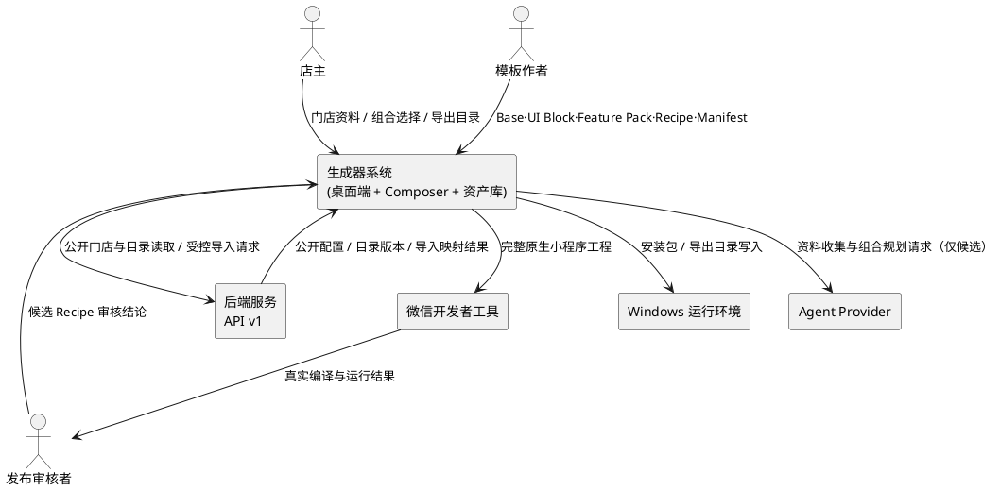

图中只表达交互方向与内容概要，不表达内部模块、数据库或缓存等实现组件。

## 4. DFX 约束

> 数值为目标值。首次实测后必须在生成报告中记录实测值；若无法达标，必须写明原因与影响，不得静默放宽。

### 4.1 性能

1. **单次生成**：固定 CompositionPlan（Base + 不超过 10 个资产）从解析到完整工程落盘，P95 不超过 30 秒（不含微信编译）。
2. **微信编译**：单工程编译在常规开发机上不超过 180 秒（不含排队与人工等待）。
3. **桌面反馈**：店主点击“导出”后 1 秒内出现真实进行状态；取消或失败后 2 秒内恢复可操作。
4. **受控导入**：单次导入（不超过 3 个分类、5 个商品、20 个桌号）P95 不超过 5 秒。
5. **资产规模**：单个 UI Block 的 Manifest + 预览数据不超过 64 KB；CompositionPlan 序列化后不超过 64 KB。

### 4.2 可靠性

1. **可复现性**：相同 Lock 在相同注册表与 Composer 版本下生成两次，产物文件集合、路径与内容校验和必须完全一致（Lock 的生成时间字段与报告时间不参与比较）。
2. **原子输出**：生成失败时不得留下可被误导入的半成品工程；失败后目标目录中不存在本次新增的不完整文件。
3. **失败可重试**：同一 CompositionPlan 在失败后可重试并通过，重试不得产生重复工程或重复资产目录。
4. **导入幂等**：同一门店、同一幂等键的重复导入只产生一份结果；并发重复请求返回同一结果或明确冲突，不产生重复门店/分类/商品/桌号。
5. **导出目录保护**：目标目录已存在非空内容时不得覆盖或删除，必须拒绝并提示。
6. **回滚**：受控导入失败必须整体回滚，不留部分写入。

### 4.3 安全性

1. **秘密零出现**：导出工程、Lock、生成报告、桌面日志、安装包资源中不得出现 AppSecret、数据库连接串、模型 API Key、微信支付密钥、用户 Token。
2. **公开配置白名单**：导出工程只能包含第 6.4 节列出的公开字段；任何白名单外字段必须先修订契约再实现。
3. **路径安全**：资产入口与生成路径只能是包内相对路径；`..`、绝对路径、盘符路径、符号链接逃逸一律拒绝。
4. **发布前扫描**：正式 Recipe 发布前必须执行敏感信息扫描与组件边界扫描，任一命中即阻断发布。
5. **身份边界**：受控导入只能由该门店 `OWNER` 发起；`STAFF` 或跨店请求返回 `403 FORBIDDEN`，前端隐藏入口不构成权限控制。
6. **模型输出不落码**：Agent 输出只能是结构化候选数据；生成器不得把模型文本写入 WXML/JS/WXSS。

### 4.4 可维护性

1. **单事实源**：同一资产只有一份权威实现与一份 Manifest；同一状态不得在文件注册表与数据库注册表各存一份。
2. **可追溯**：每个导出工程与生成报告必须能回溯到 Recipe 版本、CompositionPlan 摘要、Lock 摘要与注册表版本。
3. **报告完整**：每次生成必须产出报告，至少含版本、校验项、通过/拒绝原因、编译结果、preview-only 清单、未解决问题。
4. **版本纪律**：资产内容变化必须递增其 `version`；不得在版本不变的情况下改变行为、属性或事件。
5. **日志脱敏**：日志允许记录 requestId、版本号、耗时、错误码与计数；不得记录 Token、密钥、完整用户资料与订单内容。

### 4.5 兼容性

1. **兼容声明**：每个资产必须声明 Base 版本范围、最低微信基础库版本与后端 API 契约版本；不满足时在生成前拒绝。
2. **配置兼容**：`store.generated` 契约版本变化必须显式声明；旧版本产物必须被识别并明确拒绝或提示升级，禁止静默按新版本读取（当前主题替换静默失败即为反例）。
3. **安装包兼容**：Windows 10 与 Windows 11 x64 干净环境必须可安装、可导出；中文路径、含空格路径、只读目录（应拒绝）均需验证。
4. **接口兼容**：生成器只能调用 `docs/api.md` 已冻结的接口或本规格第 9 章批准的新接口；不得依赖未登记字段。

## 5. 核心能力

### 5.1 资产契约冻结与注册表（M5-1、M5-3）

#### 5.1.1 业务规则

1. **M5-1-01 契约先行**：在编写任何生成逻辑之前，生成器系统必须冻结 Base 边界、Manifest、CompositionPlan、页面插槽与 Lock 五类契约。
   - 验收：五类契约均有版本标识与合法/非法样例；对非法样例，契约校验给出具体错误码与出错位置，而非笼统失败。
2. **M5-1-02 契约版本纪律**：当契约版本升级时，系统应当改变版本标识并提供迁移方式或明确拒绝旧版本。
   - 验收：旧版本 Plan 提交 → 返回“版本不支持”且不生成任何文件；新版本 Plan 提交 → 正常解析。
3. **M5-1-03 Manifest 全覆盖**：每个 Base、UI Block、Feature Pack、Recipe 都必须具备 Manifest，且字段至少覆盖身份、入口、兼容性、组合、组件通信、视觉、发布状态、验证入口。
   - 验收：注册表扫描 → 任一资产缺 Manifest 或缺必填字段时注册表校验失败，并列出缺失字段。
4. **M5-1-04 白名单唯一性**：系统应当以仓库内注册表作为唯一白名单；不在注册表中的资产不得被组合或生成。
   - 验收：Plan 引用未登记 ID → 生成前拒绝，错误信息包含该 ID 与注册表版本。
5. **M5-1-05 入口安全**：Manifest 声明的入口必须是包内相对路径，禁止绝对路径、盘符、`..` 与符号链接逃逸。
   - 验收：构造含 `../` 的入口 → 拒绝并标注“路径非法”；入口指向不存在文件 → 拒绝并标注“入口缺失”。
6. **M5-1-06 声明与实现一致**：当 Manifest 声明的属性名/类型、事件名/负载与资产实现不一致时，注册表校验应当失败。
   - 验收：为组件新增未声明属性 → 校验失败；声明了但实现缺失的属性 → 校验失败。
7. **M5-1-07 注册表版本冻结**：Registry Version 必须是显式值，Plan 与 Lock 必须引用精确值；系统不得在生成过程中自动取“最新”。
   - 验收：注册表内容变化但版本号未变 → 校验失败；Plan 指定旧版本注册表 → 按旧版本解析或明确拒绝，二者不得混用。
8. **M5-1-08 禁止内容**：Manifest、CompositionPlan 与 Lock 中不得出现源码、脚本、可执行命令、任意 URL、秘密、用户 Token 或业务订单数据。
   - 验收：注入上述任一字段 → 解析阶段拒绝，错误码为“字段不允许”。

#### 5.1.2 交互流程

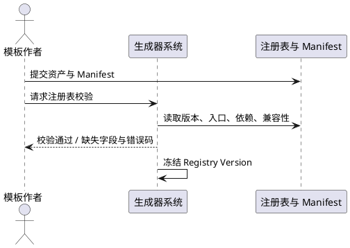

#### 5.1.3 异常场景

1. **Manifest 缺失必填字段**
   - a. 触发条件：新资产未声明 `releaseStatus` 或 `compat`。
   - b. 系统行为：拒绝该资产进入注册表索引，其他资产不受影响。
   - c. 用户感知：校验报告列出资产 ID 与缺失字段。
2. **入口路径逃逸**
   - a. 触发条件：入口写成 `../../outside/index.js`。
   - b. 系统行为：拒绝登记，记录安全事件计数（不含敏感路径以外的隐私信息）。
   - c. 用户感知：“入口路径非法，必须位于资产包内”。
3. **注册表版本漂移**
   - a. 触发条件：注册表内容被修改但版本未变。
   - b. 系统行为：注册表校验失败，禁止进入生成。
   - c. 用户感知：“注册表内容与版本不一致，请冻结新版本”。

### 5.2 Base 统一与可删除性（M5-2）

#### 5.2.1 业务规则

1. **M5-2-01 唯一 Base 来源**：当 B2 参考工程通过既有校验（7 页面、13 组件、静态检查零错误）时，系统应当从该工程提炼唯一 Base 与唯一组件源。
   - 验收：仓库中每个 UI Block 只有一份权威实现；生成链路只能引用该实现。
2. **M5-2-02 无双份维护**：当同一组件在两处存在且内容不同，系统应当判定构建失败并指出冲突文件。
   - 验收：人为修改参考工程副本中的组件 → 校验失败；两份内容完全一致时允许保留，但报告必须标注“迁移中”与退出条件。
3. **M5-2-03 Base 必备能力**：Base 必须包含工程骨架、页面注册与导航、全局主题 Token、公开配置加载、服务层请求与错误归一化、加载/空/异常通用状态、首页、菜单、购物车与结算、订单列表与详情、我的、店主订单台，以及页面命名插槽协议。
   - 验收：以 Base 单独生成的工程，可完成“扫码进入 → 浏览菜单 → 加购 → 结算 → 创建订单 → 演示付款 → 店主接单并推进至完成”的完整闭环。
4. **M5-2-04 Base 排除项**：Base 不得包含广告、优惠券、海报轮播或行业化营销页面。
   - 验收：Base 资产清单中不出现上述能力；出现则注册表校验失败。
5. **M5-2-05 可删除性**：删除任一可选 UI Block 后，Base 仍应当可以独立编译并完成核心闭环。
   - 验收：删除组件 → 页面 JSON、WXML、样式与服务层无残留引用；微信开发者工具编译通过；核心闭环回归通过。
6. **M5-2-06 组件铁律**：Base 组件不得调用网络、不得使用固定路由跳转、不得读写全局业务状态、不得依赖服务层。
   - 验收：静态检查对 `wx.request`、路由 API、全局业务状态与服务层引用零命中。
7. **M5-2-07 插槽协议**：Base 页面必须声明稳定插槽（如首页顶部与营销区、菜单页辅助区），声明允许的资产类型、容量与顺序语义。
   - 验收：未分配插槽时页面完整显示；向不允许的类型插槽放置资产时被拒绝。
8. **M5-2-08 唯一事实源迁移**：旧静态导出模板在 Composer 打通后不得继续作为导出源。
   - 验收：导出链路只读取 Base 与注册表资产；旧模板只保留为历史参考或被移除，且报告中不再出现“复制模板”路径。

#### 5.2.2 交互流程

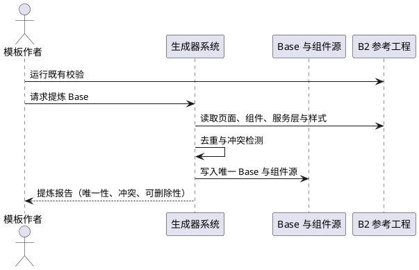

#### 5.2.3 异常场景

1. **组件双份漂移**
   - a. 触发条件：参考工程与资产目录的同名组件内容不一致。
   - b. 系统行为：阻断构建，列出差异文件，不自动以任一方覆盖。
   - c. 用户感知：“组件存在双份实现，请先合并或废弃其一”。
2. **删除组件后编译失败**
   - a. 触发条件：页面仍引用已删除组件的路径。
   - b. 系统行为：可删除性检查失败，给出引用位置。
   - c. 用户感知：报告列出页面与 `usingComponents` 残留引用。
3. **Base 被加入营销能力**
   - a. 触发条件：Base Manifest 声明海报轮播或优惠券页面。
   - b. 系统行为：拒绝该 Base 版本，要求拆分为 Feature Pack。
   - c. 用户感知：“营销能力不得进入 Base，请以 Feature Pack 提供”。

### 5.3 组合规划与 Lock（M5-4）

#### 5.3.1 业务规则

1. **M5-4-01 Plan 白名单**：CompositionPlan 只允许注册表内的资产 ID、精确版本、页面布局、插槽组件、可序列化属性、主题 Token 与后端契约版本。
   - 验收：Plan 中出现源码字段、脚本字段、绝对路径、外部 URL 或秘密 → 解析拒绝；只含白名单字段 → 正常解析。
2. **M5-4-02 精确版本**：Plan 中的 Base、功能包与组件必须写精确版本，系统不得接受“latest”或范围表达式。
   - 验收：`version: "latest"` → 拒绝；精确版本不存在 → 拒绝并列出可用版本。
3. **M5-4-03 依赖与冲突前置校验**：当 Plan 存在缺失依赖、声明冲突、循环依赖、重复页面或未登记插槽时，系统应当在生成前拒绝。
   - 验收：构造五类非法 Plan → 每类返回可区分的错误码与定位；不产生任何输出文件。
4. **M5-4-04 插槽容量**：当插槽内组件数量超过容量或类型不匹配时，系统应当拒绝。
   - 验收：向容量为 1 的插槽放入 2 个组件 → 拒绝；向仅允许 UI Block 的插槽放入 Feature Pack → 拒绝。
5. **M5-4-05 Lock 完整性**：解析成功后系统必须生成 Lock，记录 Base、注册表、功能包、组件、Composer 的精确版本、解析后的依赖关系、后端契约版本、资产源校验与产物校验。
   - 验收：任一必填项缺失 → Lock 生成失败，整体生成失败。
6. **M5-4-06 可复现**：相同 Plan 与相同注册表生成两次，Lock 的解析结果与校验和必须一致；相同 Lock 生成两次，工程产物必须字节一致。
   - 验收：连续两次生成 → 逐文件校验和一致；仅 `generatedAt` 类时间字段不同。
7. **M5-4-07 禁止隐式升级**：当资产有更新版本可用时，系统不得在生成时自动替换为最新版本。
   - 验收：注册表新增组件版本后，旧 Plan 仍生成旧版本产物；报告标注“存在更新版本，未采用”。
8. **M5-4-08 Lock 最小内容**：Lock 不得包含用户业务数据、Token、密钥或完整门店菜单。
   - 验收：敏感字段扫描对 Lock 零命中。
9. **M5-4-09 兼容校验**：当 Plan 的 `apiBinding.contractVersion` 不在 Base 兼容列表，或最低基础库声明不满足时，系统应当拒绝生成。
   - 验收：不兼容契约 → 拒绝并给出双方版本；兼容 → 继续。

#### 5.3.2 交互流程

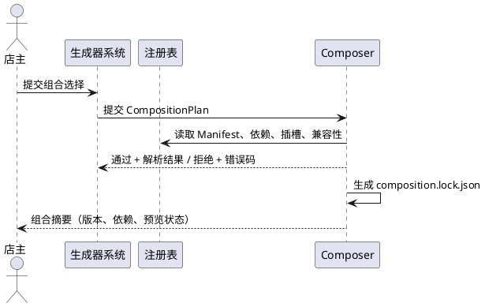

#### 5.3.3 异常场景

1. **缺依赖**
   - a. 触发条件：Plan 引入海报轮播但未声明其依赖的首页插槽与主题 Token。
   - b. 系统行为：拒绝并列出缺失依赖及建议修复。
   - c. 用户感知：“缺少依赖，无法组合”。
2. **循环依赖**
   - a. 触发条件：两个 Feature Pack 互相声明依赖。
   - b. 系统行为：拒绝并给出依赖环路径。
   - c. 用户感知：“检测到循环依赖”。
3. **Lock 校验和不一致**
   - a. 触发条件：同一 Lock 两次生成产物内容不同。
   - b. 系统行为：判定本次生成失败、丢弃产物，并记录差异文件清单。
   - c. 用户感知：“生成结果不可复现，已中止”。
4. **插槽重复占用**
   - a. 触发条件：同一页面同一插槽在 Plan 中出现两次定义。
   - b. 系统行为：拒绝并定位重复插槽。
   - c. 用户感知：“插槽定义重复”。

### 5.4 确定性生成（M5-5）

#### 5.4.1 业务规则

1. **M5-5-01 固定 Plan 先跑通**：在开放任意组合之前，系统应当先用固定 Plan 生成少量 Recipe（2–3 份）与完整工程。
   - 验收：每份固定 Plan 生成一个可导入工程；工程可被微信开发者工具编译。
2. **M5-5-02 产物完整性**：每个工程必须包含静态 WXML、页面 WXSS 与 JS、页面 JSON（含 `usingComponents`）、`app.json`（含 pages、tabBar）、主题变量样式与公开运行配置。
   - 验收：缺任一类别 → 生成失败；`app.json` 中页面路径与磁盘文件一一对应。
3. **M5-5-03 构建期确定**：页面注册、组件引用、tabBar 与主题必须在构建期确定；运行期不得根据模型输出动态加载组件路径。
   - 验收：产物中不存在任何“按名称动态加载组件”的代码路径。
4. **M5-5-04 原子输出**：系统必须以原子方式输出工程；全部校验通过后才对外呈现完整工程。
   - 验收：模拟中途失败 → 目标目录无半成品，已有目录内容不变。
5. **M5-5-05 生成前安全扫描**：生成前必须扫描资产内容，禁止秘密、Token、内网地址、绝对路径与越权跳转。
   - 验收：注入伪密钥的测试资产 → 生成被阻断，报告标注命中文件与行号范围。
6. **M5-5-06 生成后边界扫描**：生成后必须扫描产物，确认 UI Block 无网络调用、无固定路由、无全局业务状态引用。
   - 验收：人为放入违规组件 → 校验失败，不进入交付。
7. **M5-5-07 不隐式降级**：当某资产不可用或版本不兼容时，系统不得“删掉该页面后继续生成”并宣布成功。
   - 验收：移除依赖资产后 → 生成失败并说明缺失；只有显式声明“降级组合”的 Plan 才允许生成，且报告必须标注降级项。
8. **M5-5-08 生成报告**：每次生成必须产出报告，包含 Plan 摘要、Lock 摘要、注册表与 Composer 版本、校验项结果、编译命令与结果、preview-only 清单、未解决问题。
   - 验收：报告字段齐全且可被人工复核；缺项视为生成未完成。
9. **M5-5-09 复制基线退出**：Composer 打通后，导出链路不得再使用“整目录复制 + 字符串替换”作为主路径。
   - 验收：产物由资产按 Plan 组合生成；主题色以变量写入而非锚点替换，锚点缺失即失败而非静默通过。
10. **M5-5-10 主题与视觉**：主题 Token 必须只出现在声明过的 Token 位置；对比度必须满足可读性下限（正文与背景对比度不低于 4.5:1）。
    - 验收：使用低对比度组合 → 生成前拒绝或给出阻断级警告；正常主题 → 产物颜色与选中 Token 一致。

#### 5.4.2 交互流程

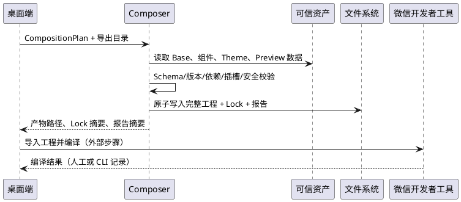

#### 5.4.3 异常场景

1. **磁盘空间不足**
   - a. 触发条件：导出目录所在盘剩余空间不足以写入完整工程。
   - b. 系统行为：在写入前预检失败并终止，不留下部分文件。
   - c. 用户感知：“目标磁盘空间不足，请更换目录”。
2. **只读目录 / 权限拒绝**
   - a. 触发条件：店主选择无写权限目录。
   - b. 系统行为：终止并保留原目录内容。
   - c. 用户感知：明确提示权限问题与可选操作。
3. **同名工程目录已存在**
   - a. 触发条件：目标目录下已存在同名工程目录。
   - b. 系统行为：拒绝覆盖与删除，提示改名或更换目录。
   - c. 用户感知：“同名工程已存在，未做任何修改”。
4. **生成中途进程中断**
   - a. 触发条件：应用崩溃或用户强制退出。
   - b. 系统行为：中断后再次生成可成功，且不读取残留半成品。
   - c. 用户感知：重新生成后得到完整工程。
5. **主题锚点缺失**
   - a. 触发条件：资产缺少主题 Token 约定位置。
   - b. 系统行为：生成失败并定位缺失 Token，禁止静默输出默认色。
   - c. 用户感知：“主题变量缺失，已中止生成”。

### 5.5 桌面会话真实导出（M5-6）

#### 5.5.1 业务规则

1. **M5-6-01 真实导出**：当进入部署阶段时，桌面端应当调用真实导出能力生成工程，而不是只播放定时动画。
   - 验收：进入部署阶段 → 出现目录选择与真实生成动作；进度反映实际阶段（校验、生成、完成），不出现无真实任务的百分比。
2. **M5-6-02 取消语义**：当店主取消目录选择时，系统不得产生任何文件、不得进入成功状态。
   - 验收：取消 → 返回原阶段可重试，无错误弹窗、无残留目录。
3. **M5-6-03 成功结果可核验**：导出成功后必须展示真实工程路径、可打开目录、可复制的路径，以及 Recipe 与 Lock 版本。
   - 验收：点击“打开目录” → 打开导出的真实目录；路径可复制；版本与 Lock 一致。
4. **M5-6-04 失败可读**：导出失败时必须展示可读原因（目录不可写、空间不足、版本不兼容、资产缺失等）与重试入口。
   - 验收：构造失败场景 → 显示对应原因，不显示“部署成功”。
5. **M5-6-05 能力诚实**：系统不得把本地导出表述为“已上传”“已发布”“已提交审核”。
   - 验收：检查部署阶段全部文案与状态 → 不出现上述表述；演示支付仍在界面标注。
6. **M5-6-06 单一组合规格**：桌面实时预览与导出必须使用同一 CompositionPlan 与同一主题 Token。
   - 验收：修改主题或插槽后 → 预览与导出产物的组合一致；不一致时以导出报告为准并阻断。
7. **M5-6-07 部署步骤重构**：部署阶段的步骤必须与实际能力对齐，至少区分“校验配置”“生成工程”“检查产物”“导入微信开发者工具（外部）”。
   - 验收：步骤名称与真实动作一一对应；“上传/审核/发布”不作为本产品步骤。
8. **M5-6-08 保留既有状态机**：接通导出的改造必须在现有会话状态机上增量完成，不得回滚或覆盖既有消息揭示与阶段交接修复。
   - 验收：既有会话相关测试仍全部通过；跳过后一次性展示剩余消息的行为不变。
9. **M5-6-09 导出可用性**：当运行在浏览器（非桌面）时，系统必须明确提示“需要桌面版才能导出”，不得伪装成功或静默失败。
   - 验收：浏览器环境点击导出 → 出现明确说明与获取桌面版的指引。

#### 5.5.2 交互流程

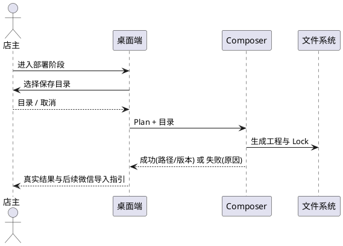

#### 5.5.3 异常场景

1. **浏览器环境导出**
   - a. 触发条件：非 Electron 环境触发导出。
   - b. 系统行为：不发起伪导出，展示桌面版说明。
   - c. 用户感知：“请使用 Windows 桌面版导出工程”。
2. **导出进行中重复点击**
   - a. 触发条件：店主连续点击导出。
   - b. 系统行为：只允许一次任务，后续点击被忽略或排队一次。
   - c. 用户感知：按钮呈忙碌态，不产生重复工程。
3. **导出成功但目录被外部删除**
   - a. 触发条件：导出后被其他程序删除目录。
   - b. 系统行为：“打开目录”返回明确错误，不崩溃。
   - c. 用户感知：“目录不存在，可重新导出”。

### 5.6 安装包与真实导出验收（M5-7）

#### 5.6.1 业务规则

1. **M5-7-01 资源包含完整**：Windows 安装包必须包含生成所需的全部运行时资产（Base、组件、注册表、契约、Composer 与模板资源）。
   - 验收：解包安装产物 → 必需文件全部存在；任一缺失视为阻断缺陷。
2. **M5-7-02 真实安装验收**：系统应当在干净 Windows 10/11 x64 环境安装后完成一次真实导出。
   - 验收：安装 → 启动 → 导出 → 微信开发者工具可导入并编译；全过程有截图或日志证据。
3. **M5-7-03 路径鲁棒性**：安装与导出必须在中文路径、含空格路径、长路径下正常工作。
   - 验收：三类路径各执行一次导出 → 均成功且工程可导入。
4. **M5-7-04 打包契约检查**：必须存在自动化检查，断言打包资源覆盖生成链路的全部运行时依赖。
   - 验收：从依赖清单移除一个必需资产 → 检查失败并指出缺失项。
5. **M5-7-05 不覆盖用户目录**：安装、升级与导出均不得删除或覆盖用户既有工程目录。
   - 验收：导出到已有工程目录 → 拒绝且原内容逐字节不变。
6. **M5-7-06 旧产物明确失败**：当导出链路遇到旧版模板或旧版配置时，必须明确失败或给出阻断级警告，不得静默成功（主题替换静默失败必须关闭）。
   - 验收：用旧产物触发导出 → 出现可感知错误或警告，且不生成“看似成功”的工程。
7. **M5-7-07 卸载与升级**：卸载不得删除用户导出的工程；升级后既有导出能力保持可用。
   - 验收：卸载 → 用户工程目录仍存在；覆盖安装 → 导出再次成功。

#### 5.6.2 交互流程

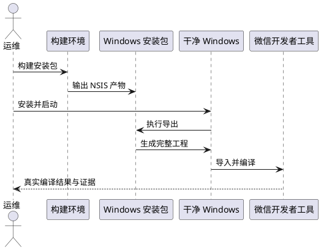

#### 5.6.3 异常场景

1. **运行时资产缺失**
   - a. 触发条件：打包清单遗漏资产目录。
   - b. 系统行为：启动后导出报“资产缺失”，并提供缺失清单；构建期契约检查应提前失败。
   - c. 用户感知：明确错误，不产生半成品。
2. **Electron 运行时下载失败**
   - a. 触发条件：构建环境网络不可用。
   - b. 系统行为：构建失败并保留可诊断日志；不得以开发模式运行冒充安装包验收。
   - c. 用户感知：构建负责人看到明确阻塞原因与替代网络方案。
3. **只读安装目录**
   - a. 触发条件：安装到受保护目录导致缓存写入失败。
   - b. 系统行为：提示更换安装位置或使用用户目录缓存。
   - c. 用户感知：可操作的错误提示。

### 5.7 门店配置受控导入（M6-1）

#### 5.7.1 业务规则

1. **M6-1-01 受控通道**：当店主确认导入门店资料时，系统应当通过后端受控导入能力写入，禁止前端直接改库或伪造成功。
   - 验收：导入成功 → 后端存在对应门店/分类/商品/桌号；导入失败 → 无部分写入。
2. **M6-1-02 幂等防重**：同一门店、同一幂等键的重复导入只产生一份结果；重复提交相同内容返回原结果，不同内容返回冲突。
   - 验收：双击导入或网络重试 → 不产生重复门店/分类/商品；冲突返回 `IDEMPOTENCY_CONFLICT` 语义错误。
3. **M6-1-03 不覆盖运营数据**：导入不得静默覆盖既有运营数据（商品名称、价格、上下架状态、桌号）。
   - 验收：对已存在商品再次导入不同价格 → 不直接覆盖，返回差异项并要求店主选择“跳过/更新/新建”。
4. **M6-1-04 差异确认**：当导入内容与后端事实存在差异时，系统必须展示逐项差异（名称、价格、可售状态、履约方式、营业时间）。
   - 验收：差异清单可逐项确认；未确认不得提交。
5. **M6-1-05 身份与租户**：只有该门店 `OWNER` 可导入；跨店或无权限返回 `403 FORBIDDEN`。
   - 验收：使用 `STAFF` 或他店店主身份导入 → 拒绝；门店数据不变。
6. **M6-1-06 分类与商品约束**：分类名在门店内唯一；商品名在同一分类内唯一；价格为 1–999999 的整数分。
   - 验收：重复分类名 → `422 VALIDATION_ERROR`；非法价格 → 拒绝且不写入。
7. **M6-1-07 桌号约束**：桌号名在门店内唯一；导入只新增或更新声明项，不得删除既有桌号。
   - 验收：导入重复桌号名 → 拒绝；导入不包含已有桌号 → 既有桌号仍存在。
8. **M6-1-08 映射回传**：导入成功必须回传草稿菜品 ID 到后端商品 ID、分类 ID、桌号 ID 的映射，以及导入后的目录版本与配置版本。
   - 验收：映射表覆盖全部导入项；缺项视为导入失败。
9. **M6-1-09 缓存与版本**：导入成功后目录版本必须递增并使公开目录缓存失效。
   - 验收：导入后立即请求公开目录 → 返回新版本与内容，不命中旧缓存。
10. **M6-1-10 整体回滚**：任一步骤失败（含映射写入失败）必须整体回滚，不保留部分数据。
    - 验收：模拟中途失败 → 后端数据与导入前一致。

#### 5.7.2 交互流程

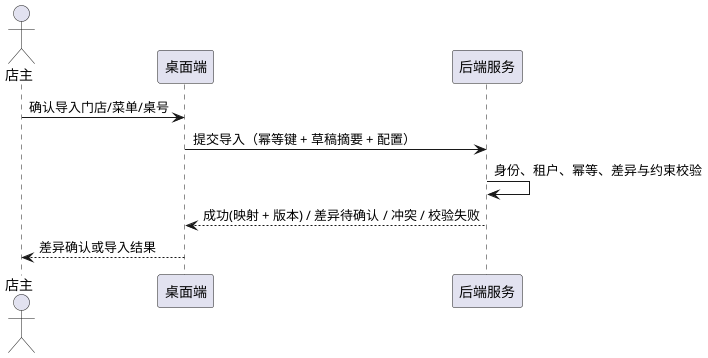

#### 5.7.3 异常场景

1. **重复导入**
   - a. 触发条件：网络超时后店主重试提交。
   - b. 系统行为：按幂等键返回原结果，不重复写入。
   - c. 用户感知：“已导入，未重复创建”。
2. **导入与运营冲突**
   - a. 触发条件：草稿价格与后端在售价格不同。
   - b. 系统行为：暂不写入冲突项，返回差异。
   - c. 用户感知：逐项选择保留后端值或应用草稿值。
3. **权限不足**
   - a. 触发条件：非该店店主发起导入。
   - b. 系统行为：拒绝并记录审计信息（不含敏感数据）。
   - c. 用户感知：“无权导入该门店配置”。
4. **导入后缓存仍返回旧目录**
   - a. 触发条件：缓存失效失败。
   - b. 系统行为：导入结果标记“缓存未刷新”，并提供重试刷新；不得声称已生效。
   - c. 用户感知：“配置已保存，目录刷新失败，请重试”。

### 5.8 AgentDraft 配置映射（M6-2）

#### 5.8.1 业务规则

1. **M6-2-01 营业时间完整映射**：营业时间（最多 3 段、`HH:MM-HH:MM`、开始早于结束、时段不重叠）必须完整映射到门店公开配置与导出配置。
   - 验收：多时段草稿 → 后端与导出配置均含全部时段且顺序稳定；非法草稿 → 导出/导入前拒绝。
2. **M6-2-02 菜品完整映射**：3–5 道菜必须全部映射，保持名称、描述与整数分价格；不得丢菜、合并同名或隐式改价。
   - 验收：5 道菜草稿 → 后端商品数量为 5，金额逐项一致；草稿价格非法 → 拒绝。
3. **M6-2-03 履约方式映射**：堂食与自取开关必须映射到门店履约配置；外送固定关闭。
   - 验收：草稿仅自取 → 公开门店 `fulfillment.dineIn=false`、`takeaway=true`、`delivery=false`。
4. **M6-2-04 店名与品类映射**：店名映射到门店名称（不超过 48 字），品类映射到门店品类或首个分类，不得丢弃。
   - 验收：草稿确认后 → 门店名称与品类一致；超长名称在确认前已拒绝。
5. **M6-2-05 未支持字段显式标注**：当草稿包含当前不支持的内容（图片、加料、规格）时，系统必须标注“未导入”。
   - 验收：导入结果列出未导入项与原因；不得在界面声称全部已导入。
6. **M6-2-06 唯一金额事实**：导出与导入只使用 `priceCents`；展示文本可派生但不得作为金额事实回写。
   - 验收：删除派生展示字段后功能不受影响；请求体不含价格字符串或总价。
7. **M6-2-07 冲突不自动覆盖**：草稿与后端既有门店资料冲突时，必须由店主确认。
   - 验收：既有门店名不同 → 展示差异并等待选择。
8. **M6-2-08 映射可追溯**：映射结果必须记录草稿摘要与后端对象 ID，支持重复导入时识别同一来源。
   - 验收：同一草稿再次导入 → 识别为同一来源并走幂等/差异流程。

#### 5.8.2 交互流程

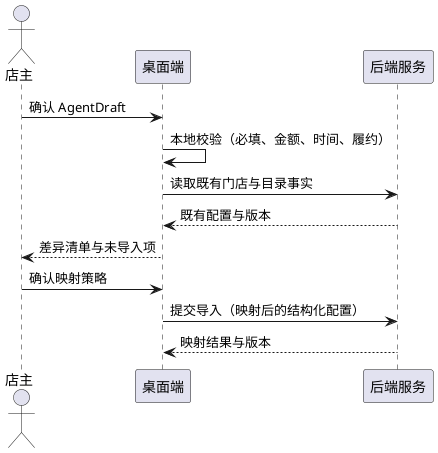

#### 5.8.3 异常场景

1. **菜品数量或价格不合规**
   - a. 触发条件：草稿 2 道菜或价格为 0。
   - b. 系统行为：阻止进入导入，返回校验错误。
   - c. 用户感知：提示“需要 3–5 道菜”“价格必须为 0.01–9999.99 元”。
2. **营业时间格式错误**
   - a. 触发条件：草稿为 `10:00~21:00` 之外的无法归一化格式。
   - b. 系统行为：拒绝映射，保留原输入。
   - c. 用户感知：给出正确格式示例。
3. **草稿重复导入但内容已变**
   - a. 触发条件：同一草稿 ID 但价格修改后再次导入。
   - b. 系统行为：按幂等键与内容摘要判定，返回差异确认而非静默更新。
   - c. 用户感知：需要确认是否更新。

### 5.9 导出公开配置与版本映射（M6-3、M6-4）

#### 5.9.1 业务规则

1. **M6-3-01 公开字段白名单**：导出工程只能写入公开 API Base URL、`storeId`、公开门店与主题信息、公开履约开关、公开能力清单与演示声明。
   - 验收：产物配置字段全部在白名单内；出现白名单外字段 → 生成失败。
2. **M6-3-02 秘密禁止**：导出工程不得包含 AppSecret、数据库连接串、模型密钥、支付密钥、用户 Token、后台管理路径。
   - 验收：敏感信息扫描零命中；命中即阻断导出。
3. **M6-3-03 地址规范**：生产导出必须使用 HTTPS 公开地址；本地开发地址只允许显式开发模式，并在工程说明与界面标注“仅本地演示”。
   - 验收：生产模式写入非 HTTPS 地址 → 拒绝；开发模式 → 工程说明含“仅本地演示”提示。
4. **M6-3-04 配置携带版本**：导出配置必须携带配置契约版本、门店配置版本、目录版本、后端契约版本、Recipe 与 Lock 版本、生成时间与生成器版本。
   - 验收：六类版本信息齐全；缺任一项 → 生成失败。
5. **M6-3-05 不兼容明确拒绝**：当配置契约主版本不被 Base 支持，或后端契约版本不在兼容列表时，必须拒绝生成。
   - 验收：不兼容组合 → 拒绝并列出双方版本；不得降级生成。
6. **M6-3-06 版本不一致提示**：当后端当前目录版本高于导出配置记录的版本时，小程序端应当以在线数据为准并提示刷新，不得把快照当事实。
   - 验收：后端更新目录后打开小程序 → 菜单刷新为新内容并提示。
7. **M6-3-07 旧版本识别**：当读取到旧版配置时，必须识别并明确提示升级或拒绝，不得按新版本解析缺失字段。
   - 验收：旧版配置 → 明确提示；不出现静默使用默认值导致的错乱。

#### 5.9.2 交互流程

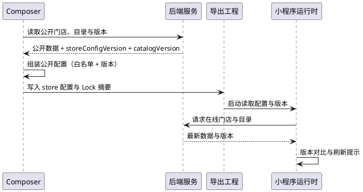

#### 5.9.3 异常场景

1. **产物命中敏感信息**
   - a. 触发条件：资产示例数据中含 `sk-` 前缀字符串。
   - b. 系统行为：阻断导出并标注位置，不写入最终目录。
   - c. 用户感知：“检测到疑似密钥，已中止”。
2. **后端契约版本不匹配**
   - a. 触发条件：Base 声明 `storefront.v1`，Plan 指定 `storefront.v2`。
   - b. 系统行为：拒绝生成。
   - c. 用户感知：提示升级 Base 或改用兼容版本。
3. **导出配置版本缺失**
   - a. 触发条件：旧导出链路未写入配置版本。
   - b. 系统行为：判定产物不合规，要求重新生成。
   - c. 用户感知：“配置缺少版本信息，请重新导出”。

### 5.10 首批资产与扩展顺序（M7-1、M7-2）

#### 5.10.1 业务规则

1. **M7-1-01 首批范围**：首批必须打通 1 个 Base、2–3 个核心 UI Block、1 个海报轮播 Feature Pack、2–3 份 Recipe。
   - 验收：注册表中上述资产齐备且通过各自验收；少于下限视为未完成，多于上限不构成加分。
2. **M7-1-02 核心 UI Block 选择**：核心 UI Block 必须来自 Base 现有稳定组件（如门店头、商品卡、购物车条），并具备独立 Manifest 与预览数据。
   - 验收：每个 Block 可单独在示例页渲染正常/空/长文本三种数据。
3. **M7-1-03 海报轮播能力**：海报轮播 Feature Pack 必须包含轮播组件、首页插槽接入、预览数据、图片资源约束、自动播放与间隔配置、可访问性降级（无图时占位）。
   - 验收：在首页插槽启用后轮播正常；关闭后首页仍完整可用；图片加载失败显示占位而非破图。
4. **M7-1-04 Recipe 覆盖**：首批 Recipe 至少包含一份等价于当前点餐闭环的正式配方，以及一份启用海报轮播的配方（其发布状态取决于后端能力）。
   - 验收：两份 Recipe 均可生成工程；正式配方可发布，海报配方按第 5.11 节状态规则处理。
5. **M7-2-01 扩展顺序**：资产扩展必须按“海报轮播 → 首页营销区 → 广告位 → 优惠券”顺序推进。
   - 验收：前一资产未通过编译/回归/发布审核时，不得开始下一资产的实现与验收；顺序变更需书面修订本规格。
6. **M7-2-02 每步独立验收**：每个新资产必须具备独立验收记录，不得以“整包通过”替代单项证据。
   - 验收：逐资产存在 Manifest、预览数据、兼容声明、测试与编译记录。

#### 5.10.2 交互流程

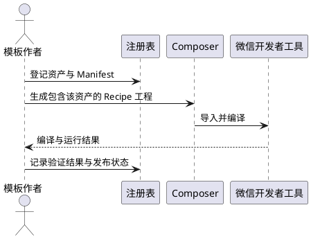

#### 5.10.3 异常场景

1. **资产数量先行**
   - a. 触发条件：在 Composer 与验证链路未通过前登记大量资产。
   - b. 系统行为：注册表校验要求每个资产具备完整验证记录，否则阻止进入正式集合。
   - c. 用户感知：报告标注“未验证资产不得发布”。
2. **海报素材缺失**
   - a. 触发条件：Feature Pack 引用不存在的图片资源。
   - b. 系统行为：生成前拒绝并列出缺失资源。
   - c. 用户感知：“海报资源缺失，无法组合”。
3. **顺序跳步**
   - a. 触发条件：海报轮播未验收即实现优惠券。
   - b. 系统行为：审核检查阻断该资产进入正式集合。
   - c. 用户感知：提示需先完成上一资产验收。

### 5.11 资产验收、preview-only 与发布晋升（M7-3、M7-4、M7-5）

#### 5.11.1 业务规则

1. **M7-3-01 Manifest 完整**：每个资产必须具备 Manifest，含身份、入口、兼容性、组合约束、属性/事件、主题 Token、预览数据、发布状态与测试入口。
   - 验收：缺字段 → 注册表校验失败；字段齐全 → 通过。
2. **M7-3-02 预览数据齐备**：每个资产必须提供正常、空数据、异常数据与长文本四类预览数据。
   - 验收：四类预览均可渲染且无异常；缺一类视为未完成。
3. **M7-3-03 兼容声明可执行**：每个资产必须声明 Base 版本范围、最低微信基础库与后端契约版本，并与实际测试一致。
   - 验收：声明范围外的组合被拒绝；范围内组合通过编译。
4. **M7-3-04 组件边界测试**：UI Block 必须通过“无网络、无固定路由、无全局业务状态、无服务层依赖”的静态检查；Feature Pack 只允许页面与服务层触网。
   - 验收：违规实现被静态检查拦截。
5. **M7-3-05 组合负例测试**：缺依赖、冲突、非法插槽、重复页面、路径逃逸五类负例必须被拒绝且有测试覆盖。
   - 验收：负例全部拒绝；正例全部通过。
6. **M7-4-01 preview-only 判定**：当资产依赖未实现的后端能力时，Manifest 必须标记 `preview-only`。
   - 验收：依赖缺失后端的资产状态为 `preview-only`；被误标 `online-ready` → 发布审核拒绝。
7. **M7-4-02 preview-only 呈现**：桌面预览、组合确认页与导出工程说明必须清晰标注 preview-only 资产及其限制。
   - 验收：启用 preview-only 资产时，界面与工程说明均出现标识；无一处遗漏。
8. **M7-4-03 后端待实现登记**：每个 preview-only 资产必须在后端待实现清单中登记缺失能力（业务目的、最小契约、优先级、验收条件）。
   - 验收：清单可一对一追溯到资产 ID；无登记则不得进入候选 Recipe。
9. **M7-4-04 preview-only 不发布**：preview-only 资产不得进入正式 Recipe 的在线功能集合，也不得宣称“可上线”。
   - 验收：发布审核检查阻断；导出工程能力清单标记 preview-only。
10. **M7-5-01 晋升门槛**：候选 Recipe 只有通过微信编译、核心链路回归、敏感信息扫描与发布审核，才能成为正式 Recipe。
    - 验收：四类证据齐全 → 状态变更为正式；缺一类 → 保持候选。
11. **M7-5-02 选择范围**：店主可选模板只展示正式 Recipe；候选 Recipe 只在内部预览入口出现。
    - 验收：正式/候选清单严格分离。
12. **M7-5-03 回归与失效**：当 Base 或依赖资产升级时，所有引用它的正式 Recipe 必须重新验证，否则标记为过期并暂时下架。
    - 验收：升级 Base → 受影响 Recipe 状态变为“待重新验证”；未复验前不出现在可选模板中。
13. **M7-5-04 发布记录**：正式 Recipe 必须记录版本、验证时间、编译结果、审核结论与已知限制。
    - 验收：发布记录可追溯，字段齐全。

#### 5.11.2 交互流程

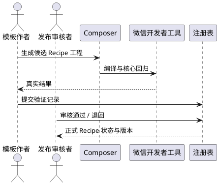

#### 5.11.3 异常场景

1. **候选 Recipe 被当作正式模板**
   - a. 触发条件：候选未审核即出现在店主选择列表。
   - b. 系统行为：发布审核阻断并回退清单。
   - c. 用户感知：只看到正式模板。
2. **preview-only 资产被组合进在线配方**
   - a. 触发条件：优惠券资产未实现后端，却被标记 `online-ready`。
   - b. 系统行为：拒绝发布，要求改为 `preview-only` 或补齐后端。
   - c. 用户感知：“该能力尚无后端支持，不能作为在线功能发布”。
3. **编译通过但核心链路失败**
   - a. 触发条件：工程可编译，但结算返回 `PRODUCT_UNAVAILABLE` 后无法恢复。
   - b. 系统行为：判定回归不通过，保持候选状态。
   - c. 用户感知：报告列出失败用例与截图/日志位置。
4. **Base 升级导致旧 Recipe 失效**
   - a. 触发条件：Base 主版本升级。
   - b. 系统行为：标记受影响 Recipe 为过期，阻止导出并提示重新验证。
   - c. 用户感知：“模板需要更新后才可导出”。

## 6. 数据约束

> 以下为逻辑约束（业务含义、取值范围、必填、唯一、关联）。存储方式、表结构与索引不属于本规格。

### 6.1 CompositionPlan

1. **schemaVersion**：必填，形如 `composition.v1`；不支持的版本必须拒绝。
2. **baseTemplate**：必填对象，含 `id` 与精确 `version`；必须指向 `kind=base` 的已登记资产。
3. **registryVersion**：必填，精确值；不得为空或“latest”。
4. **features**：数组，可为空；每项含 `id` 与精确 `version`；不得重复；只能引用 `feature-pack` 或 `ui-block` 类型。
5. **pages**：数组，至少含首页；每项含 `id`（页面内唯一）、`layout`（Base 声明的布局白名单）、`slots`（插槽名必须在 Base 页面白名单内）。
6. **slots 内容**：每项含 `component`（已登记 ID）、`version`（精确）、`props`（只允许 Manifest 声明的键，类型匹配，必填有值，字符串单项不超过 200 字）。
7. **插槽容量与类型**：组件数量不得超过插槽容量；组件类型必须与插槽允许类型一致。
8. **themeTokens**：只允许 Manifest 声明的 Token 键；颜色为 `#RRGGBB`；正文与背景对比度不低于 4.5:1。
9. **apiBinding.contractVersion**：必填，形如 `storefront.v1`；必须在 Base 兼容列表内。
10. **总大小**：序列化后不超过 64 KB。
11. **禁止字段**：源码、脚本、可执行命令、绝对路径、外部 URL（公开资源标识除外）、秘密、用户 Token、订单或用户数据。

### 6.2 Manifest

1. **identity**：`id`（kebab-case，注册表内全局唯一）、`version`（语义化版本，内容变化必须递增）、`kind`（`base` / `ui-block` / `feature-pack` / `recipe`）、`registryVersion`。
2. **entry**：包内相对路径，禁止绝对路径、盘符、`..` 与符号链接逃逸；必须存在。
3. **compat**：`baseRange`（Base 版本范围）、`minWechatLib`（最低微信基础库）、`apiContract`（后端契约版本列表）。
4. **composition**：允许的插槽、依赖、冲突、插槽容量、所需页面；依赖与冲突均引用已登记 ID 与版本。
5. **interface**：`props` 与 `events` 的 Schema、默认值与必填标记；事件名使用契约规定的动词集。
6. **visual**：使用的主题 Token、资源约束（格式、尺寸上限）、预览数据引用。
7. **release**：`releaseStatus` 为 `preview-only` 或 `online-ready`；记录已验证 Recipe 与发布状态。
8. **verification**：测试入口、微信编译要求、已知限制。
9. **一致性**：声明必须与实现一致；不一致即校验失败。

### 6.3 Composition Lock

1. **必填项**：`lockVersion`、`planDigest`、`base`、`registryVersion`、`features`、`resolvedDependencies`、`composerVersion`、`apiContract`、`sourceDigests`、`outputDigest`、`generatedAt`。
2. **精确性**：所有版本为精确值；不得出现范围或“latest”。
3. **可复现比较**：`planDigest`、`sourceDigests`、`outputDigest` 与解析结果在相同输入下必须一致；`generatedAt` 不参与可复现比较。
4. **后端版本（可选）**：可记录导入后的门店配置版本与目录版本；无后端能力时字段为空并标注原因。
5. **禁止内容**：用户数据、Token、密钥、完整菜单、订单信息。

### 6.4 导出公开配置（`store.generated` 契约）

1. **schemaVersion**：必填整数。M6 起必须携带 `meta`；旧版本必须被识别并明确提示升级或拒绝，禁止静默按新版本读取。
2. **store**：`id`（必填，与后端一致）、`name`（1–48 字）、`address`、`phone`、`businessHours`（最多 3 段 `HH:MM-HH:MM`）、`notice`（可选）。
3. **api**：`baseUrl`（生产必须 HTTPS；开发地址必须标注仅本地演示）、`contractVersion`。
4. **catalog**：分类与商品；商品含 `id`、`name`、`categoryId`、`priceCents`（1–999999 整数）、`available`、`sortOrder`；展示文本可由 `priceCents` 派生，不得作为第二份金额事实。
5. **fulfillmentOptions**：`dineIn`、`takeaway` 布尔值；`delivery` 固定 `false`。
6. **theme**：Token 集合，颜色为 `#RRGGBB`，与 Plan 选择的 Token 一致。
7. **capabilities**：`configured`、`onlineReady`、`previewOnly`、`pendingBackend` 四类 ID 清单；同一 ID 不得同时出现在 `onlineReady` 与 `previewOnly`。
8. **meta**：`configSchemaVersion`、`storeConfigVersion`、`catalogVersion`、`apiContractVersion`、`recipeId`、`recipeVersion`、`lockDigest`、`generatedAt`、`generatorVersion`。
9. **demoPaymentDisclaimer**：必填，明确演示支付不含真实微信支付。
10. **禁止内容**：AppSecret、数据库连接、模型密钥、支付密钥、用户 Token、后台管理路径、内网地址。

### 6.5 受控导入请求与结果

1. **请求必填**：`storeId`、`idempotencyKey`（8–128 个可见 ASCII）、`sourceDraftDigest`、`profile`（店名、品类、营业时间、履约）、`categories`、`products`、`tables`、`strategy`。
2. **唯一性**：分类名门店内唯一；商品名同分类内唯一；桌号名门店内唯一；幂等键按门店与发起人唯一。
3. **取值范围**：商品价格整数分；营业时段最多 3 段且不重叠；桌号名称不超过 32 字。
4. **禁止内容**：图片二进制与 base64（当前不导入图片）、价格字符串、总价、用户 Token、角色声明。
5. **结果必填**：`importId`、`status`、`mapping`（草稿菜品 ID → 商品 ID、分类 ID、桌号 ID）、`storeConfigVersion`、`catalogVersion`、`conflicts`、`skipped`、`notImported`。
6. **冲突语义**：冲突项必须逐项给出后端现值、草稿值与可选动作（跳过/更新/新建），未确认不得落库。

### 6.6 生成报告

1. **必填项**：生成时间、Recipe 与 Lock 摘要、注册表与 Composer 版本、Plan 摘要、校验项与结果、微信编译命令与结果、产物路径、preview-only 清单、未解决问题。
2. **追溯性**：报告必须能定位到具体资产版本与失败位置。
3. **禁止内容**：密钥、Token、完整用户资料、订单内容、绝对路径以外的隐私信息（本机路径仅用于诊断且不进入发布材料）。

## 7. 里程碑追踪矩阵

| 里程碑条目 | 需求编号 | 主要验收证据 | 当前状态 |
| --- | --- | --- | --- |
| M5 冻结 Base、Manifest、CompositionPlan、插槽与 Lock Schema | M5-1-01…08、M5-2-07 | 契约文件与合法/非法样例校验结果 | 未开始 |
| M5 从 B2 提炼唯一 Base 与组件源 | M5-2-01…08 | 唯一性/冲突检查、可删除性编译与回归 | 未开始 |
| M5 固定 Plan 生成少量 Recipe 与完整工程 | M5-5-01…03 | 2–3 份 Recipe 工程 + 微信编译记录 | 未开始 |
| M5 生成静态 WXML、usingComponents、app.json、主题与公开配置 | M5-5-02、M5-5-10、M6-3-01 | 产物清单、`app.json` 与磁盘文件一致性 | 未开始 |
| M5 相同 Lock 可复现，非法依赖/冲突/路径生成前拒绝 | M5-3-01…09、M5-4-05…09 | 两次生成校验和对比、五类负例 | 未开始 |
| M5 会话式 UI 接通真实导出 | M5-5-04、M5-6-01…09 | 真实导出录屏/日志、失败与取消路径 | 未开始 |
| M5 安装包资源包含与真实安装验收 | M5-7-01…07 | 干净 Windows 安装导出、asar/资源清单断言 | 未开始 |
| M6 门店、菜单、桌号受控导入，防重且不覆盖 | M6-1-01…10 | 导入幂等、冲突、回滚、权限测试 | 未开始 |
| M6 AgentDraft 营业时间/菜品/履约完整映射 | M6-2-01…08 | 映射对照表、未导入项清单 | 未开始 |
| M6 导出工程只写公开 API Base URL、storeId 与公开配置 | M6-3-01…03、6.4 | 字段白名单检查、敏感信息扫描零命中 | 未开始 |
| M6 `store.generated.js` 与后端配置版本映射，不兼容拒绝 | M6-3-04…07、6.4、6.5 | 版本齐全断言、不兼容拒绝用例 | 未开始 |
| M7 首批 1 Base / 2–3 UI Block / 1 海报轮播 / 2–3 Recipe | M7-1-01…04 | 注册表清单与逐资产验收记录 | 未开始 |
| M7 按海报轮播 → 营销区 → 广告位 → 优惠券扩展 | M7-2-01…02 | 顺序与单项验收记录 | 未开始 |
| M7 每资产 Manifest、预览数据、兼容声明与测试 | M7-3-01…05 | 注册表校验、四类预览、负例测试 | 未开始 |
| M7 未完成后端能力标 preview-only 并登记待实现 | M7-4-01…04 | 状态标识、缺口登记与追溯 | 未开始 |
| M7 候选 Recipe 经编译/回归/审核后成为正式模板 | M7-5-01…04 | 发布记录、状态变更与过期下架 | 未开始 |

## 8. 关键假设与待用户确认项

> 以下项会直接影响实现顺序与验收口径。未确认前，实现方不得自行选择“最方便”的方案并对外宣称符合本规格。

| 编号 | 假设（默认取值） | 需确认的问题 |
| --- | --- | --- |
| A1 | M6 的“受控导入”需要后端新增门店/分类/商品/桌号写接口（当前不存在） | 是否批准在 B3 范围新增后端写接口？若不批准，M6 只能交付“只读导出 + 在线 API”，导入能力标记未完成 |
| A2 | 门店配置版本需要后端新增字段或接口；当前只有目录版本 `catalogVersion` | 是否新增 `storeConfigVersion`？还是接受“目录版本 + 门店更新时间”作为过渡标识？ |
| A3 | 桌号导入与 `GET /stores/:storeId/tables` 公开只读接口一并建设（清单 17.1） | 是否纳入本轮？若不纳入，堂食选桌仍依赖扫码 `scene` 与演示桌号 |
| A4 | Base 包含店主订单台（B2 演示需要），导出工程按 `memberships` 决定是否显示入口 | 正式对外小程序是否允许保留店主入口？还是导出时按能力清单裁剪？ |
| A5 | 首批海报轮播使用 Recipe 内置公开图片资源，不依赖后端素材上传，因此可 `online-ready` | 是否允许海报素材随 Recipe 打包？若要求店主自传素材，则海报轮播也需 `preview-only` 并新增上传接口 |
| A6 | 广告位与优惠券必须依赖后端（排期、领取、核销），首批只能是 `preview-only` | 是否接受“仅预览”作为 M7 交付？还是必须同步实现后端营销能力？ |
| A7 | 微信编译验收允许“CLI 或人工操作 + 截图/日志证据” | 是否接受人工步骤作为 M5/M7 验收证据？（工具 CLI 服务端口当前需人工开启） |
| A8 | Windows 安装包构建依赖 Electron 运行时下载，当前网络阻塞 | 构建环境是否可联网或提供镜像？谁负责提供干净 Windows 验收机？ |
| A9 | 现有未提交的桌面改动（会话揭示、状态机等）是用户资产，M5-6 只在其上增量接通导出 | 是否允许后续实现轮次修改这些文件以接入真实导出？ |
| A10 | 导出配置采用“schemaVersion 递增 + 旧版本明确拒绝/提示” | 是否保留对旧 v1 导出产物的兼容读取？兼容范围到哪一版？ |
| A11 | 候选 Recipe 的发布审核由人工执行，审核记录进入注册表 | 审核人是谁？是否需要双人复核？ |
| A12 | 预览数据与主题、Recipe 命名由实现方自主决定（视觉风格不受限制） | 是否需固定首批 Recipe 名称与主题？ |
| A13 | 商品图片、加料、规格不属于 M6 导入范围 | 是否确认本阶段不导入图片？若需要，必须先补上传与存储能力 |
| A14 | 本规格不修改 `docs/后端待实现接口清单.md`，仅给出建议（第 9 章） | 是否授权将第 9 章内容合并进该清单，交由后端 agent 团队排期？ |

## 9. 后端待实现能力建议（供后端团队参考，可采纳可不采纳）

> 说明：本轮只产出需求规格，未修改 `docs/后端待实现接口清单.md`。以下建议以业务语义描述，实施前必须先修订 `docs/api.md` 与数据模型契约。

### 9.1 门店配置受控导入（M6 依赖，优先级 P0）

- **目的**：让店主确认后的门店资料、分类、商品、桌号一次性写入后端，并防止重复与覆盖。
- **建议接口**：
  - `POST /api/v1/merchant/stores/:storeId/imports`：提交导入，要求 `Idempotency-Key` 请求头。
  - `GET /api/v1/merchant/stores/:storeId/imports/:importId`：查询结果、映射、冲突与版本。
- **最小契约字段**：门店资料（名称、品类、营业时间、履约开关）、分类（名称、排序）、商品（名称、描述、`priceCents`、分类）、桌号（名称、排序）、`strategy`（跳过/更新/新建）。
- **关键规则**：仅 `OWNER` 可调用；幂等键唯一；分类/商品/桌号名唯一；冲突返回逐项差异而非静默覆盖；整体事务回滚；成功后目录版本递增并清理缓存。
- **验收**：重复提交不重复创建；并发重复只产生一份；冲突项未确认不落库；失败无部分写入；跨店返回 `FORBIDDEN`。

### 9.2 门店公开配置版本（M6 依赖，优先级 P0）

- **目的**：让导出配置能与后端事实比对，判断是否需要刷新。
- **建议**：在 `GET /stores/:storeId` 响应中增加 `configVersion`（整数，配置变更时递增），或在门店资料响应中增加 `updatedAt` 作为过渡版本。
- **验收**：配置变更后版本递增；导出配置记录该版本；版本落后时可提示刷新。

### 9.3 公开桌号列表（清单 17.1，优先级 P1）

- **目的**：支持堂食选桌与桌号校验前置提示，替代演示桌号兜底。
- **建议接口**：`GET /api/v1/stores/:storeId/tables`，公开只读，返回 `id/name/sortOrder`。
- **验收**：不返回订单或占用状态；门店不存在返回 `404 STORE_NOT_FOUND`；跨店桌号下单仍返回 `TABLE_NOT_FOUND`。

### 9.4 导出任务（可选，优先级 P2）

- **目的**：若后续需要云端导出或团队共享，可提供 `POST /exports` 与查询接口。
- **约束**：产物仍由同一 Composer 生成；不得在服务端接受任意源码或脚本。

### 9.5 营销能力（M7 后续，优先级 P2，仅 preview-only 前置）

- **海报素材**：仅在要求店主上传时，才需要对象存储与素材管理接口。
- **广告位**：需要排期、曝光与下架能力；未实现前广告位资产必须 `preview-only`。
- **优惠券**：需要券模板、领取、核销与订单抵扣规则；未实现前优惠券资产必须 `preview-only`，且不得参与计价。

### 9.6 模板注册表与组合（M8 预留，本阶段不实施）

- 本地 Composer 验收前不建设数据库注册表；文件注册表与代码同仓评审。
- 云端化时再提供 `TemplateRegistryModule` 与 `CompositionModule` 对应接口，并与本地 Composer 共用同一校验规则。

## 10. 范围红线与不做的事

1. 不以模拟支付冒充真实微信支付；不在生产开启 demo 登录与 demo 支付。
2. 不做外送、公开店主注册、客户端授权。
3. 不把任何密钥写入前端、小程序、导出工程、Lock、报告、日志或仓库。
4. 不让 Agent 直接生成或执行任意业务代码，不绕过注册表与 Composer。
5. 不用文档、React 预览、功能 ID 或动画进度代替真实实现与验收。
6. 不代办微信账号注册、认证、审核、发布，不承诺自动上线。
7. 不在后端能力缺失时把营销 UI 宣称为可上线功能；`preview-only` 必须显式标识。
8. 不覆盖或回滚工作区既有未提交用户改动；不修改 `server/`、`miniprogram/`、`src/`、`templates/` 下的实现文件来完成本规格。
9. 不以数量扩张替代验证：首批资产上限为 1 Base、2–3 UI Block、1 Feature Pack、2–3 Recipe。

---

**文档状态**：需求规格初稿，等待用户确认。确认后方可进入设计阶段（Base/Manifest/Composer 设计与任务拆解）。本文不包含实现方案与代码。