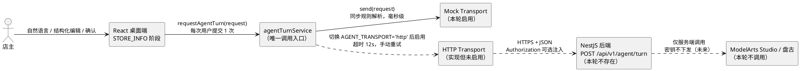
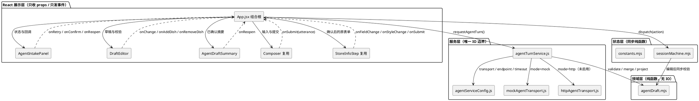
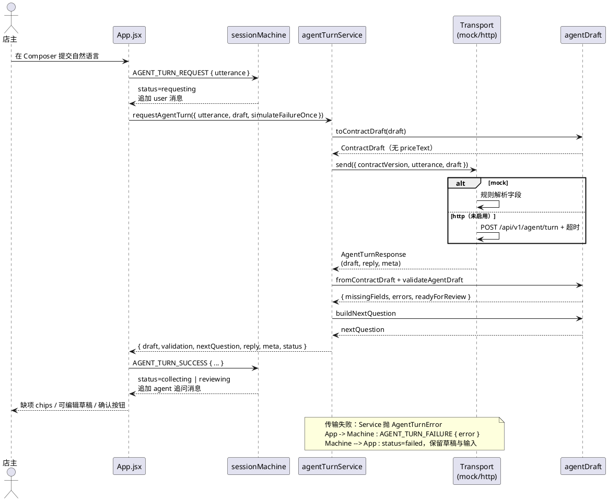
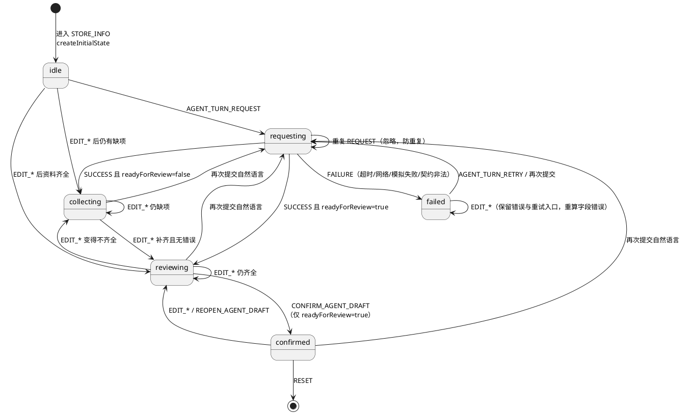
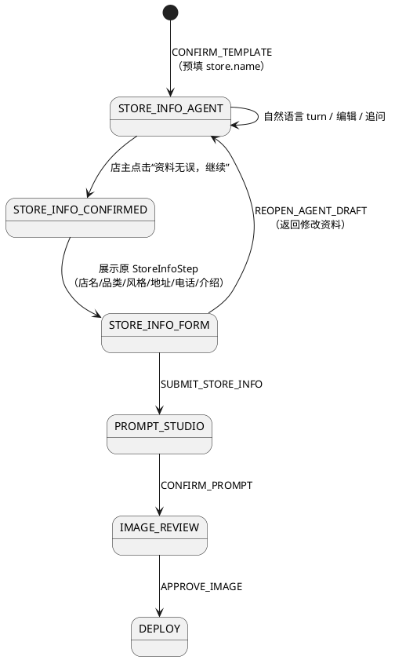
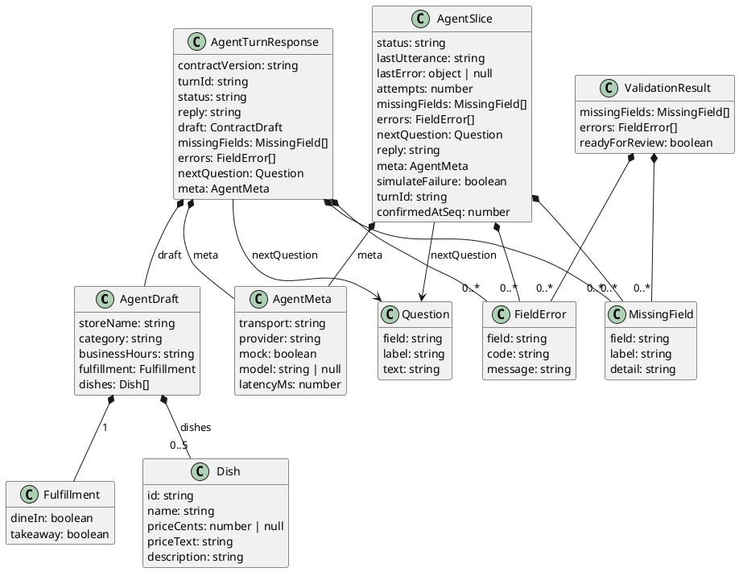

# 智能开店 Agent 资料收集 · 技术设计（agent-turn.v1）

> 文档状态：设计评审稿（本轮不写业务代码）
> 设计日期：2026-10-31
> 适用阶段：STORE_INFO 阶段接入自然语言资料收集与结构化草稿确认
> 关联契约：[`agent-turn-contract.md`](agent-turn-contract.md)（实施时创建）、[`api.md`](api.md)、[`后端待实现接口清单.md`](后端待实现接口清单.md)、[`product-scope.md`](product-scope.md)
> 上限约束：本轮只使用明确标注的本地 mock；不调用真实模型，不配置或伪造华为云凭据，不修改 `server/`、`templates/mini-program/`、`miniprogram/` 与 B1 点餐业务模块。

---

# 一、需求与存量功能关系分析

## 1.1 需求功能与存量功能对比

### 1.1.1 已实现功能

已实现功能指可直接复用、且不需要改变既有语义的部分。匹配度判定依据见最后一列。

| 需求功能 | 存量功能 | 代码位置 | 匹配度 | 判定依据 |
| --- | --- | --- | --- | --- |
| STORE_INFO 作为资料收集插入点 | 九阶段状态机中的 `store-info` 阶段 | `src/state/constants.mjs:1-11`、`src/App.jsx:444-455` | 100% | 阶段已存在，`renderStage` 已有独立分支，无需新增顶层 phase |
| 会话内展示追问与店主回答 | `appendMessages` 与消息 `role`、`staged`、`instant` 约定 | `src/state/sessionMachine.mjs:46-68`、`src/components/chat/ChatStream.jsx:6-25` | 100% | 已有 user/agent/system 三类消息与逐条揭示机制，可直接追加 turn 消息 |
| 店主命名后作为项目名 | `SUBMIT_NAME` 写入 `store.name` 并同步主会话标题 | `src/state/sessionMachine.mjs:129-139` | 100% | 店名来源已存在，可在 `CONFIRM_TEMPLATE` 时预填草稿 |
| 组件只收属性、只发事件 | `Composer`、`StoreInfoStep` 的受控组件写法 | `src/components/chat/Composer.jsx:3-49`、`src/components/build/StoreInfoStep.jsx:4-144` | 100% | 两个组件均无服务层依赖、无全局状态读取，可沿用同一纪律 |
| 金额以整数分表达 | 导出脚本与测试使用 `priceCents` | `test/generator.test.cjs:36-38`、`docs/api.md:10` | 100% | 仓库已有“整数分”约定，草稿沿用 `priceCents`，不引入浮点金额 |
| 会话阶段推进与交接 | `createStepSession` 创建 step 会话并写 system 交接 | `src/state/sessionMachine.mjs:87-111` | 100% | 确认资料后仍走原 `SUBMIT_STORE_INFO` → `PROMPT_STUDIO`，交接逻辑无需重写 |
| 状态机单测基础设施 | `node:test` + 动态 `import()` 加载 ESM | `test/session-machine.test.cjs:1-19`、`package.json:13` | 100% | 新领域模块可用同一方式测试，无需新增测试框架 |
| 异步服务调用模式 | `agentService.js` 的 `async` 函数 + 延时占位 | `src/services/agentService.js:16-67` | 75% | 调用形态可复用；但缺少失败态、取消、契约版本与传输隔离，不能直接照搬 |
| 右栏上下文卡片 | `buildPanelCards` 的 `switch` 分组 | `src/App.jsx:51-223` | 100% | 可在 STORE_INFO 分支追加 Agent 卡片，不影响其他阶段 |
| 样式按模块拆分 | `styles/index.css` 统一 `@import` | `src/styles/index.css:1-7` | 100% | 新增 `agent.css` 后只需追加一行 import，不触碰现有样式 |

### 1.1.2 需要扩展的功能

| 需求功能 | 存量功能 | 差异说明 | 扩展方向 |
| --- | --- | --- | --- |
| 在 STORE_INFO 输入自然语言 | 该阶段 `composerVisible` 为 false，仅渲染原表单 | 输入通道缺失；`COMPOSER_PHASES` 只含 onboarding/prompt-studio/image-review（`src/App.jsx:43`、`:495`） | 将 `STORE_INFO` 加入 Composer 可见阶段，增加 placeholder、提交标签与提示；不新增第二个输入框 |
| 结构化草稿 | `state.store` 只有 `name/type/notes/address/phone` 五个扁平字段（`src/state/sessionMachine.mjs:38`） | 缺菜品数组、履约方式、营业时间、字段级校验与确认态 | 新增独立 `agentDraft` 切片，不改造 `store` 既有字段；确认时再一次性映射 |
| 资料缺项追问 | 现有阶段只输出固定引导文案 | 无缺项计算、无 `nextQuestion`、无字段级错误 | 领域层纯函数统一计算 `missingFields/errors/readyForReview/nextQuestion`，reducer 只接收结果 |
| 请求中 / 失败 / 重试 | 现有 `agentService` 无 catch，无失败态（`docs/上一轮构建问题审计与修复交接.md:27`） | 请求失败会留下忙碌态，无错误提示与重试入口 | 新增 `agent.status` 子状态与 `agent.lastError`；Composer 在失败后保持可用；手动重试复用上一次 utterance |
| mock 与真实模型可替换 | 无传输层，函数体内直接返回占位数据（`src/services/agentService.js:16-67`） | 没有 transport 抽象、没有契约版本、没有 HTTP 实现 | 新增 `agentTurnService` 唯一入口 + `mockAgentTransport` / `httpAgentTransport` 双实现，配置常量切换 |
| 店名预填草稿 | `CONFIRM_TEMPLATE` 已把项目名写入 `store.name` | 草稿尚未创建，模板确认后不会自动带入 | 在 `CONFIRM_TEMPLATE` 返回前把 `store.name` 写入 `agentDraft.storeName`，并重新计算缺项 |
| 店主确认后继续原流程 | `StoreInfoStep` 仍负责地址/电话/介绍/风格 | Agent 确认与 `StoreInfoStep` 提交是两个不同确认 | Agent 的 `confirmed` 只解锁原表单；原表单的 `SUBMIT_STORE_INFO` 仍是进入 `PROMPT_STUDIO` 的唯一开关 |
| STORE_INFO 右栏提示 | 现有右栏只讲“店铺信息与装修风格” | 未体现 Mock 标识、缺项、确认进度 | 追加 Agent 状态卡：传输模式、已完成字段、缺项数量、下一步 |
| 新增视觉样式 | `build.css` / `chat.css` 已有表单与消息样式 | 直接复用会让 Agent 面板与旧表单样式耦合 | 新增命名空间为 `.agent-*` 的 `agent.css`；不修改既有类名 |

### 1.1.3 需要新增的功能或接口

#### A. 领域层（纯函数，无 IO）

| 功能点 | 输入 | 输出 | 核心逻辑 | 依赖 |
| --- | --- | --- | --- | --- |
| 空草稿工厂 | 无 | `AgentDraft` | 所有字段为空，`fulfillment` 双 false，`dishes` 空数组 | 无 |
| 草稿校验 | `AgentDraft` | `{ missingFields, errors, readyForReview }` | 先判缺项，再判格式、边界与交叉约束；`readyForReview` 仅在两者均空时为 true | 校验规则表 |
| 下一问生成 | 校验结果 | `{ field, label, text } \| null` | 按固定优先级取第一个缺项或错误，生成中文追问 | 校验结果 |
| 草稿合并 | `AgentDraft` + `DraftPatch` | 新 `AgentDraft` | 只接受白名单字段；字符串 trim；价格文本同步为整数分；菜品按 id 合并 | 价格解析 |
| 契约投影 | `AgentDraft` | `ContractDraft` | 剥离 `priceText` 等前端编辑字段，只保留可传输字段 | 无 |
| 契约反投影 | `ContractDraft` | `AgentDraft` | 补齐内部 `priceText`，规范化空值，生成缺失 id | 金额格式化 |
| 价格文本解析 | `"28"`、`"28.5"`、`"¥28.00"` 等 | `{ ok, cents, code }` | 字符串解析整数与两位小数，不使用浮点乘法 | 无 |
| 金额格式化 | `priceCents` | `"28.00"` | 整数分转两位小数字符串 | 无 |

#### B. 服务层（唯一 IO 边界）

| 功能点 | 输入 | 输出 | 核心逻辑 | 依赖 |
| --- | --- | --- | --- | --- |
| 传输配置 | 无 | 常量与 `describeAgentTransport()` | 固定 `mock`，暴露可辨识文案 | 无 |
| mock 传输 | `AgentTurnRequest` | `AgentTurnResponse` | 规则解析自然语言；返回 `meta.mock=true`；可注入一次性失败 | 领域价格解析 |
| HTTP 传输 | `AgentTurnRequest` | `AgentTurnResponse` | `POST /api/v1/agent/turn`、超时、错误归一化、响应校验、可选 Authorization 注入 | 注入的 `fetch` |
| turn 服务 | `{ utterance, draft, simulateFailureOnce }` | `{ draft, validation, nextQuestion, reply, meta, status }` | 组装请求、选择 transport、反投影、以本地校验覆盖服务端就绪判断 | 领域层 + transport |
| 错误归一化 | 任意异常 | `AgentTurnError` | 统一 `code/message/retryable/details`，禁止堆栈外泄 | 无 |

#### C. 状态层（同步 reducer 增量）

| 功能点 | 输入 | 输出 | 核心逻辑 | 依赖 |
| --- | --- | --- | --- | --- |
| 请求生命周期 | `AGENT_TURN_REQUEST/RETRY/SUCCESS/FAILURE` | 新 state | 维护 `status`、`attempts`、`lastError`，追加消息 | 领域校验 |
| 草稿编辑 | `EDIT_AGENT_DRAFT_FIELD`、`EDIT_AGENT_DISH`、`ADD/REMOVE_AGENT_DISH`、`EDIT_AGENT_FULFILLMENT` | 新 state | 合并草稿后立即重算缺项；确认态编辑降级为 `reviewing` | 领域合并/校验 |
| 确认与重开 | `CONFIRM_AGENT_DRAFT`、`REOPEN_AGENT_DRAFT` | 新 state | 只有 `readyForReview` 可确认；确认映射到 `store`；重开回到 `reviewing` | 领域校验 |
| 模拟失败开关 | `AGENT_SIMULATE_FAILURE` | 新 state | 只影响 mock 的下一请求；请求结束自动复位 | 无 |

#### D. UI 组件

| 功能点 | 输入 | 输出 | 核心逻辑 | 依赖 |
| --- | --- | --- | --- | --- |
| Agent 状态面板 | 状态、缺项、错误、重试函数 | 事件 | 展示 Mock 标识、追问、缺项 chips、失败条、重试、确认/重开 | 仅 props |
| 草稿编辑器 | 草稿、校验结果 | 字段变更、菜品增删事件 | 受控输入、字段级错误、价格文本输入、菜品 3–5 道提示 | 仅 props |
| 草稿摘要 | 已确认的展示模型 | 重开事件 | 只读摘要，金额由外部格式化后传入 | 仅 props |

#### E. 测试与文档

| 功能点 | 输入 | 输出 | 核心逻辑 | 依赖 |
| --- | --- | --- | --- | --- |
| 领域单测 | 边界样例 | 断言 | 覆盖 1/48/49 字、3/5/6 道菜、0/1/999999/1000000 分等 | `node:test` |
| 传输单测 | 注入 fetch stub | 断言 | 不发真实请求，覆盖超时、4xx/5xx、非法响应 | `node:test` |
| 流程单测 | reducer + service | 断言 | 不渲染 React，覆盖追问、确认、编辑回退、失败重试 | `node:test` |
| 契约文档 | 本设计 | `agent-turn-contract.md` | 冻结请求/响应、错误码、替换步骤、待确认项 | 本设计 |

## 1.2 存量功能详细分析

### 1.2.1 `src/state/sessionMachine.mjs`

| 维度 | 结论 |
| --- | --- |
| 接口契约 | `createInitialState()` 返回完整 state；`reducer(state, action)` 是同步纯函数，未知 action 原样返回；`selectActiveSession/selectSelectedFeatures` 是只读选择器 |
| 业务规则 | `seq` 单调递增生成消息 id；`staged` 控制逐条揭示；`createStepSession` 会先把旧 step 会话标记 `done`，再新建会话并把 `handoff` 作为首条 system 消息；`CONFIRM_TEMPLATE` 是进入 STORE_INFO 的唯一路径 |
| 扩展点 | `createInitialState` 的返回对象、`reducer` 的 `switch`、`CONFIRM_TEMPLATE` 的返回值、`SET_STORE_FIELD`、`SUBMIT_STORE_INFO` 前的防御判断；`default` 分支保证新增 action 不会影响旧行为 |
| 约束 | 不得在 reducer 内发请求、读时间、读随机数；不得改变既有消息 id 规则；不得让新增字段参与旧测试的严格深比较；`RESET` 必须把 Agent 切片一起还原 |

**对本设计的影响**：所有自然语言解析与 HTTP 调用必须发生在 reducer 之外；reducer 只接收 `AGENT_TURN_SUCCESS/FAILURE` 的最终结果。草稿校验是纯函数，可以在 reducer 内同步调用，但不得产生 IO。

### 1.2.2 `src/App.jsx`（组合根）

| 维度 | 结论 |
| --- | --- |
| 接口契约 | `useReducer(reducer, createInitialState)`；`phase` 决定主舞台；`renderStage()` 按 phase 返回组件；`COMPOSER_PHASES` 决定输入框可见性；`handleComposerSubmit` 按 phase 分流 |
| 业务规则 | `BUILDING/PROMPT_STUDIO/IMAGE_REVIEW/DEPLOY` 各自有 `useEffect` 驱动的占位异步；`BUILDING/DEPLOY` 属于 `CLOSED_PHASES`，不显示 Composer；右栏由 `buildPanelCards` 生成 |
| 扩展点 | STORE_INFO 的 `renderStage` 分支、`COMPOSER_PHASES`、`COMPOSER_PLACEHOLDER/SUBMIT_LABEL/HINTS`、`buildPanelCards` 的 case、提交分流函数、传给 `StoreInfoStep` 的 `storeTypes` |
| 约束 | 组件不直接 `fetch`；异步只能由用户事件触发或明确的 effect 触发；不得把 Agent 请求放进无条件 `useEffect`，避免 StrictMode 双调用与阶段切换重复请求；不得改动模板匹配/生图/部署占位逻辑 |

### 1.2.3 `Composer` 与 `StoreInfoStep`

| 组件 | 契约 | 可复用点 | 不可做 |
| --- | --- | --- | --- |
| `Composer` | `value/placeholder/submitLabel/disabled/hint/onChange/onSubmit` | 在 STORE_INFO 复用同一个输入框；`disabled` 可只控制提交按钮与 Enter，不控制 textarea 的编辑能力 | 组件内不发请求、不判断业务状态 |
| `StoreInfoStep` | 受控 `store`、`storeTypes`、`styles`、`styleId`、`onFieldChange/onStyleChange/onSubmit` | Agent 确认后直接展示原表单；通过组合根注入额外品类选项即可兼容自由品类 | 本轮不改其内部结构，避免与未提交改动冲突 |

**注意**：`Composer` 当前的 `disabled` 会同时禁用 textarea 与按钮（`src/components/chat/Composer.jsx:27-36`）。需求要求“失败后 Composer 不禁用”，因此失败态直接传 `disabled=false` 即可；请求中是否禁用由 App 决定，设计为“textarea 可编辑、提交按钮禁用”，需要给 Composer 增加一个可选 `submitDisabled` 属性，或在 App 层用 `disabled={requesting}` 并在面板提供重试。前者更精确，属于小范围增量，需在文件清单中注明。

### 1.2.4 `src/services/agentService.js`

| 维度 | 结论 |
| --- | --- |
| 现状 | 模板候选、提示词、生图均为 `await wait(...)` 后返回本地占位；无错误态、无取消、无契约版本 |
| 复用 | 只复用“服务层导出 async 函数”的调用形态 |
| 不改原因 | 该文件同时服务模板匹配、生图、部署占位；本轮改动会扩大回归面，且用户明确要求既有占位不改 |
| 新服务关系 | `agentTurnService` 独立目录，不与 `agentService.js` 互相 import；两者共享的只有 UI 调用方式 |

### 1.2.5 测试与构建基础设施

| 维度 | 结论 |
| --- | --- |
| 测试运行 | `npm test` 使用 `node --test test/*.test.cjs`；测试文件为 CommonJS，通过动态 `import()` 加载 `.mjs` |
| 现有覆盖 | 20 项：导出工程 2 项 + 状态机/交接/引导 18 项；没有 React 渲染测试 |
| 构建 | Vite；`npm run build` 通过；不引入新依赖即可新增 `.mjs/.js/.jsx/.css` |
| 约束 | 不引入 Jest/Vitest/Testing Library；UI 行为用 reducer 与服务层集成测试 + 人工走查覆盖 |
| 证据 | `test/session-machine.test.cjs:21-284`、`test/generator.test.cjs:8-47`、`package.json:7-17` |

### 1.2.6 文档与契约边界

| 文档 | 现有内容 | 与本设计的关系 |
| --- | --- | --- |
| `docs/api.md` | B1 点餐 API：鉴权、门店、目录、订单、店主接口 | 不新增 agent 接口到该文件；避免把生成器会话与点餐业务混在一起 |
| `docs/后端待实现接口清单.md` | 项目/会话、目录、模板候选、提示词、生图、部署；**没有** `agent/turn` | 本轮新增一节，明确 `agent/turn` 是资料收集能力，与 `store-projects`、`generation/*` 并列但不同 |
| `docs/backend-data-model.md` | `sessions` 是服务端不透明 Token（`docs/backend-data-model.md:12,35-45`） | Agent turn 不创建、不复用 B1 `sessions`；本轮不落库 |
| `docs/product-scope.md` | AI 只推荐模板/风格，不生成业务代码（`docs/product-scope.md:15-19`） | 本轮 Agent 只做字段抽取与追问，不做自主规划、不生成代码、不发布 |
| `docs/上一轮构建问题审计与修复交接.md` | 指出 `agentService` 无失败态（第 27 行） | 本设计把失败态作为一等状态，不重复该缺陷 |

### 1.2.7 存量约束与冲突预判

1. **未提交改动密集**：`src/App.jsx`、`src/components/`、`src/state/`、`src/services/agentService.js`、`server/` 均处于未提交状态。实施时必须只做局部 `Edit` 与新增文件，禁止 `git reset/checkout/clean`、禁止全文件重排或格式化。
2. **阶段语义不可变**：STORE_INFO 仍是“店铺装修”阶段；Agent 只是该阶段的前置资料收集，不新增顶层 phase，避免影响会话树、阶段文案和现有测试。
3. **现有 20 项测试必须保持通过**：新增 state 字段必须不破坏现有断言；`createStepSession` 的会话数量、标题、交接文本不变。
4. **无新依赖**：不引入表单库、校验库、HTTP 库、状态库、React 测试库。所有能力用原生 React、原生 `fetch`、纯 JS 函数实现。
5. **不触碰服务端**：本轮不实现 `POST /api/v1/agent/turn`，只冻结契约并保留 HTTP transport 的完整实现（不启用）。不修改 `server/`，不运行 server 命令。

---

# 二、增量设计方案

## 2.1 实现模型

### 2.1.1 上下文视图



| 交互 | 协议 | 频率 | 本轮状态 |
| --- | --- | --- | --- |
| 店主 → UI | 键鼠输入 | 每次补充资料 1 次 | 启用 |
| UI → `agentTurnService` | 进程内函数调用 | 每次提交 1 次；编辑不调用 | 启用 |
| Service → mock | 进程内函数调用 | 每次提交 1 次 | 启用 |
| Service → HTTP | `fetch` + JSON | 每次提交 1 次 | 代码保留，配置不启用 |
| HTTP → 后端 | `POST /api/v1/agent/turn` | 每次提交 1 次 | 后端未实现 |
| 后端 → ModelArts | 服务端私有协议 | 每次 turn 1 次 | 本轮不涉及 |

**边界说明**：React 组件永远不接触 `fetch`；`httpAgentTransport` 是唯一包含 HTTP 语义的文件；mock 与 HTTP 返回同一 `AgentTurnResponse` 形状，通过 `meta.transport/provider/mock/model` 明确标识，UI 必须展示该标识。

### 2.1.2 服务/组件总体架构



| 层 | 职责 | 允许 | 禁止 |
| --- | --- | --- | --- |
| React 展示层 | 渲染状态、派发用户意图 | 受控属性、纯 UI 状态（折叠/聚焦） | `fetch`、读取全局业务状态、直接 import 服务层、计算价格/校验 |
| 状态层 | 原子状态转换、消息追加 | 调用领域纯函数做校验 | 异步、IO、随机、时间 |
| 领域层 | 草稿规范化、校验、价格换算、契约投影 | 纯函数 | 网络、DOM、localStorage |
| 服务层 | 请求组装、transport 选择、响应反投影、错误归一化 | `fetch`（仅 HTTP transport）、超时、取消 | 直接操作 React state、写数据库、读取凭据 |
| 传输层 | mock 规则解析 / HTTP 契约实现 | 规则表、`fetch` 注入 | 决定 `readyForReview`、写业务状态 |

### 2.1.3 实现设计文档

#### A. 一次 turn 的时序



#### B. 草稿子状态机



**关键规则**：

1. `confirmed` 只表示“店主确认了结构化资料”，不表示已保存到后端、不表示已发布。确认动作只发生在内存。
2. `failed` 只描述“最近一次请求失败”，不冻结输入；失败后草稿仍可编辑，`lastError` 一直保留到下一次请求开始。
3. 任何在 `confirmed` 下的编辑都回到 `reviewing`，即使编辑后仍然齐全，也必须由店主再次点击确认。这比“必要时才回退”更保守，避免确认内容与展示内容不一致。
4. `requesting` 期间忽略新的 `AGENT_TURN_REQUEST`，但允许编辑 textarea 内容（草稿编辑也可进行，下一次请求使用最新草稿）。
5. `RESET` 恢复 `idle` 与空草稿，清空错误、消息与模拟失败开关。

#### C. 确认与阶段推进



**确认后的字段映射**：

| 草稿字段 | `state.store` 字段 | 说明 |
| --- | --- | --- |
| `storeName` | `name` | 直接覆盖，长度已在领域层校验 |
| `category` | `type` | 自由文本；`StoreInfoStep` 的 `select` 需要注入该选项，见 2.5.3 |
| `businessHours` | 不写入 `store` | 保留在 `agentDraft` 与确认摘要；不污染 `store.notes`，避免影响后续 `composePrompt` 的文案 |
| `fulfillment` | 不写入 `store` | 保留在 `agentDraft` 与确认摘要；原表单没有履约控件，未来后端导入时再映射 |
| `dishes` | 不写入 `store` | 保留在 `agentDraft`；`SUBMIT_STORE_INFO` 的交接 payload 携带契约投影，供后续阶段使用 |

> 设计取舍：`state.store` 是既有阶段共享的扁平结构，本轮不把它改造成嵌套模型，也不把营业时间/履约/菜品塞进 `notes`。`store` 只承接原表单本来就有的 `name/type/address/phone/notes`；结构化经营资料完整保留在 `agentDraft`，确认摘要只读展示，后续接入后端时由契约草稿承载。这样既不污染 `composePrompt` 的输入，也不改变导出逻辑。

#### D. 扩展点设计

| 扩展点 | 机制 | 默认实现 | 未来替换 |
| --- | --- | --- | --- |
| 传输方式 | `AGENT_TRANSPORT` 常量 + service 工厂 | `mock` | 改为 `http` 并注入 endpoint/Authorization，组件与 reducer 不变 |
| mock 规则 | `mockAgentTransport` 内部规则表 | 店名/品类/营业时间/履约/菜品 | 规则可单测、可替换；不散落在组件 |
| HTTP 客户端 | `createHttpTransport({ fetchImpl, getAuthorization })` | 未启用 | 注入真实 `fetch`、Token provider、超时 |
| 校验规则 | `agentDraft.mjs` 集中定义 | 见 2.3.4 | 后端接入后保持一致；前端仍保留最终门槛 |
| UI | 三个独立组件 | `AgentIntakePanel/DraftEditor/AgentDraftSummary` | 可单独替换或删除，不影响 service/reducer |

#### E. 事务与一致性

本轮无数据库事务、无跨进程写入。一致性边界是“一次 reducer 返回的新 state”：

- `AGENT_TURN_SUCCESS` 在同一 action 中同时更新草稿、校验结果、消息与状态，避免出现“草稿已更新但状态仍是 requesting”的中间态。
- `CONFIRM_AGENT_DRAFT` 在同一 action 中完成状态切换与 `store` 映射，避免确认按钮可点但数据未同步。
- 失败时不写入部分响应：transport 要么返回完整响应，要么抛错；service 不在 catch 中修改草稿。
- 确认前不写 `localStorage`、不调用后端、不触发部署；刷新页面即丢失，符合本轮“不持久化”的边界。

## 2.2 接口设计

### 2.2.1 总体设计

| 接口分类 | 命名 | 稳定性 | 说明 |
| --- | --- | --- | --- |
| HTTP 契约 | `POST /api/v1/agent/turn` | 冻结（`agent-turn.v1`） | 本轮只冻结，不实现后端 |
| 请求/响应 schema | `AgentTurnRequest` / `AgentTurnResponse` | 冻结 | `contractVersion` 必填；不兼容变更升 `agent-turn.v2` |
| 领域函数 | `validateAgentDraft`、`applyDraftPatch`、`toContractDraft` 等 | 稳定 | 纯函数；签名与返回值写入契约文档 |
| 服务入口 | `requestAgentTurn`、`describeAgentTransport` | 稳定 | React 唯一调用入口 |
| transport 接口 | `createMockTransport` / `createHttpTransport` | 稳定 | 返回 `{ name, send }`；不对外暴露内部规则 |
| reducer action | `AGENT_*` | 稳定（内部） | 只由组合根派发；组件不直接 dispatch |
| 配置常量 | `AGENT_TRANSPORT`、`AGENT_ENDPOINT`、`AGENT_TIMEOUT_MS`、`AGENT_CONTRACT_VERSION` | 稳定 | 不读取环境变量、不读取凭据 |

**版本策略**：

1. 请求和响应都必须携带 `contractVersion`；service 与 HTTP transport 双重校验。
2. 响应版本不匹配时抛 `AGENT_CONTRACT_MISMATCH`，不可重试，UI 提示“客户端与服务端契约版本不一致”。
3. 字段只增不改语义；新增可选字段不升级版本，删除/改义必须升版本。
4. mock 响应也必须带版本号，保证替换 HTTP 时前端不改代码。

**认证策略**：

- 本轮 mock 无认证。
- HTTP transport 预留 `getAuthorization()` 注入函数，返回 `null` 或 `Bearer <token>`；默认返回 `null`。
- 不读取 `localStorage`、`import.meta.env`、`.env` 中的任何密钥；不在前端配置华为云 AK/SK。
- 真实接入时由宿主应用注入短期 Token，token 不写日志、不进错误体。

### 2.2.2 接口清单

#### A. `POST /api/v1/agent/turn`（冻结，本轮不实现）

**用途**：把店主的一段自然语言与当前草稿合并，返回更新后的草稿、缺项、追问与 Mock/真实模型元信息。

**前置条件**：

1. `utterance` 为 1–500 字的非空字符串（去除首尾空白后）。
2. `draft` 符合 `ContractDraft` schema；允许所有字段为空。
3. `contractVersion` 必须为 `agent-turn.v1`。
4. 未来启用 HTTP 时，调用方持有有效 Token；本轮不要求。

**后置条件**：

1. 返回的 `draft` 是“输入草稿 + 本次抽取”的合并结果，不删除输入草稿中已有的合法字段。
2. `missingFields/errors` 只描述字段问题，不包含堆栈、SQL、密钥、OpenID。
3. `meta.mock=true` 时，响应必须明确标识未调用真实模型。
4. 本轮无服务端写入；未来实现也不得在店主确认前落库。

**请求头**：

| 头 | 必填 | 说明 |
| --- | --- | --- |
| `Content-Type` | 是 | `application/json; charset=utf-8` |
| `Accept` | 是 | `application/json` |
| `X-Agent-Contract` | 否 | `agent-turn.v1`，便于网关路由与日志 |
| `Authorization` | 未来 | `Bearer <token>`；本轮 mock 不发送 |

**请求体字段**：

| 字段 | 类型 | 必填 | 约束 | 说明 |
| --- | --- | --- | --- | --- |
| `contractVersion` | string | 是 | 固定 `"agent-turn.v1"` | 契约版本 |
| `utterance` | string | 是 | trim 后 1–500 字 | 本轮新增的自然语言 |
| `draft` | `ContractDraft` | 是 | 见下方草稿 schema | 当前草稿；首次为空草稿 |
| `client.surface` | string | 是 | 固定 `"desktop"` | 调用面标识 |
| `client.phase` | string | 是 | 固定 `"store-info"` | 便于服务端日志与路由 |
| `projectId` | string \| null | 否 | 本轮固定 `null` | 未来项目持久化后使用；不生成假 ID |

**`ContractDraft` 字段**：

| 字段 | 类型 | 必填 | 约束 | 说明 |
| --- | --- | --- | --- | --- |
| `storeName` | string | 是 | 空串或 1–48 字 | 未填写用空串，不用 `null` |
| `category` | string | 是 | 空串或 1–24 字 | 自由文本，不限定枚举 |
| `businessHours` | string | 是 | 空串或合法时段串 | `HH:MM-HH:MM`，多段用英文逗号分隔 |
| `fulfillment.dineIn` | boolean | 是 | `true/false` | 堂食 |
| `fulfillment.takeaway` | boolean | 是 | `true/false` | 自取 |
| `dishes` | `ContractDish[]` | 是 | 0–5 个 | 少于 3 个由校验报缺项 |
| `dishes[].id` | string | 是 | 1–32 个可见字符 | 本地稳定引用，不是数据库主键 |
| `dishes[].name` | string | 是 | 空串或 1–24 字 | 菜名 |
| `dishes[].priceCents` | integer \| null | 是 | `null` 或 1–999999 | 整数分；禁止浮点与字符串；`null` 表示未填或非法，由校验报缺项/错误 |
| `dishes[].description` | string | 是 | 空串或 ≤60 字 | 可为空 |

**请求示例（首次，空草稿）**：

```json
{
  "contractVersion": "agent-turn.v1",
  "utterance": "店名叫松月食堂，做社区家常菜，每天 10:00-21:00，堂食和自取都做。招牌是宫保鸡丁 28 元、番茄炒蛋 16 元、米饭 3 元。",
  "draft": {
    "storeName": "",
    "category": "",
    "businessHours": "",
    "fulfillment": { "dineIn": false, "takeaway": false },
    "dishes": []
  },
  "client": { "surface": "desktop", "phase": "store-info" },
  "projectId": null
}
```

**响应体字段**：

| 字段 | 类型 | 必填 | 约束 | 说明 |
| --- | --- | --- | --- | --- |
| `contractVersion` | string | 是 | `agent-turn.v1` | 版本校验 |
| `turnId` | string | 是 | 1–64 个可见字符 | mock 为 `turn-mock-<n>`；未来由后端生成 |
| `status` | string | 是 | `collecting` \| `reviewing` | 服务端视角；`confirmed` 永不出现 |
| `reply` | string | 是 | 1–500 字 | 面向店主的中文回复 |
| `draft` | `ContractDraft` | 是 | 同请求 schema | 合并后的草稿 |
| `missingFields` | `MissingField[]` | 是 | 可为空数组 | `{ field, label, detail }` |
| `errors` | `FieldError[]` | 是 | 可为空数组 | `{ field, code, message }` |
| `nextQuestion` | `Question \| null` | 是 | `reviewing` 时为 `null` | `{ field, label, text }` |
| `meta.transport` | string | 是 | `"mock"` \| `"http"` | 传输类型 |
| `meta.provider` | string | 是 | `"local-mock"` \| 未来供应商名 | 供应商 |
| `meta.mock` | boolean | 是 | 本轮固定 `true` | 是否为 Mock |
| `meta.model` | string \| null | 是 | 本轮固定 `null` | 模型标识；Mock 不得伪造模型名 |
| `meta.latencyMs` | number | 否 | ≥0 | 便于 UI 展示与排障，不参与业务判断 |

**响应示例（collecting，缺营业时间）**：

```json
{
  "contractVersion": "agent-turn.v1",
  "turnId": "turn-mock-3",
  "status": "collecting",
  "reply": "店名和菜品我记下了，还差营业时间。比如 10:00-21:00。",
  "draft": {
    "storeName": "松月食堂",
    "category": "社区餐馆",
    "businessHours": "",
    "fulfillment": { "dineIn": true, "takeaway": true },
    "dishes": [
      { "id": "dish-1", "name": "宫保鸡丁", "priceCents": 2800, "description": "" },
      { "id": "dish-2", "name": "番茄炒蛋", "priceCents": 1600, "description": "" },
      { "id": "dish-3", "name": "米饭", "priceCents": 300, "description": "" }
    ]
  },
  "missingFields": [
    { "field": "businessHours", "label": "营业时间", "detail": "格式 HH:MM-HH:MM，例如 10:00-21:00" }
  ],
  "errors": [],
  "nextQuestion": {
    "field": "businessHours",
    "label": "营业时间",
    "text": "每天几点到几点营业？例如 10:00-21:00。"
  },
  "meta": {
    "transport": "mock",
    "provider": "local-mock",
    "mock": true,
    "model": null,
    "latencyMs": 18
  }
}
```

**响应示例（reviewing，资料齐全）**：

```json
{
  "contractVersion": "agent-turn.v1",
  "turnId": "turn-mock-4",
  "status": "reviewing",
  "reply": "资料齐了：松月食堂，社区餐馆，10:00-21:00，堂食和自取，3 道菜。请检查后确认。",
  "draft": {
    "storeName": "松月食堂",
    "category": "社区餐馆",
    "businessHours": "10:00-21:00",
    "fulfillment": { "dineIn": true, "takeaway": true },
    "dishes": [
      { "id": "dish-1", "name": "宫保鸡丁", "priceCents": 2800, "description": "" },
      { "id": "dish-2", "name": "番茄炒蛋", "priceCents": 1600, "description": "" },
      { "id": "dish-3", "name": "米饭", "priceCents": 300, "description": "" }
    ]
  },
  "missingFields": [],
  "errors": [],
  "nextQuestion": null,
  "meta": {
    "transport": "mock",
    "provider": "local-mock",
    "mock": true,
    "model": null,
    "latencyMs": 21
  }
}
```

**HTTP 状态码**：

| HTTP | 场景 | 前端归一化 |
| --- | --- | --- |
| `200` | 成功 | 正常解析 |
| `400` / `422` | 请求体或字段非法 | `AGENT_HTTP_4XX`，`retryable=false` |
| `401` / `403` | 未登录 / 无权限 | `AGENT_HTTP_4XX`，`retryable=false`，提示重新登录 |
| `429` | 限流 | `AGENT_RATE_LIMITED`，`retryable=true` |
| `500` / `503` | 服务端异常 | `AGENT_HTTP_5XX`，`retryable=true` |
| 超时 | 超过 `AGENT_TIMEOUT_MS` | `AGENT_TIMEOUT`，`retryable=true` |

**错误响应体**沿用 `docs/api.md:15-24` 的 `{ code, message, requestId, details? }`，不返回堆栈、SQL、密钥或模型原始输出。

#### B. 领域函数接口

```js
// 全部为纯函数，输入输出不依赖 React、DOM、网络、时间
createEmptyAgentDraft(): AgentDraft
normalizeAgentDraft(input): AgentDraft
validateAgentDraft(draft): ValidationResult
buildNextQuestion(validation): Question | null
applyDraftPatch(draft, patch): AgentDraft
toContractDraft(draft): ContractDraft
fromContractDraft(contractDraft): AgentDraft
parsePriceTextToCents(text): { ok, cents, code }
formatCents(cents): string
createDishId(dishes): string
```

| 函数 | 前置 | 后置 | 异常 / 失败 |
| --- | --- | --- | --- |
| `createEmptyAgentDraft` | 无 | 返回所有空字段、双 false、空菜品数组 | 不抛异常 |
| `normalizeAgentDraft` | 任意对象 | 未知字段丢弃；字符串 trim；布尔强制；`priceCents` 只接受整数或 `null` | 不抛异常；非法值归零/空 |
| `validateAgentDraft` | 合法 `AgentDraft` | 返回缺项、错误、`readyForReview` | 不抛异常；内部异常兜底为字段错误 |
| `buildNextQuestion` | 校验结果 | 返回第一个问题的中文追问；齐全时 `null` | 不抛异常 |
| `applyDraftPatch` | 草稿 + 白名单 patch | 返回新草稿；价格文本同步 `priceCents`；菜品按 id 合并 | 不抛异常；未知 patch 字段忽略 |
| `toContractDraft` | 草稿 | 返回可 JSON 序列化的 `ContractDraft`，无 `priceText` | 不抛异常 |
| `fromContractDraft` | `ContractDraft` | 补 `priceText = formatCents(priceCents)`；补缺失 id | 不抛异常；非法结构按空草稿处理并记错误 |
| `parsePriceTextToCents` | 任意字符串 | `{ ok:true, cents }` 或 `{ ok:false, cents:null, code }` | 不抛异常 |
| `formatCents` | 整数分 | `"28.00"`；非法输入返回 `""` | 不抛异常 |
| `createDishId` | 当前菜品数组 | `dish-<max+1>`，删除后不复用 | 不抛异常 |

**调用示例（服务层内部，非实现代码）**：

```js
const merged = applyDraftPatch(currentDraft, patchFromTransport);
const validation = validateAgentDraft(merged);
const nextQuestion = buildNextQuestion(validation);
const contractDraft = toContractDraft(merged);
```

#### C. transport 接口

```js
createMockTransport(options?): { name: 'mock', send(request, context?) }
createHttpTransport({ fetchImpl, endpoint, timeoutMs, getAuthorization }): { name: 'http', send(request, context?) }
```

| 项目 | mock | http |
| --- | --- | --- |
| `send` 入参 | `AgentTurnRequest` | 同左 |
| `send` 出参 | `AgentTurnResponse` | 同左 |
| 失败方式 | 抛 `AgentTurnError` | 同左 |
| 超时 | 无（同步规则解析） | `AbortController` + timer，默认 12000ms |
| 重试 | 由 service/UI 触发，transport 不自动重试 | 同左 |
| 状态残留 | 不保存跨请求失败标记；一次性失败由 service 注入 | 不保存 token；每次调用读取注入的 authorization |
| 可测试性 | 纯函数式规则，直接调用 | 注入 `fetchImpl` stub，不访问真实网络 |

#### D. service 公共接口

```js
describeAgentTransport(): { mode: 'mock', label: '本地 Mock（未接入真实模型）' }
requestAgentTurn({ utterance, draft, simulateFailureOnce = false }): Promise<AgentTurnResult>
createAgentTurnService(options?): { requestAgentTurn, describeAgentTransport }
```

| 项目 | 说明 |
| --- | --- |
| `AgentTurnResult` | `{ draft, validation, nextQuestion, reply, meta, status, turnId }` |
| 业务说明 | 把一段自然语言合并进草稿，返回本地校验结果；是 React 唯一调用入口 |
| 前置条件 | `utterance` 非空且 ≤500 字；`draft` 为合法 `AgentDraft` |
| 后置条件 | 返回的 `draft` 已经过规范化与本地校验；`status` 只可能是 `collecting`/`reviewing` |
| 异常映射 | transport 异常统一为 `AgentTurnError`；service 不吞错 |
| 调用示例 | `const result = await requestAgentTurn({ utterance: text, draft: state.agentDraft });` |

#### E. reducer action 契约

| action | payload | 前置状态 | 后置状态 | 副作用 |
| --- | --- | --- | --- | --- |
| `AGENT_TURN_REQUEST` | `{ utterance }` | 非 `requesting` | `requesting`，`attempts+1`，追加 user 消息 | 清空 `lastError`，记录 `lastUtterance` |
| `AGENT_TURN_RETRY` | 无 | `failed` 且存在 `lastUtterance` | `requesting`，`attempts+1`，不追加 user 消息 | 保留草稿与错误直到结果返回 |
| `AGENT_TURN_SUCCESS` | `{ draft, validation, nextQuestion, reply, meta, turnId }` | `requesting` | `collecting` 或 `reviewing` | 追加 agent 消息；`simulateFailure` 复位 false；清空 `lastError` |
| `AGENT_TURN_FAILURE` | `{ error }` | `requesting` | `failed` | 保留草稿与 `lastUtterance`；不追加 agent 文本消息 |
| `EDIT_AGENT_DRAFT_FIELD` | `{ field, value }` | 任意 | `collecting`/`reviewing`；若原为 `confirmed` 则 `reviewing` | 重算缺项与错误 |
| `EDIT_AGENT_FULFILLMENT` | `{ field: 'dineIn'\|'takeaway', value }` | 任意 | 同上 | 重算 |
| `EDIT_AGENT_DISH` | `{ id, field, value }` | 任意 | 同上 | 价格文本同步 `priceCents`；重算 |
| `ADD_AGENT_DISH` | 无 | 菜品 < 5 | 同上 | 生成 `dish-<n>`；重算 |
| `REMOVE_AGENT_DISH` | `{ id }` | 菜品 > 0 | 同上 | 删除并重算 |
| `CONFIRM_AGENT_DRAFT` | 无 | `reviewing` 且 `readyForReview` | `confirmed` | 映射到 `store`；追加确认消息；`confirmedAt` 记录本地序号/时间戳由外部传入 |
| `REOPEN_AGENT_DRAFT` | 无 | `confirmed` | `reviewing` | 追加“返回修改”提示；不修改草稿 |
| `AGENT_SIMULATE_FAILURE` | `{ value }` | 任意 | 状态不变 | 仅设置下一次 mock 失败开关 |

> 为保持 reducer 纯净，`CONFIRM_AGENT_DRAFT` 的 `confirmedAt` 不使用 `Date.now()`，而由 App 传入或使用 `state.seq`；本设计选择 `state.seq`，避免时间依赖导致测试不稳定。
## 2.3 数据模型

### 2.3.1 设计目标

| 目标 | 说明 |
| --- | --- |
| 与需求术语一致 | `storeName`、`category`、`businessHours`、`fulfillment`、`dishes` 与需求规格逐字对应 |
| 金额安全 | 对外只传 `priceCents` 整数；内部 `priceText` 只用于编辑，永不进入契约 |
| 确认前不落库 | 草稿只存在于内存 reducer；无 `localStorage`、无后端写入、无部署副作用 |
| 可替换 | `AgentDraft` 与 `ContractDraft` 分离；mock 与 HTTP 共用契约；未来后端字段映射不改组件 |
| 兼容存量 | 不改造 `state.store` 的扁平结构；新增切片独立，旧测试不受影响 |
| 可编辑 | 菜品支持增删改；价格支持文本输入；字段级错误可定位 |
| 可审计 | 保留 `turnId`、`meta`、`attempts`、`lastUtterance`，便于排障与答辩演示 |

### 2.3.2 模型实现



> 说明：类图中的 `AgentTurnResponse.draft` 实际是 `ContractDraft`（无 `priceText`），为阅读简洁与 `AgentDraft` 合并展示；对外契约字段见 2.2.2。`AgentSlice` 是状态切片，不是领域对象，列出是为了明确 reducer 字段。

**对象关系与生命周期**：

| 对象 | 创建 | 变更 | 销毁 |
| --- | --- | --- | --- |
| `AgentDraft` | `createInitialState` 创建空草稿；`CONFIRM_TEMPLATE` 预填店名 | 每次 turn 成功后由 `fromContractDraft` 生成；每次编辑由 `applyDraftPatch` 生成新对象 | `RESET` 时重建 |
| `Dish` | mock 解析、`ADD_AGENT_DISH`、`fromContractDraft` 缺失 id 时创建 | 编辑字段时替换为新对象；价格文本变化同步 `priceCents` | 删除菜品或 `RESET` |
| `ValidationResult` | 每次草稿变更后同步计算 | 不持久化 | 随下一次计算替换 |
| `AgentSlice` | `createInitialState` 初始化 `idle` | reducer action 原子替换 | `RESET` |
| `AgentTurnResponse` | transport 每次 `send` 返回 | 不可变 | service 反投影后丢弃，仅保留展示所需字段 |

**持久化策略**：本轮不持久化。理由：

1. 需求明确“店主确认前不保存不发布”。
2. 现有 `state` 本身就是内存 `useReducer`，刷新丢失是已知边界（`docs/后端待实现接口清单.md:8-17`）。
3. 过早引入 `localStorage` 会带来敏感经营信息残留与多窗口一致性问题，且与未来后端所有者隔离方案冲突。
4. 未来持久化只应发生在店主点击确认之后，且必须由服务端校验与鉴权，不能由前端直接写库。

**展示字段与契约字段的区别**：

| 内部字段 | 契约字段 | 说明 |
| --- | --- | --- |
| `priceText` | 不传 | 店主编辑中的原始文本；可能暂时非法 |
| `priceCents` | 传 | 唯一金额事实；`null` 表示未填或非法 |
| `meta.latencyMs` | 可选传 | 仅用于展示与排障 |
| `confirmedAtSeq` | 不传 | 本地确认序号，不是业务时间 |

### 2.3.3 草稿状态转换表

| 当前状态 | 事件 | 条件 | 下一状态 | 副作用 / UI |
| --- | --- | --- | --- | --- |
| `idle` | `AGENT_TURN_REQUEST` | utterance 非空 | `requesting` | 追加 user 消息；显示“正在整理资料…”；发送按钮禁用 |
| `idle` | `EDIT_*` | 首次手动编辑 | `collecting` 或 `reviewing` | 不请求；显示字段错误/确认按钮；允许店主不用 mock |
| `requesting` | `AGENT_TURN_SUCCESS` | `readyForReview=false` | `collecting` | 合并草稿；显示缺项 chips 与追问；`reply` 进入消息流 |
| `requesting` | `AGENT_TURN_SUCCESS` | `readyForReview=true` | `reviewing` | 展示完整草稿编辑器与确认按钮 |
| `requesting` | `AGENT_TURN_FAILURE` | 任意错误 | `failed` | 保留草稿与输入；显示错误条与重试；Composer 仍可用 |
| `requesting` | `AGENT_TURN_REQUEST` | 重复提交 | `requesting` | 忽略，防止并发重复请求 |
| `collecting` | `AGENT_TURN_REQUEST` | 新补充 | `requesting` | 追加 user 消息 |
| `collecting` | `EDIT_*` | 仍缺项 | `collecting` | 重算缺项；错误就地更新 |
| `collecting` | `EDIT_*` | 补齐且无错误 | `reviewing` | 确认按钮出现 |
| `reviewing` | `AGENT_TURN_REQUEST` | 继续补充 | `requesting` | 追加 user 消息 |
| `reviewing` | `EDIT_*` | 仍齐全 | `reviewing` | 确认按钮保持可用 |
| `reviewing` | `EDIT_*` | 变得不齐 | `collecting` | 确认按钮隐藏；缺项提示出现 |
| `reviewing` | `CONFIRM_AGENT_DRAFT` | `readyForReview=true` | `confirmed` | 映射 `store`；追加确认摘要；切到原表单 |
| `reviewing` | `CONFIRM_AGENT_DRAFT` | 不齐全 | `reviewing` | 忽略；按钮本就禁用 |
| `confirmed` | `EDIT_*` | 任意 | `reviewing` | 必须再次确认；摘要实时更新 |
| `confirmed` | `REOPEN_AGENT_DRAFT` | 任意 | `reviewing` | 返回 Agent 面板；不修改草稿 |
| `confirmed` | `AGENT_TURN_REQUEST` | 继续补充 | `requesting` | 追加 user 消息；确认态失效 |
| `failed` | `AGENT_TURN_RETRY` | 存在 `lastUtterance` | `requesting` | 不追加 user 消息；复用当前草稿 |
| `failed` | `AGENT_TURN_REQUEST` | 新描述 | `requesting` | 追加新 user 消息 |
| `failed` | `EDIT_*` | 任意 | `failed` | 保留失败提示与重试；同时重算字段错误 |
| 任意 | `RESET` | 无 | `idle` | 清空草稿、消息、错误、开关 |
| 任意 | `AGENT_SIMULATE_FAILURE` | 任意 | 不变 | 只影响下一次 mock 请求 |

**状态判定函数（设计约定）**：

```text
readyForReview = missingFields.length === 0 && errors.length === 0
statusAfterValidation = readyForReview ? 'reviewing' : 'collecting'
```

`failed` 是请求结果，不参与 `readyForReview` 计算；失败后编辑仍保留 `failed`，但 `missingFields/errors` 会更新，UI 同时展示“资料已齐全，可重试”或“仍缺 N 项”。

### 2.3.4 校验规则表（含边界值）

**长度口径**：所有“字”按 Unicode 码点计（`Array.from(value).length`），不使用 UTF-16 `length`，避免 emoji 与部分中文字符被多算。字段先 `trim`，首尾空白不计入。

**缺项与错误的区别**：

- 缺项（`missingFields`）：字段为空或未选择；文案温和，引导补充。
- 错误（`errors`）：字段已填写但不合法；明确指出原因与修正方式。
- 同一字段不会同时出现在两者中；空值优先判缺项。

| 字段 | 规则 | 合法边界 | 非法边界 / 示例 | 缺项 | 错误码 |
| --- | --- | --- | --- | --- | --- |
| `storeName` | trim 后 1–48 字 | `"店"`（1 字）、48 个汉字、含 emoji 的 48 码点 | `""`、`"   "`、49 字 | `REQUIRED` | `NAME_TOO_LONG` |
| `category` | trim 后 1–24 字，自由文本 | `"咖啡"`、24 字 | `""`、25 字 | `REQUIRED` | `CATEGORY_TOO_LONG` |
| `businessHours` | 1–3 段；每段 `HH:MM-HH:MM`；小时 00–23；分钟 00–59；start 严格小于 end；不支持跨午夜 | `"10:00-21:00"`、`"10:00-14:00,16:00-21:00"`、3 段 | `""`、`"10:00"`、`"10:00-10:00"`、`"22:00-02:00"`、`"10:00-14:00,13:00-21:00"`、4 段 | `REQUIRED` | `HOURS_FORMAT`、`HOURS_RANGE`、`HOURS_OVERLAP`、`HOURS_TOO_MANY` |
| `fulfillment` | `dineIn` 或 `takeaway` 至少一个 true | `{dineIn:true,takeaway:false}`、双 true | 双 false | `FULFILLMENT_REQUIRED` | — |
| `dishes` 数量 | 3–5 道 | 3、5 | 0、1、2（缺项）；6（错误） | `DISHES_TOO_FEW` | `DISHES_TOO_MANY` |
| `dishes[].name` | trim 后 1–24 字 | 1 字、24 字 | 空串（缺项）、25 字 | `DISH_NAME_REQUIRED` | `DISH_NAME_TOO_LONG` |
| `dishes[].priceCents` | 整数，1–999999 分 | `1`、`999999` | `null`（缺项）、`0`、`-1`、`1000000`、`28.5`、`"2800"` | `PRICE_REQUIRED` | `PRICE_INVALID`、`PRICE_RANGE` |
| `dishes[].description` | trim 后 ≤60 字，可为空 | `""`、60 字 | 61 字 | — | `DESCRIPTION_TOO_LONG` |
| `dishes[].id` | 1–32 个可见字符，数组内唯一 | `dish-1`、`dish-12` | 空、重复 | 自动补齐，不报缺项 | `DISH_ID_INVALID`（内部防御） |

**营业时间补充规则**：

1. 支持全角冒号、中文逗号、顿号、`~`、`—`、`到`、`至`；`normalizeAgentDraft` 统一为 `HH:MM-HH:MM` 与英文逗号。
2. 多段按 start 升序排序后校验；后一段 start < 前一段 end 视为重叠；start == 前一段 end 视为连续，允许。
3. 不支持跨午夜（如 `22:00-02:00`），明确报 `HOURS_RANGE`，并在追问中建议拆成 `22:00-23:59,00:00-02:00` 或改为 `00:00-02:00`。本轮不引入“跨天”字段，避免扩大模型。
4. 最多 3 段是防御性上限，覆盖午市/晚市/夜宵；超过时保留解析结果但报 `HOURS_TOO_MANY`，由店主删减。
5. 只有单段且格式合法才视为完整；`10:00-`、`-21:00`、`10:0-21:00` 均为 `HOURS_FORMAT`。

**菜品补充规则**：

1. 数量少于 3 时，`missingFields` 只报一条 `dishes`，不逐道报；追问文案说明“还差 N 道”。
2. 已有 3–5 道但某道缺菜名/价格时，逐道报 `dishes[i].name` / `dishes[i].priceCents`，确保店主能定位。
3. 菜品描述为空不报错；只有超长才报错。
4. `priceCents` 必须为整数；`Number.isInteger` 为假即 `PRICE_INVALID`。价格文本非法时不自动猜测，保留文本并显示“价格格式不正确，例如 28 或 28.50”。
5. 新增菜品默认空字段；若当前已有 5 道，新增按钮禁用，reducer 也拒绝第 6 道。
6. 删除菜品后若少于 3 道，状态回到 `collecting`；`confirmed` 下删除会回到 `reviewing` 再因不齐落到 `collecting`。

**`nextQuestion` 优先级**：

| 顺序 | 字段 | 追问示例 |
| --- | --- | --- |
| 1 | `storeName` | 这家店叫什么名字？例如“松月食堂”。 |
| 2 | `category` | 主要做什么品类？例如社区餐馆、咖啡茶饮、烘焙甜品。 |
| 3 | `businessHours` | 每天几点到几点营业？例如 10:00-21:00。 |
| 4 | `fulfillment` | 顾客可以堂食、到店自取，还是两种都支持？ |
| 5 | `dishes`（数量） | 还需要再补充 N 道菜，一共 3–5 道。 |
| 6 | `dishes[i].name` | 第 i 道菜的菜名是什么？ |
| 7 | `dishes[i].priceCents` | “宫保鸡丁”卖多少钱？例如 28 或 28.50。 |
| 8 | 其它 `errors[0]` | 使用该错误的 `message` 作为追问 |

`buildNextQuestion` 先遍历 `missingFields`，再取 `errors[0]`；两者都空时返回 `null`。

### 2.3.5 mock 解析规则

mock 的目标是“可解释、可测试、不臆造”，不是追求自然语言理解上限。所有规则集中在 `mockAgentTransport.js`，并导出 `parseMockUtterance(utterance, currentDraft)` 供单测直接调用。

**0. 输入归一化**

- 全角数字、全角冒号、全角逗号、`￥` 转半角；连续空白折叠为一个空格。
- 去除首尾空白；超过 500 字的输入截断到 500 字并提示。
- 解析顺序固定为：店名 → 品类 → 营业时间 → 取餐方式 → 菜品。先解析结构化强的字段，避免把时间/价格误判为菜品。

**1. 店名**

| 优先级 | 模式 | 示例 | 结果 |
| --- | --- | --- | --- |
| 1 | `店名/店铺名称/名字/名称` + `是/叫/为/：/:` + 短语 | `店名是松月食堂` | `松月食堂` |
| 2 | `叫做/叫` + 短语 | `叫松月食堂` | `松月食堂` |
| 3 | 已知餐饮后缀连续短语 | `松月食堂`、`一杯日常咖啡` | 取后缀词及前面的 1–12 个非标点字符 |
| 4 | 首句兜底：≤20 字、不含数字/冒号/价格/时间词、不是纯取餐方式 | `松月食堂` | 作为店名 |
| 5 | 不命中 | `每天 10:00-21:00` | 不修改店名 |

- 短语截断到 48 字；不覆盖已有店名，除非明确出现“改/换成/叫”。
- 已知后缀：`食堂、小馆、餐馆、饭店、面馆、粉店、咖啡、茶饮、烘焙、甜品、烧烤、火锅、小吃、轻食`。

**2. 品类**

| 关键词 | 归一化品类 |
| --- | --- |
| 咖啡、茶饮、奶茶 | `咖啡茶饮` |
| 烘焙、甜品、蛋糕、面包 | `烘焙甜品` |
| 火锅、烧烤、串串 | `火锅烧烤` |
| 面、粉、饭、家常、炒菜、食堂、小馆、社区餐饮 | `社区餐馆` |
| 轻食、沙拉、健康餐 | `轻食` |
| 特色菜、私房菜、主厨 | `特色餐馆` |
| 显式 `品类/类型/主营：X` | 取 X，截断 24 字 |

- 只在命中时写入；不命中不猜。
- `category` 允许自由文本，不要求落在 `STORE_TYPES` 枚举内。

**3. 营业时间**

- 先匹配 `(\d{1,2})(?:[:：](\d{2}))?\s*(?:点|时)(半)?\s*(?:到|至|-|~|—)\s*(\d{1,2})(?:[:：](\d{2}))?\s*(?:点|时)?`，支持“10 点到 21 点”“10 点半到 21 点”。
- 再匹配严格 `HH:MM-HH:MM`；无分钟时补 `:00`，`半` 补 `:30`。
- 多个时段用中文逗号、顿号、`和`、`、` 分隔；逐个提取，按出现顺序输出，最多 3 段。
- 输出统一为 `HH:MM-HH:MM`，小时补零。
- 不支持中文数字（“十点到晚九点”）；不命中则不修改，由追问引导。
- 起止相同、倒置、跨午夜：保留原文并以领域校验报错，mock 不擅自修正。

**4. 取餐方式**

| 文本 | 解析结果 |
| --- | --- |
| `只做堂食`、`仅堂食`、`不打包`、`不做自取` | `{ dineIn:true, takeaway:false }` |
| `只做自取`、`仅自取`、`不堂食`、`只能打包`、`带走` | `{ dineIn:false, takeaway:true }` |
| 出现 `堂食`、`店内吃`、`在店里吃` | `dineIn=true`，保留已有 `takeaway` |
| 出现 `自取`、`外带`、`打包`、`带走` | `takeaway=true`，保留已有 `dineIn` |
| 两者都未出现 | 不修改，首次保持双 false 以触发追问 |

- “只/仅”限定优先于普通关键词。
- 不根据品类推断履约方式。

**5. 菜品**

- 先去掉 `招牌是/菜品有/菜单：/还有` 等前缀，再按 `、，,；;。\n` 分段。
- 每段模式：`^(.{1,24}?)\s*(?:¥|￥)?\s*(\d{1,6}(?:\.\d{1,2})?)\s*(?:元|块|块钱)?$`。
- 菜名必须 1–24 字，且不能包含时间、取餐、店名等字段词；价格走 `parsePriceTextToCents`。
- 只有“菜名 + 价格”同时识别才写入，避免为没有价格的菜名编造价格。
- 描述不解析，默认为空；店主可在 `DraftEditor` 补充。
- 同名菜去重，保留第一次出现的价格；不重复计数。
- 最多 5 道；超过时忽略多余项，`reply` 说明“本轮只保留前 5 道”。
- 纯时间句（如 `10:00-21:00`）不进入菜品解析；纯店名句也不进入。
- 识别到的菜品与已有菜品按名称合并，已有价格不被空值覆盖。

**6. 回复文案生成**

mock 的 `reply` 由固定模板生成，不调用模型：

| 场景 | 模板 |
| --- | --- |
| 识别到部分字段且有缺项 | `记下了：{已识别字段摘要}。还差{第一个缺项}。` |
| 资料齐全 | `资料齐了：{店名}，{品类}，{营业时间}，{履约方式}，{N} 道菜。请检查后确认。` |
| 未识别到任何字段 | `这次没有识别到新的资料。可以说“店名是…，营业时间…，招牌菜… 28 元”。` |
| 菜品超过 5 道 | 在正常回复后追加 `本轮只保留前 5 道菜。` |
| 价格格式非法 | 在正常回复后追加 `{菜名}的价格格式不正确，请在右侧改成 28 或 28.50。` |

**7. Mock 元信息**

```json
{
  "transport": "mock",
  "provider": "local-mock",
  "mock": true,
  "model": null,
  "latencyMs": 0
}
```

`latencyMs` 使用固定 0 或规则解析耗时；不得写成真实模型延迟。`model` 必须为 `null`，不得填 `pangu`、`modelarts` 等未实际调用的名称。

**8. 模拟失败**

- service 收到 `simulateFailureOnce=true` 时，在本次 `send` 中让 mock 抛 `AGENT_MOCK_FAILURE`，随后立即复位，不连续失败。
- 失败消息固定为“本地 Mock 模拟失败（仅用于验证失败态）”，`retryable=true`。
- 该开关只在 `describeAgentTransport().mode==='mock'` 时展示，避免未来误用于真实服务。

### 2.3.6 错误码与重试语义

#### A. 传输/服务错误（抛异常）

| code | 触发 | `retryable` | 建议 UI |
| --- | --- | --- | --- |
| `AGENT_MOCK_FAILURE` | 用户打开“下一次模拟失败”并提交 | 是 | 错误条 + “重试”；说明仅 Mock |
| `AGENT_TIMEOUT` | HTTP 超过 `AGENT_TIMEOUT_MS` | 是 | “请求超时，请重试”；保留输入 |
| `AGENT_NETWORK` | `fetch` 抛网络错误 | 是 | “网络不可用，请检查后重试” |
| `AGENT_ABORTED` | 外部取消或组件卸载 | 否 | 静默；不展示为失败 |
| `AGENT_HTTP_4XX` | 400/401/403/404/409/422 | 否 | 展示服务端 `message`；401/403 提示重新登录 |
| `AGENT_RATE_LIMITED` | 429 | 是 | “请求过于频繁，稍后重试” |
| `AGENT_HTTP_5XX` | 500/502/503 | 是 | “服务暂时不可用，请重试” |
| `AGENT_RESPONSE_INVALID` | 响应非 JSON、缺字段、类型错、草稿越界 | 否 | “返回内容无法识别，请重新描述” |
| `AGENT_CONTRACT_MISMATCH` | `contractVersion` 不匹配 | 否 | “客户端与服务端版本不一致，请更新应用” |
| `AGENT_TRANSPORT_UNKNOWN` | 配置了未知 transport | 否 | 开发期错误；生产显示“服务未配置” |
| `AGENT_REQUEST_INVALID` | utterance 为空或超长（UI 应提前拦截） | 否 | 输入框提示 |

**`AgentTurnError` 结构**：

```js
{
  name: 'AgentTurnError',
  code: 'AGENT_TIMEOUT',
  message: '请求超时，请重试',
  retryable: true,
  httpStatus: null,
  serverCode: null,
  requestId: null,
  details: null
}
```

#### B. 字段错误（进入 `errors`，不抛异常）

| code | 字段 | 含义 |
| --- | --- | --- |
| `NAME_TOO_LONG` | `storeName` | 店名超过 48 字 |
| `CATEGORY_TOO_LONG` | `category` | 品类超过 24 字 |
| `HOURS_FORMAT` | `businessHours` | 时段格式错误 |
| `HOURS_RANGE` | `businessHours` | 起止相同、倒置或跨午夜 |
| `HOURS_OVERLAP` | `businessHours` | 多时段重叠 |
| `HOURS_TOO_MANY` | `businessHours` | 超过 3 段 |
| `DISHES_TOO_MANY` | `dishes` | 超过 5 道 |
| `DISH_NAME_TOO_LONG` | `dishes[i].name` | 菜名超过 24 字 |
| `PRICE_INVALID` | `dishes[i].priceCents` | 非整数 |
| `PRICE_RANGE` | `dishes[i].priceCents` | 不在 1–999999 分 |
| `DESCRIPTION_TOO_LONG` | `dishes[i].description` | 描述超过 60 字 |
| `DISH_ID_INVALID` | `dishes[i].id` | id 缺失或重复（内部防御） |

#### C. 重试语义

| 场景 | 是否自动重试 | 手动重试 | 输入框 | 草稿 |
| --- | --- | --- | --- | --- |
| 超时 / 网络 / 5xx / 429 | 否 | 是 | 保持可编辑 | 不修改 |
| 4xx / 契约不匹配 / 响应非法 | 否 | 否（应重新描述或更新应用） | 保持可编辑 | 不修改 |
| Mock 模拟失败 | 否 | 是 | 保持可编辑 | 不修改 |
| 字段校验失败 | 不涉及 | 不需要 | 保持可编辑 | 保留，显示字段错误 |

**重试实现约定**：

1. 重试复用 `agent.lastUtterance` 与“当前最新草稿”，不追加 user 消息，避免会话流重复。
2. 每次重试 `attempts + 1`，错误条展示“第 N 次尝试”。
3. 重试按钮只在 `lastError.retryable === true` 时显示；“继续编辑”始终可用。
4. 请求中不允许再次提交；`requesting` 状态忽略重复 `REQUEST`。
5. 不做指数退避自动重试：turn 虽然无副作用，但自动重试会掩盖真实故障，且不利于答辩时解释失败原因。

## 2.4 前端组件与交互设计

### 2.4.1 组件树与接线

**未确认（`idle/requesting/collecting/reviewing/failed`）**：

```text
AppShell
├─ Sidebar（不变）
├─ 主区
│  ├─ TitleBar（不变，phase 仍为“店铺装修”）
│  └─ workspace
│     ├─ ChatStream
│     │  ├─ 历史消息（不变）
│     │  ├─ AgentIntakePanel（状态、Mock 标识、缺项、失败、确认）
│     │  └─ DraftEditor（结构化编辑，含菜品）
│     └─ Composer（复用，STORE_INFO 时可见）
└─ RightPanel
   └─ Agent 状态卡（新增）
```

**已确认（`confirmed`）**：

```text
AppShell
├─ 主区
│  ├─ ChatStream
│  │  ├─ 历史消息
│  │  ├─ AgentDraftSummary（只读摘要 + 返回修改）
│  │  └─ StoreInfoStep（原表单：店名/品类/风格/地址/电话/介绍）
│  └─ Composer（隐藏）
└─ RightPanel
   └─ Agent 确认卡（状态 confirmed）
```

**唯一输入框原则**：自然语言只使用全局 `Composer`，`AgentIntakePanel` 内不放第二个 textarea；`DraftEditor` 是结构化字段编辑，不是对话输入。这样与既有 `FeaturePicker` 去掉重复输入框的经验一致（`docs/本轮构建介绍.md:63`）。

**入口与折叠**：`DraftEditor` 在 `idle` 状态默认折叠，面板上显示“也可以直接手动填写”按钮；展开是组件内纯 UI 状态，不新增 reducer action。进入 `collecting/reviewing` 后自动展开，因为店主需要看到已解析字段。`confirmed` 后由 `AgentDraftSummary` 替代。

**STORE_INFO 的 Composer 文案**（写入 `constants.mjs`，实施时可按视觉调整）：

| 配置 | 值 |
| --- | --- |
| `COMPOSER_PLACEHOLDER` | `用一句话说店名、品类、营业时间、取餐方式和 3–5 道菜…` |
| `COMPOSER_SUBMIT_LABEL` | `整理资料` |
| `COMPOSER_HINTS` | `示例：店名是松月食堂，做社区家常菜，10:00-21:00，堂食和自取，宫保鸡丁 28 元、番茄炒蛋 16 元、米饭 3 元。` |

### 2.4.2 `AgentIntakePanel`

| 属性 | 类型 | 默认 | 说明 |
| --- | --- | --- | --- |
| `status` | string | `idle` | `idle/requesting/collecting/reviewing/confirmed/failed` |
| `transportLabel` | string | — | 固定来自 `describeAgentTransport().label` |
| `transportMode` | string | `mock` | 用于显示 `data-transport` 与 Mock 开关 |
| `reply` | string | `''` | 最近一次 agent 回复 |
| `missingFields` | array | `[]` | `{ field, label, detail }` |
| `errors` | array | `[]` | `{ field, code, message }` |
| `nextQuestion` | object/null | `null` | `{ field, label, text }` |
| `lastError` | object/null | `null` | `AgentTurnError` 的展示副本 |
| `attempts` | number | `0` | 展示重试次数 |
| `canConfirm` | boolean | `false` | 仅 `reviewing` 且 `readyForReview` |
| `simulateFailure` | boolean | `false` | Mock 模拟失败开关 |
| `onRetry` | function | — | 重试上一次 utterance |
| `onToggleSimulateFailure` | function | — | 切换开关 |
| `onConfirm` | function | — | 确认资料 |
| `onReopen` | function | — | 已确认时返回修改（也可在摘要组件） |

**事件**：

| 事件 | 载荷 | 触发 |
| --- | --- | --- |
| `retry` | 无 | 点击“重试” |
| `toggle-simulate-failure` | `{ value }` | 切换 Mock 失败开关 |
| `confirm` | 无 | 点击“资料无误，继续” |
| `reopen` | 无 | 点击“返回修改资料” |

**展示分区**：

1. **顶部状态条**：左侧状态徽标（“等待输入 / 正在整理 / 还差 N 项 / 可以确认 / 请求失败 / 已确认”）；右侧 Mock 徽标与说明入口。
2. **Agent 回复**：`reply` 或 `nextQuestion.text`，使用 `aria-live="polite"`。
3. **缺项 chips**：每个 `missingFields` 一个 chip，显示 `label` 与 `detail`；点击滚动/聚焦到 `DraftEditor` 对应字段。
4. **字段错误摘要**：`errors` 去重后最多展示 3 条，其余折叠；每条可定位。
5. **失败条**：`lastError` 展示图标、`message`、`retryable` 时的重试按钮；下方注明“本次不会保存或发布任何资料”。
6. **Mock 开关**：仅 `transportMode==='mock'` 时显示“下一次请求模拟失败”；开启后按钮旁显示“已武装”，请求结束自动关闭。
7. **确认区**：`reviewing` 时显示“资料无误，继续”；禁用时说明“还有 N 项需要处理”。`confirmed` 时显示“已确认，请补充风格与地址”与“返回修改资料”。

**不允许**：组件内 `fetch`、读取 `state`、调用 `requestAgentTurn`、判断字段是否合法（只展示传入结果）。

### 2.4.3 `DraftEditor`

| 属性 | 类型 | 说明 |
| --- | --- | --- |
| `draft` | object | 当前草稿 |
| `validation` | object | `{ missingFields, errors, readyForReview }` |
| `disabled` | boolean | 请求中是否禁止编辑（默认 `false`） |
| `maxDishes` | number | 固定 5 |
| `minDishes` | number | 固定 3 |
| `onChangeField` | function | `(field, value)`，`field` 为 `storeName/category/businessHours` |
| `onToggleFulfillment` | function | `(field, value)`，`field` 为 `dineIn/takeaway` |
| `onChangeDish` | function | `(id, field, value)`，`field` 为 `name/priceText/description` |
| `onAddDish` | function | 无 |
| `onRemoveDish` | function | `(id)` |

**字段布局**：

| 区域 | 控件 | 说明 |
| --- | --- | --- |
| 基础资料 | 店名 input、品类 input、营业时间 input | 营业时间 placeholder `例如 10:00-21:00`；多时段用英文逗号 |
| 取餐方式 | 两个 checkbox/开关 | 至少选一个；双 false 时显示提示 |
| 菜品 | 卡片列表 | 每行：菜名 input、价格 input（`inputMode="decimal"`）、描述 textarea、删除按钮 |
| 底部 | “添加菜品（N/5）” | 达到 5 道禁用；少于 3 道显示“至少 3 道” |
| 字段错误 | 输入框下方 | `aria-invalid` + `aria-describedby`，文案来自 `errors` |

**价格输入行为**：

1. 店主输入 `priceText`，App 派发 `EDIT_AGENT_DISH { field:'priceText' }`。
2. reducer 调 `parsePriceTextToCents`，更新 `priceCents`（合法）或 `null`（非法），再重算校验。
3. 输入框展示 `priceText`，摘要展示 `formatCents(priceCents)`；两者不会同时作为事实来源。
4. 输入 `28`、`28.5`、`28.50`、`¥28`、`28元` 均合法；输入 `28.999`、`abc`、`-1` 非法。
5. 失焦时不擅自改写店主文本；仅在确认投影时使用 `priceCents`。

**菜品增删行为**：

- 新增：id 由 `createDishId(dishes)` 生成，名称/价格/描述为空，焦点移到新菜名输入框（纯 UI 行为）。
- 删除：立即删除并重算；确认态删除会回到 `reviewing/collecting`。
- 重排：本轮不支持拖拽排序，保持数组顺序；后端接入后再考虑 `sortOrder`。

### 2.4.4 `AgentDraftSummary`

`AgentDraftSummary` 只接收已格式化的展示模型，避免组件内做金额换算：

| 属性 | 类型 | 说明 |
| --- | --- | --- |
| `storeName` | string | 店名 |
| `category` | string | 品类 |
| `businessHours` | string | 标准化营业时间 |
| `fulfillmentText` | string | “堂食 + 自取” / “仅堂食” / “仅自取” |
| `dishes` | array | `[{ id, name, priceDisplay, description }]`，`priceDisplay` 由 `formatCents` 生成 |
| `onReopen` | function | 返回修改 |

展示要求：

- 明确“以下资料已在本地确认，尚未保存到云端，也未发布”。
- 菜品价格展示 `¥28.00`，与 `api.md` 的整数分约定一致。
- 有描述时展示；无描述不占位。
- 提供“返回修改资料”按钮；不提供“发布”按钮。

### 2.4.5 失败态 UI 行为表

| 状态 | Composer textarea | Composer 提交 | 面板 | 重试按钮 | 确认按钮 | 草稿编辑 |
| --- | --- | --- | --- | --- | --- | --- |
| `idle` | 可用 | 可用 | 引导语 + Mock 标识 | 无 | 无 | 可直接编辑（手动填写兜底） |
| `requesting` | 可编辑 | 禁用（防重复） | 进度三点 + “正在整理资料” | 无 | 无 | 可编辑（下次请求使用最新草稿） |
| `collecting` | 可用 | 可用 | 缺项 chips + 追问 | 无 | 禁用/隐藏 | 可用 |
| `reviewing` | 可用 | 可用 | “资料齐全，请检查” | 无 | 可用 | 可用 |
| `failed` | **可用** | **可用** | 错误条 + 原因 + “本次不会保存” | 可重试错误显示 | 禁用（需先重试或重新提交） | 可用 |
| `confirmed` | 隐藏 | — | 摘要 + “返回修改” | 无 | 已完成 | 原 `StoreInfoStep` 可编辑 |

**失败态细节**：

1. 失败后不隐藏、不清空已识别草稿；店主可直接修改字段。
2. 失败后 `Composer` 的 `disabled` 必须为 `false`；`submitDisabled` 仅在 `requesting` 时为 `true`。为此 `Composer` 增加可选 `submitDisabled`（默认等于 `disabled`），不改变旧调用方行为。
3. 重试不发新消息气泡；错误条展示 `attempts`，避免店主误以为重复提交。
4. 失败文案不出现堆栈、HTTP 原始响应、模型名或密钥。
5. 若 `nextQuestion` 存在，失败条下方仍展示“可以继续补充：…”，让店主不必等待重试。

### 2.4.6 可访问性与视觉

| 项目 | 设计 |
| --- | --- |
| Mock 标识 | 文本固定为 `describeAgentTransport().label`；同时设置 `data-transport="mock"` 与 `title="当前为本地规则解析，未调用任何真实模型"` |
| 状态播报 | 回复与错误容器使用 `aria-live="polite"`；请求中不频繁播报 |
| 字段错误 | `aria-invalid="true"`、`aria-describedby="agent-error-<field>"` |
| 键盘 | 所有按钮可 Tab 到达；确认按钮不因动画丢失焦点 |
| 焦点 | 缺项 chip 使用锚点 `href="#agent-field-<field>"`，不引入全局滚动库 |
| 对比度 | 使用现有 `tokens.css` 的前景色/背景色；错误色需满足 4.5:1 |
| 视觉自由 | 允许在 `agent.css` 内大胆设计，但沿用暖白背景 + 紫色主 CTA 的既有语言；不改 `tokens.css` 与既有组件类 |
| 响应式 | 桌面宽屏两列（资料 + 菜品）；窄窗口单列；不引入媒体查询以外的布局库 |

### 2.4.7 样式文件与类名

新增 `src/styles/agent.css`，并在 `src/styles/index.css` 末尾追加一行 `@import './agent.css';`。类名统一前缀 `.agent-`，避免与 `.store-*`、`.composer-*`、`.chat-*` 冲突。

建议类名（设计约定，不要求逐字实现）：

```text
.agent-panel
.agent-panel-head
.agent-transport-badge
.agent-status
.agent-reply
.agent-missing-list
.agent-missing-chip
.agent-error-list
.agent-error-item
.agent-failure
.agent-failure-actions
.agent-simulate-switch
.agent-confirm-bar
.agent-editor
.agent-editor-grid
.agent-field
.agent-field-error
.agent-dish-list
.agent-dish-card
.agent-dish-price
.agent-summary
.agent-summary-note
```

## 2.5 与现有 `sessionMachine` 的增量 diff

### 2.5.1 state 形状变化

**Before（现有，`src/state/sessionMachine.mjs:24-44`）**：

```js
{
  seq,
  phase,
  activeSessionId,
  sessions,
  store,
  features,
  build,
  visual,
  deploy
}
```

**After（新增两个切片，其余不变）**：

```js
{
  // ...既有字段保持完全不变
  agentDraft: {
    storeName: '',
    category: '',
    businessHours: '',
    fulfillment: { dineIn: false, takeaway: false },
    dishes: []
  },
  agent: {
    status: 'idle',              // idle | requesting | collecting | reviewing | confirmed | failed
    lastUtterance: '',
    lastError: null,             // AgentTurnError 展示副本
    attempts: 0,
    missingFields: [],
    errors: [],
    nextQuestion: null,
    reply: '',
    meta: null,                  // { transport, provider, mock, model, latencyMs }
    simulateFailure: false,
    turnId: null,
    confirmedAtSeq: null
  }
}
```

不新增顶层 phase，不修改 `sessions`、`store`、`features`、`build`、`visual`、`deploy` 的形状。

### 2.5.2 reducer 插入点

| 位置 | 现有行 | 增量 | 影响 |
| --- | --- | --- | --- |
| import 区 | `1-20` | 引入 `agentDraft` 领域函数 | 无运行时副作用 |
| `createInitialState` | `24-44` | 返回对象追加 `agentDraft/agent` 初始切片 | 旧断言不受影响 |
| `CONFIRM_TEMPLATE` | `172-186` | 在 `createStepSession` 结果上预填 `agentDraft.storeName`，重算缺项 | 店名自动带入；缺项提示立即可用 |
| `SET_STORE_FIELD` | `188-189` | 当 `agent.status==='confirmed'` 且 `field` 为 `name/type` 时同步草稿 | 原表单改店名/品类后摘要一致 |
| `SUBMIT_STORE_INFO` | `194-211` | 增加兼容性防御：`agent.status` 为 `collecting/reviewing/requesting/failed` 时拒绝 | 旧测试从 `idle` 直接调用仍通过；UI 不会在未确认时进入下一步 |
| `RESET` | `120-121` | 无代码改动（`createInitialState` 已重置） | 自动清空 Agent |
| `default` | `280-281` | 无改动 | 未知 action 行为不变 |
| 新增 case | `switch` 内 | `AGENT_*` 与 `EDIT_*` | 见 2.2.2 E |

**关键兼容点**：现有 `session-machine.test.cjs` 有 8 处直接派发 `SUBMIT_STORE_INFO`，state 的 `agent.status` 为 `idle`。防御条件必须允许 `idle`，否则旧测试全部失败。设计采用：

```text
允许：idle（兼容旧流程/测试）或 confirmed（新流程）
拒绝：requesting / collecting / reviewing / failed
```

这与 UI 一致：只有 `confirmed` 才渲染 `StoreInfoStep`，`idle` 仅用于旧测试与无 Agent 的兼容路径。

### 2.5.3 确认后的 `store` 映射与 `storeTypes` 兼容

**映射规则**：

```text
store.name = agentDraft.storeName
store.type = agentDraft.category
store.address / store.phone / store.notes = 保持原值，不由 Agent 草稿覆盖
agentDraft = 原样保留，作为营业时间、履约方式、菜品的唯一事实来源
```

**品类兼容**：`StoreInfoStep` 的“店铺类型”是 `select`，选项来自 `STORE_TYPES`（`src/domain/storeBrief.mjs:1`）。草稿允许自由品类，可能不在枚举内。组合根通过以下方式兼容，不修改 `StoreInfoStep`：

```text
storeTypesForForm =
  STORE_TYPES.includes(draft.category)
    ? STORE_TYPES
    : [...STORE_TYPES, { value: draft.category, label: draft.category }]
```

若 `draft.category` 为空（理论上确认时不会），使用原 `STORE_TYPES`。

**`SET_STORE_FIELD` 同步语义**：

| 条件 | 行为 |
| --- | --- |
| `agent.status === 'confirmed'` 且 `field === 'name'` | 同步 `agentDraft.storeName`；重算校验；若新值非法，保留 `confirmed`，在摘要显示警告，不阻断原表单提交 |
| `agent.status === 'confirmed'` 且 `field === 'type'` | 同步 `agentDraft.category`；同上 |
| 其他状态或字段 | 只更新 `store`，不动草稿 |

不做双向实时同步（地址/电话/介绍不进入草稿），避免两个事实来源。确认后的原表单是既有流程的自由编辑区，Agent 摘要只跟随店名/品类；若店主希望重新走完整资料确认，点击“返回修改资料”即可。

**交接 payload 延续**：`SUBMIT_STORE_INFO` 生成交接时，在既有 `{ styleId, store }` 之外追加 `agentDraft: toContractDraft(state.agentDraft)`。该字段不含 `priceText`，只用于会话交接与后续阶段读取；不写库、不发布。现有测试只断言交接标题与摘要，不校验该 payload，因此兼容。

### 2.5.4 消息追加规则

| 事件 | 消息 | 追加位置 | 说明 |
| --- | --- | --- | --- |
| `AGENT_TURN_REQUEST` | user，`instant:true` | 当前 `session-store` | 店主的自然语言原文 |
| `AGENT_TURN_SUCCESS` | agent，`staged:true`，`meta.kind='agent-turn'` | 当前 `session-store` | `reply` 文本；缺项追问也通过 `reply` 呈现 |
| `AGENT_TURN_FAILURE` | 不追加文本 | — | 错误在面板展示，避免把错误写进会话历史 |
| `AGENT_TURN_RETRY` | 不追加 user | — | 复用上次 utterance |
| `CONFIRM_AGENT_DRAFT` | user“资料已确认” + agent 摘要 | 当前会话 | 摘要包含店名/品类/时间/履约/菜品数 |
| `REOPEN_AGENT_DRAFT` | agent“已返回资料编辑” | 当前会话 | 不重复交接 |
| `SUBMIT_STORE_INFO` | 原有 user summary | — | 保持不变 |

**消息 id**：复用 `appendMessages` 的 `seq` 递增，不手写 id；新增消息不得插入到历史消息中间。

### 2.5.5 选择器增量

```js
selectAgentComposerState(state): {
  visible: boolean,
  placeholder: string,
  submitLabel: string,
  hint: string,
  submitDisabled: boolean,
  editable: boolean
}
```

规则：

| 条件 | `visible` | `editable` | `submitDisabled` |
| --- | --- | --- | --- |
| `phase !== STORE_INFO` | 按原 `COMPOSER_PHASES` | 原逻辑 | 原逻辑 |
| STORE_INFO 且 `confirmed` | false | — | — |
| STORE_INFO 且 `requesting` | true | true | true |
| STORE_INFO 且 `failed` | true | **true** | **false** |
| STORE_INFO 且其它状态 | true | true | false |

该选择器让“失败后 Composer 保持可用”成为可单测的纯函数，而不是只靠 UI 约定。

### 2.5.6 伪 diff（仅说明改动形状）

```diff
 export function createInitialState() {
   return {
     seq: 0,
     phase: PHASES.HOME,
     ...
+    agentDraft: createEmptyAgentDraft(),
+    agent: createInitialAgentSlice(),
   };
 }

 export function reducer(state, action) {
   switch (action.type) {
+    case 'AGENT_TURN_REQUEST':
+      return withAgentRequest(state, action);
+    case 'AGENT_TURN_SUCCESS':
+      return withAgentSuccess(state, action);
+    case 'AGENT_TURN_FAILURE':
+      return withAgentFailure(state, action);
+    case 'AGENT_TURN_RETRY':
+      return withAgentRetry(state);
+    case 'EDIT_AGENT_DRAFT_FIELD':
+    case 'EDIT_AGENT_FULFILLMENT':
+    case 'EDIT_AGENT_DISH':
+    case 'ADD_AGENT_DISH':
+    case 'REMOVE_AGENT_DISH':
+      return withAgentDraftEdit(state, action);
+    case 'CONFIRM_AGENT_DRAFT':
+      return withAgentConfirmed(state);
+    case 'REOPEN_AGENT_DRAFT':
+      return withAgentReopened(state);
+    case 'AGENT_SIMULATE_FAILURE':
+      return { ...state, agent: { ...state.agent, simulateFailure: Boolean(action.value) } };
     case 'CONFIRM_TEMPLATE': {
-      return createStepSession(state, { ... });
+      const base = createStepSession(state, { ... });
+      return withAgentStoreName(base, base.store.name);
     }
     case 'SET_STORE_FIELD':
+      // confirmed 时同步 name/type 到草稿
       return { ...state, store: { ...state.store, [action.field]: action.value } };
     case 'SUBMIT_STORE_INFO': {
+      // 允许 idle（旧流程/测试）与 confirmed；其余拒绝
+      if (!['idle', 'confirmed'].includes(state.agent.status)) return state;
       ...
     }
   }
 }
```

> 上述 helper 的具体实现属于编码阶段；本设计只冻结其输入、输出与纯函数约束。

## 2.6 文件清单与每个文件职责

### 2.6.1 新增文件

| 文件 | 职责 | 主要导出 | 依赖 | 禁止 |
| --- | --- | --- | --- | --- |
| `src/domain/agentDraft.mjs` | 草稿工厂、规范化、校验、追问、合并、契约投影/反投影、价格解析与格式化 | `createEmptyAgentDraft`、`normalizeAgentDraft`、`validateAgentDraft`、`buildNextQuestion`、`applyDraftPatch`、`toContractDraft`、`fromContractDraft`、`parsePriceTextToCents`、`formatCents`、`createDishId` | 无 | 网络、DOM、React、时间、随机 |
| `src/services/agentTurn/agentServiceConfig.js` | 传输配置与可辨识文案 | `AGENT_TRANSPORT`、`AGENT_ENDPOINT`、`AGENT_TIMEOUT_MS`、`AGENT_CONTRACT_VERSION`、`describeAgentTransport` | 无 | 读取 `.env`、localStorage、密钥 |
| `src/services/agentTurn/mockAgentTransport.js` | 本地规则解析、mock 元信息、可注入失败 | `createMockTransport`、`parseMockUtterance` | `agentDraft` 价格解析 | 真实模型、网络、伪造模型名 |
| `src/services/agentTurn/httpAgentTransport.js` | 完整 HTTP 契约、超时、错误归一化、可选 Authorization、响应结构校验 | `createHttpTransport` | 注入的 `fetch`、config | 默认启用、读取全局 Token、自动重试 |
| `src/services/agentTurn/agentTurnService.js` | React 唯一调用入口；选择 transport；请求组装；反投影；本地校验覆盖服务端就绪判断 | `requestAgentTurn`、`createAgentTurnService`、`describeAgentTransport`（转出） | `agentDraft`、config、mock/http | 直接操作 React state、写库、吞错 |
| `src/components/agent/AgentIntakePanel.jsx` | 状态面板、Mock 标识、缺项 chips、失败条、重试、确认/重开 | 默认组件 | React、lucide-react（现有） | `fetch`、import service、读全局 |
| `src/components/agent/DraftEditor.jsx` | 受控草稿编辑、菜品增删、字段错误展示 | 默认组件 | React | 价格换算、校验、service |
| `src/components/agent/AgentDraftSummary.jsx` | 已确认摘要 | 默认组件 | React | 金额换算、确认逻辑、发布按钮 |
| `src/styles/agent.css` | `.agent-*` 命名空间样式 | CSS | `tokens.css` 变量 | 修改既有类名 |
| `test/agent-draft.test.cjs` | 领域边界单测 | — | `node:test`、动态 import | 网络、React |
| `test/agent-turn.test.cjs` | mock/http/service 单测 | — | `node:test`、fetch stub | 真实请求 |
| `test/agent-intake-flow.test.cjs` | reducer + service 流程测试 | — | `node:test`、动态 import | React 渲染 |
| `docs/agent-turn-design.md` | 本文 | — | — | — |
| `docs/agent-turn-contract.md` | 冻结 HTTP 契约、草稿 schema、错误码、mock↔HTTP 替换、与 B1 sessions 区别、ModelArts 待确认项 | — | 本文 | 写入真实凭据 |
| `docs/本轮Agent接入前准备交接.md` | 交接：当前实现、验证命令、未决项、下一步 | — | 本文 | 夸大已接入模型 |

### 2.6.2 修改文件

| 文件 | 改动 | 冲突控制 |
| --- | --- | --- |
| `src/state/sessionMachine.mjs` | 新增切片、actions、helper、选择器；`CONFIRM_TEMPLATE` 预填；`SET_STORE_FIELD` 同步；`SUBMIT_STORE_INFO` 兼容防御 | 只局部 Edit；不改既有消息/阶段逻辑 |
| `src/state/constants.mjs` | `COMPOSER_PLACEHOLDER/SUBMIT_LABEL` 增加 STORE_INFO；可增加 `AGENT_STATUS` 常量 | 不改 `PHASES` 枚举与既有键 |
| `src/App.jsx` | STORE_INFO 渲染 Agent 面板/摘要/原表单；`COMPOSER_PHASES` 增加 STORE_INFO；提交分流；turn 请求 handler；右栏卡片；`storeTypes` 注入 | 不改模板/生图/部署逻辑；只在既有分支内追加 |
| `src/components/chat/Composer.jsx` | 增加可选 `submitDisabled`，默认等于 `disabled` | 不改变旧调用方行为 |
| `src/styles/index.css` | 末尾追加 `@import './agent.css';` | 只追加一行 |
| `docs/后端待实现接口清单.md` | 新增 `agent/turn` 章节与实现建议 | 保留原有章节编号，追加新节 |
| `docs/待完成目标.md` | 新增本轮 Agent 目标勾选项与验证证据 | 只追加，不删除历史 |
| `docs/本轮构建介绍.md` | 实施完成后追加本轮构建说明 | 设计阶段不写实现结果 |

### 2.6.3 明确不改的文件

| 文件/目录 | 原因 |
| --- | --- |
| `src/services/agentService.js` | 模板匹配、提示词、生图、部署占位保持不变，避免回归 |
| `src/components/build/StoreInfoStep.jsx` | 复用现有表单；通过组合根注入选项与回调，不改内部 |
| `server/**` | 本轮不实现后端，不跑 server 命令 |
| `templates/mini-program/**`、`miniprogram/**` | 属于小程序导出与 B2/B3 范围 |
| `src/domain/catalog.mjs`、`src/domain/storeBrief.mjs` | 目录与风格预设不变；品类自由文本不写入目录 |
| `package.json` / lockfile | 不引入新依赖 |
| `desktop/**` | Electron 主进程与导出能力不变 |

### 2.6.4 依赖方向

```text
components/agent/*  →  React（仅 props/events）
App.jsx             →  components/agent/*、sessionMachine、agentTurnService
sessionMachine.mjs  →  domain/agentDraft.mjs
agentTurnService.js →  domain/agentDraft.mjs、agentServiceConfig.js、mock/http transport
mock/http           →  仅被 agentTurnService 调用；不反向依赖 React/state
domain/agentDraft   →  无依赖
```

禁止出现：`components/agent/* → services/*`、`domain/* → services/*`、`mock → http`、`http → mock`。

## 2.7 测试用例矩阵

### 2.7.1 `test/agent-draft.test.cjs`

| 编号 | 场景 | 输入 | 断言 |
| --- | --- | --- | --- |
| D1 | 空草稿缺项顺序 | `createEmptyAgentDraft()` | `missingFields[0].field==='storeName'`；`readyForReview=false` |
| D2 | 店名 1 字合法 | `storeName:'店'` | 无 `NAME_TOO_LONG` |
| D3 | 店名 48 字合法 / 49 字非法 | 48、49 个汉字 | 48 无错；49 报 `NAME_TOO_LONG` |
| D4 | 店名 emoji 计数 | 48 个 emoji | 合法（按码点） |
| D5 | 品类必填 / 24 / 25 | `''`、24 字、25 字 | 缺项、合法、`CATEGORY_TOO_LONG` |
| D6 | 营业时间单段合法 | `10:00-21:00` | 无错 |
| D7 | 营业时间多段合法 | `10:00-14:00,16:00-21:00` | 无错 |
| D8 | 起止相同 | `10:00-10:00` | `HOURS_RANGE` |
| D9 | 倒置 / 跨午夜 | `21:00-10:00`、`22:00-02:00` | `HOURS_RANGE` |
| D10 | 格式错误 | `10:00`、`10:0-21:00`、`10:00-25:00` | `HOURS_FORMAT` |
| D11 | 多段重叠 | `10:00-14:00,13:00-21:00` | `HOURS_OVERLAP` |
| D12 | 超过 3 段 | 4 段合法时段 | `HOURS_TOO_MANY` |
| D13 | 履约至少一种 | 双 false、单 true、双 true | 缺项、合法、合法 |
| D14 | 菜品 2 / 3 / 5 / 6 道 | 2、3、5、6 | 缺项 `DISHES_TOO_FEW`、合法、合法、`DISHES_TOO_MANY` |
| D15 | 菜名 1 / 24 / 25 字 | 边界 | 合法、合法、`DISH_NAME_TOO_LONG` |
| D16 | 价格 0 / 1 / 999999 / 1000000 | 整数分 | `PRICE_RANGE`、合法、合法、`PRICE_RANGE` |
| D17 | 价格非整数 | `28.5`、`"2800"`、`NaN` | `PRICE_INVALID` |
| D18 | 描述 60 / 61 字 | 边界 | 合法、`DESCRIPTION_TOO_LONG` |
| D19 | 价格文本解析 | `28`、`28.5`、`28.50`、`¥28`、`28元`、全角 `２８` | `cents` 分别为 2800、2850、2850、2800、2800、2800 |
| D20 | 价格文本非法 | `abc`、`-1`、`28.999`、空串 | `ok=false`，code 正确 |
| D21 | `formatCents` | `2800`、`0`、`1`、`999999`、`null` | `"28.00"`、`"0.00"`、`"0.01"`、`"9999.99"`、`""` |
| D22 | `applyDraftPatch` 合并 | 部分字段 patch | 只覆盖 patch 字段；未知字段忽略 |
| D23 | 菜品按 id/名称合并 | 已有 + 新增 | 不重复、价格不被空值覆盖 |
| D24 | `toContractDraft` | 含 `priceText` 的草稿 | 输出无 `priceText`；`priceCents` 为整数或 null |
| D25 | `fromContractDraft` | 缺 id、含非法价格 | 补齐 id；非法价格归 null 并留待校验 |
| D26 | `readyForReview` 综合 | 全字段合法 | true；任一错误/缺项则为 false |
| D27 | `nextQuestion` 优先级 | 同时缺店名和时间 | 先问店名 |
| D28 | 纯函数性 | 同一输入调用两次 | 输出深相等；不修改入参 |

### 2.7.2 `test/agent-turn.test.cjs`

| 编号 | 场景 | 方法 | 断言 |
| --- | --- | --- | --- |
| T1 | mock 解析店名/品类/时间/履约/菜品 | `parseMockUtterance` | 字段值符合规则表 |
| T2 | mock 不臆造价格 | 输入菜名无价格 | 不新增菜品 |
| T3 | mock 时间优先于菜品 | 输入 `10:00-21:00` | 只更新营业时间，不产生菜品 |
| T4 | mock 菜品去重/上限 | 6 道、重复菜名 | 最多 5 道、同名合并 |
| T5 | mock 元信息 | `createMockTransport().send` | `meta.mock=true`、`provider='local-mock'`、`model=null` |
| T6 | mock 模拟失败 | 同一 service 实例调用 `requestAgentTurn({ ..., simulateFailureOnce:true })` | 抛 `AGENT_MOCK_FAILURE`，`retryable=true` |
| T7 | mock 失败只一次 | 同一 service 实例连续两次请求，首次带 `simulateFailureOnce:true` | 第一次失败，第二次成功；开关自动复位 |
| T8 | HTTP 请求构造 | 注入 `fetch` stub | URL、method、headers、body 正确；`contractVersion` 正确 |
| T9 | HTTP 成功解析 | stub 返回合法 JSON | 返回归一化响应 |
| T10 | HTTP 超时 | stub 永久 pending + `timeoutMs:10` | 抛 `AGENT_TIMEOUT`，`retryable=true` |
| T11 | HTTP 4xx | stub 返回 422 错误体 | `AGENT_HTTP_4XX`、`retryable=false`、保留 `serverCode/requestId` |
| T12 | HTTP 429 | stub 返回 429 | `AGENT_RATE_LIMITED`、`retryable=true` |
| T13 | HTTP 5xx | stub 返回 503 | `AGENT_HTTP_5XX`、`retryable=true` |
| T14 | HTTP 非 JSON | stub 返回 HTML | `AGENT_RESPONSE_INVALID` |
| T15 | HTTP 响应缺字段 | 缺 `draft`/`meta` | `AGENT_RESPONSE_INVALID` |
| T16 | 契约版本不匹配 | 响应 `agent-turn.v0` | `AGENT_CONTRACT_MISMATCH` |
| T17 | service 默认 mock | `describeAgentTransport()` | `{mode:'mock', label:'本地 Mock（未接入真实模型）'}` |
| T18 | service 本地校验覆盖服务端 | 服务端说 reviewing 但草稿缺项 | 返回 `collecting`（本地为准） |
| T19 | service 空 utterance | `''` | `AGENT_REQUEST_INVALID` |
| T20 | 组件不触网约束 | 静态检查 `src/components/agent/*` | 不含 `fetch`、`agentTurnService` import |

### 2.7.3 `test/agent-intake-flow.test.cjs`

| 编号 | 场景 | 步骤 | 断言 |
| --- | --- | --- | --- |
| F1 | 资料不完整追问 | `START→NAME→...→CONFIRM_TEMPLATE` 后 `AGENT_TURN_REQUEST/SUCCESS`（缺时间） | `status='collecting'`；`nextQuestion.field='businessHours'`；消息含 agent 追问 |
| F2 | 资料完整进入可编辑确认 | 完整 mock 响应 | `status='reviewing'`；`readyForReview=true`；确认按钮条件满足 |
| F3 | 修改价格后重新校验 | `EDIT_AGENT_DISH priceText='abc'` | `priceCents=null`；`errors` 含 `PRICE_INVALID`；状态回 `collecting` |
| F4 | 修改菜品数量 | 删除至 2 道、增加到 6 道 | 2 道缺项；第 6 道被拒绝 |
| F5 | 确认后编辑回退 | `CONFIRM_AGENT_DRAFT` → `EDIT_AGENT_DRAFT_FIELD` | `status='reviewing'`；`store.name` 同步 |
| F6 | mock 失败后可重试 | 模拟失败 → `failed` → `RETRY` → 成功 | `attempts=2`；不重复 user 消息；最终 `reviewing` |
| F7 | 失败后 Composer 可用 | `selectAgentComposerState` | `editable=true`、`submitDisabled=false` |
| F8 | 确认前不可提交原表单 | `collecting` 下派发 `SUBMIT_STORE_INFO` | 返回原 state（被拒绝） |
| F9 | 旧测试兼容 | `idle` 下派发 `SUBMIT_STORE_INFO` | 原逻辑仍进入 `PROMPT_STUDIO` |
| F10 | 模板确认预填店名 | `CONFIRM_TEMPLATE` | `agentDraft.storeName===state.store.name` |
| F11 | RESET 清空 | 任意状态 `RESET` | `agent.status='idle'`、空草稿、无错误 |
| F12 | 确认映射 store | 完整草稿确认 | `store.name/type` 正确；`store.notes` 不被覆盖；`agentDraft.businessHours/fulfillment/dishes` 保留；`SUBMIT_STORE_INFO` 交接 payload 含契约草稿 |
| F13 | 自由品类兼容表单 | `category='社区家常菜'` | `storeTypesForForm` 追加该项，不抛错 |
| F14 | 失败不追加错误气泡 | `AGENT_TURN_FAILURE` | 消息数量不变；`lastError` 存在 |
| F15 | 重试复用最新草稿 | 失败后编辑，再重试 | 请求体使用编辑后的草稿 |

### 2.7.4 人工走查清单（不新增自动化框架）

| 步骤 | 预期 |
| --- | --- |
| `npm run dev` → 走到 STORE_INFO | 看到 Mock 徽标、输入框、可选手动编辑 |
| 输入只含店名 | 出现营业时间/履约/菜品追问 |
| 补一句完整资料 | 进入 `reviewing`，草稿可编辑 |
| 修改价格为非法文本 | 字段标红，确认按钮禁用 |
| 打开“下一次模拟失败”并提交 | 失败条出现；输入框仍可输入 |
| 点击重试 | 成功；不重复用户气泡 |
| 确认资料 | 展示摘要；原 StoreInfoStep 出现；店名/品类已回填 |
| 走完原流程 | `PROMPT_STUDIO → IMAGE_REVIEW → DEPLOY` 与既有行为一致 |

## 2.8 验证命令

| 命令 | 目的 | 预期 |
| --- | --- | --- |
| `npm test` | 全量测试 | 现有 20 项保持通过；新增领域/传输/流程测试全部通过 |
| `node --test test/agent-draft.test.cjs` | 领域边界 | 全部通过 |
| `node --test test/agent-turn.test.cjs` | mock/http/service | 全部通过，无真实网络请求 |
| `node --test test/agent-intake-flow.test.cjs` | reducer + service 流程 | 全部通过 |
| `npm run build` | Vite 生产构建 | 成功；无新增依赖；无未解析 import |
| `npm run dev` | 人工走查 | 按 2.7.4 清单通过 |

**不执行的命令**：

- 不运行 `server/` 下的 `npm run build`、`npm test`、`npm run start:*`；本轮不改后端。
- 不运行 `npm run build:win`；Electron 打包不是本轮范围，且上一轮已知 GitHub 下载阻塞（`docs/上一轮构建问题审计与修复交接.md:13`）。
- 不运行任何华为云 CLI、不调用 ModelArts、不读取真实凭据。

**测试数量目标**：领域 ≥28 项、传输/服务 ≥20 项、流程 ≥15 项；实施时以实际断言为准，不为了凑数写重复用例。

## 2.9 风险与回退方案

| 风险 | 概率 | 影响 | 缓解 | 回退 |
| --- | --- | --- | --- | --- |
| mock 规则误判（把描述当菜名、把时间当价格） | 中 | 草稿错误，店主困惑 | 固定解析优先级；只识别“名称+价格”；错误可编辑；`DraftEditor` 兜底 | 关闭自然语言入口，直接手动编辑 |
| 契约在实现中漂移 | 中 | mock/HTTP 不兼容 | `contractVersion` + 契约文档 + 双端校验 + 契约测试 | 回退到 `agent-turn.v1` 冻结字段，删除新增字段 |
| React StrictMode 或阶段切换导致重复请求 | 中 | 重复消息/重复请求 | 请求只由用户提交触发；`requesting` 忽略重复；不使用自动 effect | 在 App 层加请求 ref 去重 |
| 状态切片膨胀、UI 分支复杂 | 中 | 难维护 | 子状态 + `selectAgentComposerState` + 组件拆分 | 保留 reducer，先移除右栏卡片与动画 |
| `store.type` 不在枚举导致 select 空显示 | 高 | 确认后表单品类丢失 | 组合根注入自由品类选项 | 确认时把品类映射到最接近的 `STORE_TYPES` 值，原文保留在摘要 |
| 价格文本浮点误差 | 低 | 金额错误 | 字符串解析整数分；禁止 `parseFloat*100` | 回退为只允许整数元输入 |
| 失败重试重复用户气泡 | 中 | 会话流混乱 | `RETRY` 不追加 user 消息；测试 F6 | 重试改为“重新描述” |
| 未提交改动冲突 | 高 | 覆盖用户代码 | 只局部 Edit；新增文件；不格式化；不改 server | 用 `git diff` 逐文件核对；必要时只保留新增文件 |
| 样式污染既有页面 | 低 | 视觉回归 | `.agent-*` 命名空间；只在 `index.css` 追加 import | 删除 `agent.css` import 即恢复 |
| 真实模型接入被误认为已完成 | 中 | 答辩诚信风险 | UI 固定 Mock 标识；`meta.model=null`；文档明确未接入 | 保持 `AGENT_TRANSPORT='mock'`，不展示任何“已接入”文案 |
| 店主确认前数据被持久化 | 低 | 违反需求 | 不写 localStorage/后端；确认只改内存 | 删除任何持久化调用；`RESET` 可清空 |

**总体回退策略**：

1. 功能开关：`AGENT_TRANSPORT` 始终为 `mock`；如需完全关闭 Agent，App.jsx 的 STORE_INFO 分支可直接渲染原 `StoreInfoStep`，不影响后续阶段。
2. 文件隔离：新增文件均可独立删除；对既有文件的改动仅为局部 case/import/常量，回退时按 diff 反向删除即可。
3. 数据安全：本轮无数据库迁移、无导出工程变更、无服务端变更，回退无数据修复成本。
4. 文档保留：即使代码回退，`agent-turn-design.md` 与 `agent-turn-contract.md` 仍可作为下一轮依据。

## 2.10 交付边界与待确认项

### 2.10.1 本轮明确不做

- 通用 Agent 框架、Skill/插件注册、工具调用编排、多 Agent、自主规划。
- 真实模型调用、华为云 ModelArts Studio/盘古接入、任何云凭据配置。
- 认证、会话持久化、业务写库、门店/菜品落库。
- B1 点餐模块、`server/`、`templates/mini-program/`、`miniprogram/`。
- Electron 打包、菜单系统、自动上传审核发布。
- 语音输入、图片上传、多语言、多人协作、审批流。
- 菜品排序、规格/加料、库存、分类管理。
- 自动生成小程序代码或动态执行模型输出。

### 2.10.2 ModelArts 接入前待确认项（写入契约文档）

| 编号 | 待确认项 | 影响 | 本轮处理 |
| --- | --- | --- | --- |
| Q1 | ModelArts Studio 工作流的调用方式：API 网关、SDK 还是 OpenAI 兼容接口 | HTTP transport 的 endpoint 与请求体 | 只保留 `POST /api/v1/agent/turn` 业务契约，供应商细节由后端适配 |
| Q2 | 鉴权方式：IAM Token、AK/SK 签名、API Key 或网关自定义 | 是否允许前端直连（结论：不允许） | 前端只注入短期 Token；AK/SK 永不下发 |
| Q3 | 模型名称与版本、是否支持结构化输出/JSON mode | 响应稳定性 | 后端负责适配与校验；前端只认 `agent-turn.v1` |
| Q4 | 超时、配额、限流与重试策略 | `AGENT_TIMEOUT_MS`、429 处理 | 本轮 12s 超时、手动重试；接入时联调 |
| Q5 | 是否流式返回 | UI 是否改为增量渲染 | 本轮非流式；契约预留 `meta`，不实现 SSE |
| Q6 | 内容审核与敏感信息处理 | 店主经营信息、地址、电话 | 本轮不发送真实数据到云端；接入前确认审核与脱敏 |
| Q7 | 日志与可观测性：是否记录 prompt/响应、保留多久 | 隐私与排障 | 前端不记录完整草稿；后端日志脱敏 |
| Q8 | 会话归属与多租户隔离 | 谁能读取哪次 turn | 本轮不落库；未来按 owner/store 隔离，不复用 B1 `sessions` |
| Q9 | 幂等：同一 turn 重试是否会产生重复副作用 | 未来写库/计费 | 本轮 turn 无副作用；未来后端需 `Idempotency-Key` 或 turnId 去重 |
| Q10 | 价格与营业时间的最终校验责任 | 模型输出可直接入库的风险 | 前端领域校验 + 后端二次校验；店主确认后才落库 |

### 2.10.3 与 B1 `sessions` 的区别（必须在契约文档中重申）

| 维度 | B1 `sessions` | 本轮 Agent turn |
| --- | --- | --- |
| 用途 | 顾客/店主登录后的服务端不透明 Token | 生成器资料收集的一次对话回合 |
| 存储 | MySQL `sessions` 表，存 `tokenHash` | 本轮不落库；未来独立表，不复用 `sessions` |
| 生命周期 | 7 天，可续期/失效 | 单次请求；草稿在内存 |
| 归属 | `userId` | 未来按 `ownerId/storeId` 隔离 |
| 认证 | Bearer Token | 本轮无；未来由宿主注入 |
| 数据内容 | Token 哈希、过期时间 | 草稿、缺项、追问、meta |
| 风险 | 会话劫持 | 经营信息泄露、模型幻觉 |
| 本轮改动 | 无 | 无服务端改动 |

### 2.10.4 实施顺序建议（不是任务分解文档）

1. 领域层 `agentDraft.mjs` + `test/agent-draft.test.cjs`，先把边界钉死。
2. 配置、mock、HTTP、service + `test/agent-turn.test.cjs`，用 fetch stub 验证契约。
3. reducer 增量 + `test/agent-intake-flow.test.cjs`，确保旧 20 项不回归。
4. UI 三组件 + `agent.css` + App 接线，人工走查。
5. 文档收口：`agent-turn-contract.md`、待实现清单、待完成目标、交接文档、构建说明。
6. 全量 `npm test` + `npm run build`，记录真实输出。

---

## 附录 A：文档更新清单（实施阶段执行）

| 文档 | 更新内容 |
| --- | --- |
| `docs/agent-turn-contract.md`（新建） | 冻结 `POST /api/v1/agent/turn` 请求/响应、`ContractDraft` schema、校验责任边界、错误码、mock↔HTTP 替换步骤、与 B1 `sessions` 区别、ModelArts 待确认项 Q1–Q10 |
| `docs/后端待实现接口清单.md` | 新增“Agent 资料收集”章节：路径、请求/响应、与 `store-projects`/`generation/*` 的区别、实现建议（NestJS 模块、DTO 校验、服务端二次校验、不落库直到确认） |
| `docs/待完成目标.md` | 新增本轮目标：STORE_INFO 自然语言资料收集、mock 可替换边界、失败态与重试、测试证据；标注“真实模型未接入” |
| `docs/本轮Agent接入前准备交接.md`（新建） | 交接：已完成文件、验证命令与真实输出、未决项、下一轮 ModelArts 接入前置条件、禁止项 |
| `docs/本轮构建介绍.md` | 实施完成后追加“2026-10-31 Agent 资料收集 Mock 接入”段落，记录改动、测试数量、构建结果与边界 |
| `docs/agent-turn-design.md` | 评审后如有修订，更新版本与变更记录 |

## 附录 B：设计自检清单

- [x] 组件不直接 `fetch`，HTTP 只在 `httpAgentTransport.js`。
- [x] mock 与 HTTP 返回同一契约，`meta` 可辨识，`model=null`。
- [x] 店主确认前不保存、不发布、不写 localStorage、不调用后端。
- [x] 草稿状态与顶层 phase 解耦，不新增 phase。
- [x] 所有校验集中在 `agentDraft.mjs`，reducer 不重复实现规则。
- [x] 价格只用整数分传输，`priceText` 不进入契约。
- [x] 失败后 Composer 保持可用，重试不重复用户消息。
- [x] 现有 20 项测试兼容（`SUBMIT_STORE_INFO` 允许 `idle`）。
- [x] 不修改 `server/`、`templates/`、`miniprogram/`、`agentService.js`。
- [x] 无新增依赖。
- [x] 文档明确 ModelArts 未接入、凭据未配置。